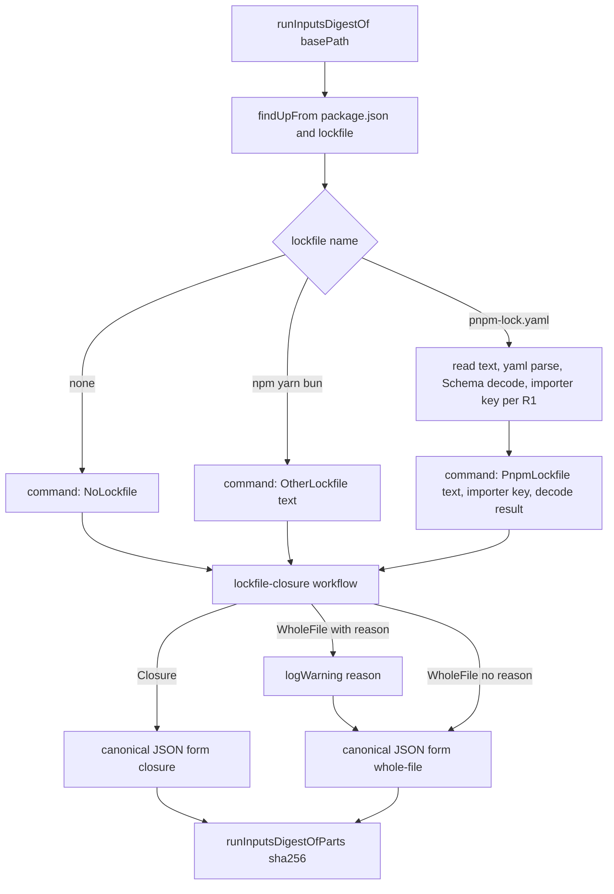

# Scope each project's run-inputs digest to its own lockfile closure - Plan

## Goal Capsule

- **Objective:** A `pnpm-lock.yaml` edit that cannot change what a mutated project installs leaves that project's saved verdicts reusable, so main's Mutation run re-tests only the projects whose installed dependencies actually moved.
- **Means:** `runInputsDigestOf` hashes the project's resolved dependency closure from `pnpm-lock.yaml`, decided by a pure closure workflow, instead of the whole file (KTD1, KTD2).
- **Authority:** root ruling 2026-10-11 (Stream K, one small PR off `main`) > this Product Contract > the Key Technical Decisions > unit Approach text.
- **Execution profile:** one PR on `ci/mutation-digest-scope`, failing acceptance tests first (U1 red against unchanged `src/`), then U2-U5. No mutation run of any kind outside CI.
- **Stop conditions:** stop and report if `yaml` plus the Schema decode cannot reach the closure form on either real lockfile (AE1, AE5), if the work needs a change to `.github/workflows/mutation.yml`, the planner or the verdict store, or if the R9 ordering fix grows past a few lines in `verdict-semantics.ts` (split it into its own PR and say so).
- **Who finishes:** the implementing agent opens the PR and gets CI green; the operator merges. Rollout steps 2-3 are a follow-up the operator approves (Scope Boundaries).

---

## Product Contract

Product Contract preservation: restructured, no scope change. R6 now names a `link:` whose target is not an importer and a snapshot without a `packages` entry as cases of "a ref with no target". R9 now says how the closure avoids node arrays. AE10 is added to illustrate R1. The two planning questions are resolved by KTD1 and KTD8.

### Summary

Today every project's run-inputs digest includes the full lockfile text, so any lockfile edit makes every project re-verify every mutant. Each project's digest will instead cover its own closure in `pnpm-lock.yaml`: its importer, the importers it links, the importers above it, and every snapshot reachable from those, together with each snapshot's package metadata. Other lockfile formats keep today's whole-file behaviour.

### Problem Frame

`runInputsDigestOf` (`packages/stryker-js/src/verdict-semantics.ts:158-174`) reads the nearest lockfile and passes its whole text into `runInputsDigestOfParts` (`:122-123`, `:171`). A saved verdict is reused only when the digest matches. #274 added 39 lockfile lines for a bench importer, and #266 added 70 for a new importer, `test/checker-parity`. Neither change reaches any mutated project, but after each one main's next Mutation run re-tested everything. The operator measured the mutation-shard median rising from about 161 s (run 38083502908) to about 630 s (run 38091732059). The budget gate then failed at 807 s and 714 s against a 701 s budget.

A probe over the real lockfiles confirms the scoping would have prevented this. Using the closure rule in R1–R3, all four mutated projects' closure digests are unchanged across #274 and #266, and all four change across the v18.1.0 tarball pin bump (#251), which did alter installed bytes.

### Verified premises

| #   | Premise                                                                                                                                                 | Status                                   | Evidence                                                                                                                                                                                                                                                                                                                                                                                                                                                                                      |
| --- | ------------------------------------------------------------------------------------------------------------------------------------------------------- | ---------------------------------------- | --------------------------------------------------------------------------------------------------------------------------------------------------------------------------------------------------------------------------------------------------------------------------------------------------------------------------------------------------------------------------------------------------------------------------------------------------------------------------------------------- |
| P1  | Closure = importer (path relative to the lockfile dir), then snapshots by resolved ref, including peer suffixes and `patch_hash`, plus linked importers | Verified, with three additions (P1a–P1c) | Importer keys are dir paths (`pnpm-lock.yaml:219` `.`, `:700` `packages/stryker-js`). Peer suffixes and `patch_hash` are in the ref (`:704`, `:756`). Links are relative `link:` refs (`:734`). The probe over `ec9dcf63c` follows 476–488 snapshots and 13–15 importers per project and finds no dangling ref.                                                                                                                                                                               |
| P1a | Aliased refs name their own target                                                                                                                      | Verified                                 | Scoped alias to a file tarball (`@systemfsoftware/stryker-js-vm-runner` → `@systemfsoftware/stryker-js-vitest-runner@file:…`), unscoped alias (`released-stryker-js-cli-contract`) and a JSR alias (`@std/jsonc` → `@jsr/std__jsonc@1.0.2`). A naive `name@ref` key leaves these dangling; pnpm's `refToRelative` rule resolves all of them.                                                                                                                                                  |
| P1b | A local tarball keeps one key across re-packs, so its bytes are only in `packages[…].resolution.integrity`                                              | Verified                                 | `packages['@systemfsoftware/stryker-js@file:.sfs-deps/stryker-js.tgz']` carries `integrity` and `version: 18.1.0`. Without the packages entry, a pin bump would leave digests unchanged.                                                                                                                                                                                                                                                                                                      |
| P1c | Node resolution from a workspace package walks up to ancestor `node_modules`, including the root importer's                                             | Verified (probe)                         | Including the ancestor importer `.` still leaves #274 and #266 digests unchanged.                                                                                                                                                                                                                                                                                                                                                                                                             |
| P1d | `overrides`, `patchedDependencies` and `catalogs` act only through resolved refs                                                                        | Verified                                 | Overrides show up as `file:.sfs-deps/…` refs plus their integrity (`:774`, `:783`). A patch shows up as `patch_hash` in the ref (`:756`). A catalog shows up as each importer's resolved `version` (`:222-223`). `pnpmfileChecksum`, `packageExtensionsChecksum` and `time` are absent from this lockfile; their effects would also land in the graph.                                                                                                                                        |
| P1e | `settings` and `lockfileVersion` are global                                                                                                             | Verified                                 | `pnpm-lock.yaml:1-5`. The lockfile does not record hoisting or `node-linker` settings, and today's digest doesn't cover them either.                                                                                                                                                                                                                                                                                                                                                          |
| P2  | Non-pnpm lockfiles keep whole-file behaviour; an unusable `pnpm-lock.yaml` must not produce a constant digest                                           | Verified (current code)                  | `LOCKFILE_NAMES` (`verdict-semantics.ts:36-42`) and `findUpFrom` (`:135-150`). `readIfPresent` (`:152-156`) already maps an unreadable file to `''`. The fallback is decided in KD2.                                                                                                                                                                                                                                                                                                          |
| P3  | `stryker-js` has no YAML dependency; `yaml` is in the catalog                                                                                           | Verified                                 | `packages/stryker-js/package.json` lists no `yaml`. `pnpm-workspace.yaml:73` has `yaml: ^2.9.1`. `main.mjs` bundles every non-`node:` import (`packages/stryker-js/tsdown.config.ts:66`) and the library entry does not, so `yaml` belongs in `dependencies`.                                                                                                                                                                                                                                 |
| P4  | Canonical encoding is stable under reorder                                                                                                              | Partly verified; defect found            | `canonicalJsonOf` sorts keys with `localeCompare` (`verdict-semantics.ts:51`). ICU collation can tie distinct keys, and a stable sort then keeps input order, so the result can depend on reorder. R9 fixes this.                                                                                                                                                                                                                                                                             |
| P5  | House standard and packs apply                                                                                                                          | Verified                                 | Packs come from `.compound-engineering/config.yaml`. The ones that apply are listed under Sources.                                                                                                                                                                                                                                                                                                                                                                                            |
| P6  | `basePath` is each mutated project's dir                                                                                                                | Verified                                 | Plan: `plan-request.cell.ts:254-276` (`realPath(resolve(basePath, directory))`). Shard run: `shard/shard-run.ts:101,108` spawns each child with `cwd: projectDir`, and `run/RunEnvironment.service.ts:84` sets `basePath = realPath('.')`. Projects: `.github/workflows/mutation.yml:36`. Every caller of `runInputsDigestOf` passes that `basePath` (`read-project.cell.ts:395`, `mutation-reporting.service.ts:891,982`, `run/incremental-reuse.cell.ts:384`, `run/dry-run-choice.ts:153`). |
| P7  | Main runs the released CLI pinned at `27b107590` (v18.1.0)                                                                                              | Verified; the pin is already stale       | `flake.nix:33-38`. `PUBLISHED_CLI` points at `packages/stryker-js/node_modules/.bin/stryker`, installed from `.sfs-deps` (`mutation.yml:37`, `pnpm-lock.yaml:781-783`). v19.0.0 is tagged (`9e81669b8`, #267) but not pinned. Pin moves are manual PRs (#241, #251); `release.yml` doesn't touch the pin.                                                                                                                                                                                     |

### Key Decisions

- KD1. **A project's closure includes its ancestor importers and every dependency field of each linked importer.** Leaving these out would produce stale verdicts that look valid; including them only costs re-tests, and the probe shows #274 and #266 still don't invalidate anything. Governs R2, R3.
- KD2. **An unusable `pnpm-lock.yaml` falls back to the whole-file digest and logs the reason, rather than failing with a typed error.** The fallback can only cause extra re-tests, never wrong reuse. `runInputsDigestOf` keeps its `never` error channel, so none of its five callers change. A typed failure would make every caller choose what to do anyway, and the only safe choice is to reuse nothing, which is what the whole-file digest already gives. Governs R5, R6.
- KD3. **The closure digest and the whole-file digest are tagged differently.** A closure input can then never hash equal to a whole-file input. Governs R7.
- KD4. **Package metadata is part of each closure node.** Without it, a re-packed local tarball would keep its old digest (P1b). Governs R4.
- KD5. **Canonical encoding uses code-unit key order everywhere.** One convention for `verdict-semantics.ts`; the cache version bump already discards digests made under the old ordering. Governs R9, R10.

### Requirements

**Closure**

- R1. When the nearest lockfile is `pnpm-lock.yaml`, the project's importer key is the directory of its nearest `package.json`, made relative to the lockfile's directory, in POSIX form, with `.` for the lockfile's own directory.
- R2. The closure contains that importer, every ancestor importer up to `.`, and, transitively, every importer reached through a `link:` ref, following all dependency fields (`dependencies`, `devDependencies`, `optionalDependencies`) of each of them.
- R3. A ref becomes a snapshot key by pnpm's `refToRelative` rule, so aliases, peer suffixes, `patch_hash` and `file:` refs each resolve to their own snapshot. From each snapshot the closure follows `dependencies` and `optionalDependencies`, and it terminates on cycles.
- R4. Each closure node contributes its snapshot entry and its `packages` entry (the snapshot key with its peer suffix removed). Each importer contributes its whole entry. `lockfileVersion` and `settings` are included once.

**Fallback**

- R5. `package-lock.json`, `yarn.lock`, `bun.lock` and `bun.lockb` keep today's whole-file input.
- R6. A `pnpm-lock.yaml` falls back to the whole-file input, with one warning naming the reason, when it fails YAML parsing or Schema decoding, has a `lockfileVersion` other than 9.x, has no importer for the project, has no `package.json` above `basePath`, or has a ref with no target: a snapshot key absent from `snapshots`, a snapshot without its `packages` entry, or a `link:` whose target directory is not an importer.
- R7. The digest input records which form it took, closure or whole-file.

**Encoding and invalidation**

- R8. The lockfile is parsed with `yaml` (a `catalog:` entry in `packages/stryker-js` `dependencies`) and decoded through Schema with strict string fields. No regex or line-based YAML reading.
- R9. The closure is encoded canonically with keys sorted by code unit at every depth. Closure nodes are maps keyed by importer, snapshot or `packages` key, so no array of nodes exists; arrays inside an entry keep pnpm's order.
- R10. `INCREMENTAL_CACHE_VERSION` moves from `5` to `6`, so no verdict stored under the whole-file meaning is read as a closure-scoped one.

### Acceptance Examples

- AE1. Covers R1, R2. Given the #266 lockfile edit (a new importer `test/checker-parity` that no mutated project links), when each of the four mutated projects is digested before and after, then every digest is unchanged.
- AE2. Covers R3, R4. Given two projects A and B where only A's closure reaches `x@1.0.0`, when `x` moves to `1.0.1`, then A's digest changes and B's doesn't.
- AE3. Covers R4. Given a `file:` tarball ref whose `packages` integrity changes while its key stays the same, then the digest of the project depending on it changes.
- AE4. Covers R2. Given a root importer devDependency that moves, then every project's digest changes.
- AE5. Covers R3. Given a scoped alias, an npm alias and a JSR alias in a project's closure, then each resolves to its target snapshot and the closure has no dangling ref.
- AE6. Covers R9. Given the same lockfile re-serialized with importers, snapshots and keys in another order, then every digest is unchanged.
- AE7. Covers R5. Given a `package-lock.json` project, when an unrelated part of the file changes, then the digest changes.
- AE8. Covers R6, R7. Given a `pnpm-lock.yaml` that fails to parse, or has no importer for the project, then the digest equals the tagged whole-file digest of that text, changes when the text changes, and one warning names the reason.
- AE9. Covers R10. Given a stored report with `incrementalVersion: '5'`, then reuse is refused.
- AE10. Covers R1. Given a `basePath` that is a subdirectory of a project with no `package.json` of its own, then its digest equals the project directory's digest.

### Success Criteria

- After the rollout, a lockfile edit shaped like #274 or #266 leaves main's next Mutation run reusing every mutated project's verdicts: the shard median returns to the pre-regression range (about 161 s in run 38083502908) and the budget gate passes.

### Scope Boundaries

- No change to `mutation.yml`, the kill matrix, the verdict store, the planner or sharding.
- No closure scoping for npm, yarn or bun lockfiles.
- Not handled: pnpm's hidden hoisting (`node_modules/.pnpm/node_modules`), which can let a dependency load a phantom package outside its declared closure. The lockfile doesn't record hoisting settings and today's digest doesn't cover them.
- No mutation run outside CI. The fix takes effect on main only after the rollout below.
- Considered, not built: deduplicating the fallback warning across the up-to-four digest computations per project per run (`read-project.cell.ts:395`, `run/dry-run-choice.ts:153`, `mutation-reporting.service.ts:891,982`). Each computation is pure and stateless; the warning text names the lockfile and reason, so repeats are identifiable. Revisit if a run's logs show the repeat drowning other warnings.
- Considered, not built: excluding platform-binding `optionalDependencies` from the closure. Keeping them is the safe direction (KD1); a pnpm upgrade that moves those bindings still invalidates most projects. Revisit with a measured run where that churn costs a budget-gate failure.

#### Deferred to Follow-Up Work

- Rollout steps 2-3 below: the release PR, then the manual dogfood PR that moves `stryker-published` in `flake.nix`, updates `flake.lock` and refreshes the `.sfs-deps` integrity in `pnpm-lock.yaml`. Both need operator approval and are not in this PR.

### Rollout

1. The PR merges with a patch changeset for `@systemfsoftware/stryker-js`.
2. The release PR ("version packages", as in #267) merges and tags the release.
3. A manual dogfood PR, following #241 and #251, moves `stryker-published` in `flake.nix`, updates `flake.lock`, and refreshes the `.sfs-deps` integrity in `pnpm-lock.yaml`. Releases and the pin move need operator approval. The pin is at v18.1.0, so this move also takes in v19.0.0's breaking changes (#267).
4. The first main Mutation run after the pin move re-tests everything once, because the engine digest, the cache version and the tarball integrity all change. After that, a lockfile edit outside a project's closure reuses its verdicts.

### Sources

- Packs: (pack: cell-architecture, pure-decision-workflows.md) for the closure decision; (pack: cell-architecture, decode-never-cast.md) for the R8 decode; (pack: schema-laws, rich-type-over-foreign-encoded.md), since the pnpm lockfile is a foreign wire shape; (pack: schema-laws, tests-own-no-schemas.md), so tests draw from the production lockfile schema; (pack: boundary-testing, pin-dependency-semantics.md) for the `yaml` parse behaviour and pnpm's ref rule.
- pnpm `refToRelative` rule: `@pnpm/dependency-path`.
- `docs/solutions/tooling-decisions/verdict-cache-content-keyed-reuse.md`: the run-inputs digest is one of the verdict key's true inputs; a key narrower than its inputs is false reuse, wider is false miss.
- `docs/solutions/build-errors/pnpm-pack-tarball-bytes-are-not-a-stable-cache-key.md`: canonicalize before hashing; generate twice and diff before content-addressing.

---

## Planning Contract

### Key Technical Decisions

- KTD1. **The closure decision is a `Workflow.make` in `packages/stryker-js/src/lockfile-closure.workflow.ts`, total (`error: S.Never`), and `runInputsDigestOf` stays the shell that reads the file and calls it.** The sanctioning row is the file-extension taxonomy's `*.workflow.ts | Pure Decision | Workflow.make(Command, decider) | Complexity 1, total, no I/O, no R` (pack: cell-architecture, service-and-layer-boundaries.md), with the body rules of (pack: cell-architecture, pure-decision-workflows.md). `packages/stryker-js/stryker.config.ts:16-23` mutates `src/**/*.workflow.ts` and `src/**/*.schema.ts`, so the decision lands inside the mutation gate. Governs R1-R7. (session-settled: user-directed — chosen over a plain pure function beside `runInputsDigestOf` in `verdict-semantics.ts`: that file is outside the mutation config, so logic there escapes the gate.)
- KTD2. **Every fallback branch is decided in the workflow; the shell turns I/O outcomes into command data.** The shell finds the files, reads the text, runs `yaml` parse and the Schema decode, and passes their results (success or the failure's message) in a tagged command: pnpm lockfile, other lockfile, or no lockfile. It then logs, encodes and hashes the decision. Parse and decode failures never short-circuit in the shell (pack: cell-architecture, decode-never-cast.md). Governs R5-R7.
- KTD3. **The pnpm wire shape is declared in `packages/stryker-js/src/pnpm-lock.schema.ts`, byte-for-byte as pnpm v9 writes it.** Dependency maps are typed with strict strings (`importers[*].{dependencies,devDependencies,optionalDependencies}[name].{specifier,version}`, `snapshots[*].{dependencies,optionalDependencies}[name]`); every other field of an importer, snapshot or `packages` entry is kept as JSON so hashing sees whole entries (R4). Unknown top-level sections (`catalogs`, `overrides`, `patchedDependencies`, `time`) are accepted and unread (P1d). `lockfileVersion` is decoded as a string and judged in the workflow, because valid foreign input is not refused for being unwelcome (pack: schema-laws, rich-type-over-foreign-encoded.md). The `yaml` import stays in the shell: the `*.schema.ts` row allows only Effect, schema-family and workspace imports (pack: cell-architecture, service-and-layer-boundaries.md).
- KTD4. **pnpm's ref grammar lives as two operations in `pnpm-lock.schema.ts`, reimplemented rather than imported.** `lockRefOf(name, ref)` follows `refToRelative`: `link:` refs become a link target; a ref starting with `@`, or whose first `@` precedes any `:` and `(`, is already a snapshot key; anything else becomes `name@ref`. `packageKeyOf(snapshotKey)` strips the trailing balanced parenthesised groups, which removes peer suffixes and `(patch_hash=…)` together (`pnpm-lock.yaml:756` vs `:3078`). `@pnpm/dependency-path` is rejected because the brainstorm allows `yaml` as the only new dependency. The oracle in U1 pins both operations against real pnpm output (pack: boundary-testing, pin-dependency-semantics.md).
- KTD5. **The fallback warning is one `Effect.logWarning` per digest computation, naming the lockfile path and the reason.** Precedent: `read-project.cell.ts:326-328` and `run/incremental-reuse.cell.ts:346-350`. `Effect.logWarning` does not enter `R`, so `runInputsDigestOf` keeps `Effect.fn.Return<string, never>` and no caller changes (KD2).
- KTD6. **`RunInputs.lockfile` becomes the canonical JSON of the tagged decision**: `{ form: 'closure', lockfileVersion, settings, importers, snapshots, packages }` or `{ form: 'whole-file', text }`. The whole-file form wraps today's raw text, so R5 behaviour is unchanged apart from the tag (KD3).
- KTD7. **The R9 fix is a comparator swap in `sortObject`** (`verdict-semantics.ts:50-55`): code-unit `Order.String` replaces `localeCompare`. It is two lines, so it stays in this PR.
- KTD8. **Two kinds of committed oracle, both real tool output.** (a) A miniature pnpm workspace under `packages/stryker-js/tests/__fixtures__/lockfile-closure/oracle/`, its `pnpm-lock.yaml` and variants generated by the repo's pinned pnpm (`packageManager: pnpm@11.27.0`), each generated twice and diffed for reproducibility, with the recipe and pnpm version recorded beside it. It covers the plain, peer-suffixed, `patch_hash`, `file:` tarball, scoped-alias, unscoped-alias and JSR-alias key forms, plus a `link:` between two importers. (session-settled: user-directed — chosen over hand-written YAML: only pnpm's own output pins the key grammar.) (b) The real root lockfile at `56426ca94` and at `ec9dcf63c`, taken with `git show` and committed verbatim under `.../lockfile-closure/real/` (about 283 KB each). (session-settled: user-directed — chosen over generated edits alone: the #266 shape must be the real one.) A trimmed copy is rejected because a trim is a hand edit. A test-time `git show` is rejected because CI checks out shallow. `dprint.json` gains an exclude for the fixture directory, following the existing `packages/stryker-js-typescript-checker/tests/__fixtures__/**` entry, so formatting never rewrites pnpm's bytes.
- KTD9. **`yaml` is a runtime `dependencies` entry with no tsdown change.** The library entry's bundle allowlist (`packages/stryker-js/tsdown.config.ts:19-32`) leaves it external, and the `main` entry bundles every non-`node:` import (`:66`). `yaml@2.9.1` is already resolved in `pnpm-lock.yaml` (`:4759-4762`, `:7399`), so regeneration adds only the importer line. Governs R8.
- KTD10. **The changeset bumps `patch` for `@systemfsoftware/stryker-js`, authored with `pnpm change`** (`.changeset/README.md:5-7`). (session-settled: user-directed — chosen over a minor bump: the change invalidates the verdict cache once and changes no public API; `verdict-semantics.ts` is not exported from `src/mod.ts`, so `etc/stryker-js.api.md` does not move.)

### High-Level Technical Design

Data flow through the shell and the decision:

Decision table inside the workflow for a `PnpmLockfile` command, first matching row wins:

| Condition                                                                         | Decision   | Reason tag                   |
| --------------------------------------------------------------------------------- | ---------- | ---------------------------- |
| YAML parse or Schema decode failed                                                | whole-file | `LockfileUnparseable`        |
| `lockfileVersion` not `9.x`                                                       | whole-file | `UnsupportedLockfileVersion` |
| no `package.json` above `basePath`                                                | whole-file | `NoPackageManifest`          |
| importer key absent from `importers`                                              | whole-file | `ImporterMissing`            |
| traversal reaches a snapshot, `packages` entry or `link:` importer that is absent | whole-file | `DanglingRef`                |
| otherwise                                                                         | closure    | none                         |

`OtherLockfile` and `NoLockfile` commands decide whole-file with no reason (R5; an absent lockfile keeps today's empty text).

### Assumptions

- Windows is out of scope beyond R1's POSIX normalization; main's Mutation runs on `ubuntu-latest`.
- Generating the oracle's JSR and npm-alias forms needs registry access once, at authoring time; the committed lockfile is then read offline.
- About 566 KB of committed real-lockfile text is acceptable repository weight for AE1.

### Risks

| Risk                                                                                                    | Mitigation                                                                                                         |
| ------------------------------------------------------------------------------------------------------- | ------------------------------------------------------------------------------------------------------------------ |
| The real lockfile silently falls back (parse, decode or ref-grammar gap), so the fix never takes effect | AE1 and AE5 assert the closure form and no warning on both real lockfiles and the oracle, not only digest equality |
| Under-inclusion produces false reuse that looks valid                                                   | KD1's ancestor and link rules; U3 laws prove an in-closure edit moves exactly the reaching projects                |
| A pnpm major changes the ref grammar                                                                    | The oracle is regenerated with the new pnpm; KTD4's operations fail their pins before production regresses         |
| The first post-rollout Mutation run re-tests everything                                                 | Expected once (Rollout step 4); the operator schedules the pin move knowing it                                     |

---

## Implementation Units

### U1. Commit the oracles and the failing acceptance tests

- **Goal:** AE1 and AE2 exist as integration tests over real lockfiles and fail against the unchanged `src/`.
- **Requirements:** R1-R4; AE1, AE2; KTD8.
- **Dependencies:** none.
- **Files:**
  - `packages/stryker-js/tests/__fixtures__/lockfile-closure/real/pnpm-lock.56426ca94.yaml` (new, verbatim `git show`)
  - `packages/stryker-js/tests/__fixtures__/lockfile-closure/real/pnpm-lock.ec9dcf63c.yaml` (new, verbatim `git show`)
  - `packages/stryker-js/tests/__fixtures__/lockfile-closure/oracle/**` (new: workspace manifests, `pnpm-workspace.yaml`, local tarballs, patch file, generated `pnpm-lock.yaml` and its generated variants, `README.md` with the recipe)
  - `packages/stryker-js/tests/lockfile-closure-digest.integration.test.ts` (new)
  - `dprint.json` (exclude the fixture directory)
- **Approach:**
  1. Take both real lockfiles with `git show` and commit them unmodified.
  2. Build the oracle workspace (KTD8a): projects A and B; A reaches `x` and B does not; both share the root importer. Generate the base lock and an `x`-bumped variant from identical manifests so only the resolved version of `x` differs.
  3. The test stages a temp workspace per case: the chosen lockfile text at the root and a `package.json` for each project at its importer path, then calls `runInputsDigestOf` with the project directory. Stage with `fs.makeTempDirectory` and remove in `Effect.ensuring`.
- **Execution note:** test-first. Run the new file against the unchanged `src/` and record the red output (AE1: all four digests differ; AE2: B's digest differs) in the PR description before writing U2.
- **Patterns to follow:** `tests/incremental-reuse.integration.test.ts:100-121` (`writeFixture`/`removeFixture`), `tests/incremental-reuse.integration.test.ts:489-495` (capturing logger), `@systemfsoftware/vitest` `it.effect` usage in the same file.
- **Test scenarios:**
  - AE1: for `packages/stryker-js`, `packages/stryker-js-typescript-checker`, `packages/stryker-js-vitest-runner` and `test/e2e-core`, staging the `56426ca94` lockfile and then the `ec9dcf63c` lockfile with the same `package.json` yields equal digests. Red today.
  - AE2: with the oracle's base lock and its `x`-bumped variant, A's digest differs and B's is equal. Red today because B's differs too.
- **Verification:** both scenarios fail on the unchanged `src/` for the stated reason, and the fixtures are byte-identical to the `git show` and pnpm output.

### U2. Declare the pnpm lockfile schema and its ref grammar

- **Goal:** a decoded, typed view of `pnpm-lock.yaml` plus the two pnpm grammar operations the closure walk needs.
- **Requirements:** R3, R4, R8; KTD3, KTD4.
- **Dependencies:** U1 (the oracle supplies the pinned key forms).
- **Files:** `packages/stryker-js/src/pnpm-lock.schema.ts` (new, with an in-source `import.meta.vitest` block).
- **Approach:**
  - Declare the v9 wire shape per KTD3; the root export is the schema itself, not a local wire constant piped later (pack: schema-laws, rich-type-over-foreign-encoded.md).
  - Implement `lockRefOf` and `packageKeyOf` per KTD4 as operations on types this file declares; their laws go in the file's in-source block with the operation in the `subject` slot (pack: schema-laws, refusals-beside-generated-laws.md).
  - Any refinement carries constructive arbitrary metadata so derived laws never rejection-sample (pack: schema-laws, arbitrary-filter-floors.md).
- **Patterns to follow:** `src/import-closure.schema.ts` (command and data types beside a workflow), `src/Worker.schema.ts:93-101` (in-source law shape with seeds).
- **Test scenarios:**
  - `lockRefOf('x', '1.0.0')` is snapshot key `x@1.0.0`.
  - `lockRefOf('c', '21.2.2(@types/node@24.13.3)')` keeps the peer suffix: `c@21.2.2(@types/node@24.13.3)`.
  - `lockRefOf('@std/jsonc', '@jsr/std__jsonc@1.0.2')` is `@jsr/std__jsonc@1.0.2` (JSR alias, `pnpm-lock.yaml:750`).
  - `lockRefOf('@systemfsoftware/stryker-js-vm-runner', '@systemfsoftware/stryker-js-vitest-runner@file:…')` is the target key unchanged (scoped alias).
  - `lockRefOf('released-stryker-js-cli-contract', '@systemfsoftware/stryker-js-cli-contract@file:…')` is the target key unchanged (unscoped alias).
  - `lockRefOf('@s/x', 'file:.sfs-deps/x.tgz(peer@1.0.0)')` is `@s/x@file:.sfs-deps/x.tgz(peer@1.0.0)`.
  - `lockRefOf('a', 'link:../b')` is a link to `../b`.
  - `packageKeyOf` of the `differential-spec` snapshot key with `(patch_hash=…)` and nested peer groups (`pnpm-lock.yaml:5795`) is `@systemfsoftware/differential-spec@1.0.1` (`:3078`).
  - Law: for any key and any appended sequence of balanced groups, `packageKeyOf` returns the key without the groups, and is idempotent.
  - The generated schema round-trip laws pass (in-source schema-laws plugin, `packages/stryker-js/vitest.config.ts:22`).
- **Verification:** the in-source laws pass; the oracle's every ref decodes and resolves to a snapshot key present in its lock (asserted again end-to-end in U4).

### U3. Decide the closure in a pure workflow

- **Goal:** given the tagged command, decide the closure input or the whole-file input with its reason.
- **Requirements:** R1-R7; AE2, AE4 (law form); KTD1, KTD2; the decision table in High-Level Technical Design.
- **Dependencies:** U2.
- **Files:**
  - `packages/stryker-js/src/lockfile-closure.workflow.ts` (new)
  - `packages/stryker-js/src/__tests__/lockfile-closure.workflow.property.test.ts` (new)
- **Approach:**
  - Command, decision and reason types are tagged; dispatch is `Match.exhaustive`; the walk is a fold with a visited set, so cycles terminate (pack: cell-architecture, pure-decision-workflows.md).
  - Start nodes: the importer from R1 plus each ancestor up to `.`. Importers follow all three dependency fields; snapshots follow `dependencies` and `optionalDependencies`; `link:` targets are joined against the linking importer's key and POSIX-normalized.
  - The closure carries whole importer, snapshot and `packages` entries keyed by their own keys, plus `lockfileVersion` and `settings` (R4, R9).
- **Patterns to follow:** `src/admit-incremental-report.workflow.ts:118-124` (`error: S.Never`), `src/__tests__/import-closure.workflow.property.test.ts:82-100` (order-invariance law), `src/__tests__/admit-incremental-report.workflow.property.test.ts:1-4` (imports).
- **Test scenarios:** laws draw lockfiles from a constructive generator that builds consistent production `PnpmLockfile` values (acyclic and cyclic graphs, links, ancestors); each closure law also asserts the closure form was reached, so a silent fallback cannot pass vacuously.
  - Adding an importer that no existing importer links and that is no existing importer's ancestor leaves every existing project's decision unchanged (#266 shape).
  - Changing the version of one reachable snapshot (key, its references and its `packages` key) changes the decision for exactly the projects whose closure reached it (AE2).
  - Changing only a `packages` entry's integrity under an unchanged key changes the decision of projects reaching it (AE3, law form).
  - Changing a root importer devDependency changes every project's decision (AE4).
  - A `link:` from the project's importer pulls in the linked importer's `devDependencies` closure (R2).
  - A two-snapshot cycle terminates and both snapshots are in the closure (R3).
  - Each decision-table row yields whole-file with its reason tag: unparseable, `lockfileVersion: '6.0'`, no package manifest, importer missing, snapshot missing, `packages` entry missing, `link:` to a non-importer.
  - `OtherLockfile` yields whole-file of its text with no reason; `NoLockfile` yields whole-file of empty text with no reason (R5).
- **Verification:** all laws pass; `lint` reports no control-flow keyword in the workflow body.

### U4. Wire the shell, the ordering fix and the cache version

- **Goal:** `runInputsDigestOf` produces the closure-scoped digest, and U1's tests turn green.
- **Requirements:** R1, R5-R10; AE1-AE10; KTD2, KTD5-KTD7, KTD9.
- **Dependencies:** U3.
- **Files:**
  - `packages/stryker-js/src/verdict-semantics.ts` (shell, `sortObject`, `INCREMENTAL_CACHE_VERSION`, in-source laws)
  - `packages/stryker-js/package.json` (`yaml: catalog:` in `dependencies`)
  - `pnpm-lock.yaml` (regenerated by pnpm)
  - `packages/stryker-js/tests/lockfile-closure-digest.integration.test.ts` (AE3, AE5-AE8, AE10)
  - `packages/stryker-js/tests/incremental-reuse.integration.test.ts` (the stale-layout expectation at `:947` names version 6)
- **Approach:**
  1. In `runInputsDigestOf`, branch on the found lockfile's name to build the command (KTD2); compute the R1 importer key from the found `package.json` and lockfile paths.
  2. Call the workflow, log any reason (KTD5), and set `RunInputs.lockfile` per KTD6.
  3. Swap the comparator in `sortObject` (KTD7) and set `INCREMENTAL_CACHE_VERSION` to `'6'`.
  4. Add `yaml` via `catalog:` and regenerate the lockfile with pnpm (KTD9).
- **Patterns to follow:** existing in-source laws at `verdict-semantics.ts:237` onward (`it.effect.prop`, temp dirs via `fs.makeTempDirectoryScoped`); `read-project.cell.ts:326-328` for the warning.
- **Test scenarios:**
  - AE1 and AE2 from U1 pass.
  - AE1 extended: on both real lockfiles, all four projects take the closure form and log no warning.
  - AE3: an oracle variant whose `file:` tarball was re-packed with different content, so its `packages` integrity changes under the same key, changes the dependent project's digest and not the other's.
  - AE5: every oracle project takes the closure form with no warning, which proves the scoped, unscoped and JSR aliases, peer suffix, `patch_hash` and `file:` forms all resolve.
  - AE6: the oracle lockfile re-serialized with `yaml` in reversed key order at every depth yields the same digest for every project.
  - AE6 (in-source law): canonical JSON of a record equals that of any key permutation, seeded with keys `localeCompare` ties, such as `'é'` and `'e\u0301'`.
  - AE7: a `package-lock.json` project's digest changes when an unrelated part of the file changes, and no warning is logged.
  - AE8: unparseable `pnpm-lock.yaml` text, and a valid one with no importer for the project, each give the whole-file digest of that text, a different digest for different text, and exactly one warning per computation naming the reason.
  - KD3 law: a whole-file input whose text equals a closure's canonical JSON yields a different digest from that closure.
  - AE9: the existing stale-layout tests pass with version 6 (`src/__tests__/admit-incremental-report.workflow.property.test.ts:100-108`, `tests/incremental-reuse.integration.test.ts:900-955`).
  - AE10: `basePath` at `<project>/src` with no `package.json` there gives the project directory's digest.
- **Verification:** the package test suite passes; `pnpm-lock.yaml`'s only diff is the `yaml` line under the `packages/stryker-js` importer; the dogfood check in the Verification Contract passes.

### U5. Record the change intent

- **Goal:** the release carries a patch changelog entry explaining the one-time verdict re-test.
- **Requirements:** R10; KTD10; Rollout step 1.
- **Dependencies:** U4.
- **Files:** `.changeset/<generated>.md` (new, written by `pnpm change`).
- **Approach:** the summary says each project's run-inputs digest now covers only its own `pnpm-lock.yaml` closure, that the cache layout moves to version 6, and that the first run after upgrading re-tests every mutant once.
- **Test expectation:** none -- release metadata; CI `Changeset Check` gates it.
- **Verification:** CI `Changeset Check` passes.

---

## Verification Contract

| Gate                                | Command                                                                                                                                                                 | When                                                    |
| ----------------------------------- | ----------------------------------------------------------------------------------------------------------------------------------------------------------------------- | ------------------------------------------------------- |
| Red-first proof                     | `pnpm --filter @systemfsoftware/stryker-js exec vitest run tests/lockfile-closure-digest.integration.test.ts`                                                           | after U1 on unchanged `src/` (fails), after U4 (passes) |
| Targeted unit laws                  | `pnpm --filter @systemfsoftware/stryker-js exec vitest run src/pnpm-lock.schema.ts src/__tests__/lockfile-closure.workflow.property.test.ts src/verdict-semantics.ts`   | U2-U4                                                   |
| Package tests                       | `pnpm --filter @systemfsoftware/stryker-js test`                                                                                                                        | after U4                                                |
| Typecheck, lint, Effect diagnostics | `pnpm --filter @systemfsoftware/stryker-js typecheck`, `lint`, `lint:tsgo`                                                                                              | after each unit                                         |
| Build and API report                | `pnpm --filter @systemfsoftware/stryker-js build` and `api:check` (no `etc/stryker-js.api.md` change expected)                                                          | after U4                                                |
| Format                              | `pnpm format:check` (START-1)                                                                                                                                           | before push                                             |
| Dogfood install (START-6)           | `nix build .#stryker-published --out-link .sfs-deps && pnpm install --frozen-lockfile && ! git grep -qE "^  '@systemfsoftware/stryker-[a-z-]+@[0-9]" -- pnpm-lock.yaml` | after the lockfile regeneration in U4                   |
| CI                                  | `CI`, `Changeset Check`, `Nix`, `Commitlint` on the PR head                                                                                                             | before handing to the operator                          |

No `stryker run`, `pnpm mutation` or Mutation workflow dispatch locally (root ruling; `refuse-local-mutation` also refuses it).

---

## Definition of Done

| Unit   | Done when                                                                                                                                                                   |
| ------ | --------------------------------------------------------------------------------------------------------------------------------------------------------------------------- |
| U1     | AE1 and AE2 are committed and shown failing on the unchanged `src/`, with that output in the PR description                                                                 |
| U2     | Schema and grammar laws pass, including every key form listed in U2                                                                                                         |
| U3     | Workflow laws pass, each closure law asserts the closure form, and the workflow body has no control-flow keyword                                                            |
| U4     | AE1-AE10 pass, the lockfile diff is the single `yaml` importer line, and START-6 passes                                                                                     |
| U5     | A patch changeset for `@systemfsoftware/stryker-js` exists and `Changeset Check` passes                                                                                     |
| Global | One PR off `main`; CI green on its head; no stray scratch or abandoned-attempt code in the diff; no `.tmp-*` files committed; no change to `.github/workflows/mutation.yml` |
