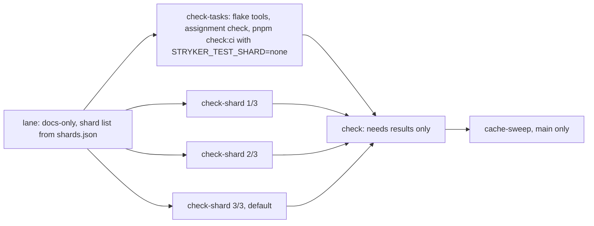

# Check Critical Path - Plan

## Goal Capsule

- **Objective:** A maintainer or agent opening a PR that changes `packages/stryker-js` gets the `check` verdict within 10 minutes of wall time at p95, cold or warm, from the same tasks and assertions that run today, on the same `ubuntu-latest` runners.
- **Means:** Take the `tsc -b` out of `stryker-js#build` and drop test files from its inputs (KTD13), let Turbo's `--affected` choose a PR's tasks while main stays full (KTD12), run `stryker-js#test` on three parallel shards selected by an environment variable only that task hashes (KTD1, KTD2), make the α-Conversion property's runs cheaper (KTD6), take `gritlint` from a flake-tool cache (KTD7), keep main's Turbo entry fresh when main's Gate fails (KTD8), and publish each part's Turbo run summary (KTD5).
- **Product authority:** the root's check-critical-path outcome (2026-10-12): the PR check finishes in 10 minutes or less at p95, cold and warm, with no runner upsizing; every test still runs somewhere, a failing shard fails the check, and main's Turbo cache stays fresh. The house Turbo law (2026-10-12): task caching, affected-only runs and cache scope use Turborepo's mechanisms, and a home-grown mechanism survives only with a written reason Turbo cannot do the job (KTD15). This plan refines U6 and KTD10 of `docs/plans/2026-10-10-0702-perf-ci-wall-clock-plan.md`, replaces that plan's KTD3 save rule, binds parent U2's KTD6 as the `gritlint` mechanism (U1 here carries parent U2 steps 1–3), and, once Q7 is answered, takes `ci.yml` off parent KTD11's docs-only classifier (U9). It governs `.github/workflows/ci.yml`'s `check` jobs, root `package.json` scripts, `turbo.json`, `stryker-js`'s `build` script, the `stryker-js` Vitest sharding input, the two slow `stryker-js` test files (moved scenarios only), the α-Conversion helper in `test/e2e-core/tests/analyzer.differential.test.ts`, the new `.github/actions/flake-tools` composite (U1), the shard packer in `packages/toolchain/vitest-config` (U5), and `scripts/test-shards.ts` (U6). The e2e legs (`e2e.yml`, moved to main pushes by #314, merged 2026-10-12 as `9e0be995`), checker-parity (#266), and `mutation.yml` are outside it.
- **Open blockers:** none.
- **Execution profile:** one `gh stack` with `main` as trunk, one layer per unit in the order U7, U8, U1, U2, U3, U4, U5, U6, then U9 once Q7 is answered; each layer passes `check` on its own and leaves `main` releasable, so U5 lands inert until U6 wires it. Once U8 lands, a layer whose diff is CI wiring alone (`.github/**`, `scripts/**`) selects no package task on its PR run (KTD12), so such a layer also proves itself with one full `workflow_dispatch` run of CI on its branch, linked in its PR body. Merge `origin/main` up with plain merges; never rebase or force-push. Local verification stays light: format, typecheck, lint and the touched packages' own tests, one build at a time. Every wall-time claim comes from real CI runs on the branch, read from the jobs API.
- **Stop conditions:** stop and report instead of continuing when a unit's coverage proof shows a test, scenario or task count that differs before and after; when a shard's build-closure hashes differ from the tasks part's on a warm run (R10); or when the only remaining way to meet R1 is a lever R15 or the Scope Boundaries exclude.
- **Who finishes:** the implementing agent opens each layer ready for review and reports its head SHA when green; the root or operator merges bottom-up.

---

## Product Contract

### Summary

Split `check` into parallel parts so the 13.4-minute `stryker-js#test` task runs as three balanced shards, each building what it needs from the Turbo cache. Make the α-Conversion property's 300 runs cheap enough that `e2e-core#test` stops setting a 7-minute floor on the remaining part. Together with a cached `gritlint` and a main cache that survives a red Gate, the projected cold `check` is about 8.5 minutes and warm about 6.6, before queue; taking `tsc -b` out of `stryker-js#build` (KTD13) brings the cold figure to about 6.7.

### Problem Frame

Every PR that touches `stryker-js` waits 20–22 minutes for `check`, and caching cannot fix it: one test task alone runs 13.4 minutes on a fully warm graph. The measurements come from #303's two `check` runs, [38105648999](https://github.com/systemfsoftware/stryker-js-effect/actions/runs/38105648999) (job 21.6 min) and [38108376853](https://github.com/systemfsoftware/stryker-js-effect/actions/runs/38108376853), their Vitest and Turbo log lines, a local `turbo --dry=json` diff between the restored cache commit and the PR head, and throwaway probes run once and deleted. `TURBO_RUN_SUMMARY` is set, but `.turbo/runs/*.json` is never uploaded, so per-task times were rebuilt from group timestamps and Vitest output.

**Critical path of `check`, run 38105648999 (cold)**

| Segment                                                                                            | Minutes |
| -------------------------------------------------------------------------------------------------- | ------: |
| Job setup before the Gate (checkout, Nix, pnpm install, cache restores)                            |     1.2 |
| `format:check`                                                                                     |     0.1 |
| `lint:conventions`: `gritlint` compiled from source by Nix, then run (29 of 29 runs, median 179 s) |     2.9 |
| Turbo graph (`lint`, `lint:tsgo`, `typecheck`, `test` at concurrency 4), 53 of 120 cached          |    17.3 |
| `gate:dist`                                                                                        |    0.02 |

Inside the Turbo graph of 38108376853, upstream builds end at 1.4 minutes and `stryker-js#build` at 3.6, while lint and tsgo tasks hold the four slots. `stryker-js#test` starts at 4.6 and runs 13.4 minutes: Vitest reports 803.6 s for 266 files, 2,112 file-seconds at 2.63 files in flight on average. `e2e-core#test` runs from 3.8 to 11.2 minutes. Concurrency, not serial ordering, is not the main cost: the chain is serial, and the longest task decides it.

**Slowest test files (CI Vitest per-file durations)**

| File                                                             | Seconds | Shape                                               |
| ---------------------------------------------------------------- | ------: | --------------------------------------------------- |
| `stryker-js` `tests/compile-error-reuse.integration.test.ts`     |   366.0 | 11 scenarios, 52 engine runs, median 6.1 s per run  |
| `stryker-js` `tests/incremental-reuse.integration.test.ts`       |   351.6 | 18 scenarios, 74 engine runs, median 3.7 s per run  |
| `stryker-js` `tests/vm-parity.differential.test.ts`              |   240.3 | one scenario, 6 engine runs                         |
| `stryker-js` `tests/lockfile-closure-digest.integration.test.ts` |   112.0 | 33.6 s locally after #303 cut its hoisting scenario |
| `stryker-js` `tests/dry-run-failure.integration.test.ts`         |    94.8 |                                                     |
| `e2e-core` `tests/analyzer.differential.test.ts`                 |   438.9 | α-Conversion property 341–414 s of it, 300 runs     |
| `e2e-core` `tests/placement.integration.test.ts`                 |   161.3 | next-longest `e2e-core` file                        |

**Why the two `stryker-js` files are slow.** Real engine runs take 347 of `compile-error-reuse`'s 366 s and 323 of `incremental-reuse`'s 352 s. There are many runs because each scenario drives two to four engine runs, and `@systemfsoftware/vitest` runs every passing test a second time on a fresh build to catch leaked state. That re-run is a house gate and stays. Each run's time goes to fixed engine phases, not to the fixture:

| Phase, median per engine run                         | `compile-error-reuse` | `incremental-reuse` |
| ---------------------------------------------------- | --------------------: | ------------------: |
| Config and file discovery                            |                0.11 s |              0.13 s |
| Initial test run (runner spawn, Vitest boot, 1 test) |                2.25 s |              2.04 s |
| Mutant phase (checker and runner processes)          |                4.02 s |              2.99 s |
| Runner-reported overhead inside the initial run      |                0.55 s |              0.46 s |

The fixture checker (`tests/__fixtures__/program-digesting-checker/worker.mjs`) reads three files and answers in microseconds, yet one deferred run spends 5.1 s between `Deferring the initial test run` and `No valid mutant was tested`. Worker module boot is not the cost: the worker's `@effect/platform-node` barrel import costs 0.1–0.2 s more than subpath imports per process, at most about 0.4 s of a 6.1-second run with two checker processes. The rest is engine-side (process pool, RPC, runner sandbox), and these logs cannot attribute it. A source-level cut in the test files therefore saves at most about 5% [INFERENCE: two worker processes per run at the measured import delta]. The larger cut is in the engine's per-run fixed cost, a product change that would speed every engine run in every suite and needs a trace before it can be sized (Q1).

**Why α-Conversion is slow.** `alphaRename` builds a new in-memory ts-morph `Project` for each of the 300 inputs and calls `rename()` per declaration. The first rename builds a type-checked program that includes TypeScript's lib `.d.ts` files, so every run pays the lib load. Local probe, one 36-line input:

| Step                       | Libs loaded | `skipLoadingLibFiles` |
| -------------------------- | ----------: | --------------------: |
| `Project` plus source file |      0.8 ms |                0.1 ms |
| plus first rename          |    100.3 ms |                0.9 ms |
| plus every rename          |    133.0 ms |               19.8 ms |

Renamed text was identical with and without libs. CI's 414 s over 300 runs is 1.38 s per run; at the local ratio it would be about 54 s [INFERENCE: assumes CI keeps the 7.7x local ratio]. The Monotonic Subtraction property runs the same analyser 300 times in 3.9 s, which confirms the rename, not the analyser, is the cost.

**Why the cache was cold.** The PR's base, `ec9dcf63c`, had no Turbo entry: main's `check` failed there on the stale `cli-contract` baseline, and the save rule (parent KTD3) stores nothing unless the Gate passed. The PR fell back to `56426ca94`'s entry, two commits older. Of the 67 misses, 54 trace to #267's version bumps in package manifests, 6 to the new checker-parity package, 6 to #303's own `stryker-js` sources, and 10 to upstream build hashes only. `pnpm-lock.yaml` caused none, and the global hash was unchanged. The same pattern held for all 22 PR `check` runs since `ec9dcf63c` (53 of 120 cached, Gates of 13–21 minutes) against 105–115 cached and 4–7 minutes before it. A scratch-repository probe on Turbo 2.10.12 confirmed that a failed `--continue` run writes the cache entry of every task that succeeded and none for the task that failed, and that the next run hits the first and re-executes the second.

**Balance model.** Longest-processing-time packing of the 266 measured file durations, with each shard running three files at a time and the measured 1.12 contention factor: whole files give a 6.8-minute floor at any shard count, because `compile-error-reuse` alone is 408 s. With those two files split into scenario groups, three shards balance at 4.5 minutes, and more shards do not help: `vm-parity` (240 s, one scenario) sets the floor.

**Re-measured on 2026-10-12, main at `ddeb67ab5`.** The jobs API and the `check` logs of the 44 CI `check` jobs created since 2026-10-11, all events, confirm the frame. Nothing merged since then changed the slow files' shape: #301 added scenarios to `plan.integration.test.ts`, #311 changed `e2e-core`'s lock code, and `alphaRename` still builds one `Project` per input (`test/e2e-core/tests/analyzer.differential.test.ts:248`).

| Measure, minutes                                                                                      |  p50 |  p95 | n  |
| ----------------------------------------------------------------------------------------------------- | ---: | ---: | -- |
| `check` job wall, first-attempt successful PR runs                                                    | 18.7 | 21.8 | 17 |
| `check` job wall when `stryker-js#build` missed (39 of 44 jobs)                                       | 20.2 | 21.9 | 20 |
| `check` job wall when `stryker-js` was cached                                                         |  5.2 |  8.9 | 5  |
| `lint:conventions` (`gritlint` built by Nix, then run), every job                                     |  2.9 |  3.3 | 44 |
| From the end of `stryker-js#build` to the end of the Turbo graph (`stryker-js#test` is the last task) | 12.9 | 14.0 | 39 |
| `check` start after the run's first job start (queue; `lane` itself takes 0.1–0.2)                    |  4.7 | 16.9 | 17 |
| Whole run without the e2e legs, first job start to last non-e2e job end                               | 24.1 | 37.6 | 17 |

Three facts are new since the first measurement:

- **The queue now costs as much as the cut.** In 10 of 17 first-attempt PR runs, `check` started more than 4 minutes after `lane` ended, and in 4 runs more than 12. The repository's running jobs peaked at 55 on 2026-10-10 and at 60–62 on 2026-10-11 [INFERENCE: a 60-job concurrency limit, read from the plateau; the plan is not visible to this token]. Every job a PR run adds competes for that pool with the other open PRs (21 open on 2026-10-12) and with main's mutation and kill-matrix shards (20 each).
- **The warm path is now `gritlint`'s.** On the five runs that did not rebuild `stryker-js`, `lint:conventions` took 2.7–3.3 of a 4.4–8.9-minute job. On main's own `check` at `ddeb67ab5` it took 3.3 of 8.9.
- **`check` is not always the last job.** `checker-parity-report` ended the run in 4 of 17 runs, up to 30.6 minutes in. Checker-parity belongs to #266.

`turbo.json` sets `test`'s `outputLogs` to `errors-only`, so a passing run prints no Vitest per-file durations. The file table above comes from runs that printed them; Q2's manifest source must not depend on logs.

**Turbo query pass, 2026-10-12, main at `38924e53`.** `turbo query` (Turbo 2.10.12) over the package graph, `affectedTasks` for the last 60 first-parent main commits, `--dry=json` hashes, and scratch-commit probes. Four facts change the plan:

| Finding                                                                                                                                                                     | Evidence                                                                                                                                                                                                                                                                                                             |
| --------------------------------------------------------------------------------------------------------------------------------------------------------------------------- | -------------------------------------------------------------------------------------------------------------------------------------------------------------------------------------------------------------------------------------------------------------------------------------------------------------------- |
| `stryker-js#build` is `pnpm run typecheck && tsdown`, so about 1.8 minutes of `tsc -b` precede every `stryker-js` test, lint and `api:check` task and every dependent build | 39 cold `check` logs: `stryker-js:build` p50 2.13, p90 2.77 minutes after its last dependency ended; `tsdown`'s own "Build complete" lines total p50 21.7 s. `stryker-js#typecheck` runs the same `tsc -b` as its own task. 57 of the last 60 main commits touching `packages/stryker-js/src` change non-test source |
| `build` and `api:check` inputs (`src/**`) include test files, which `tsconfig.app.json` excludes                                                                            | `affectedTasks` on `cc7fcefe` (one property-test edit): `stryker-js#build` changed for `packages/stryker-js/src/__tests__/plan-mutant-tests.workflow.property.test.ts`. With test exclusions in both inputs, a scratch commit re-executes 3 tasks instead of 15                                                      |
| PR `check` runs every task: `gate:tasks` and `gate:dist` read `TURBO_BASE`, which `ci.yml` never sets                                                                       | 144 `lint lint:tsgo typecheck test` tasks per PR. On `cc7fcefe`, `--filter=...[base]` and `--affected` both select 47. Of 60 main commits, 34 affect `stryker-js#test`, 18 affect no lint, typecheck or test task. In 4 of 38 PR runs, `stryker-js#test` ran its 13 minutes although the PR did not affect it        |
| The docs-only skip is a hand-written classifier (`.github/actions/change-lane`, `scripts/change-lane.ts`)                                                                   | Turbo selects no package task for a docs-only commit (`40eff394`), but `format:check`, `lint:conventions` and `gate:repo` are root scripts outside the graph, and `affectedTasks` marks every `//#` task on any root-package change                                                                                  |

The rest of the check path's caching is GitHub carriage that Turbo cannot replace under this plan's constraints; KTD15 records each reason.

### Requirements

**Wall clock**

- R1. On a PR that changes `packages/stryker-js`, every job behind the `check` name finishes within 10 minutes of wall time at p95, cold and warm, and so does `check` from its first job start to its last job end. Queue time between `check`'s parts counts against that span; queue before its first part is recorded beside it (R3).
- R2. The CI workflow as a whole finishes within 10 minutes of wall time on such a PR, cold and warm. This plan does not own it: the e2e legs left the PR run with #314 (merged 2026-10-12), and checker-parity's jobs reach it through #266. R3 records the workflow wall so the root sees what remains.
- R3. The first cold run and one warm run on the branch record each shard's wall, the other parts' wall, the `check` wall, the workflow wall, each part's queue before its first step, and the measured build-closure time of each shard. If a cold shard, `check`, or the workflow exceeds 10 minutes, the work stops and reports these measurements: a shard already builds only `stryker-js#test`'s own dependency closure, so the next cut has to come from Q1 or a new decision.

**Coverage**

- R4. On a main push, every task that `check:ci` runs today still runs, in exactly one `check` part, with the same assertions. On a PR, Turbo's `--affected` against the base commit selects the tasks: each task the PR affects runs in exactly one part, and each task it does not affect runs on main's push of the merge. A PR whose diff is CI wiring alone (`.github/**`, `scripts/**`) affects no package task; Turbo treats `turbo.json`, the root `package.json` and the lockfile as global changes and selects every dependent task. The one exception is `stryker-js#test`, which runs once per shard over disjoint files (R5) and once in the tasks part over none.
- R5. Every `stryker-js` test file runs in exactly one shard. The summed per-shard test count equals the unsharded count from run 38108376853, 1,619 tests in 266 files, adjusted only for tests added or removed on the branch.
- R6. A test file with no recorded duration, including a new or renamed one, lands in the default shard, which runs every file the other shards were not given. A file assigned to zero shards or to two still fails `check` with its own reason code naming the file.
- R7. `compile-error-reuse` and `incremental-reuse` move into scenario-group files with every scenario and assertion unchanged. The test count and scenario names before and after are identical.
- R8. The α-Conversion property keeps its 300 runs, its generator, and its assertion. Only the cost of each run changes, and the renamed text is identical for the inputs CI generates.

**Required check**

- R9. The `check` name keeps its meaning: an aggregate job running under `if: always()` fails when any part fails, is cancelled, or is skipped, reading each needed job's result. Main's protection lists no required status checks today (`GET branches/main`: `required_status_checks.contexts` is empty; ruleset 23172737 has none), so the aggregate's own result is the merge signal and must never pass over a failed or missing part. One planted shard failure on CI proves this before the PR is ready, then is reverted.

**Cache**

- R10. Shard selection never enters the hash of any build task. On the warm run, every shard's build tasks whose inputs the PR did not change are cache hits on the same hashes as the non-test part, shown by hit and miss lines in each step summary.
- R11. On main, a red Gate still saves the Turbo entries of the tasks that succeeded, so the next PR restores its base commit's entry. Tasks that failed are never cached. Cache keys are immutable per commit, so a passing re-run of the same commit cannot replace a red entry; its failed task stays a miss for PRs off that base until main's next commit.
- R12. No `check` part compiles `gritlint` when the files that define it are unchanged.
- R14. All `turbo-` entries together stay within parent KTD3's 4 GB budget once each `check` part keeps its own entry.
- R15. Each new `check` part's `timeout-minutes` is 60, the single backstop; no step carries a timeout or kill wrapper. This is the root's standing rule of 2026-10-12 (no cap under 60 minutes anywhere).
- R16. A `build` or `api:check` task's inputs name only what it reads: an edit to a `stryker-js` test file alone leaves every `build` and `api:check` hash unchanged, and `stryker-js#typecheck` still type-checks that file.
- R17. Every cache or scope mechanism on the `check` path is Turbo's (`--affected`, task `inputs`, `env`, `outputs`) or carries a reason, recorded in KTD15, that Turbo cannot do that job under this plan's constraints. The one exception is `ci.yml`'s use of `change-lane`, which stays until Q7 is answered and U9 removes it.

**Agent surface**

- R13. Each `check` part's step summary lists cached and total tasks, the missed tasks, the slowest tasks by duration, and a reason code, as `job-report` already does for today's single job (`.github/actions/job-report/action.yml`, `turbo-runs` input); its Turbo run summaries also upload as an artifact, which nothing does today. Raw logs stay in artifacts.

### Key Decisions

- **Each shard builds its inputs from the Turbo cache; no build artifact is shared.** (session-settled: user-directed — chosen over one build job shared through `actions/upload-artifact`: that route puts a second setup plus upload and download, about 1.8 minutes, in series on every run, projects 10.3 minutes cold, and saves only runner-minutes, which are free on this public repository.) Governs R1, R3, R10.
- **Shards are balanced by a committed duration manifest packed longest-first, not by Vitest's `--shard`.** (session-settled: user-directed — the operator's ruling sets the assignment check and its reason code, which is the sign-off GATE1 requires.) `--shard` splits by file count and can put both 6-minute files on one shard. A committed manifest gives the same assignment for a given commit, so a shard can be re-run locally. The default shard excludes the other shards' lists instead of listing its own, so a stale manifest costs balance, never coverage, and the assignment check catches a file placed in zero shards or two. Governs R5, R6.
- **`compile-error-reuse` and `incremental-reuse` are split by scenario group before sharding.** Whole files cap a shard at 6.8 minutes. The test-code cut is about 5%, and the engine cut is a product change still unsized (Q1). Governs R7.
- **α-Conversion gets cheaper runs, not fewer.** The lib load per `Project` is the cost, so the rename must stop paying it on every run. Governs R8.
- **Three test shards.** At three, the balance reaches its floor (`vm-parity`, 4.5 minutes), and the parent plan's contention cap (parent KTD10, at most 3) holds. More shards would buy nothing and add jobs to a queue that already costs a p50 of 4.7 minutes. This plan adds four jobs (three shards plus the aggregate). #314 dropped a PR run from 16 jobs to 11, so it ends at 15, one fewer than before #314. Governs R1.
- **Main's Turbo cache is saved after a red Gate.** This replaces parent KTD3's "only when the Gate passed": Turbo already refuses to cache a failed task, so a red save stores only work that succeeded. Governs R11.
- **`gritlint` comes from parent KTD6's flake-tool cache, not a parallel `lint:conventions` job.** The cache also removes the build from runner time. A PR that changes `flake.lock`, `flake.nix`, or `nix/**` pays the 2.9 minutes once. Governs R12.
- **The 10-minute target holds with the queue inside it.** R1 counts queue between `check`'s parts, so the plan keeps the number of jobs it adds as small as the balance allows and starts every part on `needs: lane` alone, never on another part. Queue before the first part comes from the repository's whole job pool, which this plan cannot shape; R3 records it so the root can see what is left of the p95 when the cut lands. Governs R1, R3.
- **A PR runs what Turbo's `--affected` selects; main runs everything.** (session-settled: user-directed — the house Turbo law of 2026-10-12 names `turbo run --affected` and `--filter=...[base]` as the mechanism, over a hand-written affected script or a wider change classifier.) Coverage holds because main's push of every merge runs the full graph, the form the CI wall-clock contract names ("affected-only on PR, full on main"). Governs R4, R17.
- **`stryker-js#build` runs `tsdown` alone.** `tsc -b` already runs as `stryker-js#typecheck`, which every PR that affects the package still runs, so moving it out of `build` takes about 1.8 minutes off the path every test waits on without dropping a check. Governs R1, R16.

### Acceptance Examples

- AE1. Covers R9. **Given** a branch commit that plants a failing assertion in one shard's file, **when** CI runs, **then** that shard's leg fails and its own `job-report` summary names the shard, the aggregate `check` fails naming the `check-shard` part, and the other shards report success.
- AE2. Covers R6. **Given** a new `stryker-js` test file absent from the manifest, **when** CI runs, **then** it runs in the default shard and in no other, and the summed per-shard test count still equals the unsharded count. **Given** an assignment that drops or duplicates a file, **then** `check` fails with the assignment reason code naming that file.
- AE3. Covers R10. **Given** a warm run on a PR that changes only `stryker-js` sources, **when** the shards build, **then** each shard's summary shows its upstream build tasks as hits with the same hashes the non-test part reports.
- AE4. Covers R11. **Given** a main push whose Gate fails on one test task, **when** the next PR off that commit runs, **then** it restores the base commit's entry and misses only the failed task, the tasks whose inputs the PR changed, and their dependents.
- AE5. Covers R4. **Given** a PR that changes only `test/e2e-core`, **when** CI runs, **then** the tasks part runs only the tasks `--affected` selects, every shard runs no task and reports success, and main's push of the merge runs every task.
- AE6. Covers R16. **Given** a PR that edits only a `stryker-js` test file, **when** CI runs warm, **then** the summaries show `stryker-js#build` and `stryker-js#api:check` as hits and only `stryker-js#test`, `#typecheck`, `#lint` and `#lint:tsgo` as misses.

### Projection

[INFERENCE: build closure and the non-test part are estimates; R3 measures them.]

| Path, minutes                                                                                                                             |  Cold |  Warm |
| ----------------------------------------------------------------------------------------------------------------------------------------- | ----: | ----: |
| Shard: setup 1.2, build closure, tests 4.5                                                                                                |   8.2 |   6.3 |
| Non-test part: setup, `format:check`, cached `gritlint`, lint, tsgo, typecheck, other tests with `e2e-core#test` at about 3 minutes       |   8.2 | ≤ 4.5 |
| Aggregate `check` job                                                                                                                     |   0.3 |   0.3 |
| `check`, first job start to last job end, before queue (p50 4.7, p95 16.9 before the first part today); about 6.7 cold with KTD13 (below) | ≈ 8.5 | ≈ 6.6 |

KTD13 removes about 1.8 minutes of `tsc -b` from every shard's build closure whenever `stryker-js#build` misses, which is every PR that changes its non-test source, so the cold path projects to about 6.7 minutes [INFERENCE: the 2.13-minute cold build less `tsdown`'s 0.36; R3 measures it].

<!-- ce-section: work-relationships -->

### How This Work Fits Together

This plan covers `check`'s critical path on PRs that change `stryker-js`. The rest of CI's wall clock is the parent plan's, as currently understood rather than as a committed roadmap.

- `docs/plans/2026-10-10-0702-perf-ci-wall-clock-plan.md` U6 is the unit this plan refines; its KTD10 part layout, aggregate job, and per-part cache entries stand, with the balancing and the shard count set here.
  - Depends on parent U1 (merged as #279) for base-commit restore and `job-report`.
  - Depends on parent U2's KTD6 for the `gritlint` cache that R12 needs. Parent U2 has no branch and no PR on 2026-10-12 (`.github/actions/` holds only `change-lane`, `job-report` and `released-tarballs`), and #281 now takes `gritlint` from the `systemfsoftware/gritlint` flake, still built from source in every `check`. Because `gritlint` is now 36–63% of the warm path, this plan carries parent U2 steps 1–3 for `check`'s own tools (`gritlint`, `dprint`) as its U1, built exactly as parent KTD6 specifies; parent U2 keeps the Nix legs' input closure (its step 4).
  - Parent U7 and KTD11 built the docs-only classifier as `.github/actions/change-lane` (named `change-class` in that plan), used by `ci.yml`, `nix.yml` and `changeset-check.yml`. U9 here takes only `ci.yml` off it, under parent R2's 3-minute docs-only bound; `nix.yml` and `changeset-check.yml` keep it.
  - Shares `ci.yml` with #266's checker-parity jobs; whichever lands second merges main.
- R2's whole-workflow target depends on #266 keeping checker-parity's report under 10 minutes; #314 already took the five e2e legs off PR runs.
- The e2e legs in `e2e.yml` rebuild their dependencies through `^build` with no Turbo cache restore (27–49 s of build and startup per leg on 2026-10-10 runs). Restoring main's Turbo entry there is a follow-up for `e2e.yml`, outside this plan.
- Q1, the engine's per-run fixed cost, can proceed independently as a product change; it would shorten every engine-driven suite, these shards included.

### Scope Boundaries

- The e2e legs, Export telemetry, and the fixture bake (#314, #311).
- Checker-parity jobs (#266) and everything in `mutation.yml` and `kill-matrix.yml`.
- The engine's per-run fixed cost (Q1); this plan shards around it.
- `vm-parity.differential` stays one scenario; its 240 s is the accepted shard floor.
- `@systemfsoftware/vitest`'s leaked-state re-run stays on every test.
- No test is added for moved scenarios; they keep their files' existing layer, and AE1's planted failure is reverted before the PR is ready. Coverage of the split is proved by the assignment check and by test counts on real runs. The only new tests are two property suites over pure decisions: the packer (U5) and the assignment comparison (U6).
- No bigger runners, skipped or quarantined tests, `continue-on-error`, optional checks, self-hosted runners, cloud credentials, or new third-party actions or executables. No timeout below 60 minutes and no step-level kill (R15).
- Considered, not built: an automatic manifest refresh or a shard-imbalance warning. A stale manifest costs balance only (KTD3), and each shard's wall is already in its `job-report` summary; evidence that shards drift past 10 minutes between refreshes would change this.
- Considered, not built: a summed test-count check on every PR. The `none` guard (KTD11) and the assignment check (KTD5) close the paths by which a shard job could run fewer files than its list; evidence of another path would change this.
- `change-lane` stays until Q7 is answered; U9 replaces it then.

### Outstanding Questions

**Deferred to Planning**

- Q1. Where an engine run's fixed 4–8 s goes once the checker answers instantly: trace one `compile-error-reuse` run with the engine's spans and size a product-side cut.
- Q2–Q5 are resolved in the Planning Contract: the manifest and its refresh in KTD3, the hashing mechanism in KTD1, the α-Conversion change in KTD6, and the per-part entries in KTD4.
- Q6. For the root: R1 counts queue between `check`'s parts but records the queue before the first part beside the span, because it comes from the account's shared job pool (p50 4.7, p95 16.9 minutes today). Does that carve-out meet the outcome "the PR check finishes in 10 minutes or less at p95", or must the plan also cut jobs from the pool?
- Q7. For the root: `ci.yml`'s docs-only skip is a hand-written classifier, which the house Turbo law names for replacement, but Turbo can decide it only once the root gates (`format:check`, `lint:conventions`, `gate:repo`, the repo-scripts tests) are root tasks with declared `inputs`, and a Turbo-decided docs PR pays `check`'s setup before Turbo can answer. Options: (a) keep `change-lane` for `ci.yml` with a written reason; (b) model the root gates as `//#` tasks, run `check` on every PR under `--affected`, take `ci.yml` off `change-lane`, and hold the docs-only wall to parent R2's 3 minutes by measurement; (c) keep a `lane` job but have it ask Turbo (`turbo run <check tasks> --affected --dry=json`) instead of an allowlist. Recommended: (b), landed as U9 after U1 makes `gritlint` cheap, with (a) as the fallback if the docs-only wall exceeds 3 minutes. `nix.yml` and `changeset-check.yml` keep `change-lane` under any answer (KTD15).

### Sources / Research

- Runs: [38105648999](https://github.com/systemfsoftware/stryker-js-effect/actions/runs/38105648999) (job 114370536940) and [38108376853](https://github.com/systemfsoftware/stryker-js-effect/actions/runs/38108376853) (job 114378635195), plus the last 40 CI `check` jobs for the cached-task counts.
- Refresh, 2026-10-12: the 44 CI `check` jobs created since 2026-10-11 (logs parsed for `lint:conventions`, Turbo groups and summaries), the 17 first-attempt successful PR runs among them (jobs API, queue and run walls), main's `check` in run [38278851382](https://github.com/systemfsoftware/stryker-js-effect/actions/runs/38278851382) at `ddeb67ab5`, running-job concurrency over 100 runs created 2026-10-11 07:00–12:00 UTC, and main's protection (`GET branches/main`, `GET rules/branches/main`).
- Workflow and config: `.github/workflows/ci.yml` (Gate verdict and save rule), `turbo.json`, root `package.json` `check:ci` and `gate:tasks`, `packages/stryker-js/vitest.config.ts`.
- Tests read: `packages/stryker-js/tests/compile-error-reuse.integration.test.ts`, `packages/stryker-js/tests/__fixtures__/program-digesting-checker/worker.mjs`, `test/e2e-core/tests/analyzer.differential.test.ts`.
- Turbo failed-task caching: scratch repository with one passing and one failing task, Turbo 2.10.12.
- House test runner: `@systemfsoftware/vitest` README, "Leaked state" and "Concurrency and shuffle".
- Turbo per-task environment hashing: scratch repository on Turbo 2.10.12, 2026-10-12. A variable added to one package's `test` through a package `turbo.json` (`extends: ["//"]`, `env: ["$TURBO_EXTENDS$", …]`) changes only that task's hash; every `build` hash and the other package's `test` hash stay byte-identical, and the root `env`, `inputs` and `outputLogs` are inherited. Docs: [Package Configurations](https://turborepo.dev/docs/reference/package-configurations).
- Turbo task selection on the command line: in the same scratch repository, `--filter=!<pkg>` is ignored once a `<pkg>#<task>` argument is present, so no single invocation can run every task except one package's `test`.
- Turbo query pass, 2026-10-12, Turbo 2.10.12 at main `38924e53`: `packages`, `packageGraph`, `boundaries` and per-task `allDependencies`; `affectedTasks` with reasons for the last 60 first-parent main commits; `turbo run build test lint typecheck --dry=json` hashes at `cc7fcefe` and its parent, with and without test exclusions committed on a scratch base; `--affected --filter=@systemfsoftware/stryker-js` and `--filter=@systemfsoftware/stryker-js...[base]` on `cc7fcefe`, `ddeb67ab`, `40eff394` and `81575469` (a dependency-only change); `cacheMaxAge` and `cacheMaxSize` accepted by 2.10.12 in a scratch repository. Docs: [Configuring turbo.json](https://turborepo.dev/docs/reference/configuration) (cache eviction), [Turborepo 2.10](https://turborepo.dev/blog/2-10).
- Remote cache routes: Vercel's needs an account and token; GitHub-cache-backed servers (`pixpilot/turbo-persistent-cache`, `rharkor/caching-for-turbo`) are third-party actions. The CI wall-clock contract forbids both.

---

## Planning Contract

**Product Contract preservation:** changed, no scope change: R2 names its owners (#314, #266); R4 states the `stryker-js#test` exception that KTD2 creates and, after the Turbo query pass, scopes PR runs by `--affected` with main full (KTD12); R10 limits the warm-run hit requirement to build tasks whose inputs the PR did not change, as AE3 already did; R14 and two Key Decisions cite parent KTD3 and KTD6 by that name; the Scope Boundaries test line admits two property suites over pure decisions (U5, U6). R16, R17, AE5, AE6, two Key Decisions, KTD12–KTD15 and U7–U9 come from the Turbo query pass. Q2–Q5 moved into KTD1–KTD4 and KTD6; Q6 and Q7 added.

### Key Technical Decisions

- KTD1. **Shard selection is one environment variable, `STRYKER_TEST_SHARD`, declared only on `@systemfsoftware/stryker-js#test`.** It lives in a new package configuration, `packages/stryker-js/turbo.json`, which extends the root and appends the variable to the inherited `env`. The scratch probe shows the build closure keeps its hashes and each shard's test task gets its own. Values: unset runs every file (local runs and `pnpm check:ci` unchanged); `<k>/<n>` runs shard `k`; `none` runs no file and exists only for the tasks part (KTD2). Resolves Q3. Governs R10.
- KTD2. **The tasks part runs `pnpm check:ci` unchanged with `STRYKER_TEST_SHARD=none`; the shard jobs run only `stryker-js#test`.** Turbo cannot run every task except one package's `test` in one invocation (Sources), and splitting `gate:tasks` into two invocations would serialize them locally. `none` keeps `check:ci` the one definition (parent KTD4) and every other task in exactly one part (R4). This replaces parent KTD10's sub-script split and its Vitest `--shard`. Governs R4, R9.
- KTD3. **A committed manifest, `packages/stryker-js/tests/shards.json`, holds the shard count and each file's measured seconds; a shared packer assigns files longest-first at config load.** The packer lives in `@systemfsoftware/vitest-config` beside its other helpers and is the only assignment logic. Shards `1` to `n-1` take the files the packer gives them; shard `n` is the default shard and runs the package's include globs minus those lists, so a new or renamed file runs there (R6). A config asked for `<k>/<n>` with `n` different from the manifest's count fails to load. The shard jobs set `STRYKER_TEST_DURATIONS` (pass-through, outside the hash) so Vitest's built-in JSON reporter writes per-file durations, uploaded as each shard's artifact. A maintainer refreshes the manifest from those artifacts with `scripts/test-shards.ts refresh` and commits it; nothing refreshes it automatically. A stale manifest moves balance, never coverage. Resolves Q2. (session-settled: user-directed — chosen over Vitest's `--shard`: `--shard` splits by file count and can put both 6-minute files on one shard.) Governs R5, R6.
- KTD4. **Each part saves its own Turbo entry, and shards save only their test task.** The tasks part keeps today's key, `turbo-<os>-dist-<sha>`, with today's restore, prune and save steps. A shard restores that same base-commit entry for its build closure plus its own `turbo-<os>-stryker-js-shard<k>-<sha>`, and prunes its save to the `stryker-js#test` hash from its run summary, so a shard entry is a few kilobytes of logs (`test` has no `outputs`). `cache-sweep` counts entries per ref and per part, the part being the key without its trailing commit SHA. Resolves Q5. Governs R10, R14.
- KTD5. **The assignment check reads Vitest's own resolution, not the packer.** A step in the tasks part runs `vitest list --filesOnly --json` for `stryker-js` once unsharded and once per shard, and `scripts/test-shards.ts check` fails with `CHECK_SHARD_ASSIGNMENT` naming every file in zero or two shards. The shard matrix comes from the same manifest: `lane` emits `[1..n]` from `shards.json`, so the workflow cannot run fewer shards than the check verifies. Each part uploads `.turbo/runs` as `turbo-runs-<part>` and calls `job-report` with it. Governs R6, R13.
- KTD6. **α-Conversion builds each `Project` with `skipLoadingLibFiles: true`.** A reused `Project` would carry state across property runs, which the house leaked-state re-run exists to catch; the per-`Project` option keeps every run independent and removed 99% of the first rename's cost locally with identical text. Resolves Q4. Governs R8.
- KTD11. **In-source test modules run only in the default shard, and `none` is refused outside the tasks part.** `stryker-js` sets `includeSource: ['src/**/*.ts']`, so shards `1` to `n-1` set `includeSource` to empty and only shard `n` keeps it. The config honours `none` only when `GITHUB_JOB` is `check-tasks` (a pass-through variable, outside the hash), so a shard job set to `none` fails at config load instead of passing with no files. Governs R5, R9.
- KTD7. **`check`'s own flake tools come from parent KTD6's file binary cache, through a new composite `.github/actions/flake-tools`.** It takes the requested outputs (`gritlint`, `dprint`), restores `flake-tools-<os>-<hash of flake.lock, flake.nix, nix/**>`, copies the closure in with `nix copy --no-check-sigs`, builds and saves only on a miss, and appends each `bin` directory to `GITHUB_PATH`, where `bin/gritlint` and `bin/dprint` find them first. It reports `FLAKE_TOOL_CACHE_HIT` or `FLAKE_TOOL_CACHE_MISS` (warning) in the job summary, parent KTD5's codes. It replaces `ci.yml`'s `dprint from the flake` step. Governs R12.
- KTD8. **On a main push, the tasks part saves after `TURBO_TASK_FAILED` and `GATE_NON_TURBO_FAILED` too.** Turbo writes no entry for a failed task, so the save holds only work that succeeded (Problem Frame probe). Pull requests keep today's rule. The verdict step's reason code and annotation do not change; only `save` does. Governs R11.
- KTD9. **The aggregate `check` job decides from `needs.<part>.result` alone.** It runs under `if: always()` with today's `check` condition (not docs-only, not a bot push), checks out only `.github/actions`, and passes only when the tasks part and the shard matrix both report `success`. Anything else fails it with `CHECK_PART_FAILED`, `CHECK_PART_CANCELLED` or `CHECK_PART_SKIPPED`, naming the part. A failed `lane` leaves the parts skipped, so the aggregate fails rather than skipping. `cache-sweep` keeps `needs: check`. Governs R9.
- KTD10. **Every new part's `timeout-minutes` is 60, `check-tasks` included (today's `check` already has 60, set by #314), and no step adds a timeout.** R15 owns the rule.
- KTD12. **On a PR, Turbo's own `TURBO_SCM_BASE` selects `--affected`; on main nothing does.** `gate:tasks` and `gate:dist` replace `${TURBO_BASE:+--filter=...[$TURBO_BASE]}` with `${TURBO_SCM_BASE:+--affected}`, and every `check` part's `base` step exports `TURBO_SCM_BASE` as the base commit's SHA on `pull_request` only, so the tasks part and every shard diff against the same commit; without it, `--affected` falls back to Turbo's own inferred base. A push leaves it unset, because `--affected` on a push to main compares main with itself and selects nothing. Shard jobs run `turbo run test --affected --filter=@systemfsoftware/stryker-js` under the same rule; the probes show this selects `stryker-js#test` exactly when the package or a dependency changed (`cc7fcefe`, `81575469`) and nothing otherwise (`ddeb67ab`, `40eff394`). A run that selects nothing exits 0 and still writes a run summary with an empty `tasks` array (scratch probe), which `scripts/turbo-summary.ts` reads as zero missed and zero failed, so an unaffected shard reports `GATE_OK`. A PR whose diff is CI wiring alone selects no package task (`61d40db4`, #279: zero); `turbo.json` is a default global file and selects every task (`f06f244f`). `TURBO_BASE` is removed everywhere. Governs R4, R17.
- KTD13. **`stryker-js`'s `build` script becomes `tsdown`, and the root `build` and `api:check` inputs exclude `src/**/__tests__/**`, `src/**/*.test.ts` and `src/**/*.spec.ts`.** Both changes land together: once `build` stops running `tsc -b`, nothing in it reads a test file, so the inputs state what it reads. The gritlint pack `typecheck-build-mode` binds only the `typecheck` script, which keeps `tsc -b`. Governs R1, R16.
- KTD14. **Main runs the full graph.** No `--affected`, no filter, on a push or a `workflow_dispatch`; this is what every PR's skipped task falls back to (R4). Governs R4.
- KTD15. **The surviving home-grown mechanisms and why Turbo cannot replace each.** (1) Carrying `.turbo/cache` in `actions/cache`: Turbo persists across runners only through a remote cache, and every remote-cache route needs credentials or a third-party action (Sources). (2) Base-commit-first restore: GitHub cache scoping, under which a ref reads its own entries before main's, decides which entry arrives; Turbo never sees it. (3) `cache-sweep`: it deletes entries from GitHub's cache store, which Turbo does not manage. (4) The prune before save (by the hashes in `.turbo/runs`): Turbo 2.10's eviction is by age or size only, so it cannot keep a per-commit entry to this run's artifacts, and per-part entries (KTD4) must hold only their own work to fit parent KTD3's budget (R14). (5) `flake-tools` and `released-tarballs`: Nix store paths, outside any Turbo task. (6) `scripts/turbo-summary.ts`: it reads Turbo's own run summary for reason codes and caches nothing. (7) `change-lane` in `nix.yml` and `changeset-check.yml`: the Nix flake builds and the changeset check are not Turbo tasks, so Turbo has nothing to select for them. (8) `change-lane` in `ci.yml`: no reason survives; Q7 and U9 replace it. Governs R17.

### High-Level Technical Design

| `STRYKER_TEST_SHARD` | Who sets it        | Files Vitest runs                             | In `stryker-js#test` hash |
| -------------------- | ------------------ | --------------------------------------------- | ------------------------- |
| unset                | local, `check:ci`  | every file the include globs match            | yes (empty)               |
| `k/n`, `k < n`       | shard job `k`      | the packer's list for `k`                     | yes                       |
| `n/n`                | the last shard job | include globs minus shards `1..n-1`           | yes                       |
| `none`               | tasks part only    | none (`passWithNoTests` for this value only)  | yes                       |
| `k/m`, `m ≠ n`       | nobody             | config load fails naming the manifest's count | n/a                       |

### Alternatives Considered

- **Move the `stryker-js` integration suites to postsubmit, as `ci/e2e-postsubmit` does for the e2e legs.** Rejected: those suites are the package's own contract, and the root's outcome requires that a failing shard fails the PR check.
- **The tasks part runs shard 1 itself.** Removes `none`, but shard 1 would share four Turbo slots with lint, tsgo, typecheck and `e2e-core#test`; the cold projection then passes 10 minutes [INFERENCE: 1.2 setup + 3.6 build + 4.5 shard before contention].
- **Engine fixed-cost cut (Q1).** Would shorten every engine-driven suite, but it is a product change still unsized; it stays outside this plan.

### Assumptions

- `cachix/install-nix-action@v31` makes the runner user a trusted Nix user, so `nix copy --no-check-sigs` from a file cache works. U1's first run proves or refutes it; a refusal stops U1 before any other unit depends on it.
- Vitest 5.0.1's `vitest list --filesOnly --json` resolves files from the config without importing test modules, including `includeSource` modules, so the assignment check costs seconds and sees in-source tests.
- The scenario groups chosen in U4 each measure at most 240 s on CI, the `vm-parity` floor; U6's first cold run measures them (R3).
- Turbo's `--affected` diff works on `check`'s treeless fetch of main (`--filter=tree:0`), with git fetching the base commit's trees on demand in seconds. U8's first PR run proves it; a slow or failing diff adds the trees to the fetch.
- `tsdown`'s own type emit produces the `.d.mts` files `api:check` reads without `tsc -b`'s output. U7's execution note proves or refutes it before any other unit relies on it.

---

## Implementation Units

### U1. Cached flake tools for `check`

**Goal:** `check` stops compiling `gritlint` and building `dprint` when the files that define them are unchanged.

**Requirements:** R12, R13; KTD7.

**Dependencies:** none.

**Files:** `.github/actions/flake-tools/action.yml` (new), `.github/workflows/ci.yml`.

**Approach:**

1. The composite takes a space-separated list of flake outputs, restores the KTD7 key, imports the cached closure, builds and exports only what is missing, saves only on a miss, and appends each `bin` directory to `GITHUB_PATH`.
2. `check` calls it for `gritlint dprint` in place of the `dprint from the flake` step; the `job-report` details line names the hit or miss.

**Patterns to follow:** `.github/actions/released-tarballs/action.yml` (restore, Nix build on miss, save on miss, `cache-hit` output).

**Test scenarios:** Test expectation: none -- workflow and composite-action configuration; proven by CI runs below.

**Verification:** on the branch, a first run reports `FLAKE_TOOL_CACHE_MISS` and saves; the next run reports `FLAKE_TOOL_CACHE_HIT` and `lint:conventions` takes under 0.5 minutes in the Gate log; `actionlint` passes.

### U2. Main keeps its Turbo entry after a red Gate

**Goal:** a PR whose base commit failed main's Gate still restores that commit's entry.

**Requirements:** R11; KTD8.

**Dependencies:** U1 (same file; stacked layer).

**Files:** `.github/workflows/ci.yml`.

**Approach:** in the verdict step, a main push with reason `TURBO_TASK_FAILED` or `GATE_NON_TURBO_FAILED` sets `save=true` when tasks missed and the commit has no entry; the `Drop restored cache entries` and `Save the Turbo cache` conditions read `save` instead of `success()`.

**Test scenarios:** Test expectation: none -- workflow condition; Turbo's failed-task behaviour is already proven by the scratch probe.

**Verification:** `actionlint` passes; the details line on a green main run is unchanged. AE4 can only be observed on main's first red Gate after merge; it is a post-merge check (Definition of Done), not part of this layer's Verification.

### U3. Cheaper α-Conversion runs

**Goal:** `e2e-core#test` stops setting a 7-minute floor on the tasks part.

**Requirements:** R8; KTD6.

**Dependencies:** none (stacked on U2 by the execution profile, no code overlap).

**Files:** `test/e2e-core/tests/analyzer.differential.test.ts`.

**Approach:** `alphaRename` passes `skipLoadingLibFiles: true` to its `Project`; generator, `runBudget: 300`, relation and assertion stay as they are.

**Execution note:** before committing, run a throwaway comparison in a scratch file outside the repo: for at least 1,000 inputs from the property's own `sourceCode` arbitrary, `alphaRename` with and without the option returns identical text. Delete the scratch file; it is evidence, not a test.

**Test scenarios:** Test expectation: none -- the existing α-Conversion property is the test and is unchanged.

**Verification:** the throwaway comparison reports zero differences, and its input count and result are recorded in the U3 PR body; `e2e-core#test` passes locally; CI's Vitest output for `analyzer.differential.test.ts` drops from about 440 s.

### U4. Scenario-group files for the two slow suites

**Goal:** no single `stryker-js` file exceeds the 240-second shard floor.

**Requirements:** R7.

**Dependencies:** none.

**Files:**

- Modify then delete: `packages/stryker-js/tests/compile-error-reuse.integration.test.ts`, `packages/stryker-js/tests/incremental-reuse.integration.test.ts`.
- Create: `packages/stryker-js/tests/__fixtures__/compile-error-reuse.ts`, `packages/stryker-js/tests/__fixtures__/incremental-reuse.ts` (the file-scope helpers, moved verbatim).
- Create: `compile-error-reuse-runs.integration.test.ts` (scenarios 1–5), `compile-error-reuse-plan.integration.test.ts` (6–8), `compile-error-reuse-shard-leaf.integration.test.ts` (9–11), `incremental-reuse-command.integration.test.ts` (1–4), `incremental-reuse-preflight.integration.test.ts` (5–10), `incremental-reuse-vm.integration.test.ts` (11–15), `incremental-reuse-wire.integration.test.ts` (16–18), all under `packages/stryker-js/tests/`.

**Approach:**

1. Move the helpers each file shares into its `__fixtures__` module unchanged; body-local helpers stay with their scenarios, which keeps 16–18 together.
2. Each new file keeps its source file's `Feature` title, layer and `live` reason, and `compile-error-reuse`'s `{ timeout: 240_000 }`.
3. Scenario names, bodies and assertions move byte for byte.

**Patterns to follow:** `packages/stryker-js/tests/__fixtures__/` modules already shared by several suites.

**Test scenarios:** Test expectation: none -- no test is added or changed; the moved scenarios are the tests.

**Verification:** `vitest list --json` before and after lists the same 29 scenario names and the same total test count for the package; each new file passes locally, run one at a time.

### U5. Shard selection in the `stryker-js` Vitest config

**Goal:** `STRYKER_TEST_SHARD` selects a deterministic, complete partition of `stryker-js` test files without touching any build hash.

**Requirements:** R5, R6, R10; KTD1, KTD3, KTD11.

**Dependencies:** U4 (the manifest lists the split files).

**Files:**

- Create: `packages/toolchain/vitest-config/lib/shards.js`, `packages/toolchain/vitest-config/lib/shards.d.ts`, `packages/toolchain/vitest-config/tests/shards.property.test.ts` (the package's Vitest config collects only `tests/**/*.test.ts`; the suite imports the `./shards` export, as `tests/in-source-schema-laws.integration.test.ts` imports its subject).
- Modify: `packages/toolchain/vitest-config/package.json` (a `./shards` export).
- Create: `packages/stryker-js/turbo.json`, `packages/stryker-js/tests/shards.json`.
- Modify: `packages/stryker-js/vitest.config.ts`.

**Approach:**

1. The packer takes the manifest, the shard index and the files the include globs match, and returns that shard's include or exclude list per KTD3.
2. `vitest.config.ts` spreads the shared config whole and only adds the shard's selection, the KTD11 `includeSource` and `none` rules, `passWithNoTests` for `none`, and the JSON reporter when `STRYKER_TEST_DURATIONS` names a file (`docs/solutions/build-errors/vitest-config-narrow-spread-drops-source-condition.md`).
3. `packages/stryker-js/turbo.json` appends `STRYKER_TEST_SHARD` to `test.env`, and `STRYKER_TEST_DURATIONS` and `GITHUB_JOB` to `test.passThroughEnv`.
4. The seed manifest splits each split file's whole-file duration from the Problem Frame across its scenario groups in proportion to scenario count, and takes every other file's duration from the Problem Frame or omits it. It balances only U6's first collection run.

**Execution note:** this layer is inert on `main`; nothing sets the variable until U6.

**Patterns to follow:** `packages/toolchain/vitest-config/lib/files.js` (plain JS with JSDoc types and a `.d.ts`); house property tests through `@systemfsoftware/vitest`'s `it.prop`.

**Test scenarios** (`tests/shards.property.test.ts`, a pure decision cell, so properties only):

- For any manifest, shard count and file set, each file lands in exactly one of the `n` shards.
- For any file absent from the manifest, it lands in shard `n` and no other.
- For the same manifest and file set, the assignment is identical across calls and input orderings.
- For any shard `k < n`, its list contains only files that are both in the manifest and in the file set.
- A shard index outside `1..n` or a count other than the manifest's is refused with a message naming the manifest's count.

**Verification:** the property suite passes; `turbo run build test --dry=json` with `STRYKER_TEST_SHARD` set to `1/3` and `2/3` shows identical hashes for every task except `@systemfsoftware/stryker-js#test`; unset, `pnpm check:ci`'s task list is unchanged.

### U6. `check` split into a tasks part, three shards and an aggregate

**Goal:** the `check` verdict arrives within R1's budget from the same tasks and files.

**Requirements:** R1, R3, R4, R5, R6, R9, R10, R13, R14, R15; KTD2, KTD4, KTD5, KTD9, KTD10, KTD11.

**Dependencies:** U1, U2, U3, U5, U7, U8.

**Files:** `.github/workflows/ci.yml`, `scripts/test-shards.ts` (new), `scripts/test-shards.test.ts` (new).

**Approach:**

1. `lane` emits the shard list from `shards.json`.
2. Today's `check` job becomes `check-tasks`: the assignment check before the Gate, `STRYKER_TEST_SHARD=none` on the Gate, and an upload of `.turbo/runs`.
3. `check-shard` is a matrix over the lane's list with `fail-fast: false`, as every other matrix in `ci.yml`, so one failing leg leaves the others running and their durations JSON uploaded. It shares the tasks part's setup, restores per KTD4, runs `turbo run test --affected --filter=@systemfsoftware/stryker-js` on a PR and `turbo run test --filter=@systemfsoftware/stryker-js` on main (KTD12) with `STRYKER_TEST_SHARD=<k>/<n>`, and uploads its durations JSON and `.turbo/runs`. Its verdict step reuses the tasks part's reason codes.
4. A new `check` job aggregates per KTD9.
5. `cache-sweep` groups by ref and part per KTD4.
6. `scripts/test-shards.ts` has two commands: `check` compares the unsharded and per-shard file lists, and `refresh` writes `shards.json` from durations JSON files.
7. Before measuring, a first `cache: cold` dispatch collects every shard's durations JSON; `refresh` rewrites `shards.json` from it and the result is committed. R3's cold and warm runs come after that commit.

**Execution note:** prove AE1 and AE2 with planted commits on the branch, each reverted before the PR is ready.

**Patterns to follow:** today's `check` job steps; `scripts/turbo-summary.ts` and its `Deno.test` file; `job-report` callers.

**Test scenarios** (`scripts/test-shards.test.ts`, the pure list comparison only; the `vitest list` spawn is the composition root and is proven by CI):

- For any file set and any `n` shard lists forming a partition of it, the comparison reports nothing.
- A file missing from every shard list is reported once, with no shard named.
- A file present in two shard lists is reported once, naming both shards.
- A file in a shard list but absent from the unsharded list is reported as unknown to the unsharded run.

**Verification:** `actionlint` and `./bin/deno test --config=scripts/deno.json scripts/` pass; AE1, AE2 and AE3 are observed on branch runs; R3's numbers come from a `cache: cold` dispatch and one warm run on the branch.

### U7. `stryker-js#build` without `tsc -b`, and build inputs without tests

**Goal:** every task that waits on `stryker-js#build` starts about 1.8 minutes sooner, and a test-only edit stops invalidating any build.

**Requirements:** R1, R16; KTD13.

**Dependencies:** none; the first layer.

**Files:** `packages/stryker-js/package.json` (`build` script), `turbo.json` (`build.inputs`, `api:check.inputs`).

**Approach:**

1. `build` becomes `tsdown`; `typecheck` stays `tsc -b`.
2. `build.inputs` and `api:check.inputs` gain the three test exclusions in KTD13.

**Execution note:** before committing, confirm locally that `tsdown` alone writes the same `dist` file list as today's `build` and that `api:check` passes on it. If either needs `tsc -b`'s output, stop and report: the dependency is the finding.

**Test scenarios:** Test expectation: none -- build script and task inputs; Turbo's hashes are the proof.

**Verification:** a scratch commit that edits only a `stryker-js` test file changes the `--dry=json` hash of `stryker-js#test`, `#typecheck`, `#lint` and `#lint:tsgo` and of no other task; on CI, the cold `check` log's `stryker-js:build` group ends at least 1.5 minutes sooner after its last dependency than the 2.13-minute baseline; AE6 is observed on a planted test-only commit, reverted before the PR is ready.

### U8. PR scope by `--affected`, main full

**Goal:** a PR runs only the tasks Turbo says it affects, and main's push still runs everything.

**Requirements:** R4, R17; KTD12, KTD14.

**Dependencies:** U7 (stacked; no overlap).

**Files:** root `package.json` (`gate:tasks`, `gate:dist`, the only code that reads `TURBO_BASE` on 2026-10-12), `.github/workflows/ci.yml`.

**Approach:**

1. Replace the `TURBO_BASE` expansion in both scripts with `${TURBO_SCM_BASE:+--affected}`.
2. The `base` step in each part's shared setup appends `TURBO_SCM_BASE=<base sha>` to `$GITHUB_ENV` on `pull_request` and nothing on other events, so the tasks part and every shard job diff against the same base commit.
3. The `job-report` details line names the scope: `affected since <base>` or `full`.
4. No other file reads `TURBO_BASE`; dated plans that describe it stay as history.

**Test scenarios:** Test expectation: none -- script flags and a workflow variable; Turbo's dry runs and CI summaries are the proof.

**Verification:** `git grep -n TURBO_BASE -- ':!docs/plans'` returns nothing; locally, `TURBO_SCM_BASE=<parent> pnpm turbo run lint lint:tsgo typecheck test --affected --dry=json` on `cc7fcefe` selects 47 tasks and unset selects the full graph; on CI, a PR run's summary reports the affected scope and main's next push reports `full`; AE5 is observed on a planted `test/e2e-core`-only commit, reverted before the PR is ready.

### U9. Docs-only through Turbo (after Q7)

**Goal:** `ci.yml` stops using `change-lane`, and a docs-only PR still gets its verdict within 3 minutes (parent R2).

**Requirements:** R17; Q7 option (b).

**Dependencies:** U1, U8; Q7 answered.

**Files:** `turbo.json` (root tasks), root `package.json` (`check:ci`), `.github/workflows/ci.yml`. `.github/actions/change-lane/` and `scripts/change-lane.ts` stay for `nix.yml` and `changeset-check.yml`.

**Approach:**

1. `format:check`, `lint:conventions` and `gate:repo` become `//#` root tasks with declared `inputs`, and `check:ci` runs them through Turbo.
2. `check` runs on every PR under `--affected`; `lane` keeps only the shard list.
3. `ci.yml`'s `lane` job stops calling `change-lane`; `nix.yml` and `changeset-check.yml` keep their calls.

**Test scenarios:** Test expectation: none -- task configuration and workflow wiring.

**Verification:** on a docs-only PR, `check` (first part start to aggregate end) is at most 3 minutes from the jobs API; on a code PR the root tasks appear in the Turbo summary as hits or misses by their inputs; `git grep -n change-lane -- .github/workflows/ci.yml` returns nothing.

---

## Verification Contract

- Workflow files: `actionlint` with shellcheck from the flake's nixpkgs, zero findings beyond those already on `main`.
- Repo scripts: `./bin/deno test --config=scripts/deno.json scripts/`.
- Touched packages, one at a time: `pnpm --filter @systemfsoftware/vitest-config test`, `pnpm --filter @systemfsoftware/stryker-js typecheck lint lint:tsgo`, `pnpm --filter @systemfsoftware/stryker-e2e-core test`; split `stryker-js` files run one file per command.
- Hash isolation (R10): `turbo run build test --dry=json` under two shard values; only `@systemfsoftware/stryker-js#test` differs.
- Coverage (R5, R7): before and after U4 and U6, `vitest list --json` scenario names and test count are equal; on the branch's cold run, the summed shard test count equals the unsharded count from run 38108376853 (1,619 tests in 266 files), adjusted for tests the branch adds or removes.
- Wall clock (R1, R3): from the jobs API, each part's wall, queue and the `check` span on one `cache: cold` dispatch and one warm PR run after the manifest refresh. The pre-merge exit criterion is every part and the `check` span at most 10 minutes on both.
- Wall clock at p95 (R1): after U6 merges, the same measures over the first 20 first-attempt PR runs that change `packages/stryker-js`, the sample size of the 2026-10-12 baseline (n = 17).
- Cache budget (R14): the total size of `gh cache list --key turbo-` entries after the cold and warm runs, against parent KTD3's 4 GB.
- Scope (R4): on one PR run, the tasks part's Turbo summary lists only `--affected` tasks and its `job-report` line names the base; on main's next push, the summary lists every task.
- Hash narrowing (R16): the U7 scratch-commit comparison; only `stryker-js#test`, `#typecheck`, `#lint` and `#lint:tsgo` change.
- Gates: `pnpm format:check`; CI's `check` on every layer.

## Definition of Done

- Every unit's Verification holds on its own layer, and each layer's `check` is green.
- Post-merge, reported in the PR thread: AE4 on main's first red Gate, and R1's p95 over 20 PR runs; a p95 above 10 minutes triggers R3's next cut.
- AE1, AE2 and AE3 were observed on branch runs; the planted commits are reverted and absent from the final diff.
- R3's table (part walls, queues, `check` span, workflow wall, build-closure time per shard, cold and warm) is in the U6 PR body.
- No `timeout-minutes` under 60 on any job this plan adds and no step-level timeout (R15).
- KTD15's list is the complete inventory of home-grown cache and scope mechanisms on the `check` path; any other found during implementation is either replaced by a Turbo mechanism or added with its reason.
- Throwaway scripts, scratch probes and abandoned attempts are absent from the diff.
