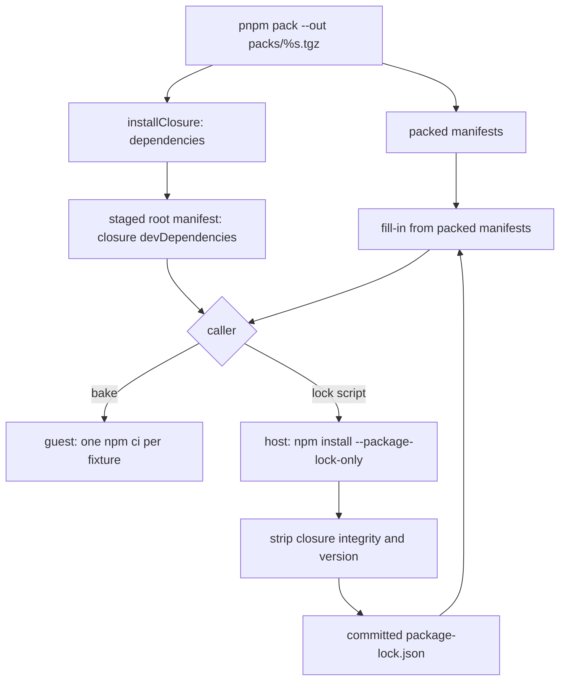

# E2E Fixtures Install From Committed Locks - Plan

## Goal Capsule

- **Objective:** An upstream npm publish can no longer stall or change the e2e lane. Every run bakes the same fixture dependency trees until someone commits new locks, so main's e2e goes green and main merges can resume.
- **Means:** each fixture installs with one `npm ci` from a committed `package-lock.json`, and one script regenerates those locks.
- **Product authority:** the root P0 of 2026-10-11, which supplied done items (a)-(f) and the four questions answered in Appendix A, then the root's eight rulings on the brainstorm. The branch is `fix/e2e-locked-fixtures`, cut from `main` at `84052beb4` and not based on `ci/e2e-postsubmit`.
- **Stop conditions:** stop and report before opening the PR if the hand-written diff heads past R9's limit. Stop if a committed lock cannot pin R3's four packages at 4.0.0.
- **Execution profile:** units U1-U4 in order, one commit per unit on this branch. Local checks only (Verification Contract). No local e2e run and no local mutation.
- **Who ships:** the implementing agent opens the PR ready for review and watches its CI. The root merges.
- **Open blockers:** none.

---

## Product Contract

### Summary

The bake stops resolving dependencies. The harness stages each fixture with a committed lock and the packed workspace closure, and the guest runs one `npm ci` per fixture. A new upstream release can reach a fixture only through a regenerated, committed lock.

### Problem Frame

Every e2e run that started after 10:04Z on 2026-10-11 fails in global setup. The stalled job 114447960356 (run 38127840866) logs `[bake] calc-fixture: npm install the workspace closure tarballs`, then `Terminated`, then `... did not finish within 300s`, and fails with `ExitFailure: bake every fixture in the preparation microVM: exited 143`. The registry install that runs before it finished.

The packed `@systemfsoftware/stryker-js` depends on `@effect/platform-node: ^4.0.0`. That range admits 4.0.3, which declares the peer `effect@^4.0.3`, while effect's newest release is still 4.0.2. `--min-release-age=1` only held 4.0.3 back until it was a day old (Appendix A, answer 1). An age gate delays the next half-published release by a day and does not stop it. Removing resolution from the bake does.

### Key Decisions

- **The bake installs from committed locks with `npm ci`; it does not resolve.** (session-settled: user-directed, chosen over the age gate, `--before`, registry-snapshot pins, budgets, kill caps and retries, because each of those leaves resolution in the bake.) Governs R1, R2.
- **Committed locks keep the closure entries but drop their integrity.** npm records a sha512 for each `file:` tarball. With an empty cache, which is the guest's state, any source change in a packed package then fails `npm ci` with `EINTEGRITY`. With a warm cache, `npm ci` silently installs the stale bytes instead (Appendix A, answer 2). Governs R4.
- **At bake time the harness rewrites the closure entries' `version` and dependency fields from the freshly packed manifests.** Without that rewrite, a release that bumps versions makes `npm ci` fetch closure names from the registry, and a closure package that adds a dependency installs without it and fails only at run time. With the rewrite, version bumps install cleanly and a new dependency fails `npm ci` with its own "Missing: … from lock file" error (Appendix A, answer 2). It follows #285's `overlayOf` but reads the lock as plain JSON (KTD1). Governs R4, R6.
- **Closure tarballs are packed under version-free file names.** The fixture's root manifest names each closure package as `file:../../packs/<name>.tgz`. With versioned file names, every release would change those specs and drift every lock. Governs R5.
- **Regeneration starts from the committed lock.** `npm install --package-lock-only` keeps every locked version that still satisfies its range, so regeneration does not pull in releases. #285's seven locks (`@effect/*` all at 4.0.0) seed the first run, and npm keeps a locked version when the manifest's spec widens from `4.0.0` to `^4.0.0` (Appendix A, answer 2). Governs R3, R7.
- **Locks are regenerated on the host and installed in the musl guest.** npm records every platform variant of a native optional dependency, so one lock serves both: #285's calc lock lists `@oxc-parser/binding-linux-x64-gnu` (`libc=glibc`) next to `-musl` (`libc=musl`), and the same for `@rolldown` and `lightningcss`. Governs R7.

### Requirements

**Install**

- R1. Each fixture installs with exactly one `npm ci` from its committed `test/e2e/testResources/<fixture>/package-lock.json`. There is no `timeout`, per-install budget or whole-bake budget.
- R2. `--min-release-age` and the second install are gone from the bake (Appendix A, answer 4).

**Determinism**

- R3. Every committed lock resolves `effect`, `@effect/platform-node`, `@effect/platform-node-shared` and `@effect/opentelemetry` to the versions `pnpm-lock.yaml` pins, which are 4.0.0 at `pnpm-lock.yaml:1989`, `:2021`, `:2027` and `:3861`. The PR shows this per lock with command output.
- R4. Committed locks carry no `integrity` and no `version` on closure (`file:`) entries. Before `npm ci`, the harness copies onto each closure entry the five fields npm ci checks, read from that entry's freshly packed manifest: `version`, and the four edge fields `dependencies`, `optionalDependencies`, `peerDependencies` and `peerDependenciesMeta` (KTD2). It touches no other field and no other entry.
- R5. The harness packs each closure package to `<packs>/<name>.tgz` with no version in the file name. The staged root manifest lists the whole closure, aliases included, as `file:../../packs/<name>.tgz` devDependencies, so the paths match in the guest (`/baked/<id>`, `/packs`) and in the regeneration staging.

**Drift**

- R6. A drifted or missing lock fails the bake with npm ci's own output unchanged, plus one line that names the regeneration command. The bake's exit code is npm ci's exit code (Appendix A, answer 3).
- R7. One script regenerates every fixture's lock: `pnpm --filter @systemfsoftware/stryker-e2e fixtures:lock`. It stages fixtures the way the bake does, runs `npm install --package-lock-only --ignore-scripts` over the committed lock, and writes the result back with R4's fields stripped.

**Proof and size**

- R8. All five e2e legs pass on the PR head under main's PR CI, which still runs e2e from `ci.yml`.
- R9. About 250 hand-written lines or fewer, tests and docs included, the seven generated locks excluded (Appendix B).

### Acceptance Examples

- AE1. **Covers R1, R3.** A new `@effect/platform-node` is published while the committed locks are unchanged. The bake installs 4.0.0 and never asks the registry for a version list.
- AE2. **Covers R4.** A PR edits source in `packages/stryker-js` without regenerating any lock. Every fixture bakes with no `EINTEGRITY`.
- AE3. **Covers R4, R5.** A release PR bumps every closure package's version without regenerating any lock. Every fixture bakes.
- AE4. **Covers R6.** A closure package adds a registry dependency and the locks are not regenerated. The bake fails with npm ci's `Missing: <dep>@<version> from lock file`, then the regeneration line, and exits with npm ci's code.
- AE5. **Covers R6.** A fixture's lock is deleted. The bake fails with npm ci's `EUSAGE` error and the regeneration line.

### Scope Boundaries

- Out: the bench lane's enterprise install (`test/bench/src/prepare-side.service.ts:495-504`), which pins with `--before`, and `ClosureInstall.specs`, which the bench still reads.
- Out, by contract: registry-snapshot pins, `--before`, npm wire schemas, bake reports, budgets, new or raised kill caps, retry loops, and any `ci.yml` change.
- `ci/e2e-postsubmit` also edits `bake-fixtures.sh` (deleting the timeout) and `test/e2e/README.md:14`. When it resumes, it merges `main` and takes this branch's version of both.

---

## Planning Contract

**Product Contract preservation:** changed R4 and R9 under the root's rulings, scope unchanged. R4 copies only the five fields npm ci checks (sub-conductor ruling of 2026-10-11, which replaced ruling 2's full manifest-field list). R9 now counts tests and docs (ruling 5). The two deferred questions are resolved by KTD5 and KTD6.

### Key Technical Decisions

- KTD1. **The fill-in and strip are pure functions over plain JSON in `test/e2e-core`.** They narrow `unknown` with effect's `Predicate.isObject` (a non-null, non-array object, [`packages/effect/src/Predicate.ts:1042`](https://github.com/Effect-TS/effect/blob/14a3f140095fdebbff9162944fe7d4ea83e054e6/packages/effect/src/Predicate.ts#L1042) at `effect@4.0.0-rc.117`), so CONST-B5 holds without a cast, and no Schema describes npm's lock or manifest. (session-settled: user-directed — chosen over an Effect Schema of npm's lock and manifest formats: the root ruled out any wire schema.) Governs R4.
- KTD2. **The copied fields are the ones npm ci checks.** npm ci builds the ideal tree from the lock and fails when an ideal node is absent from the lock or differs in `version` (`npm/lib/utils/validate-lockfile.js:13-24`). Arborist builds a lock node's edges from `dependencies`, `optionalDependencies`, `peerDependencies` and `peerDependenciesMeta` (`@npmcli/arborist/lib/node.js:907-922`). So `version` lets a release-bumped tarball install, and the four edge fields make a dependency the lock lacks fail with "Missing: … from lock file". Every other committed field, `bin` included, stays as npm last wrote it. Governs R4.
- KTD3. **`installClosure` also returns the closure as a name-to-spec record.** `ClosureInstall` gains `dependencies` (each member's name, and each alias name, mapped to `file:<tarball path>`) next to `specs`, so the harness writes the staged root manifest from the same decision. Its refusals (`UnpackedWorkspaceDependency`, `ConflictingAliasTargets`, `FixtureNamesWorkspacePackage`) keep guarding it. The bench still reads `specs`. Governs R5.
- KTD4. **The bake and the lock script stage fixtures through one harness path.** Staging copies the fixture, resolves `catalog:` specs, adds the closure devDependencies, and fills the committed lock when one exists. The bake mounts that staging at `/baked`. The script runs npm over the same staging on the host. A missing lock is staged without one, so the bake fails as AE5 says and the script writes a fresh lock. Governs R5, R6, R7.
- KTD5. **The lock script runs under `tsx --conditions=@systemfsoftware/source`, declared as `"tsx": "catalog:"` in `test/e2e`.** Node type stripping cannot load the harness: its relative imports name `.ts` files with `.js` specifiers, and Node does not remap them. tsx 4.23.15 is already in `pnpm-lock.yaml`, and `test/bench` runs its Effect entry point the same way (`test/bench/package.json:15`), so no new package enters the lockfile. Governs R7.
- KTD6. **One property suite covers the fill-in, in-source in `test/e2e-core/src/closure-lock.ts`.** The repo's `test-discipline` lint forbids a `src/__tests__/` property file for a module that is not a workflow and routes it to an `if (import.meta.vitest)` block, as `key-material.ts` does. It covers AE3, AE4's precondition and a registry entry passing through. (session-settled: user-directed — chosen over a new e2e journey or a harness integration test: the root admitted one small test at the layer the test-admission gate allows.) Governs R4.
- KTD7. **The first regeneration is seeded from #285's seven locks.** They already pin R3's four packages at 4.0.0 and `@opentelemetry/sdk-trace-base` at 2.11.0, as `pnpm-lock.yaml` does. `npm install --package-lock-only` keeps a locked version that still satisfies its widened `^` range (Appendix A, answer 2). Governs R3, R7.

### Data flow



### Assumptions

- The root pre-authorised this run end to end, so the scoping synthesis was announced, not confirmed.
- A fixture's `node_modules/.bin/stryker` link comes from the closure entry's `bin`, which the committed lock keeps; a release that changes `bin` needs `fixtures:lock`.

---

## Implementation Units

### U1. Pure closure-lock fill-in, strip and closure record

- **Goal:** pure functions that fill a lock's closure entries from packed manifests and strip them for commit, plus the closure as a name-to-spec record.
- **Requirements:** R4, R5. KTD1, KTD2, KTD3, KTD6.
- **Dependencies:** none.
- **Files:**
  - `test/e2e-core/src/closure-lock.ts` (new)
  - (the property suite is in-source in `closure-lock.ts`, KTD6)
  - `test/e2e-core/src/install-closure.workflow.ts`
  - `test/e2e-core/src/mod.ts`
- **Approach:**
  1. A closure entry is any `packages` entry whose `resolved` is `file:<path>.tgz`. Its key is the tarball's file name.
  2. Fill-in takes the lock and a record from tarball file name to raw manifest. It rewrites matching entries per KTD2 and returns every other entry unchanged.
  3. Strip removes `integrity` and `version` from every closure entry.
  4. A third helper adds the closure record to a root manifest's `devDependencies`. The two-argument helpers are `Function.dual`.
  5. `installOf` builds `dependencies` from the members and the alias edges it already resolves.
- **Patterns to follow:** `it.prop` with schema inputs in an in-source `if (import.meta.vitest)` block, as in `test/e2e-core/src/key-material.ts`. Plain helper modules sit beside workflows, as `catalog-resolution.ts` and `key-material.ts` do.
- **Test scenarios:**
  - Covers AE3. A lock with a closure entry at `../../packs/<t>.tgz` holding stale `version` and `dependencies` is filled from a manifest with an arbitrary new `version` and dependency map. The filled entry carries exactly the manifest's `version` and `dependencies`.
  - Covers AE4's precondition. The manifest names a dependency the stale entry lacks. The filled entry lists it, so `npm ci` finds it missing from the lock.
  - A registry entry (`resolved` on `https://registry.npmjs.org/`) passes through fill-in unchanged, `integrity` included.
- **Verification:** the new test passes, and e2e-core typechecks and lints clean.

### U2. Harness and bake script install from the lock

- **Goal:** the bake stages each fixture with the closure devDependencies and a filled lock, then runs one `npm ci` per fixture.
- **Requirements:** R1, R2, R4, R5, R6. KTD3, KTD4.
- **Dependencies:** U1.
- **Files:**
  - `test/e2e/src/Harness/fixture-cache.service.ts`
  - `test/e2e/src/Harness/bake-key.schema.ts`
  - `test/e2e/tests/__fixtures__/bake-fixtures.sh`
- **Approach:**
  1. Pack with `pnpm -r pack --out <packs>/%s.tgz` and derive each tarball's name from the package name. Delete the versioned lookup: `packedFileNameOf`, `PACKED_VERSION`, `lookupOf`, `packedTarballOf`, `FoundPackage`, `MissingTarball`, `PackedPackageLookup` and `PackedPackage.version`.
  2. Point closure members at `../../packs/<file>`, the path that resolves to `/packs` from `/baked/<id>` and to `<dir>/packs` from `<dir>/baked/<id>`.
  3. `closureInstallOf` returns the closure record and the raw packed manifests. `stageFixtures` applies U1's helpers to the staged root manifest and the staged lock.
  4. Export one staging entry point for U3. Its requirements are only the child-process spawner, file system and path services, so it runs without a guest.
  5. The bake job passes no closure arguments. The script loops over `/baked/*/` and runs `npm ci --no-audit --no-fund --loglevel=error` in each. On failure it prints Appendix A answer 3's line and exits with npm's status.
- **Test expectation:** none. The harness is proven by the five e2e legs (R8), and the root refused a harness integration test.
- **Verification:** `test/e2e` typechecks and lints clean, `bake-fixtures.sh` passes `sh -n` and shellcheck, and nothing in committed code wraps npm in `timeout`, a retry or a budget.

### U3. Lock regeneration script and the seven locks

- **Goal:** one command regenerates every fixture lock, and the seven locks it writes are committed.
- **Requirements:** R3, R7. KTD4, KTD5, KTD7.
- **Dependencies:** U2.
- **Files:**
  - `test/e2e/scripts/lock-fixtures.ts` (new)
  - `test/e2e/package.json`
  - `pnpm-lock.yaml` (the `tsx` edge only)
  - `test/e2e/testResources/*/package-lock.json` (seven, generated)
- **Approach:**
  1. The script runs `BakedFixtureCache.lockProgram` with `NodeServices`. The harness stages every fixture into a scoped temp directory through the bake's own staging.
  2. For each fixture it runs `npm install --package-lock-only --ignore-scripts --no-audit --no-fund` in the staged copy through the harness's `runChecked`, so a failure carries npm's stderr tail.
  3. It strips the result with U1's helper and writes it to `test/e2e/testResources/<id>/package-lock.json` with npm's two-space indent and trailing newline.
  4. The first run starts from #285's seven locks checked out into `testResources` (KTD7).
- **Test expectation:** none. The output is the seven locks, which R3's jq check and the e2e legs verify.
- **Verification:**
  - A jq query over the seven locks prints 4.0.0 for R3's four packages in every lock.
  - A second jq query shows no `integrity` or `version` on any `file:` entry.
  - A second script run leaves the tree unchanged.

### U4. Docs and the stall lesson

- **Goal:** the README and solutions docs describe one `npm ci` from committed locks.
- **Requirements:** R2, R6, R7.
- **Dependencies:** U2, U3.
- **Files:**
  - `test/e2e/README.md`
  - `docs/solutions/build-errors/e2e-lane-packed-a-subset-of-its-workspace-closure.md`
  - `docs/solutions/build-errors/e2e-bake-resolved-an-npm-alias-edge-from-the-registry.md`
- **Approach:**
  1. README line 14 becomes the lock rule: one `npm ci` per fixture, the regeneration command, and when to run it.
  2. The closure lesson's install table names the closure-plan step and the single `npm ci`. The hang itself stays recorded in Appendix A, answer 1, not in a solutions doc (scope review).
  3. The alias lesson's sentence that the harness passes the plan to `bake-fixtures.sh` as arguments becomes the staged-manifest devDependencies and the one `npm ci`.
  4. The alias lesson's versioned tarball-name lookup becomes the version-free name.
- **Test expectation:** none -- documentation.
- **Verification:** `pnpm format:check` passes, and no doc names `--min-release-age`, the 300 s install timeout or the versioned tarball lookup.

---

## Verification Contract

| Gate      | Command                                                                                           | Proves                    |
| --------- | ------------------------------------------------------------------------------------------------- | ------------------------- |
| New test  | `pnpm --filter @systemfsoftware/stryker-e2e-core exec vitest run src/closure-lock.ts`             | U1, AE3, AE4 precondition |
| Typecheck | `pnpm --filter @systemfsoftware/stryker-e2e-core --filter @systemfsoftware/stryker-e2e typecheck` | U1-U3                     |
| Lint      | the same two filters with `lint` and `lint:tsgo`                                                  | U1-U3                     |
| Format    | `pnpm format:check`                                                                               | all                       |
| Pins      | jq over `test/e2e/testResources/*/package-lock.json` next to `pnpm-lock.yaml:1989,2021,2027,3861` | R3                        |
| PR CI     | every check on the PR head, run_watch only                                                        | R8                        |

Never run locally: e2e (`pnpm test:e2e`) and mutation of any kind.

---

## Definition of Done

- (a) Each fixture installs with exactly one `npm ci` from its committed lock, with no timeout or budget: R1, U2.
- (b) The age gate and the second install are gone: R2, U2, U4.
- (c) A new upstream publish cannot change what a fixture installs: R3, R4, U1-U3, shown with the jq output.
- (d) A drifted or missing lock fails with npm ci's own error plus one line naming the regeneration command: R6, U2.
- (e) One script regenerates the locks: R7, U3.
- (f) All five e2e legs are green on the PR head: R8.
- The hand-written diff stays within R9. Scratch probes and abandoned attempts are not in the diff.

---

## Appendix

### A. Answers to the four questions

1. **The edge that stalls.** It is the closure tarballs' `@effect/*` ranges, not a fixture manifest.
   - The packed `stryker-js` lists `"@effect/platform-node": "^4.0.0"` (and the same range for `platform-node-shared` and `opentelemetry`). Source: `packages/stryker-js/package.json:39-41`, where `catalog:` resolves through `pnpm-workspace.yaml:14,15,17`. The released 19.0.0 tarball's `package.json` shows the `^4.0.0` that pnpm pack writes.
   - calc-fixture's own spec (`test/e2e/testResources/calc-fixture/package.json:7`, `"effect": "catalog:"` → `pnpm-workspace.yaml:56` `^4.0.0`) installs effect 4.0.2, the latest.
   - `npm view @effect/platform-node@4.0.3 peerDependencies` gives `effect: ^4.0.3`. 4.0.3 was published at 2026-10-10T10:04:06.183Z.
   - Reproduced in a scratch dir: registry-install `effect@^4.0.0` (4.0.2), then `npm install --min-release-age=1 ../dep-1.0.0.tgz`, where `dep` depends on `@effect/platform-node ^4.0.0`. It printed nothing, ignored SIGTERM, and was killed at 125 s (exit 137).
   - The same two edges declared at the root fail in 2 s instead: `ERESOLVE … Could not resolve dependency: peer effect@"^4.0.3" from @effect/platform-node@4.0.3`. Only the transitive placement through a tarball hangs.
   - The 09:34Z run passed because 4.0.3 was 23 h 30 m old, inside the one-day gate.
2. **Closure tarballs.** #285 stripped `integrity` and `version` from `file:` entries when committing (`committableLockOf`, `test/e2e-core/src/npm-wire.schema.ts:167-168` on `origin/fix/hermetic-e2e-bake`). At bake time it restored `version` and the dependency fields from the packed manifests (`overlayOf`, `:223-230`; commit 486536723 "bake installs the lock check validated, closure versions restored"). It packed to `packs/%s.tgz`. Scratch probes with npm 11.19.0, two packed packages `a` → `b`:

   | Committed lock                             | Change since the lock was written           | `npm ci`                                                                   |
   | ------------------------------------------ | ------------------------------------------- | -------------------------------------------------------------------------- |
   | as npm wrote it (with integrity)           | source change, empty cache                  | `EINTEGRITY`, exit 1                                                       |
   | as npm wrote it                            | source change, warm cache                   | exit 0, but installs the stale cached bytes (`index.js` v1, version 1.0.0) |
   | integrity stripped, versions kept          | version bump plus a new registry dependency | exit 0; the new dependency is silently absent                              |
   | integrity and version stripped, no overlay | version bump                                | `ENOTCACHED`: it fetches closure names from the registry                   |
   | stripped, overlay applied                  | version bump                                | exit 0                                                                     |
   | stripped, overlay applied                  | member adds a registry dependency           | `EUSAGE … Missing: left-pad@1.3.0 from lock file`                          |
   | none                                       | lock missing                                | `EUSAGE`                                                                   |

   Committed full locks fit the budget once R4 and R5 hold. They pin the whole tree, closure members' third-party dependencies included. They leave open only what a regeneration resolves for an edge the committed lock does not already satisfy. #285 ran this design (one `npm ci` per fixture plus the overlay, commits 43cc5a498 and 486536723) with all five e2e legs green in CI: run 38089587997 at 542e353ff, and again in run 38124123027 at 630413948.
   - **Rejected: third-party-only locks with the tarballs installed by path.** This needs a second `npm install <tarballs>` after `npm ci`. That install resolves again, and that resolution is today's stall; it also breaks (b). It pins the third-party tree only until the tarball install and leaves every edge the closure adds open.
   - **Rejected: npm's lock committed as written.** It fails with `EINTEGRITY` on every PR that touches a closure package, or installs stale bytes from a warm cache.
3. **(d)'s line.** Neither npm's output nor its exit code is wrapped or captured:

   ```sh
   npm ci --no-audit --no-fund --loglevel=error || {
     status=$?
     echo "[bake] $id: npm ci exited $status; if package-lock.json drifted or is missing, run pnpm --filter @systemfsoftware/stryker-e2e fixtures:lock and commit the result" >&2
     exit "$status"
   }
   ```

   npm writes straight to the job's stderr. The line comes last, and global setup reports the last 4000 stderr characters (`test/e2e/src/Harness/guest-job.service.ts:33`, `:74`), so the report always includes it.
4. **Deleted bake lines.**
   - `test/e2e/tests/__fixtures__/bake-fixtures.sh:4-5`: `INSTALL_LIMIT_SECONDS`, `KILL_AFTER_SECONDS`.
   - `bake-fixtures.sh:7-19`: `install()`, with its `timeout`, `--min-release-age=1` and overrun message.
   - `bake-fixtures.sh:24-25`: the two installs, replaced by the `npm ci` in answer 3.
   - `test/e2e/src/Harness/fixture-cache.service.ts:698`: the closure specs passed as the bake script's arguments.
   - `fixture-cache.service.ts:114-115` and `:416-453`: the versioned tarball-name lookup, replaced by version-free names; `--pack-destination` at `:504` becomes `--out`.
   - `test/e2e/README.md:14`: the age-gate and timeout paragraph.
   - Docs that describe the two installs: `docs/solutions/build-errors/e2e-lane-packed-a-subset-of-its-workspace-closure.md:68-69` and `docs/solutions/build-errors/e2e-bake-resolved-an-npm-alias-edge-from-the-registry.md:60`.

### B. Hand-written line budget

| Change                                                       | Added (approx.)                  |
| ------------------------------------------------------------ | -------------------------------- |
| U1 `closure-lock.ts` and the `dependencies` record           | 45                               |
| U1 property test                                             | 45                               |
| U2 `fixture-cache.service.ts`, net of about 60 removed lines | 55                               |
| U2 `bake-fixtures.sh` (26 lines become about 12)             | 10                               |
| U3 `lock-fixtures.ts`, its script line and the `tsx` edge    | 45                               |
| U4 README and solutions docs                                 | 15                               |
| **Total**                                                    | **about 215** (about 95 removed) |

The seven regenerated `package-lock.json` files are generated and not counted.
