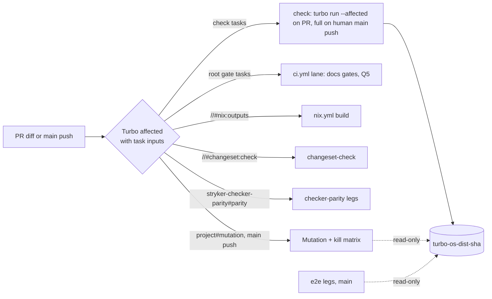

# Turbo-Native Caching And Change Selection - Plan

## Goal Capsule

- **Objective:** Every pull request runs each task its diff can affect, every human-authored push to main runs every `check` task, the results come from a cache and a selection that Turborepo computes, and every cache or change classifier Turbo does not own has a written reason a reviewer can check.
- **Means:** Declare every file a task reads in that task's `inputs` and turn on Turbo's task-input affected selection, pinned by one executable test (KTD1, KTD8); scope PR runs with `--affected` while main stays full (KTD2); answer each CI lane's "does this change matter" question with a Turbo query instead of a hand-written classifier (KTD3); stop naming cache entries by hand-made content hashes (KTD4, KTD6); record the survivors and their reasons (KTD7).
- **Product authority:** the root's intent of 2026-10-12 relaying Ryan's house rule "never roll your own caching when turbo exists". It owns this Stream K audit for the whole repository's CI and dev loops. It must not lose the wall-clock wins already landed, main-only e2e and Bench, or the guarantee that a PR runs every task its diff can affect. Stryker's own mutation verdict reuse is product behaviour and out of scope; only its CI wiring is in scope. The CI wall-clock contract's limits still hold: no bigger or self-hosted runners, no cloud credentials, no new third-party actions or executables, no skipped tests, no optional checks. This plan owns the Turbo-law units of `docs/plans/2026-10-11-0608-perf-check-critical-path-plan.md` (branch `ci/check-critical-path`, not on main): that plan's U7, U8 and U9 become U2, U3 and U4 here, its KTD12–KTD15 become KTD1–KTD7, and its Q7 becomes Q5, once the root approves this plan.
- **Open blockers:** Q1–Q5 are root decisions; U4 and U5 wait on Q5, U10 on Q4.
- **Execution profile:** one `gh stack` with `main` as trunk, one layer per unit in the order U1, U2, U3, U6, U7, U8, U9, then U4 and U5 after Q5 and U10 after Q4. Each layer replaces one confirmed finding, carries that finding's query and run evidence in its PR body, passes `check` on its own and leaves `main` releasable. Plain merges, no rebase or force-push. No local e2e or mutation runs; host memory is tight, so local verification is `turbo query`, `--dry=json`, format, lint and the touched packages' own tests. Every wall-time claim comes from the jobs API.
- **Stop conditions:** stop and report when a unit's differential over recent main commits shows Turbo skipping a commit that the mechanism it replaces ran for a real reason; when a declared input set cannot be completed without making a 10-minute-plus task re-run on most commits; when a touched job's wall breaks R6; or when a unit needs a credential, a new third-party action or a new gate the root has not approved.
- **Who finishes:** the implementing agent opens each layer ready for review and reports its head SHA when green; the root or operator merges bottom-up.

---

## Product Contract

### Summary

Turbo already runs the task graph, but the work around it is hand-made: content-hash keys for its cache, a docs-only classifier, a checker-parity change trigger, and a path filter on Mutation. Meanwhile Turbo's own hashes miss files that three tests read from other packages, so a PR or a main push can replay a stale pass. This plan first makes Turbo's hashes complete and pins the Turbo behaviour it relies on, then moves every change-based selection onto Turbo's affected query, then removes the hand-made cache keys. What Turbo cannot do under the contract stays, each with its reason.

### Problem Frame

The audit ran the `turbo-query-optimization` skill on main at `c8bdd7f3` (Turbo 2.10.12): schema and surface (W1–W2), `packages` (25), `packageGraph` (24 nodes, 104 edges), `boundaries` (20 diagnostics), `affectedTasks` over the last 60 first-parent main commits, `--dry=json` hashes, and scratch-commit probes in throwaway worktrees outside the repository. A read-only inventory listed every cache, hash, path filter and classifier in `.github/`, `scripts/`, root scripts, hooks, `turbo.json`, the e2e harness, the bench and the Nix flake.

**Turbo hashes miss files that tests read across package boundaries.** Each probe appended one line to a tracked file in a scratch commit and compared `turbo run test --dry=json` hashes before and after.

| Reader (task)                                                                                             | Reads                                                                    | Hash of the reader after the edit | Selected by `affectedTasks`                          |
| --------------------------------------------------------------------------------------------------------- | ------------------------------------------------------------------------ | --------------------------------- | ---------------------------------------------------- |
| `stryker-e2e-core#test` via `test/e2e-core/tests/__fixtures__/effect-concurrency/fixture-project.js:1-12` | `packages/stryker-js-instrumenter/testResources/effect-concurrency/*.ts` | unchanged (`bbf97c3e29`)          | only through a package-level match                   |
| `stryker-e2e-core#test` via `test/e2e-core/tests/status-closure.integration.test.ts:28,52`                | `test/e2e/tests/*.e2e.test.ts` journeys                                  | unchanged (`bbf97c3e29`)          | no (`stryker-e2e#test` only)                         |
| `stryker-js#test` via `packages/stryker-js/tests/lockfile-closure-digest.integration.test.ts:27,111`      | the live `pnpm-lock.yaml`                                                | unchanged on a byte edit          | no on 1 of the last 11 lockfile commits (`ddeb67ab`) |

An unchanged hash means Turbo replays the cached result, on PRs and on main alike, so today's guarantee that a PR runs every task its diff can affect already fails for these three readers. With the three reads declared as `test` inputs and `futureFlags.affectedUsingTaskInputs` on, the same probes change the reader's hash and select it (journey edit `d1f4554624 -> 04dd3e0da8`, selected; resource edit `-> 5220a58ed8`, selected).

**PRs run the whole graph.** `gate:tasks` and `gate:dist` accept `TURBO_BASE` (`package.json:29,31`), which no workflow sets, so every PR runs all 144 lint, tsgo, typecheck and test tasks and only the cache saves work. Of the last 60 main commits, 34 affect `stryker-js#test` and 18 affect no lint, typecheck or test task. In 4 of 38 PR `check` runs measured on 2026-10-12, `stryker-js#test` ran its 13 minutes although the PR did not affect it (base cache entry absent or stale).

**`stryker-js#build` invalidates on test edits and runs `tsc -b`.** Its script is `pnpm run typecheck && tsdown`, and the root `build` and `api:check` inputs take `src/**`, tests included. Cold, it ends 2.13 minutes (p50, 39 runs) after its last dependency, of which `tsdown` is 21.7 s. With test exclusions committed on a scratch base, a test-only edit (`cc7fcefe`) changes 3 task hashes instead of 15.

**Change selection is hand-written in four places, and Turbo answers the same questions.**

| Mechanism                                                                                                                                                     | Evidence against Turbo                                                                                                                                                                                                                                                                                                                                                                                                                                                                 |
| ------------------------------------------------------------------------------------------------------------------------------------------------------------- | -------------------------------------------------------------------------------------------------------------------------------------------------------------------------------------------------------------------------------------------------------------------------------------------------------------------------------------------------------------------------------------------------------------------------------------------------------------------------------------- |
| `change-lane` (`.github/actions/change-lane/action.yml:1-38`, `scripts/change-lane.ts`), used by `ci.yml:26-55`, `nix.yml:16-30`, `changeset-check.yml:12-27` | Under the flag, root tasks follow their inputs: a `docs/plans` Markdown edit selects `//#format:check` and `//#gate:repo` only, a workflow `.yml` edit selects `//#format:check` only, and a docs-only commit selects no package task.                                                                                                                                                                                                                                                 |
| `checker-parity-changes` trigger (`ci.yml:305-352`, `test/checker-parity/src/lane-trigger.ts`, `trigger-parity-lane.workflow.ts:13-22`)                       | A `parity` task with the trigger's shared files as `$TURBO_ROOT$` inputs and an explicit `stryker-js-typescript-checker#build` dependency (the package graph has no edge from `stryker-checker-parity` to the checker) agrees on 58 of the last 60 main commits. The 2 differences (`ddb62550`, `7d15adcf`) are trigger over-runs: they touch `cli-contract` tests and `stryker-config/lib`, neither in the checker bundle. Turbo skipped no commit the trigger ran for a real reason. |
| Mutation's push `paths-ignore` (`mutation.yml:6-9`)                                                                                                           | The four mutated projects' `mutation` task, with `flake.lock`, `flake.nix`, `mutation.yml`, `kill-matrix.yml` and `.stryker/**` as inputs, runs on 52 of the 57 commits the filter runs; the 5 it skips touch only CI wiring, `cli-contract` tests, the e2e bake script or `commitlint.config.ts`. Without `flake.nix` as an input it would also skip `cddbd52c` and `36afef4d`, which change the published CLI's derivation.                                                          |
| Bench's PR `paths-ignore` (`bench.yml:4-7`)                                                                                                                   | Not measured: #316 (open) takes Bench off the pull-request path.                                                                                                                                                                                                                                                                                                                                                                                                                       |

**Cache entries carry hand-made names.** No remote cache exists: no `TURBO_TOKEN`, `TURBO_TEAM`, `TURBO_API`, `remoteCache`, `cacheMaxAge` or `cacheMaxSize` anywhere. `.turbo/cache` moves through `actions/cache` as `turbo-<os>-dist-<sha>` (`ci.yml:94-120,215-226`), `turbo-<os>-bench-<slug>-<sha>` (`bench.yml:108-114`), and `mutation-build-<os>-<hashFiles(pnpm-lock.yaml, turbo.json, packages/**, test/e2e-core/**)>` in `mutation.yml:118` and `kill-matrix.yml:82`, a hand-written content hash naming an entry whose contents Turbo already hashes per task. Mutation's incremental report is named by another content hash (`mutation.yml:64`). The e2e legs restore no Turbo cache and rebuild their closure (27–49 s of build and startup per leg on 2026-10-10 runs).

**`turbo` answers without a workspace install.** In a bare checkout, `pnpm install --frozen-lockfile --filter . --ignore-scripts` installs the root's 96 packages in 3.6 s on a warm store without `.sfs-deps`, and `pnpm exec turbo` (2.10.12) then answers `affectedTasks`. `turbo query affectedTasks` ignores `TURBO_SCM_BASE`; it needs explicit `base:` and `head:` arguments, while `turbo run --affected` reads the variable.

**Bot pushes run no CI.** `ci.yml:27,59`, `e2e.yml:18` and Mutation's jobs skip pushes authored by `github-actions[bot]`, the release version commits (27 of the last 200 first-parent main commits). Every PR merge is authored by its merger, so a PR-skipped task still runs on that merge's push.

**Walls today (jobs API, 2026-10-12).** PR `check` job p50 16.67, p95 21.05 minutes (n = 36); `ci.yml` `lane` 0.13; checker-parity leg 1.85 and report 1.23; `nix.yml` lane 0.12 and flake outputs 5.93; `changeset-check.yml` lane 0.14 and check 8.89; Mutation plan 1.89, build 0.66, shard 2.60, kill-matrix shard 8.36, report 0.93 (last 10 successful runs each); e2e legs 7.4–13.2 on main. None of the last 53 PR runs took the docs-only path, so the docs-only verdict has no recent measurement; parent plan R2 bounds it at 3 minutes.

### Requirements

**Selection**

- R1. A task runs on a PR whenever a file it reads changed on that PR: Turbo's `--affected` selects it, and its hash changes so the cache cannot replay an old result. Every file a cached task reads from outside its own package is in that task's `inputs`.
- R2. On every human-authored push to main and every `workflow_dispatch`, `check` runs every task with no `--affected` and no filter; that is the backstop for anything a PR skipped. e2e and Mutation stay main-only and Bench becomes main-only through #316. Mutation is the one lane Turbo gates on a main push: a skipped push's changes are mutated on the next Mutation run, because Stryker's incremental report still records the old verdicts, and the nightly schedule and the `full` dispatch run regardless. Bot release pushes run no CI, as today.
- R3. Every change-based decision about whether a CI lane runs comes from Turbo, except the mechanisms KTD7 lists with their reasons.

**Cache**

- R4. In the workflows this plan touches, no `actions/cache` key is a hand-written content hash: entries are named by commit, ref or run.
- R5. A cached task's inputs name only what it reads; a test-only edit leaves every `build` and `api:check` hash unchanged.

**Kept wins and limits**

- R6. No job a unit touches gets slower: its p50 wall over the first 10 runs after the unit merges stays within 10% of the Problem Frame's p50, and a docs-only PR's verdict arrives within 3 minutes.
- R7. No credential, remote cache, new third-party action or executable, and no new gate lands without the root's explicit approval (Q1, Q3).

**Agent surface**

- R8. Every job that asks Turbo writes its decision to the step summary with a reason code: `LANE_TURBO_SELECTED` with the selected tasks, `LANE_TURBO_NONE`, or `LANE_FULL` when the event bypasses Turbo (human-authored push to main for `check`, `workflow_dispatch`, `schedule`, or a base Turbo cannot resolve). A failure writes an annotation with the next action.

**Inventory**

- R9. KTD7 is the complete list of bespoke caches and change classifiers that survive, each with the reason Turbo cannot do its job under this plan's limits.

### Key Decisions

- **Turbo decides selection by task inputs, not by package.** (session-settled: user-directed — the house law of 2026-10-12 names `--affected` and `turbo.json` inputs, over a hand-written classifier or a package-level filter.) `futureFlags.affectedUsingTaskInputs` is the only Turbo mechanism under which a root-file change or a cross-package read selects exactly the tasks that read it. Governs R1, R3.
- **Main's `check` runs everything.** A PR's skipped task runs on the merge's push, so a selection error costs one red main run, never a lost check. Governs R2.
- **A lane that Turbo does not execute still asks Turbo.** The Nix, changeset, parity and mutation lanes run outside Turbo, but each gets a Turbo task whose `inputs` state what the lane reads, and the lane job queries Turbo for it. One selection mechanism, readable in `turbo.json`. Governs R3, R8.
- **The Turbo behaviour this plan relies on is pinned by a test.** The task-input flag, `$TURBO_ROOT$` inputs, the empty run summary and the explicit-base query are non-obvious third-party semantics, so one executable pin re-fires on every `check` and on every Turbo upgrade (pack: boundary-testing, `pin-dependency-semantics.md`). Governs R1, R3.
- **No remote cache without the root.** The only routes need a Vercel token or a third-party action, both outside the contract; Q1 asks. Governs R7.

### Acceptance Examples

- AE1. Covers R1. **Given** a PR that edits only a `test/e2e/tests/*.e2e.test.ts` journey, **when** CI runs, **then** `stryker-e2e-core#test` is selected and misses the cache.
- AE2. Covers R3, R6. **Given** a PR that edits only `docs/**/*.md`, **when** CI runs, **then** only the Turbo root tasks whose inputs match run, the Nix and changeset lanes report `LANE_TURBO_NONE`, and the PR's verdict arrives within 3 minutes.
- AE3. Covers R2. **Given** a human-authored main push of a commit that only edits `.github/workflows/ci.yml`, **when** CI runs, **then** `check` runs every task and reports `LANE_FULL`.
- AE4. Covers R2, R3. **Given** a main push that changes only `packages/stryker-js-cli-contract/tests/**`, **when** Mutation's gate runs, **then** it reports `LANE_TURBO_NONE` and no mutation shard starts; **given** the nightly schedule, **then** it reports `LANE_FULL`.
- AE5. Covers R4. **Given** a main push, **when** the Mutation build job restores `.turbo/cache`, **then** its key names a commit and contains no `hashFiles`, and the job saves nothing.

### Scope Boundaries

- Stryker's incremental verdict reuse, its run-inputs digest, and the checker-parity verdict semantics are product behaviour; only the CI wiring around them is in scope.
- Bench's trigger belongs to #316; this plan does not edit `bench.yml`.
- `.github/workflows/release.yml`, the reusable workflows it calls from `systemfsoftware/pnpm-release-management`, and the bot-push skip are out of scope.
- One test is added: the Turbo semantics pin (KTD8). Every other unit proves itself with Turbo dry runs, a throwaway differential over recent main commits whose result goes in the PR body, and real CI runs. Units that remove a classifier delete its tests with it (DEL1).
- No bigger runners, self-hosted runners, skipped or quarantined tests, `continue-on-error`, optional checks, cloud credentials, or new third-party actions or executables. Timeouts stay at 60 minutes, the root's standing rule.

### Outstanding Questions

**For the root**

- Q1. **Remote cache.** None exists. A Turbo remote cache would replace the `actions/cache` carriage, the base-first restore, the prune and `cache-sweep` (KTD7 items 1–4), but needs either a Vercel account and a `TURBO_TOKEN` secret (a credential; fork PRs cannot read it) or a third-party cache-server action (`pixpilot/turbo-persistent-cache`, `rharkor/caching-for-turbo`). The contract forbids both. Recommended: keep `actions/cache` carriage with its written reasons unless you lift that limit.
- Q2. **e2e fixture bake cache.** `test/e2e/src/Harness/fixture-cache.service.ts` keys baked fixtures by SHA-256 of packed-file and fixture bytes (`:452-456`, `:640-660`, `test/e2e-core/src/key-material.ts`), guards concurrent local runs with leases (`:301-345`), and prunes stale entries (`test/e2e-core/src/prune-stale-entries.workflow.ts`). A Turbo `stryker-e2e#bake` task with `outputs` could own the key and the eviction, but the bake runs in the microVM guest, its output size is unmeasured, CI would hit only when no packed build changed (18 of the last 60 main commits [INFERENCE: from `affectedTasks` for the packed closure's builds]), and local runs would lose the leases. Options: (a) keep it with that reason; (b) prototype the Turbo task on main's e2e runs and adopt it if the entry size fits the cache budget and the hit rate holds. Recommended: (a) now, (b) as a later measured layer.
- Q3. **`turbo boundaries` as a gate.** It reports 20 diagnostics today, including the 12 `fixture-project.js` imports behind the first Problem Frame row. Running it in `check` would catch the next undeclared import mechanically, but it is a new gate (GATE1) and does not see file reads such as the journey and lockfile reads. Without it, R1's completeness rests on review and the pin. Recommended: approve it after U1, with today's diagnostics fixed or declared first.
- Q4. **Checker-parity trigger ownership.** The trigger belongs to #266's stream. U10 replaces it with a Turbo `parity` task; the differential supports it, but the owner should land or approve it. Who lands U10?
- Q5. **`ci.yml`'s docs-only route** (the parent plan's Q7). Options: (a) keep `change-lane` for `ci.yml` with a written reason; (b) make the root gates Turbo root tasks and always run `check` under `--affected`, paying `check`'s setup on docs PRs (unmeasured against 3 minutes); (c) `ci.yml`'s `lane` job asks Turbo through KTD3's action, runs only the selected root tasks itself as it runs the docs gates today, and skips `check` when Turbo selects no package task. Recommended: (c). It removes the allowlist, keeps the docs-only path's cost where it is, and uses the same action as U5; (a) remains the fallback if (c) measures over 3 minutes.

**Deferred to implementation**

- Q6. The exact input globs for the root gate tasks (`//#format:check`, `//#lint:conventions`, `//#gate:repo`, `//#test:scripts`) come from each tool's own file discovery, checked by a dry run per tool.

### Sources / Research

- Turbo 2.10.12 at main `c8bdd7f3`: `query --schema` (surface unchanged since `38924e53`), `packages`, `packageGraph`, `boundaries`, `affectedTasks` over the last 60 first-parent main commits; `run --dry=json` hashes in throwaway worktrees under `/tmp`, each with probe commits never pushed; a bare checkout answering `turbo query` in 0.8 s without `node_modules`; a root-only frozen install in 3.6 s.
- Docs: [Configuring turbo.json](https://turborepo.dev/docs/reference/configuration) (`futureFlags.affectedUsingTaskInputs`, planned default in 3.0; cache eviction), [Package Configurations](https://turborepo.dev/docs/reference/package-configurations). Issues: [#14340](https://github.com/vercel/turborepo/issues/14340) (over-selection when inputs mix `**/` and `$TURBO_ROOT$`), [#12947](https://github.com/vercel/turborepo/issues/12947) (root-task affected bug; the 2.10.12 probes select root tasks correctly).
- Jobs API, 2026-10-12: last 10 successful runs of `mutation.yml`, `nix.yml`, `changeset-check.yml`, `e2e.yml`; the last 60 PR runs of `ci.yml`; 38 PR `check` runs mapped to merge bases.
- Inventory: every `actions/cache` step, `hashFiles`, `paths*` filter, classifier and hook named in KTD7 and the Problem Frame, read at the cited lines.
- Pack: `boundary-testing/pin-dependency-semantics.md` (executable assumption pins, upgrade tripwire).

---

## Planning Contract

**Product Contract preservation:** new plan, revised in place after its first report-only review; it absorbs the check-critical-path plan's Turbo units as the Goal Capsule states.

### Key Technical Decisions

- KTD1. **`futureFlags.affectedUsingTaskInputs: true`, and every cross-package read is a `$TURBO_ROOT$` input of the reading task.** Today's three reads go into package `turbo.json` files that extend the root (`extends: ["//"]`, `inputs: ["$TURBO_EXTENDS$", ...]`, the pattern `packages/stryker-js-cli-contract/turbo.json` already uses): `test/e2e-core/turbo.json` adds `$TURBO_ROOT$/test/e2e/tests/**/*.e2e.test.ts` and `$TURBO_ROOT$/packages/stryker-js-instrumenter/testResources/effect-concurrency/**`; `packages/stryker-js/turbo.json` adds `$TURBO_ROOT$/pnpm-lock.yaml` to `test`, which costs one extra `stryker-js#test` run in the last 11 lockfile commits. Issue #14340 can over-select a reader whose inputs mix `**/` and `$TURBO_ROOT$`; that costs time, never coverage, and R6 measures it. Governs R1.
- KTD2. **PR scope is `${TURBO_SCM_BASE:+--affected}`; main sets nothing.** `gate:tasks` and `gate:dist` replace their `TURBO_BASE` expansion. The `check` job's `base` step (`ci.yml:85-93`) already reads the checked-out merge commit's first parent, the base branch's tip at merge time, so the first-parent diff is the PR's own change set; the unshallowed treeless fetch of main (`ci.yml:81-84`) makes that commit and its trees available. The step appends `TURBO_SCM_BASE=<that sha>` to `$GITHUB_ENV` on `pull_request` only, and `TURBO_SCM_HEAD` stays `HEAD`. A run that selects nothing exits 0 and writes a run summary with an empty `tasks` array, which `scripts/turbo-summary.ts` reads as zero missed and zero failed. Governs R1, R2.
- KTD3. **One composite action, `.github/actions/turbo-affected`, asks Turbo for every lane outside Turbo.** Inputs: a task list. It installs only the root workspace (`pnpm install --frozen-lockfile --filter . --ignore-scripts`, the lockfile's `turbo`), resolves `base` and `head` (PR: `HEAD^1` and `HEAD` of the merge commit; push to main: `github.event.before` fetched with `git fetch --depth=1`, and `github.sha`), and runs `pnpm exec turbo query` on `affectedTasks(base: ..., head: ..., tasks: [...])` with explicit arguments, since the query ignores `TURBO_SCM_BASE`. It emits `run` and the selected task ids and writes R8's line. On `workflow_dispatch` and `schedule`, or when `before` is the all-zero SHA or does not resolve, it emits `run=true` with `LANE_FULL`, failing open to a full run. Each lane's task lives in `turbo.json` with its real `inputs`; its script is the lane's local reproduction command where one exists. Governs R3, R8.
- KTD4. **Mutation, the kill matrix and the e2e legs read `check`'s Turbo entries and save none.** Their build steps restore `turbo-<os>-dist-<parent sha>` first and the newest `turbo-<os>-dist-` second with `actions/cache/restore`, the restore pair `check` already uses (`ci.yml:94-112`), so Turbo's per-task hashes decide every hit. The `mutation-build-` family and its `hashFiles` key go, `cache-sweep`'s per-ref retention is unchanged because no new `turbo-` entry appears, and main's `check` stays the only writer. Governs R4, R6.
- KTD5. **`stryker-js#build` is `tsdown`; `build` and `api:check` inputs exclude `src/**/__tests__/**`, `src/**/*.test.ts` and `src/**/*.spec.ts`.** `tsc -b` stays the `typecheck` script, which the gritlint pack `typecheck-build-mode` requires. Governs R5, R6.
- KTD6. **Mutation's push trigger is the Turbo gate, not `paths-ignore`; its incremental report is named by commit.** The four mutated projects' `mutation` task (already `cache: false`, `dependsOn: ["^build"]`) declares `$TURBO_ROOT$/flake.lock`, `$TURBO_ROOT$/flake.nix`, `$TURBO_ROOT$/.github/workflows/mutation.yml`, `$TURBO_ROOT$/.github/workflows/kill-matrix.yml` and `$TURBO_ROOT$/.stryker/**` beside `$TURBO_DEFAULT$`. The incremental-report key becomes `mutation-incremental-<sha>` with the existing prefix fallback; Stryker's run-inputs digest, not the key, decides reuse. Governs R2, R3, R4.
- KTD7. **Survivors and their reasons.** (1) `actions/cache` carriage of `.turbo/cache`: Turbo persists across runners only through a remote cache (Q1). (2) Base-commit-first restore (`ci.yml:94-120`): GitHub cache scoping decides which entry a ref reads first; Turbo never sees it. (3) Prune before save (`ci.yml:215-220`): Turbo's eviction is by age or size, so it cannot keep an entry to one run's artifacts. (4) `cache-sweep` (`ci.yml:241-303`): it deletes GitHub cache entries, which Turbo does not manage. (5) `released-tarballs` (`.github/actions/released-tarballs/action.yml:17-53`, keyed on the flake input's own `narHash`) and the flake tools: Nix store outputs, outside every Turbo task. (6) `scripts/turbo-summary.ts` and `job-report`: they read Turbo's own run summary and cache nothing. (7) Checker-parity verdict and cost caches (`ci.yml:353-448,500-660`, `test/checker-parity/src/run-side.ts`, `reuse-cached-verdicts.workflow.ts`): they reuse verdicts per file inside one task and compare main's checker built at the base commit with the branch's, which Turbo's whole-task cache cannot express; #266 owns them. (8) Mutation's incremental report carried in `actions/cache` (`mutation.yml:68-76,305-328`): Stryker's own state file, whose validity Stryker decides; the `hashFiles(...) != ''` guard at `mutation.yml:325` tests the file exists and names nothing. (9) The e2e bake cache, pending Q2. (10) `test:e2e`, `mutation` and `stryker-js-cli-contract#test` stay `cache: false`: their results depend on the microVM runtime, the published CLI's run or git state that no input glob captures. (11) `lint-staged` (`.lintstagedrc.js`): it fixes staged files only, which `--affected` cannot select. (12) The pre-push hook and `gate:repo`: repository rules, not caching. (13) Bench's workload digest and pristine-tree reset (`test/bench/src/workload-digest.service.ts`, `pristine-tree.service.ts`): A/B comparability, not caching. (14) Bench's PR `paths-ignore` (`bench.yml:4-7`): owned by #316, which removes Bench's pull-request trigger. (15) `change-lane` for `ci.yml`, only if Q5 picks (a). Governs R9.
- KTD8. **One pin suite, `scripts/turbo-semantics.test.ts`, runs in the existing repo-scripts tests.** In a temporary git repository with two packages and a root task, using the repository's installed `turbo`, it asserts: a root-file change selects only the tasks whose inputs match it (flag on); a `$TURBO_ROOT$` input in a package configuration changes the reader's hash and selects it; a run that selects nothing exits 0 and writes `tasks: []`; `affectedTasks` honours explicit `base:`/`head:`; and `turbo run --affected` honours `TURBO_SCM_BASE`. It re-runs on every `check`, so a Turbo upgrade that changes any of these fails before CI's selection silently changes. Follows `scripts/turbo-summary.test.ts` (Deno, `./bin/deno test --config=scripts/deno.json scripts/`). Governs R1, R3.

### High-Level Technical Design

| Lane              | Today's selector                     | After                                        | Push to main / dispatch / schedule           |
| ----------------- | ------------------------------------ | -------------------------------------------- | -------------------------------------------- |
| `check`           | `change-lane`, full graph            | `--affected` (U3); docs route per Q5 (U4)    | full                                         |
| Nix flake outputs | `change-lane`                        | `//#nix:outputs` inputs (U5)                 | full on dispatch; Turbo-gated otherwise      |
| Changeset check   | `change-lane`                        | `//#changeset:check` inputs (U5)             | PR only, as today                            |
| Checker parity    | `lane-trigger.ts` + trigger workflow | `stryker-checker-parity#parity` inputs (U10) | full on dispatch                             |
| Mutation          | push `paths-ignore`                  | `<project>#mutation` inputs (U6)             | Turbo-gated push; schedule and dispatch full |

### Alternatives Considered

- **Keep `--affected` package-level and widen the classifiers' allowlists.** Rejected: the docs-only, parity and mutation questions then stay hand-written, which the law forbids where Turbo can answer them, and the cross-package read gap stays.
- **Add the readers' foreign files to `globalDependencies`.** Rejected: every task would re-run on any journey, resource or lockfile edit; per-task inputs re-run only the reader.
- **Give Mutation its own commit-named Turbo family.** Rejected: `cache-sweep` keeps main's newest three `turbo-` entries per ref, so a second family on main would evict the base entries PRs restore; reading `check`'s entries costs nothing extra.
- **Fetch `turbo` at run time (`npx`, `pnpm dlx`).** Rejected: an unpinned run-time fetch; the root-only frozen install uses the lockfile's binary.
- **Turbo-cache the e2e bake now.** Deferred to Q2.

### Assumptions

- `affectedUsingTaskInputs` keeps its documented semantics on 2.10.x; KTD8 turns this into a failing test rather than an assumption.
- A root-only frozen install stays fast on a cold CI store; U5's first runs measure the lane walls against R6.
- The CI wall-clock contract's limits still bind this plan (no credentials, no new third-party actions).

---

## Implementation Units

### U1. Declare cross-package reads; turn on task-input selection; pin Turbo's semantics

**Goal:** a task's hash and its selection cover every file it reads, and the Turbo behaviour later units rely on is tested.

**Requirements:** R1; KTD1, KTD8.

**Dependencies:** none; the first layer.

**Files:** `turbo.json` (`futureFlags`), `test/e2e-core/turbo.json` (new), `packages/stryker-js/turbo.json` (new), `scripts/turbo-semantics.test.ts` (new).

**Approach:** the two package configurations extend the root and append KTD1's inputs to `test`; the root gains the flag. No command passes `--affected` until U3, so selection does not change yet; the two readers miss the cache once.

**Test scenarios** (`scripts/turbo-semantics.test.ts`, an assumption pin over a temporary repository): the five assertions in KTD8, each with its own repository state.

**Verification:** scratch commits on the branch editing a journey, an effect-concurrency resource and the lockfile each change the reader's `--dry=json` hash and select it in `affectedTasks`; a docs-only scratch commit selects no package task; the pin passes locally and in CI's repo-scripts step; CI's `check` is green.

### U2. `stryker-js#build` without `tsc -b`; build inputs without tests

**Goal:** a test-only edit stops invalidating builds, and every task waiting on `stryker-js#build` starts about 1.8 minutes sooner on a cold run.

**Requirements:** R5, R6; KTD5.

**Dependencies:** U1 (stacked).

**Files:** `packages/stryker-js/package.json` (`build`), `turbo.json` (`build.inputs`, `api:check.inputs`).

**Execution note:** before committing, confirm `tsdown` alone writes the same `dist` file list and `api:check` passes on it; if it needs `tsc -b`'s output, stop and report.

**Verification:** a scratch test-only commit changes only `stryker-js#test`, `#typecheck`, `#lint` and `#lint:tsgo` hashes; the cold `check` log's `stryker-js:build` group ends at least 1.5 minutes sooner after its last dependency than the 2.13-minute baseline.

### U3. PR scope by `--affected`, main full

**Goal:** a PR runs the tasks Turbo selects; a human-authored main push runs all.

**Requirements:** R1, R2, R6, R8; KTD2.

**Dependencies:** U1 (the guarantee needs complete inputs first).

**Files:** root `package.json` (`gate:tasks`, `gate:dist`), `.github/workflows/ci.yml` (`base` step, verdict and `job-report` details).

**Verification:** `git grep -n TURBO_BASE -- ':!docs/plans'` returns nothing; a branch PR's summary reports `LANE_TURBO_SELECTED` with the base and the selected count; the next human-authored main push reports `LANE_FULL` (AE3); the PR `check` job's p50 over 10 runs stays within R6 of 16.67 minutes.

### U4. `ci.yml`'s docs-only route (after Q5)

**Goal:** `ci.yml` stops calling `change-lane`, and a docs-only PR still gets its verdict within 3 minutes.

**Requirements:** R3, R6, R8; KTD3; Q5.

**Dependencies:** U3, U5's action (land U5's action first if Q5 picks (c)); Q5 answered.

**Files:** `turbo.json` (root tasks `//#format:check`, `//#lint:conventions`, `//#gate:repo`, `//#test:scripts` with inputs per Q6), root `package.json` (new `test:scripts` script, `./bin/deno test --config=scripts/deno.json scripts/`; `check:ci` runs the root tasks through Turbo), `.github/workflows/ci.yml` (`lane` asks Turbo under (c); the unconditional "Repo scripts tests" step at `ci.yml:136-137` goes, since `//#test:scripts` replaces it).

**Verification:** AE2 on a docs-only branch PR from the jobs API; on a code PR each root task appears in the summary as hit or miss by its inputs and the scripts suite runs once; if the docs-only verdict exceeds 3 minutes, stop and fall back to Q5 (a).

### U5. Nix and changeset lanes ask Turbo

**Goal:** the two other callers of the docs-only classifier use the Turbo gate; `change-lane` is deleted unless Q5 keeps it for `ci.yml`.

**Requirements:** R3, R6, R8; KTD3.

**Dependencies:** U3; Q5 answered for the deletion.

**Files:** `.github/actions/turbo-affected/action.yml` (new), `turbo.json` (`//#nix:outputs`, `//#changeset:check`), `.github/workflows/nix.yml`, `.github/workflows/changeset-check.yml`; deleted unless Q5 picks (a): `.github/actions/change-lane/`, `scripts/change-lane.ts`, `scripts/change-lane.test.ts`.

**Approach:** `//#nix:outputs` reads `flake.nix`, `flake.lock`, `nix/**`, `pnpm-lock.yaml`, `pnpm-workspace.yaml` and the packed packages' sources; `//#changeset:check` reads `.changeset/**` and every publishable package's sources and manifest. Before committing, a throwaway differential over the last 60 main commits compares each gate with `change-lane`'s decision; every commit Turbo skips that `change-lane` ran is justified in the PR body.

**Verification:** a docs-only branch PR shows both lanes `LANE_TURBO_NONE`; a code PR shows both selected; each lane job's p50 over 10 runs is reported against R6 (0.12 and 0.14 minutes today plus the root install); after deletion, `git grep -n change-lane -- ':!docs/plans'` returns nothing.

### U6. Mutation's push trigger by the Turbo gate

**Goal:** Mutation skips a main push only when Turbo says no mutated project's `mutation` task is affected.

**Requirements:** R2, R3, R8; KTD3, KTD6.

**Dependencies:** U5's action.

**Files:** `turbo.json` (`mutation.inputs`), `.github/workflows/mutation.yml` (drop `paths-ignore`; a gate job before `plan` and `build`; the `kill-matrix` call sits behind the gate on pushes).

**Verification:** the Problem Frame differential re-run on the branch reports zero commits that the filter ran for a mutated-project change and Turbo skipped; AE4 on the first qualifying main push and the next schedule run, reported in the PR thread.

### U7. Mutation and the kill matrix read `check`'s Turbo entries

**Goal:** no `hashFiles` key names a Turbo cache entry, and no second family competes with `check`'s.

**Requirements:** R4, R6; KTD4.

**Dependencies:** U6 (same file).

**Files:** `.github/workflows/mutation.yml` (`build` key, restore, prune and save steps), `.github/workflows/kill-matrix.yml` (`build` key, restore and save).

**Verification:** AE5; the build job's p50 over 10 runs stays within R6 of 0.66 minutes; `gh cache list --key mutation-build-` is empty once the last entry ages out.

### U8. e2e legs restore `check`'s Turbo entry read-only

**Goal:** each e2e leg takes its closure builds from the cache instead of rebuilding them.

**Requirements:** R4, R6; KTD4.

**Dependencies:** none (stacked by order).

**Files:** `.github/workflows/e2e.yml`.

**Approach:** `actions/cache/restore` of `turbo-<os>-dist-<parent sha>`, then the newest `turbo-<os>-dist-`, before `pnpm test:e2e`. The legs start beside the push's own `check`, which saves its entry only at the end, so they read the parent commit's entry and hit for every package the push did not change.

**Verification:** on the first main push after merge, each leg's Turbo summary shows its unchanged packages' build tasks as hits, and the build-and-startup segment shrinks from 27–49 s; `e2e.yml` has no save step.

### U9. Mutation's incremental report named by commit

**Goal:** the incremental report's entry is named by commit; Stryker's digest decides reuse.

**Requirements:** R4; KTD6.

**Dependencies:** U7 (same file).

**Files:** `.github/workflows/mutation.yml` (`plan` key step, `report` save).

**Verification:** the next main push restores the previous commit's entry through the prefix fallback, and its report's reused-mutant count is within normal variation of the run before the change; no `key:` line in `mutation.yml` contains `hashFiles`.

### U10. Checker-parity trigger by the Turbo gate (after Q4)

**Goal:** the parity lane runs when Turbo's `parity` task is affected, and the hand-written trigger goes.

**Requirements:** R3, R8; KTD3.

**Dependencies:** U5's action; Q4 answered.

**Files:** `turbo.json` (`parity` task with the trigger's shared files as `$TURBO_ROOT$` inputs and `dependsOn: ["^build", "@systemfsoftware/stryker-js-typescript-checker#build"]`), `test/checker-parity/package.json` (`parity` script), `.github/workflows/ci.yml` (`checker-parity-changes` `changes` step); deleted: `test/checker-parity/src/lane-trigger.ts`, `trigger-parity-lane.workflow.ts` and their tests, the `trigger` CLI command.

**Verification:** the Problem Frame differential re-run on the branch shows no commit the trigger ran for a checker-bundle change that Turbo skips; a branch PR touching only `test/e2e/testResources/**` selects the lane; the parity legs' p50 stays within R6 of 1.85 minutes.

---

## Verification Contract

- Every unit: `actionlint` with shellcheck from the flake's nixpkgs, zero findings beyond those on `main`; `pnpm format:check`; the repo-scripts tests including KTD8's pin; CI's `check` green on its layer.
- Selection units (U1, U3–U6, U10): a throwaway differential over the last 60 first-parent main commits, run once and deleted, with its counts and every disagreement listed in the PR body.
- Cache units (U2, U7–U9): `--dry=json` hash comparisons and the jobs API before and after.
- Wall clock (R6): each touched job's p50 over its first 10 runs after merge against the Problem Frame's p50, reported in the PR thread.

## Definition of Done

- Every unit's Verification holds on its own layer; each layer's `check` is green.
- `git grep -nE "key: .*hashFiles\(|change-lane|trigger-parity-lane" -- .github scripts test/checker-parity/src` returns nothing, and `git grep -n paths-ignore -- .github` returns only `bench.yml` until #316 lands, or only what KTD7 keeps under Q5 (a).
- KTD7 is the complete inventory of surviving bespoke caches and classifiers.
- Throwaway scripts, scratch probes and planted commits are absent from the diff.
