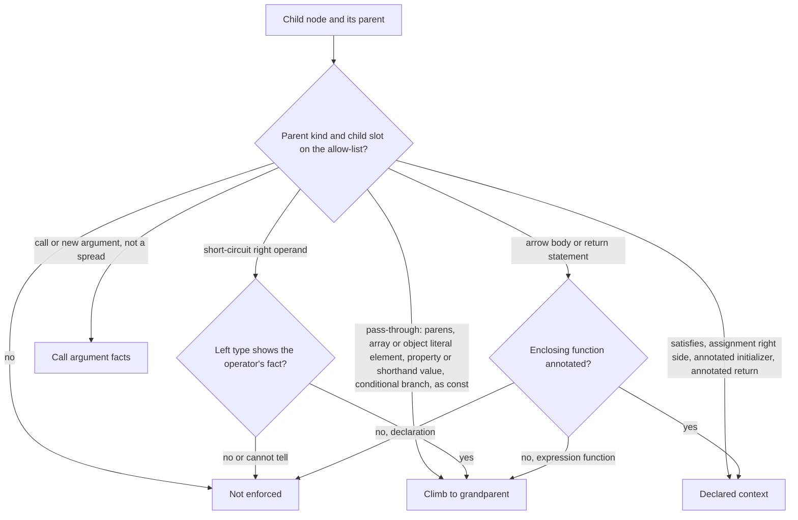

# Type-query re-land without false NotAssignable - Plan

## Goal Capsule

- **Objective:** The TypeScript checker serves type queries again, and a NotAssignable answer only ever names a mutant the real checker rejects, so no consumer can turn a type-query answer into a false `CompileError`.
- **Means:** Revert the revert of #277 on top of main, then decide context enforcement by an allow-list over parent shapes (KTD1, KTD2).
- **Product authority:** Root's P0 intent of 2026-10-13 (revert #277 first, then re-land through the full Compound Engineering cycle as a fresh PR off main; the failing-first proof drives a published surface and asserts only user-observable output). The sandbox-race fix and #286 are not active scope; #286 waits on this re-land.
- **Stop conditions:** Stop and report to root if a requirement can only be met by relaxing the parity lane, touching `mutation.yml`, `kill-matrix.yml`, the e2e fixture, a threshold or a CI limit, or by running mutation locally.
- **Execution profile:** U1 lands first and alone as a failing test; the PR opens as a draft on it. Root merges.

---

## Product Contract

Product Contract preservation: changed: R3, R4 (short-circuit right operands whose left type cannot reach the right operand are not enforcing; tsgo evidence in Sources), R6 (the regression drives the built checker worker over the published plugin protocol, per root's directive that `CheckerRuntime` is not a failing-first proof), R9 and its Key Decision (#325 merged, so the re-land is based on main, not stacked).

### Summary

#277's type queries come back unchanged except where the checker never enforces the site against the context the query would borrow: under a spread, under a non-null assertion, or on the right of `??`, `||` or `&&` when the left side's type means the right side never reaches the result. Those sites answer `Unknown` with reason `context-not-enforced`. The rule is a pure decision with property laws, pinned on real tsgo through the shipped checker worker, and the PR carries a full-corpus parity run on its own head.

### Problem Frame

#277 (`ee7038a5c`) added a type-query port: a caller sends mutant sites and candidate texts, and the checker answers `Assignable`, `NotAssignable` or `Unknown` without running a full check per mutant. A NotAssignable answer is meant to stand in for a compile error.

On main, `checker-parity-report` failed after #277 (CI runs 38305371777 on `ee7038a5c` and 38310864588 on `ec1769de2`) with 10 `wrong-not-assignable` violations, and #325 reverted it (`7ddec2fd3`). Every violation is the same shape: an object literal inside a spread, `...(cond ? {} : { field })`, replaced by `{}`. The query answered NotAssignable against the whole enclosing object type (for example `TransformerOptions` at `packages/stryker-js-instrumenter/src/Format.ts:201`), while the checker's verdict was `passed`.

The query decides whether a site's context is enforced by walking from the site to its parent, passing the context through shapes such as parentheses and object literals, until it reaches a declared type. A spread was treated as a pass-through shape, but TypeScript never checks a spread operand against the containing object's type, only the object that results. A non-null assertion has the same hole: `null!` is `never`, so the checker passes what the query rejected. Planning research found a third: tsgo drops the right operand's type from a `??`, `||` or `&&` result when the left type cannot be nullish, falsy or truthy respectively, so a mutant there can be invisible to the checker.

The tests #277 shipped could not see this. The decision laws take the context origin as an input. The differential fixture has no site under any of these shapes. The pull-request parity run checks only changed files plus a sample of projects, and the full corpus runs only on push and manual dispatch.

### Requirements

**Answer soundness**

- R1. The type query never answers NotAssignable for a candidate that the checker passes when the same candidate is applied as a mutant.
- R2. A site's context passes through a parent shape only when the checker enforces that shape's operand against the context it passes, and any other parent shape ends the path as not enforced, answering `Unknown` with reason `context-not-enforced`.
- R3. Spreads (in object literals, array literals and call arguments), non-null assertions, and the right operand of `??`, `||` or `&&` whose left operand's type cannot be nullish, falsy or truthy respectively are not enforcing shapes under R2.
- R4. Every other answer #277 gives stays as it is.

**Proof**

- R5. The rule that decides whether each parent shape passes its context through, ends it as declared, or ends it as not enforced is a pure decision with property laws covering every parent shape and every slot a site can occupy in it.
- R6. A regression test drives the built checker worker over the published plugin protocol (`Plugin.CheckerRpcs` through `Worker.makeWorkerClient`) on a real on-disk project that copies the `Format.ts:201` shape. It asserts only the worker's outputs: the type-query answer for the site is `Unknown context-not-enforced` and the check verdict for the same mutant is `passed`. It fails on today's main and on #277's tree.
- R7. On real tsgo, the differential test covers at least one site through every parent shape that R2 lets pass its context through, plus every shape R3 excludes, and every NotAssignable answer among them is a `CompileError` when the checker applies the same candidate.
- R8. The PR shows a full-corpus parity run on its own head with no `wrong-not-assignable` violation and with the lane's existing gates unchanged. It is evidence for the candidate shapes the corpus's mutants produce; R6 and R7 carry the shapes the corpus never queries.

**Delivery**

- R9. The re-land merges as one PR whose diff against main is #277 plus this fix.
- R10. The PR body names the non-Claude reviewer models that actually served the code review.

### Acceptance Examples

- AE1. **Covers R1, R3, R6.** Given a project whose function returns `{ a, ...(flag !== undefined ? { flag } : {}) }` against a declared object type, when `{}` is queried for `{ flag }` and the same mutant is checked, the answer is `Unknown context-not-enforced` and the verdict is `passed`. On #277's tree the answer is NotAssignable.
- AE2. **Covers R3.** Given `const s: string = maybe!`, when `null` is queried for `maybe`, the answer is `Unknown context-not-enforced`, not NotAssignable.
- AE3. **Covers R4, R7.** Given `const o: { readonly o: { readonly k: number } } = { o: { k: 1 } }`, when `{}` is queried for `{ k: 1 }`, the answer stays NotAssignable and the checker's verdict is `compileError`.
- AE4. **Covers R4.** Given `({ ...base, k: 'v' })` against a type that declares `k: string`, when `0` is queried for `'v'`, the answer stays NotAssignable: the property after a spread is still checked.
- AE5. **Covers R3, R4.** Given `declare const a: string; const s: string = a ?? b`, when `0` is queried for `b`, the answer is `Unknown context-not-enforced` (the checker passes it). Given `declare const m: string | undefined; const s: string = m ?? 'x'`, when `0` is queried for `'x'`, the answer stays NotAssignable and the verdict is `compileError`.

### Key Decisions

- **Revert first, then re-land as a fresh PR off main.** (session-settled: user-directed — chosen over a fix-forward on main: main must go green before the shortcut returns.) Governs R9.
- **The parity lane stays strict: no allow-list, no dropped candidates, no relaxed threshold.** (session-settled: user-directed — chosen over loosening the gate: the gate is the contract.) Governs R8.
- **Mutation evidence comes only from main's nightly or manually dispatched Mutation runs; there is no local mutation of any kind.** (session-settled: user-directed — chosen over hand-applied mutants: house law.) Governs R5, R6.
- **The parity verdict and cost caches stay.** (session-settled: user-directed — chosen over Turbo task caching: they are product semantics Turbo cannot express.) Governs R8.
- **The failing-first proof drives a published surface and asserts only user-observable output.** (session-settled: user-directed — chosen over the in-process `./runtime` verdict: `CheckerRuntime`, engine cells, telemetry, decision fields, injected ports and hand-mutated source are not admissible proof.) The CLI never issues type queries, so the published checker worker protocol is the surface that carries the answer. Governs R6.
- **Non-null assertions and short-circuit right operands are in scope even though the corpus has not hit them.** Both break the R1 invariant on real tsgo. Governs R3.
- **Soundness is an allow-list over parent shapes, not a list of exceptions.** A list of exceptions is how #277 shipped the defect: the next shape nobody considered brings it back. Governs R2, R7.
- **Unsound sites answer `Unknown` rather than being checked against a derived type.** `context-not-enforced` already exists in the published `UnknownReason` union, so the port's contract does not change. Governs R2, R3.

### Scope Boundaries

- No engine consumer of type queries. `packages/stryker-js/src` does not call the port, and this work does not add a caller.
- No change to `.github/workflows/ci.yml`, `mutation.yml`, `kill-matrix.yml`, `turbo.json` or any package `scripts`. #277 touched none of them, and the full-corpus run uses the lane's existing manual dispatch.
- No change to the e2e fixture or to any limit, budget or threshold.
- No new answer kinds and no new `UnknownReason` literal.
- Considered and not built: treating a call-argument spread as enforcing. tsgo checks a spread argument against a rest parameter, but a spread into fixed parameters has no single declared context; keeping it off the allow-list costs some answers and no soundness. A differential row showing enforcement for rest parameters would change this.
- The sandbox-race fix and #286 proceed separately.

### Dependencies / Assumptions

- #325 merged as `7ddec2fd3`; reverting it restores #277's tree exactly and removes the revert's `none` intent, which would be false once #277 is back.
- A manual dispatch of `ci.yml` runs the checker-parity lane over the full corpus on any branch (`test/checker-parity/src/ci-environment.ts:18`; `.github/workflows/ci.yml:5-11`). The token in this session is refused (HTTP 403) on Actions run and rerun endpoints, so the dispatch may need root.

### Sources / Research

- Defect site: `packages/stryker-js-typescript-checker/src/type-query.handle.ts:467-516` on #277's tree (spread and non-null links at `:471`, `:472`, `:474`; the default is already `unenforced` at `:508-509`).
- `UnenforcedContext` answers `context-not-enforced`: `packages/stryker-js-typescript-checker/src/answer-type-query.workflow.ts:72`.
- The violation the lane raises: `test/checker-parity/src/compare-sides.workflow.ts:852-880`, with the zero-not-assignable vacuity check after it.
- tsgo contextual typing and result typing (microsoft/typescript-go `89d5d5b2`, `internal/checker/checker.go`): a spread assignment's operand takes the enclosing object literal's contextual type (`:29501-29502`), a non-null operand takes its parent's (`:29517-29518`), and `&&`, `||`, `??` keep the right operand's type only when the left type has the truthy, falsy or nullish fact (`:12587-12620`).
- Worker harness to reuse: `packages/stryker-js-typescript-checker/tests/type-query-worker.integration.test.ts` on #277's tree.
- TypeScript keeps the right operand's type out of a `??` result whose left side is non-nullable, an open design question upstream ([microsoft/TypeScript#36393](https://github.com/microsoft/TypeScript/issues/36393)); the "right operand is unreachable" error TS2869 fires only on a syntactically non-nullish left side (`checker.go:13039`), so `a ?? b` with `a: string` compiles.
- Real-system oracles for boundary integration tests (pack: boundary-testing, real-system-oracles.md); third-party semantics pinned differentially (pack: boundary-testing, pin-dependency-semantics.md); decisions as pure workflows (pack: cell-architecture, pure-decision-workflows.md); a decision whose output depends on a kind is a tagged union, not state by presence (pack: schema-laws, tagged-unions-over-state-by-presence.md).

---

## Planning Contract

### Key Technical Decisions

- KTD1. **The re-land is `git revert 7ddec2fd3`, not a cherry-pick of `ee7038a5c`.** The squash-merged revert also added `.changeset/revert-type-query.md`; reverting it restores #277 byte for byte and deletes that `none` intent in one commit, which is what R9 needs. Governs R9.
- KTD2. **A new pure workflow, `context-link.workflow.ts`, owns the parent-shape rule.** Its command is the parent's `SyntaxKind`, the slot the child fills, and the few facts the rule needs that only tsgo can give (operator token, `as const`, annotation present, left operand's short-circuit fact, call-signature facts). Its decision is a tagged union: pass the context to the grandparent, end it as declared, end it as a call argument, or end it as not enforced. Any kind or slot not on the allow-list decides not enforced. `type-query.handle.ts` keeps only the reads and the climb loop, so `LINKS` disappears (pack: cell-architecture, pure-decision-workflows.md). Governs R2, R5.
- KTD3. **The law generator enumerates the runtime `SyntaxKind` enum and every slot, not the allow-list.** A generator built from the allow-list cannot produce the shape nobody considered. The independent oracle is a fixture table of allow-listed `(kind, slot)` pairs with their expected decision; every other pair must decide not enforced. Modelled on `classify-candidate.workflow.ts` and its law file on #277's tree. Governs R5.
- KTD4. **The short-circuit fact comes from tsgo's type of the left operand and is read conservatively.** The handle reports whether the left type can be nullish (for `??`), falsy (for `||`) or truthy (for `&&`) only when it recognises that from the type's flags and union members: `any`, `unknown`, `undefined`, `null`, `void`, `boolean` and the primitive kinds whose empty value is falsy. Anything it cannot classify reports "cannot tell", which decides not enforced. Governs R3, R4.
- KTD5. **The regression test is a new file beside #277's worker test, reusing its harness shape.** `tests/type-query-unenforced-context.integration.test.ts` and fixture `tests/__fixtures__/worker-type-query-spread/` sit outside every file #277 restores, so the revert in U2 applies without conflict on top of U1. It spawns the built worker, which the in-process admission gate of the test-layer rules refuses; root's directive (a built or published surface, with `CheckerRuntime` barred as proof) overrides it, and #277's worker test is the precedent. Because it grades `dist/main.mjs`, it is trusted only after a fresh build. Governs R6.
- KTD6. **The fix amends #277's restored checker changeset instead of adding a patch changeset.** #277 was never released (no CHANGELOG entry), so the intent consumers will read is the one feature with its narrowed answers. Governs R9.

### High-Level Technical Design

The decision the new workflow makes for one step of the climb from a site to its declared context:

Spread elements, spread assignments and non-null expressions are not on the allow-list, so they reach "Not enforced" by the default, not by a special case.

### Assumptions

- tsgo's async API exposes each type's flags and a union's member types to the handle, which KTD4's recognizer needs. If it does not, the short-circuit right operand decides not enforced unconditionally, which keeps R1 and narrows R4 further; the PR body records it.

---

## Implementation Units

### U1. Failing-first regression through the checker worker

- **Goal:** A test that shows the false NotAssignable from the outside, red before the fix.
- **Requirements:** R1, R6; AE1.
- **Dependencies:** none.
- **Files:** `packages/stryker-js-typescript-checker/tests/type-query-unenforced-context.integration.test.ts` (new); `packages/stryker-js-typescript-checker/tests/__fixtures__/worker-type-query-spread/tsconfig.json`, `format.ts` (new).
- **Approach:**
  1. The fixture copies `toTransformerOptions` from `packages/stryker-js-instrumenter/src/Format.ts:197-203`: a declared options interface with an optional field, and a function returning an object literal whose last member is `...(field !== undefined ? { field } : {})`.
  2. One scenario launches the built worker (`dist/main.mjs`) with `Worker.makeWorkerClient` over `Plugin.CheckerRpcs`, sends one type query for the `{ field }` site with candidate `{}`, then checks the same mutant (`ObjectLiteral`, replacement `{}`) through the same worker.
  3. The scenario asserts the answer and the verdict together, nothing else (KTD5).
- **Execution note:** Commit this unit alone. Before committing, show it red on today's main (the worker serves no `typeQuery`), and red with the NotAssignable answer on #277's tree (U2 applied without U3).
- **Patterns to follow:** `makeClient`, `locationOf` and `checkAroundQuery` in #277's `tests/type-query-worker.integration.test.ts`.
- **Test scenarios:**
  - The `{ field }` site queried with `{}` answers `Unknown context-not-enforced`, and checking the mutant `{ field }` -> `{}` answers `passed`.
- **Verification:** red on `0aebc83e6`; red with `NotAssignable {} to TransformerOptions` after U2; green after U3.

### U2. Restore #277

- **Goal:** #277's tree on top of U1, with the revert's `none` intent gone.
- **Requirements:** R9.
- **Dependencies:** U1.
- **Files:** every file in `7ddec2fd3` (KTD1).
- **Approach:** revert `7ddec2fd3`; no other edit in this commit.
- **Test expectation:** none -- behaviour is #277's; U1 turns from "no RPC" red to "NotAssignable" red, which is this unit's check.
- **Verification:** `git diff ee7038a5c^ ee7038a5c` equals the diff this commit adds, apart from deleting `.changeset/revert-type-query.md`.

### U3. Allow-list decision for context links

- **Goal:** Context passes only through shapes the checker enforces.
- **Requirements:** R1, R2, R3, R4, R5; AE1, AE2, AE4, AE5.
- **Dependencies:** U2.
- **Files:** `packages/stryker-js-typescript-checker/src/context-link.workflow.ts` (new); `src/__tests__/context-link.workflow.property.test.ts` (new); `tests/__fixtures__/context-link-law.fixture.ts` (new); `src/CheckerCommands.schema.ts`; `src/type-query.handle.ts`.
- **Approach:**
  1. Add the command and decision schemas beside `ContextOrigin` in `CheckerCommands.schema.ts`.
  2. Write the workflow per KTD2, with the allow-list as data.
  3. Replace `LINKS`, `linkOf`, `climb` and `whenSlot` in `type-query.handle.ts` with one read of the parent's facts per step and a loop that follows the decision; add the left-operand reading per KTD4.
- **Patterns to follow:** `classify-candidate.workflow.ts` and `src/__tests__/classify-candidate.workflow.property.test.ts` (`Workflow.make`, `it.prop` over a tagged case union with an `expected` field).
- **Test scenarios:**
  - Every `(SyntaxKind, slot)` pair outside the fixture's allow-list decides not enforced, for every value of the runtime enum.
  - Every allow-listed pair decides what the fixture table says.
  - A spread element, spread assignment and non-null expression decide not enforced in every slot.
  - A short-circuit right operand climbs only when the left fact is "can be"; "cannot be" and "cannot tell" decide not enforced; the left operand slot decides not enforced.
  - A conditional's condition slot, a property's name slot and a call's callee slot decide not enforced.
- **Verification:** U1 green; #277's restored pins, differential and worker tests green unchanged (R4).

### U4. Differential rows for every link shape

- **Goal:** Real tsgo confirms every pass-through shape and every exclusion.
- **Requirements:** R7; AE2, AE3, AE5.
- **Dependencies:** U3.
- **Files:** `packages/stryker-js-typescript-checker/tests/__fixtures__/type-query/sites.ts`; `tests/type-query.differential.test.ts`.
- **Approach:** append declarations at the end of `sites.ts`, so existing line-addressed sites keep their lines. Each new site text must be unique on its line, because `locationOf` takes the last occurrence. Add one row per shape with a candidate the context rejects.
- **Test scenarios:**
  - Parenthesized, array element, object property value, shorthand property value, conditional branch, `as const`, `satisfies`, `=` right side, annotated return, arrow body, variable, property and parameter initializers, call argument: every NotAssignable answer is a `compileError` verdict.
  - Array spread element, object spread, call-argument spread, non-null: the answer is `Unknown context-not-enforced` and the verdict is `passed`.
  - `??`, `||`, `&&` with a left type that drops the right operand: `Unknown context-not-enforced`, verdict `passed`; with a left type that keeps it: NotAssignable and `compileError`.
- **Verification:** the differential passes, and every new row's answer names its site (no `site-not-found`), so no row passes vacuously.

### U5. Release intent and README

- **Goal:** Consumers read one accurate intent for the feature.
- **Requirements:** R9.
- **Dependencies:** U3.
- **Files:** `.changeset/typescript-checker-type-query.md`; `packages/stryker-js-typescript-checker/README.md`.
- **Approach:** state in the restored intent and in the README's type-query section that sites under a spread, a non-null assertion, or a short-circuit right side the left type cannot reach answer `Unknown context-not-enforced` (KTD6).
- **Test expectation:** none -- release prose; the changeset gate checks the intent exists.
- **Verification:** `changeset-management check` from `pnpm-release-management`'s `release-tools` exits 0 against the merge base.

### U6. Full-corpus parity and the PR record

- **Goal:** The PR carries the evidence R8 and R10 name.
- **Requirements:** R8, R10.
- **Dependencies:** U4, U5.
- **Files:** none.
- **Approach:** dispatch `ci.yml` on the PR branch; if the token is refused, ask root to dispatch it and record the refusal. Put the run link, its `wrong-not-assignable` count and the reviewer models in the PR body.
- **Test expectation:** none -- CI evidence.
- **Verification:** the dispatched run's `checker-parity-report` is green on the PR head.

---

## Verification Contract

| Check                                                | Command                                                                                                                 | Applies to                    |
| ---------------------------------------------------- | ----------------------------------------------------------------------------------------------------------------------- | ----------------------------- |
| Build the worker bundle the integration tests launch | `pnpm turbo build --filter @systemfsoftware/stryker-js-typescript-checker...`                                           | before every checker test run |
| Checker tests                                        | `pnpm --filter @systemfsoftware/stryker-js-typescript-checker test`                                                     | U1, U3, U4                    |
| Types                                                | `pnpm --filter @systemfsoftware/stryker-js-typescript-checker typecheck` and `lint:tsgo`                                | U1, U3, U4                    |
| Lint and format                                      | `pnpm --filter @systemfsoftware/stryker-js-typescript-checker lint`; `dprint check` on changed files                    | every unit                    |
| Published API report                                 | `pnpm --filter @systemfsoftware/stryker-js-typescript-checker api:check` and the same for `stryker-js-plugin-interface` | U2, U3                        |
| Parity lane package                                  | `pnpm --filter @systemfsoftware/stryker-checker-parity test`                                                            | U2                            |
| Release intent                                       | `changeset-management check <merge-base>`                                                                               | U2, U5                        |
| Full corpus                                          | manual `ci.yml` dispatch, `checker-parity-report`                                                                       | U6                            |

No mutation run of any kind is part of verification.

## Definition of Done

- U1 was shown red on `0aebc83e6` and on #277's tree before U3, and is green on the PR head.
- R1-R10 hold, with AE1-AE5 each exercised by a test.
- The parity lane, `mutation.yml`, `kill-matrix.yml`, the e2e fixture, thresholds and CI limits are unchanged in the PR diff.
- The PR diff against main is #277 plus the units above; no scratch tests, probes or abandoned code remain.
