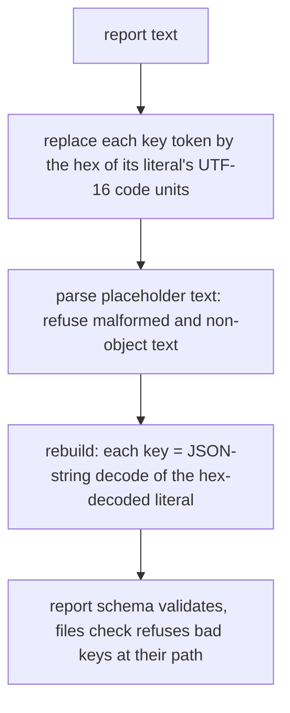

# Kill or delete every surviving mutant the exact-key report decode left on main - Plan

## Goal Capsule

- **Objective:** `stryker audit` reads every report it is given exactly. It refuses a report whose `files` key no file can have and says which key. Main's mutation evidence shows that a regression in either behaviour fails a test.
- **Means:** the decode rebuilds keys from placeholders that encode their own key, so the lookup that could miss is gone (KTD1). The unread annotation is deleted (KTD3). The laws are sharpened so that each remaining mutant has an oracle taken from the contract (KTD4, KTD5).
- **Authority:** the root's 2026-10-13 intent: a retroactive full-path review of #327, with a forward fix for each violation it finds. Then the receipt on #327 (https://github.com/systemfsoftware/stryker-js-effect/pull/327#issuecomment-6138991366, review run `20261013-044455-06cb18de`), then `CONSTITUTION.md` (CONST-T3, CONST-T10, CONST-S4), which outranks both.
- **Stop conditions:** a change outside `packages/stryker-js/src/audit.schema.ts` and its changeset. Any local mutation run. Any edit to `test/e2e-core` or a mutation workflow.
- **Execution profile:** one PR off `main`, one layer. Local verification is the file's laws, the package suite, typecheck, lint, effect-tsgo and dprint.
- **Who finishes:** `ce-work` implements and verifies the change, and `ce-code-review` reviews it. The supervisor merges. The kills are read off the first main Mutation report after the merge.

---

## Product Contract

### Summary

#327 made `CountedReportJson` and `KillMatrixReportJson` read report keys exactly on Node 24, and made them refuse empty or NUL `files` keys. CI's Mutation run on that merge commit left 6 Survived and 2 NoCoverage mutants on its production lines. This change removes the code that no input reaches, and gives each remaining behaviour a law whose expected value comes from the contract.

### Problem Frame

`kill-matrix-459` (Mutation run 38338484710, head `2512017555`) lists these mutants on `audit.schema.ts`:

- `path: [key]` → `[]` (`5d39a67db845dee7`) and the refusal text → `''` (`79ec35e11a224433`) survive. No law reads the refusal's path or text, so a regression could drop the key from `matrix-undecodable` unnoticed.
- `keyAtOffset`'s failure branch is NoCoverage (`3385759cf76b617e`, `0a120a952f4850f0`). The placeholder text and the offset map come from the same regex, so the lookup cannot miss.
- The `JSON_TEXT` annotation's three mutants survive (`f001cc0c92494358`, `2806d51b5a2dc255`, `6f0f2b9f911dad67`). Nothing reads the annotation: the codecs are not exported from `src/mod.ts` or `etc/stryker-js.api.md`.
- The escape alternative `\\[\s\S]` → `\\[\S\S]` survives (`a7c2158c7d2e67d0`). On text the first parse accepts, a backslash is never followed by whitespace, so the mutant is equivalent.
- R3 of the #327 plan (malformed and non-report text fail) has no test.

CONST-T3 requires a perfect kill score on the change-relevant set. It names two remedies for a survivor: a sharper property, or deleting the dead branch the survivor exploits.

### Requirements

**Decode**

- R1. Both codecs decode every object key exactly as `JSON.parse` reads it on an engine without nodejs/node#63785, after any earlier parse in the process. That covers the characters, the key order and the last-wins rule for duplicate keys.
- R3. Malformed text and valid JSON that is not a report fail on both codecs with the same issue `S.fromJsonString(S.JsonObject)` gives for that text, never with a thrown defect. `stryker audit` prints that issue in `matrix-undecodable`, so its wording is what a user reads.

**Refusal**

- R2. A `files` key that is empty or holds NUL fails on decode and on encode with the issue `Expected a non-empty file path without NUL` at path `["files", <key>]`. A valid key in the same record never hides the bad one, and no entry is silently dropped.

**Evidence**

- R4. In the first main Mutation report after the merge, every mutant on the codec's production lines in `audit.schema.ts` is Killed, CompileError, Ignored by an existing ignorer, or absent because its code was deleted.

### Acceptance Examples

- AE1 (R2). A `files` record holding `src/a.ts` and `""` fails, and the issue list holds exactly one entry: path `["files", ""]` with the R2 text. The same record encoded through either codec fails the same way.
- AE2 (R1). A document whose keys are `b`, `\u1234\u5678`, `2`, `1` and `10` decodes to the same key order as `JSON.parse` of the same text: `1`, `2`, `10`, `b`, `\u1234\u5678`.
- AE3 (R1). `src/😀.ts` and `src/ὠ\u0002䀇` in one `files` record decode as two distinct keys, each exactly as written.
- AE4 (R3). `{"files":{"a":1},}` and `''` fail on both codecs with `Expected a valid JSON string`, and `[]` fails with `Expected object`, the messages `S.fromJsonString(S.JsonObject)` gives for those texts (probed on effect 4.0.0).

### Scope Boundaries

- The two codecs keep their exports, their names and their generated laws. `stryker audit`'s output for a valid report does not change.
- Not built: a CLI integration scenario for the refusal. The codec law observes the same issue the CLI prints, and the plan for #327 refused that scenario for the same reason.
- Not built: widening the shared declaration ignorer to hoisted annotation objects. Deleting the only such annotation leaves nothing for it to match (KTD3).
- Not built: changing the changeset level of #327. Its refusal rejects only keys that no writer emits and no file can have (receipt, "Suppressed").

#### Deferred to Follow-Up Work

- `docs/solutions/test-failures/v8-json-parse-key-corruption-schema-laws.md:82` still says the `CountedReportJson` and `KillMatrixReportJson` laws can flake on Node 24. #327 made that untrue for those two codecs.
- `test/e2e-core/src/catalog-resolution.schema.ts` keeps #306's offset lookup with its `getOrElse` fallback. That package is out of this unit's scope.

---

## Planning Contract

### Key Technical Decisions

- KTD1. **Each placeholder encodes its own key token, and the rebuild has no lookup.** One `replace` over the text puts a placeholder in place of each key token: the token's literal, quotes and escapes included, written as its UTF-16 code units in 4-digit lowercase hex. After the second parse, each placeholder is hex-decoded back to its literal, and that literal alone is decoded as a JSON string. So `keyAtOffset`, the offset record and the separate token scan are all deleted. No branch in the rebuild carries its own failure value: a literal's decode fails only by propagating the string codec's issue. Hex of UTF-16 code units at width 4 is a left inverse over every string, including astral characters and lone surrogates. Code points at width 4 rename astral keys and can merge two of them (spec-flow probe on Node v24.21.0). The placeholder alphabet `[0-9a-f]` needs no JSON escape, so nodejs/node#63785, which needs an escaped key, cannot reach it. Every literal starts with `"` (U+0022), so every placeholder starts with `0022`. No integer index has a leading zero, so the second parse keeps the text's key order without a prefix, and no prefix literal is left whose mutant would be equivalent. (pack: mutation-discipline, unkillable-survivors-are-dead-code.md)
- KTD2. **The escape alternative becomes `\\[^]`.** Both spellings match any character after a backslash. The new spelling has no whitespace class whose negation yields an equivalent mutant. The next Mutation report decides whether every remaining regex mutant is killed (R4).
- KTD3. **`JSON_TEXT` is deleted, not ignored.** Nothing reads the annotation, so CONST-S4 removes it. The codecs start from `S.String`, and a non-string input fails with Effect's own string message, which no caller can produce.
- KTD4. **The refusal law asserts the issue through Standard Schema issues.** Each refused payload is decoded and encoded through both codecs, and the law asserts the message and path of every issue against R2's literal text and `["files", key]`. The expected values come from R2 and from the key the law drew. The bad-key oracle stays independent of `keyedByFilePath`. (pack: mutation-discipline, kill-survivors-with-contract-properties.md) (pack: boundary-testing, expected-values-never-come-from-the-subjects-output.md)
- KTD5. **Object semantics are the oracle for key order and duplicates.** `JSON.parse` builds an object by defining each member in text order, so the expected read is `Object.entries(Object.fromEntries(members))`. It needs no parse, so nodejs/node#63785 cannot reach the oracle, and the drawn keys may need escapes. (pack: schema-laws, refusals-beside-generated-laws.md)

### Assumptions

- Main's next Mutation report runs the `full` policy over `src/**/*.schema.ts`, as `kill-matrix-459` did.
- The Standard Schema issue list renders a `files` record key as one path segment, as the current `error.message` does (`["files"]["a\u0000b"]`).

### High-Level Technical Design

The decode becomes one substitution before one whole-text parse:

---

## Implementation Units

### U1. Total placeholder decode

- **Goal:** the decode keeps R1 with no branch that no input reaches.
- **Requirements:** R1, R3, R4; KTD1, KTD2, KTD3, KTD5.
- **Dependencies:** none.
- **Files:** `packages/stryker-js/src/audit.schema.ts` (production code and its in-source block).
- **Approach:**
  1. Replace `keyTokensOf`, `placeheld`, `keyAtOffset` and the offset record with one `replace` that writes each key token's literal as hex (KTD1).
  2. Rebuild objects by hex-decoding each placeholder and decoding that literal as a JSON string. Arrays recurse as today.
  3. Keep the first whole-text parse only if the AE4 law fails without it. The substitution swaps whole string tokens for valid strings, so the placeholder text may be valid JSON exactly when the original is, apart from key escapes, which the rebuild decodes. If so, the first parse is a stage no input can tell apart, and CONST-S4 deletes it.
  4. Rewrite the escape alternative (KTD2) and delete `JSON_TEXT` and its two uses (KTD3).
- **Execution note:** write the multi-key law first and run it against the current decode. It must pass there too, because the current decode keeps order and last-wins. Then rewrite the decode and run it again.
- **Patterns to follow:** the in-source `it.prop` laws already in `audit.schema.ts`; `refusalOf` in `packages/stryker-js-cli-contract/src/shard-plan.schema.ts`.
- **Test scenarios:**
  - Covers AE2, AE3. One decode law over drawn key lists plus seed lists (`b`, `\u1234\u5678`, `2`, `1`, `10`, `a`; `a.ts`, `b`, `a.ts`; `src/😀.ts`, `src/ὠ\u0002䀇`; lone and paired surrogates): each list is written as raw report text with one member per key, duplicates kept, each member's mutant id its index. Both codecs read the `files` entries, keys and ids, equal to `Object.entries(Object.fromEntries(members))`.
  - The generated `∀x_CountedReportJson_=x`, `∀x_KillMatrixReportJson_=x` and their `Enc` laws pass unchanged.
  - The twin law `∀p_ReportJsonKeys_≡ReadAnEscapedKeyExactlyAfterAParseOfItsBackslashTwin` passes unchanged.
- **Verification:** the file's laws pass over 200 unpinned runs, and no function in the decode has a branch that only a broken parser could reach.

### U2. Refusal and malformed-text laws

- **Goal:** each refusal behaviour has a law whose expected value comes from R2 or R3.
- **Requirements:** R2, R3, R4; KTD4.
- **Dependencies:** U1.
- **Files:** `packages/stryker-js/src/audit.schema.ts` (in-source block).
- **Approach:** the decode law of U1 also covers refusal: a list holding any key no file can have expects the refusal issues instead of the read. A second law runs the same lists through both encoders. A third law covers R3. The old `∀k_ReportFilePathRefusal_…` law, which read only `Option` presence, is replaced.
- **Test scenarios:**
  - For every key list, drawn or seeded (`""`, `"\u0000"`, `"a\u0000"`, `"src/a\u0000.ts"`, and repeats), decoding through both codecs fails with exactly one issue per distinct refused key, in record order: R2's text at `["files", key]`.
  - The same lists encoded through both codecs fail the same way, and a list with no refused key encodes.
  - Covers AE1. The list `src/a.ts`, `""` fails with one issue, at `["files", ""]`.
  - Covers AE4. For drawn texts and the seeds `''`, `'{'`, `'[]'`, `'null'`, `'"x"'`, `'1'`, `'{"files":{"a":1},}'`, `'{"\x":1}'`, `'[{"\x":1}]'` and a valid report followed by `x`: whenever `S.fromJsonString(S.JsonObject)` refuses the text, both codecs refuse it with the same issues, and none throws. `'[{"\x":1}]'` is the seed that tells the first whole-text parse apart (U1 step 3).
- **Verification:** the file's laws pass over 200 unpinned runs. The CI evidence that each named survivor is killed is the first main Mutation report after the merge (R4). No mutant is applied by hand locally.

### U3. Changeset

- **Goal:** the publishable package records the change.
- **Requirements:** R4.
- **Dependencies:** U1, U2.
- **Files:** `.changeset/report-json-survivors.md`.
- **Approach:** a `none` intent for `@systemfsoftware/stryker-js`, because nothing a consumer runs changes. The repository gate asks for an intent because the package's build hash moves.
- **Test expectation:** none. A changeset is release metadata.

---

## Verification Contract

| Check          | Command or source                                                            | Done signal                                        |
| -------------- | ---------------------------------------------------------------------------- | -------------------------------------------------- |
| Laws           | `vitest run src/audit.schema.ts` in `packages/stryker-js`, 200 unpinned runs | 0 failures                                         |
| Test admission | `test-layer-selection` over each proposed test (Appendix)                    | every admitted test names the contract it enforces |
| Package suite  | `vitest run` in `packages/stryker-js`                                        | exit 0                                             |
| Gates          | `typecheck`, `lint`, `lint:tsgo`, `dprint check`                             | exit 0                                             |
| Review         | `ce-code-review`, full path, served by a non-Claude model                    | every finding has a disposition                    |
| CI             | `run_watch` on the PR head                                                   | required jobs green                                |
| Mutation       | first main Mutation report after the merge, file `src/audit.schema.ts`       | R4 holds, cited by run id and mutant ids           |

A refuted local run writes its seed to `src/__property_seeds__/<file>.jsonl`. Delete any entry that a refuted run wrote before the final measurement.

---

## Appendix

### Test admission

Every test below is an in-source law in a `*.schema.ts` cell, the layer `test-layer-selection` assigns to a domain declaration. Each enforces a stated contract and is admitted by OP12. Refusal is the default for anything else.

| Test                                          | Contract it enforces            | Mutants it is expected to kill                                                                     | Verdict                                                |
| --------------------------------------------- | ------------------------------- | -------------------------------------------------------------------------------------------------- | ------------------------------------------------------ |
| Decode law: order, last-wins, refusal on read | R1, R2 (decode)                 | mutants of the hex width, padding, radix and joins in KTD1; `5d39a67db845dee7`, `79ec35e11a224433` | Admitted                                               |
| Encode law: refusal on write                  | R2 (encode)                     | the same refusal mutants, reached on the encode path                                               | Admitted                                               |
| Mixed-record refusal (AE1)                    | R2, never hidden by a valid key | none alone; a seed of the refusal law, not a separate test                                         | Folded into the refusal law                            |
| Malformed-text law (AE4)                      | R3 issue wording                | removal of the first whole-text parse; mutants that let a non-object through                       | Admitted                                               |
| CLI scenario for the refusal                  | R2 at the process boundary      | the same issue the codec law reads                                                                 | Refused: spawns a process, adds no observation         |
| Hand-applied red check                        | none                            | none                                                                                               | Refused: a hand-applied mutant is a local mutation run |

### Destructive review

- **Assumptions tested:** key order is observable, the first parse earns its cost, and a hand-applied red check is allowed.
- **Lens:** Brevity.
- **Outcomes:**
  - Order stays in R1: R1 promises `JSON.parse` parity, and key order is part of what `JSON.parse` returns.
  - The first parse was assumed to set the issue's wording. The probe shows the issue carries no position, so U1 step 3 keeps that parse only if a law can tell it apart.
  - The red check is removed: the root forbids local mutation, and a hand-applied mutant is one.
- **Radical alternatives:**
  - A hand-written tokenizer: rejected, because it replaces one regex with a parser that has its own mutant surface.
  - A `JSON.parse` reviver: rejected, because a reviver receives the keys V8 has already misread.

---

## Definition of Done

- U1-U3 are complete and every check above except Mutation passes on the PR head.
- The PR body cites the #327 receipt and lists each mutant id in the Problem Frame with its intended outcome: killed, or deleted with its code.
- After the merge, the Mutation row is cited on #327 by run id.
- The diff holds no scratch files, no seed entries from deliberate red checks, and no abandoned code paths.

---

## Sources

- Receipt on #327: https://github.com/systemfsoftware/stryker-js-effect/pull/327#issuecomment-6138991366
- Mutation run 38338484710, artifact `kill-matrix-459`, file `src/audit.schema.ts`.
- `docs/plans/2026-10-13-0208-fix-report-json-exact-keys-plan.md` (the #327 plan, R1-R3).
- `docs/solutions/test-failures/stream-schema-must-not-carry-json-rest-records.md` (the exact-key decode #306 introduced).
- nodejs/node#63785 and nodejs/node#66542.
