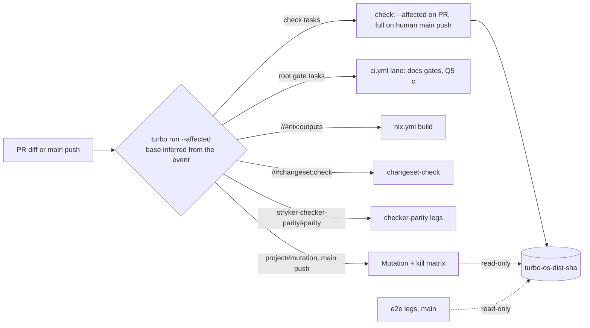

# Turbo-Native Caching And Change Selection - Plan

## Goal Capsule

- **Objective:** Every pull request runs each task its diff can affect, every human-authored push to main runs every `check` task, the results come from a cache and a selection that Turborepo computes, and every cache or change classifier Turbo does not own has a written reason a reviewer can check.
- **Means:** Declare every file a task reads in that task's `inputs` and turn on Turbo's task-input selection and its GitHub Actions base fallback, pinned by one executable test (KTD1, KTD8); scope PR runs with `--affected` against the base Turbo infers from the GitHub event, while main stays full (KTD2); answer each CI lane's "does this change matter" question with Turbo's own `run --affected` selection instead of a hand-written classifier (KTD3); stop naming cache entries by hand-made content hashes (KTD4, KTD6); record the survivors and their reasons (KTD7).
- **Product authority:** the root's intent of 2026-10-12 relaying Ryan's house rule "never roll your own caching when turbo exists", and the root's go of 2026-10-12 16:03 EDT that settled D1–D3 and Q1–Q5 below. It owns this Stream K audit for the whole repository's CI and dev loops. It must not lose the wall-clock wins already landed, main-only e2e and Bench, or the guarantee that a PR runs every task its diff can affect. Stryker's own mutation verdict reuse is product behaviour and out of scope; only its CI wiring is in scope. The CI wall-clock contract's limits still hold: no bigger or self-hosted runners, no cloud credentials, no new third-party actions or executables, no skipped tests, no optional checks. This plan owns the Turbo-law units of `docs/plans/2026-10-11-0608-perf-check-critical-path-plan.md` (branch `ci/check-critical-path`, not on main): that plan's U7, U8 and U9 are U2, U3 and U4 here, its KTD12–KTD15 are KTD1–KTD7, and its Q7 is Q5.
- **Supersession (2026-10-13):** this plan replaces `docs/plans/2026-10-12-1932-refactor-turbo-native-caching-plan.md`, whose U1 and U8 had started. It corrects three things. (1) The house intent of 2026-10-13 bars new material in `test/e2e-core`, and Stream D owns its dissolution, so `stryker-e2e-core#test`'s reads move from a new package `turbo.json` to a root package-task entry (KTD1, U1). (2) On the first three main runs after #318, U8's legs restored the parent's entry and still hit nothing, because Turbo hashes the lane's `--` arguments into every task of the run. The legs now build their closure without arguments (KTD4, U8). (3) U11 and Q3's enrollment are replaced by `docs/plans/2026-10-13-0108-refactor-turbo-boundaries-clean-tree-plan.md` under CONST-E7, which leaves the gate to its owner. Every other decision and unit stands as written.
- **Supersession (2026-10-13 05:49):** this plan replaces `docs/plans/2026-10-13-0326-refactor-turbo-native-caching-plan.md`, the contract U1's PR (#319) was reviewed against at `ed156206`. A full-path review of that head found three wrong assumptions. (1) KTD1's list of cross-package reads was incomplete: `stryker-e2e-core#test` and `stryker-js-cli-contract#test` both read `pnpm-workspace.yaml`, which Turbo 2.10.12 keeps out of every hash, so both now declare it (KTD1, U1). (2) The unit may not edit the CI step that runs its own pin: under CONST-E7 the `-P` that `Repo scripts tests` needs is a proposal to the workflow owner (root ruling of 2026-10-13; KTD8, U1). (3) U4's `test:scripts` command dropped `-P`, which the pin needs (U4). No test is added; the reviewers' suggested guard that compares the shipped `turbo.json` entry with `test` would assert the repo's own configuration and is refused.
- **Open blockers:** U1's `check` stays red on the pin's `NotCapable` until the workflow owner applies the proposed `-P` to `Repo scripts tests` (KTD8). U10 waits for #286 (Stream H) to merge. Q1's remote cache is an infrastructure ask routed by the root to RunnerCache (chat-269); nothing here waits on it.
- **Execution profile:** independent PRs off `main` in dependency waves (KTD9), not a native `gh stack`: the root's D3 ruling of 2026-10-12 records that deep native stacks stall merges in this organisation (`gh pr merge` and base changes rejected, update-branch stalls). A unit whose predecessor shares a file or a mechanism is cut from `main` after that predecessor merges. Each PR replaces one confirmed finding, carries its `turbo query` / `--dry=json` evidence and the reviewer personas and models that ran in its body, passes `check` on its own and leaves `main` releasable. Plain merges, no rebase or force-push. No local e2e or mutation runs; host memory is tight, so local verification is `turbo query`, `--dry=json`, format, lint and the touched packages' own tests. Every wall-time claim comes from the jobs API.
- **Stop conditions:** stop and report when a unit's differential over recent main commits shows Turbo skipping a commit that the mechanism it replaces ran for a real reason; when a declared input set cannot be completed without making a 10-minute-plus task re-run on most commits; when a touched job's wall breaks R6; when the docs-only verdict measures over 3 minutes (Q5 falls back to (a)); or when a unit needs a credential, a new third-party action or a new gate the root has not approved.
- **Who finishes:** CE `ce-work` implements each unit through a delegated coder and a review pass; the conductor opens each PR ready for review and reports its branch, head SHA and CI when green; the root or operator merges.

---

## Product Contract

### Summary

Turbo already runs the task graph, but the work around it is hand-made: content-hash keys for its cache, a docs-only classifier, a checker-parity change trigger, a path filter on Mutation, and a base commit resolved by hand for scoping. Meanwhile Turbo's own hashes miss files that three tests read from other packages, so a PR or a main push can replay a stale pass. This plan first makes Turbo's hashes complete and pins the Turbo behaviour it relies on, then moves every change-based selection onto Turbo's affected selection with Turbo's own base inference, then removes the hand-made cache keys. What Turbo cannot do under the contract stays, each with its reason.

### Problem Frame

The audit ran the `turbo-query-optimization` skill on main at `c8bdd7f3` (Turbo 2.10.12): schema and surface (W1–W2), `packages` (25), `packageGraph` (24 nodes, 104 edges), `boundaries` (20 diagnostics), `affectedTasks` over the last 60 first-parent main commits, `--dry=json` hashes, and scratch-commit probes in throwaway worktrees outside the repository. A read-only inventory listed every cache, hash, path filter and classifier in `.github/`, `scripts/`, root scripts, hooks, `turbo.json`, the e2e harness, the bench and the Nix flake. The root's review of 2026-10-12 16:03 checked the plan against Turbo's configuration reference; the D1 and D2 probes below re-measured the disputed behaviour on `33c6175f`.

**Turbo hashes miss files that tests read across package boundaries.** Each probe appended one line to a tracked file in a scratch commit and compared `turbo run test --dry=json` hashes before and after.

| Reader (task)                                                                                             | Reads                                                                    | Hash of the reader after the edit | Selected today (flag off)                                                                         |
| --------------------------------------------------------------------------------------------------------- | ------------------------------------------------------------------------ | --------------------------------- | ------------------------------------------------------------------------------------------------- |
| `stryker-e2e-core#test` via `test/e2e-core/tests/__fixtures__/effect-concurrency/fixture-project.js:1-12` | `packages/stryker-js-instrumenter/testResources/effect-concurrency/*.ts` | unchanged (`bbf97c3e29`)          | only through a package-level match                                                                |
| `stryker-e2e-core#test` via `test/e2e-core/tests/status-closure.integration.test.ts:28,52`                | `test/e2e/tests/*.e2e.test.ts` journeys                                  | unchanged (`bbf97c3e29`)          | no (`stryker-e2e#test` only)                                                                      |
| `stryker-js#test` via `packages/stryker-js/tests/lockfile-closure-digest.integration.test.ts:27,111`      | the live `pnpm-lock.yaml`                                                | unchanged on a byte edit          | no on `ddeb67ab`, 1 of the last 11 lockfile commits: Turbo's package-level lockfile diff skips it |

An unchanged hash means Turbo replays the cached result, on PRs and on main alike, so today's guarantee that a PR runs every task its diff can affect already fails for these three readers. With the three reads declared as `test` inputs and `futureFlags.affectedUsingTaskInputs` on, the same probes change the reader's hash and select it (journey edit `d1f4554624 -> 04dd3e0da8`, selected; resource edit `-> 5220a58ed8`, selected; `ddeb67ab`, selected).

**Turbo's selection semantics, measured (D1).** Turbo's configuration reference says that under `affectedUsingTaskInputs`, a change to the root `package.json`, `turbo.json`, the lockfile or `globalDependencies` selects every task. On 2.10.12, scratch commits on main gave (tasks `test build lint typecheck`, 120 in the graph):

| Change                                  | `run --affected`, flag off | `run --affected`, flag on | `query affectedTasks`, flag on |
| --------------------------------------- | -------------------------- | ------------------------- | ------------------------------ |
| `ddeb67ab` (lockfile and fixture locks) | 40, `stryker-js#test` no   | 120 (all)                 | 38                             |
| lockfile comment line only              | 0                          | 120 (all)                 | 0                              |
| root `package.json` script edit         | 0                          | 0                         | 0                              |
| `turbo.json` edit                       | 120                        | 120                       | 118                            |
| `packages/stryker-js/README.md` edit    | 44                         | 0                         | 0                              |
| file named by a `$TURBO_ROOT$` input    | –                          | 28, reader selected       | 26, reader selected            |

The lockfile-selects-all rule holds for `turbo run --affected` and not for `turbo query affectedTasks`, which keeps the package-level lockfile diff; a root `package.json` edit that changes no dependency selects no package task on either path, against the docs. The lockfile's bytes are not in any task hash (`stryker-js#test` keeps its hash on a byte edit), so the `$TURBO_ROOT$/pnpm-lock.yaml` input stays where a test reads the file. Every lane decision therefore uses `turbo run --affected`, never the query (KTD3), and the pin suite asserts each row (KTD8).

**Turbo infers the base on GitHub Actions (D2).** `turborepo-scm/src/git.rs:433-527` reads `GITHUB_BASE_REF` on `pull_request` and the event payload's `before` on `push` (the first commit's parent when `before` is all zeros or the push was forced), and `run --affected` diffs from the merge-base (`turborepo-lib/src/run/task_filter.rs:46`). `actions/checkout` leaves no local `main` on a PR, so inference needs `futureFlags.githubActionsRemoteBaseRefFallback` to fall back to `origin/main`. In a clone with only `origin/main`, a simulated PR merge commit with main moved one commit past its first parent selected 38 tasks by inference and 38 with the first parent set by hand; a README-only PR selected 0 and 0; without the fallback flag, inference failed to resolve `main` and selected all 72; a push payload with `before` selected the same 38; an all-zero `before` and a `workflow_dispatch` payload ran every task with the warning "--affected could not determine changed files". No workflow uses `merge_group`. So the `check` job's hand-resolved base is needed only to name its GitHub cache entry, never for selection.

**PRs run the whole graph.** `gate:tasks` and `gate:dist` accept `TURBO_BASE` (`package.json:29,31`), which no workflow sets, so every PR runs all 144 lint, tsgo, typecheck and test tasks and only the cache saves work. Of the last 60 main commits, 34 affect `stryker-js#test` and 18 affect no lint, typecheck or test task. In 4 of 38 PR `check` runs measured on 2026-10-12, `stryker-js#test` ran its 13 minutes although the PR did not affect it (base cache entry absent or stale).

**`stryker-js#build` invalidates on test edits and runs `tsc -b`.** Its script is `pnpm run typecheck && tsdown`, and the root `build` and `api:check` inputs take `src/**`, tests included. Cold, it ends 2.13 minutes (p50, 39 runs) after its last dependency, of which `tsdown` is 21.7 s. With test exclusions committed on a scratch base, a test-only edit (`cc7fcefe`) changes 3 task hashes instead of 15.

**Change selection is hand-written in four places, and Turbo answers the same questions.**

| Mechanism                                                                                                                                                     | Evidence against Turbo                                                                                                                                                                                                                                                                                                                                                                                                                                                                 |
| ------------------------------------------------------------------------------------------------------------------------------------------------------------- | -------------------------------------------------------------------------------------------------------------------------------------------------------------------------------------------------------------------------------------------------------------------------------------------------------------------------------------------------------------------------------------------------------------------------------------------------------------------------------------- |
| `change-lane` (`.github/actions/change-lane/action.yml:1-38`, `scripts/change-lane.ts`), used by `ci.yml:26-55`, `nix.yml:16-30`, `changeset-check.yml:12-27` | Under the flag, root tasks follow their inputs: a `docs/plans` Markdown edit selects `//#format:check` and `//#gate:repo` only, a workflow `.yml` edit selects `//#format:check` only, and a docs-only commit selects no package task.                                                                                                                                                                                                                                                 |
| `checker-parity-changes` trigger (`ci.yml:305-352`, `test/checker-parity/src/lane-trigger.ts`, `trigger-parity-lane.workflow.ts:13-22`)                       | A `parity` task with the trigger's shared files as `$TURBO_ROOT$` inputs and an explicit `stryker-js-typescript-checker#build` dependency (the package graph has no edge from `stryker-checker-parity` to the checker) agrees on 58 of the last 60 main commits. The 2 differences (`ddb62550`, `7d15adcf`) are trigger over-runs: they touch `cli-contract` tests and `stryker-config/lib`, neither in the checker bundle. Turbo skipped no commit the trigger ran for a real reason. |
| Mutation's push `paths-ignore` (`mutation.yml:6-9`)                                                                                                           | The four mutated projects' `mutation` task, with `flake.lock`, `flake.nix`, `mutation.yml`, `kill-matrix.yml` and `.stryker/**` as inputs, runs on 52 of the 57 commits the filter runs; the 5 it skips touch only CI wiring, `cli-contract` tests, the e2e bake script or `commitlint.config.ts`. Without `flake.nix` as an input it would also skip `cddbd52c` and `36afef4d`, which change the published CLI's derivation.                                                          |
| Bench's PR `paths-ignore` (`bench.yml:4-7`)                                                                                                                   | Not measured: #316 (open) takes Bench off the pull-request path.                                                                                                                                                                                                                                                                                                                                                                                                                       |

**Cache entries carry hand-made names.** No remote cache exists: no `TURBO_TOKEN`, `TURBO_TEAM`, `TURBO_API`, `remoteCache`, `cacheMaxAge` or `cacheMaxSize` anywhere. `.turbo/cache` moves through `actions/cache` as `turbo-<os>-dist-<sha>` (`ci.yml:94-120,215-226`), `turbo-<os>-bench-<slug>-<sha>` (`bench.yml:108-114`), and `mutation-build-<os>-<hashFiles(pnpm-lock.yaml, turbo.json, packages/**, test/e2e-core/**)>` in `mutation.yml:118` and `kill-matrix.yml:82`, a hand-written content hash naming an entry whose contents Turbo already hashes per task. Mutation's incremental report is named by another content hash (`mutation.yml:64`). The e2e legs restore no Turbo cache and rebuild their closure (27–49 s of build and startup per leg on 2026-10-10 runs).

**`turbo` answers without a workspace install.** In a bare checkout, `pnpm install --frozen-lockfile --filter . --ignore-scripts` installs the root's 96 packages in 3.6 s on a warm store without `.sfs-deps`, and `pnpm exec turbo` (2.10.12) answers `run --dry=json` and `query`.

**Bot pushes run no CI.** `ci.yml:27,59`, `e2e.yml:18` and Mutation's jobs skip pushes authored by `github-actions[bot]`, the release version commits (27 of the last 200 first-parent main commits). Every PR merge is authored by its merger, so a PR-skipped task still runs on that merge's push.

**Walls today (jobs API, 2026-10-12).** PR `check` job p50 16.67, p95 21.05 minutes (n = 36); `ci.yml` `lane` 0.13; checker-parity leg 1.85 and report 1.23; `nix.yml` lane 0.12 and flake outputs 5.93; `changeset-check.yml` lane 0.14 and check 8.89; Mutation plan 1.89, build 0.66, shard 2.60, kill-matrix shard 8.36, report 0.93 (last 10 successful runs each); e2e legs 7.4–13.2 on main. None of the last 53 PR runs took the docs-only path, so the docs-only verdict has no recent measurement; parent plan R2 bounds it at 3 minutes.

### Requirements

**Selection**

- R1. A task runs on a PR whenever a file it reads changed on that PR: Turbo's `--affected` selects it, and its hash changes so the cache cannot replay an old result. Every file a cached task reads from outside its own package is in that task's `inputs`.
- R2. On every human-authored push to main and every `workflow_dispatch`, `check` runs every task with no `--affected` and no filter; that is the backstop for anything a PR skipped. e2e and Mutation stay main-only and Bench becomes main-only through #316. Mutation is the one lane Turbo gates on a main push: a skipped push's changes are mutated on the next Mutation run, because Stryker's incremental report still records the old verdicts, and the nightly schedule and the `full` dispatch run regardless. Bot release pushes run no CI, as today.
- R3. Every change-based decision about whether a CI lane runs, and the base it compares against, comes from Turbo, except the mechanisms KTD7 lists with their reasons.

**Cache**

- R4. In the workflows this plan touches, no `actions/cache` key is a hand-written content hash: entries are named by commit, ref or run.
- R5. A cached task's inputs name only what it reads; a test-only edit leaves every `build` and `api:check` hash unchanged.

**Kept wins and limits**

- R6. No job a unit touches gets slower: its p50 wall over the first 10 runs after the unit merges stays within 10% of the Problem Frame's p50, and a docs-only PR's verdict arrives within 3 minutes.
- R7. No long-lived credential, no new third-party action or executable, and no new gate lands without the root's explicit approval. The root approved one gate (Q3) and one future credential shape (Q1).

**Agent surface**

- R8. Every job that asks Turbo writes its decision to the step summary with a reason code: `LANE_TURBO_SELECTED` with the selected tasks, `LANE_TURBO_NONE`, or `LANE_FULL` when the event bypasses Turbo (human-authored push to main for `check`, `workflow_dispatch`, `schedule`) or Turbo reports it could not determine the changed files. A failure writes an annotation with the next action.

**Inventory**

- R9. KTD7 is the complete list of bespoke caches, base resolvers and change classifiers that survive, each with the reason Turbo cannot do its job under this plan's limits.

### Key Decisions

- **Turbo decides selection by task inputs, not by package.** (session-settled: user-directed — the house law of 2026-10-12 names `--affected` and `turbo.json` inputs, over a hand-written classifier or a package-level filter.) `futureFlags.affectedUsingTaskInputs` is the only Turbo mechanism under which a cross-package read selects exactly the tasks that read it. Governs R1, R3.
- **Turbo resolves the base.** (session-settled: root D2 of 2026-10-12, over the hand-resolved first parent.) `GITHUB_BASE_REF` with the remote fallback, and the push payload's `before`, select exactly what the first parent selects (D2 probe); a hand-written base survives only where Turbo is not the consumer. Governs R3.
- **Main's `check` runs everything.** A PR's skipped task runs on the merge's push, so a selection error costs one red main run, never a lost check. Governs R2.
- **A lane that Turbo does not execute still asks Turbo, through `run`.** The Nix, changeset, parity and mutation lanes run outside Turbo, but each gets a Turbo task whose `inputs` state what the lane reads, and the lane job asks `turbo run <task> --affected --dry=json` whether it is selected. The query path diverges from `run` on lockfile edits (D1), so it is not used. Governs R3, R8.
- **The Turbo behaviour this plan relies on is pinned by a test.** Task-input selection, the lockfile and root-file rules, `$TURBO_ROOT$` inputs, the GitHub inference and its fail-open cases, and the empty run summary are non-obvious third-party semantics, so one executable pin re-fires on every `check` and on every Turbo upgrade (pack: boundary-testing, `pin-dependency-semantics.md`). Governs R1, R3.
- **No static remote-cache token.** (session-settled: root Q1 of 2026-10-12.) A remote cache arrives later as self-hosted infrastructure behind short-lived OIDC credentials, owned by RunnerCache; until then `actions/cache` carriage keeps its reasons. Governs R7.

### Acceptance Examples

- AE1. Covers R1. **Given** a PR that edits only a `test/e2e/tests/*.e2e.test.ts` journey, **when** CI runs, **then** `stryker-e2e-core#test` is selected and misses the cache.
- AE2. Covers R3, R6. **Given** a PR that edits only `docs/**/*.md`, **when** CI runs, **then** only the Turbo root tasks whose inputs match run, the Nix and changeset lanes report `LANE_TURBO_NONE`, and the PR's verdict arrives within 3 minutes.
- AE3. Covers R2. **Given** a human-authored main push of a commit that only edits `.github/workflows/ci.yml`, **when** CI runs, **then** `check` runs every task and reports `LANE_FULL`.
- AE4. Covers R2, R3. **Given** a main push that changes only `packages/stryker-js-cli-contract/tests/**`, **when** Mutation's gate runs, **then** it reports `LANE_TURBO_NONE` and no mutation shard starts; **given** the nightly schedule, **then** it reports `LANE_FULL`.
- AE5. Covers R4. **Given** a main push, **when** the Mutation build job restores `.turbo/cache`, **then** its key names a commit and contains no `hashFiles`, and the job saves nothing.
- AE6. Covers R1, R3. **Given** a PR that edits `pnpm-lock.yaml`, **when** CI runs, **then** `check` selects every task (Turbo's lockfile rule) and `stryker-js#test` misses the cache.

### Scope Boundaries

- Stryker's incremental verdict reuse, its run-inputs digest, and the checker-parity verdict semantics are product behaviour; only the CI wiring around them is in scope. Stream H owns the checker-bundle differential and the parity verdict caches (KTD7 item 7).
- Bench's trigger belongs to #316; this plan does not edit `bench.yml`.
- `.github/workflows/release.yml`, the reusable workflows it calls from `systemfsoftware/pnpm-release-management`, and the bot-push skip are out of scope.
- The remote-cache infrastructure (bucket, server, OIDC exchange) belongs to RunnerCache (chat-269); this plan records the ask and wires nothing until the root routes it.
- One test is added: the Turbo semantics pin (KTD8). Every other unit proves itself with Turbo dry runs, a throwaway differential over recent main commits whose result goes in the PR body, and real CI runs. Units that remove a classifier delete its tests with it (DEL1).
- No bigger runners, self-hosted runners, skipped or quarantined tests, `continue-on-error`, optional checks, cloud credentials, or new third-party actions or executables. Timeouts stay at 60 minutes, the root's standing rule.

### Root Decisions (2026-10-12 16:03 EDT)

- Q1. **Remote cache.** No long-lived static Vercel `TURBO_TOKEN` and no new third-party action. A later self-hosted, IaC-managed remote cache reached through `remoteCache.apiUrl` with short-lived GitHub OIDC credentials and no static token is allowed; fork PRs stay on `actions/cache`, read-only. Bucket and runner infrastructure belong to RunnerCache (chat-269). Until it exists, KTD7 items 1–4 keep their reasons. **The infrastructure ask, derived from Turbo 2.10.12's client:**
  1. An HTTP service implementing Turbo's remote-cache API under one base URL: `GET`/`HEAD`/`PUT /v8/artifacts/{hash}` (with the `x-artifact-duration` and `x-artifact-tag` headers), `POST /v8/artifacts/events`, `GET /v8/artifacts/status`, team scoping by the `slug` or `teamId` query parameter, and either no preflight or a preflight that allows the `Authorization` header (`crates/turborepo-api-client/src/lib.rs:304-452,923-965`).
  2. Turbo sends one bearer token (`TURBO_TOKEN`) for the whole run, and a GitHub OIDC ID token lives about 5 minutes [INFERENCE: GitHub's OIDC reference does not state the lifetime; issue reports cite 5 minutes], shorter than a 20-minute `check`. So the service also needs an exchange endpoint: it verifies the job's OIDC token (issuer `https://token.actions.githubusercontent.com`, audience fixed by the service, `repository` = `systemfsoftware/stryker-js-effect`) and returns a cache token valid for at most 60 minutes, the job timeout.
  3. Token scope from the OIDC claims: write only when `ref` is `refs/heads/main` and `event_name` is `push` or `workflow_dispatch`; read for same-repository `pull_request`. Fork PRs receive no OIDC token and keep `actions/cache` read-only.
  4. No artifact signature key: Turbo's signing needs a static `TURBO_REMOTE_CACHE_SIGNATURE_KEY`, which the no-static-credential rule excludes; integrity comes from the main-only write scope.
  5. Retention and size limits set in the IaC, with the size of today's `turbo-` entries (about 290 MB per entry, 9.9 GB across the family on 2026-10-10) as the sizing input.
  6. The repository side, once routed: `id-token: write` on the jobs that use the cache, one in-repo step that requests the OIDC token (`ACTIONS_ID_TOKEN_REQUEST_URL`) and exchanges it with `curl`, masks the result and writes `TURBO_TOKEN`, `TURBO_API` and `TURBO_TEAM` to `$GITHUB_ENV`, and `--cache=local:rw,remote:r` on pull requests. That later unit then removes KTD7 items 1–4.
- Q2. **e2e fixture bake cache.** Interim now: "unmeasured" is not "cannot". After U7 lands, U12 measures the bake entry size, main e2e's hit rate on a Turbo-keyed bake, and the concurrent local-run lease behaviour. Adopt a Turbo `stryker-e2e#bake` task if the evidence supports it; otherwise write the rule-4 reason with those numbers into KTD7 item 9.
- Q3. **`turbo boundaries` as a gate.** Corrected by the root on 2026-10-13 under CONST-E7: the diagnostics are graded work, and the gate is authored by a different owner after U1 merges. `docs/plans/2026-10-13-0108-refactor-turbo-boundaries-clean-tree-plan.md` (#326) carries the diagnostics and the enrollment request.
- Q4. **Checker-parity trigger.** Stream K owns U10 after Stream H's #286 merges; both touch `ci.yml`. H keeps the checker-bundle differential and the parity verdict caches.
- Q5. **`ci.yml`'s docs-only route.** Option (c): the `lane` job asks Turbo, runs the selected root tasks itself and skips `check` when Turbo selects no package task. Option (a), keeping `change-lane` for `ci.yml`, only if the docs-only verdict measures over 3 minutes.

**Deferred to implementation**

- Q6. The exact input globs for the root gate tasks (`//#format:check`, `//#lint:conventions`, `//#gate:repo`, `//#test:scripts`) come from each tool's own file discovery, checked by a dry run per tool.

### Sources / Research

- Turbo 2.10.12 at main `c8bdd7f3` and `33c6175f`: `query --schema` (surface unchanged since `38924e53`), `packages`, `packageGraph`, `boundaries`, `affectedTasks` over the last 60 first-parent main commits; `run --dry=json` hashes and `run --affected --dry=json` selections in throwaway worktrees and a throwaway clone under `/tmp`, each with probe commits never pushed; a root-only frozen install in 3.6 s.
- Turbo source at tag `v2.10.12` (local clone): `crates/turborepo-scm/src/git.rs:433-527` (GitHub base inference and the remote fallback), `crates/turborepo-lib/src/run/task_filter.rs:32-60` (`--affected` uses the merge-base), `crates/turborepo-lib/src/commands/query.rs:113-270` (`turbo query affected` reads `TURBO_SCM_BASE`; `--exit-code`), `crates/turborepo-query/src/affected_tasks.rs:75-179` (the query's lockfile handling), `crates/turborepo-api-client/src/lib.rs` (remote-cache endpoints and bearer auth).
- Docs: [Configuring turbo.json](https://turborepo.dev/docs/reference/configuration) (`affectedUsingTaskInputs`, `githubActionsRemoteBaseRefFallback`, `filterUsingTasks`, cache eviction), [run](https://turborepo.dev/docs/reference/run) (`--affected`, `TURBO_SCM_BASE`), [Package Configurations](https://turborepo.dev/docs/reference/package-configurations). Issues: [#14340](https://github.com/vercel/turborepo/issues/14340) (over-selection when inputs mix `**/` and `$TURBO_ROOT$`), [#12947](https://github.com/vercel/turborepo/issues/12947) (root-task affected bug; the 2.10.12 probes select root tasks correctly).
- Jobs API, 2026-10-12: last 10 successful runs of `mutation.yml`, `nix.yml`, `changeset-check.yml`, `e2e.yml`; the last 60 PR runs of `ci.yml`; 38 PR `check` runs mapped to merge bases.
- Inventory: every `actions/cache` step, `hashFiles`, `paths*` filter, classifier and hook named in KTD7 and the Problem Frame, read at the cited lines.
- Open PRs by the same account that touch this plan's files (2026-10-12): #289 and #271 (`turbo.json` env, `packages/stryker-js/package.json` exports, `mutation.yml`, `kill-matrix.yml`, `e2e.yml` matrix), #288 and #286 (`ci.yml`).
- Pack: `boundary-testing/pin-dependency-semantics.md` (executable assumption pins, upgrade tripwire).

---

## Planning Contract

**Product Contract preservation:** revised in place after its first report-only review and again after the root's review of 2026-10-12 16:03 (D1–D3, Q1–Q5); it absorbs the check-critical-path plan's Turbo units as the Goal Capsule states.

### Key Technical Decisions

- KTD1. **`futureFlags.affectedUsingTaskInputs: true`, and every cross-package read is a `$TURBO_ROOT$` input of the reading task.** `packages/stryker-js/turbo.json` extends the root (`extends: ["//"]`, `inputs: ["$TURBO_EXTENDS$", ...]`) and adds `$TURBO_ROOT$/pnpm-lock.yaml` to `test`, which puts the lockfile's bytes into `stryker-js#test`'s hash. `packages/stryker-js-cli-contract/turbo.json` does the same with `$TURBO_ROOT$/pnpm-workspace.yaml`, which `tests/contract-version-law.integration.test.ts:269` reads; that task stays `cache: false` (KTD7 item 10), so the input decides only its selection. `stryker-e2e-core#test` reads `$TURBO_ROOT$/test/e2e/tests/**/*.e2e.test.ts`, `$TURBO_ROOT$/test/e2e/testResources/**`, `$TURBO_ROOT$/packages/stryker-js-instrumenter/testResources/effect-concurrency/**` and `$TURBO_ROOT$/pnpm-workspace.yaml` (`tests/fixture-manifests.integration.test.ts:17`). Those reads go into a root `@systemfsoftware/stryker-e2e-core#test` entry, not a package file, because `test/e2e-core` takes no new material (house intent of 2026-10-13). A root package-task entry is a complete definition and does not extend the generic `test` task. With `$TURBO_EXTENDS$`, it silently drops `dependsOn` and `env` and keeps 141 of 230 inputs (measured). So the entry copies `test`'s definition and appends the four reads. Measured against the package file: the resolved definition is equal, the input set is the same minus that file, and an edit to each read changes the hash. The entry is removed when Stream D moves the suite, and its reads go with the package that then owns them. Selection on a lockfile edit needs no input: under the flag, `run --affected` selects every task on any lockfile change (D1), so PRs that touch `pnpm-lock.yaml` (11 of the last 60 main commits) run the full graph, as every PR does today. A `pnpm-workspace.yaml` edit that leaves the lockfile unchanged does need the input: Turbo 2.10.12 puts neither file in the global hash, so without it the two readers' hashes stay put. Issue #14340 can over-select a reader whose inputs mix `**/` and `$TURBO_ROOT$`; that costs time, never coverage, and R6 measures it. Governs R1.
- KTD2. **PR scope is `${GITHUB_BASE_REF:+--affected}`, against the base Turbo infers; main sets nothing.** `gate:tasks` and `gate:dist` replace their `TURBO_BASE` expansion. `GITHUB_BASE_REF` is set only on `pull_request` events, so a human main push, a dispatch and a local run stay full with nothing set by hand. `futureFlags.githubActionsRemoteBaseRefFallback: true` lets Turbo resolve `origin/main`, which the `check` job's unshallowed treeless fetch (`ci.yml:81-84`) provides; Turbo diffs from the merge-base, which equals the merge commit's first parent (D2). No `TURBO_SCM_BASE` is exported. The `base` step (`ci.yml:85-93`) stays only to name the GitHub cache entry the job restores first (KTD7 item 2). A run that selects nothing exits 0 and writes a run summary with an empty `tasks` array, which `scripts/turbo-summary.ts` reads as zero missed and zero failed. `filterUsingTasks` is not enabled: after U3 no git-range `--filter` remains, and it would change the meaning of the one package filter left (`ci.yml:345`) for no consumer. Governs R1, R2, R3.
- KTD3. **One composite action, `.github/actions/turbo-affected`, asks Turbo for every lane outside Turbo.** Inputs: a task list. The caller checks out with `fetch-depth: 0` and `filter: tree:0`, so the merge-base and a push's `before` exist. The action installs only the root workspace (`pnpm install --frozen-lockfile --filter . --ignore-scripts`, the lockfile's `turbo`), runs `pnpm exec turbo run <tasks> --affected --dry=json` and reads the selected task ids from `.tasks[].taskId`, keeping only the requested lane tasks (the dry run also lists their dependencies). Turbo infers the base from the event (KTD2). It emits `run` and the selected ids and writes R8's line. On `workflow_dispatch` and `schedule` it skips Turbo and emits `run=true` with `LANE_FULL`: those events have no base by definition, and Turbo itself would run everything there (D2); the explicit event check exists to name the reason code. When Turbo prints that it could not determine the changed files (wording pinned by KTD8), the action reports `LANE_FULL` with that warning. Any failure inside the action (install, Turbo exit, unparsable JSON) emits `run=true` with `LANE_FULL` and an annotation naming the failed step: a broken gate runs the lane, never skips it. Each lane's task lives in `turbo.json` with its real `inputs`; its script is the lane's local reproduction command where one exists. Governs R3, R8.
- KTD4. **Mutation, the kill matrix and the e2e legs read `check`'s Turbo entries and save none.** Their build steps restore `turbo-<os>-dist-<parent sha>` first and the newest `turbo-<os>-dist-` second with `actions/cache/restore`, the restore pair `check` already uses (`ci.yml:94-112`), so Turbo's per-task hashes decide every hit. A reading job builds with no `--` arguments. Turbo 2.10.12 hashes those arguments into every task of the run, dependency builds included, although it passes them only to the named task: `turbo run test:e2e --dry=json -- tests/x` turns `stryker-ignorer-interface#build` from `check`'s `b564520d` into `395ade03`. An e2e leg therefore runs `turbo run build --filter=@systemfsoftware/stryker-e2e^...`, whose 17 hashes equal `check`'s, and then `pnpm test:e2e --only -- <files>`, which runs `stryker-e2e#test:e2e` alone with the leg's arguments. The `mutation-build-` family and its `hashFiles` key go, `cache-sweep`'s per-ref retention is unchanged because no new `turbo-` entry appears, and main's `check` stays the only writer. Governs R4, R6.
- KTD5. **`stryker-js#build` is `tsdown`; `build` and `api:check` inputs exclude `src/**/__tests__/**`, `src/**/*.test.ts` and `src/**/*.spec.ts`.** `tsc -b` stays the `typecheck` script, which the gritlint pack `typecheck-build-mode` requires. Governs R5, R6.
- KTD6. **Mutation's push trigger is the Turbo gate, not `paths-ignore`; its incremental report is named by commit.** The four mutated projects' `mutation` task (already `cache: false`, `dependsOn: ["^build"]`) declares `$TURBO_ROOT$/flake.lock`, `$TURBO_ROOT$/flake.nix`, `$TURBO_ROOT$/.github/workflows/mutation.yml`, `$TURBO_ROOT$/.github/workflows/kill-matrix.yml` and `$TURBO_ROOT$/.stryker/**` beside `$TURBO_DEFAULT$`. The incremental-report key becomes `mutation-incremental-<sha>` with the existing prefix fallback; Stryker's run-inputs digest, not the key, decides reuse. Governs R2, R3, R4.
- KTD7. **Survivors and their reasons.** (1) `actions/cache` carriage of `.turbo/cache`: Turbo persists across runners only through a remote cache, which arrives through RunnerCache under Q1. (2) Base-commit-first restore and the `base` step that names it (`ci.yml:85-120`): GitHub cache scoping decides which entry a ref reads first, and Turbo never names GitHub cache entries; selection no longer reads this step. (3) Prune before save (`ci.yml:215-220`): Turbo's eviction is by age or size, so it cannot keep an entry to one run's artifacts. (4) `cache-sweep` (`ci.yml:241-303`): it deletes GitHub cache entries, which Turbo does not manage. (5) `released-tarballs` (`.github/actions/released-tarballs/action.yml:17-53`, keyed on the flake input's own `narHash`) and the flake tools: Nix store outputs, outside every Turbo task. (6) `scripts/turbo-summary.ts` and `job-report`: they read Turbo's own run summary and cache nothing. (7) Checker-parity verdict and cost caches (`ci.yml:353-448,500-660`, `test/checker-parity/src/run-side.ts`, `reuse-cached-verdicts.workflow.ts`): they reuse verdicts per file inside one task and compare main's checker built at the base commit with the branch's, which Turbo's whole-task cache cannot express; Stream H owns them. (8) Mutation's incremental report carried in `actions/cache` (`mutation.yml:68-76,305-328`): Stryker's own state file, whose validity Stryker decides; the `hashFiles(...) != ''` guard at `mutation.yml:325` tests the file exists and names nothing. (9) The e2e bake cache: interim until U12's measurement decides it (Q2). (10) `test:e2e`, `mutation` and `stryker-js-cli-contract#test` stay `cache: false`: their results depend on the microVM runtime, the published CLI's run or git state that no input glob captures. (11) `lint-staged` (`.lintstagedrc.js`): it fixes staged files only, which `--affected` cannot select. (12) The pre-push hook and `gate:repo`: repository rules, not caching. (13) Bench's workload digest and pristine-tree reset (`test/bench/src/workload-digest.service.ts`, `pristine-tree.service.ts`): A/B comparability, not caching. (14) Bench's PR `paths-ignore` (`bench.yml:4-7`): owned by #316, which removes Bench's pull-request trigger. (15) The lane action's explicit `workflow_dispatch` / `schedule` branch (KTD3): those events carry no base, and the branch exists only to name `LANE_FULL`. Governs R9.
- KTD8. **One pin suite, `scripts/turbo-semantics.test.ts`, runs in the existing repo-scripts tests.** It is an assumption pin on a third-party dependency (pack `boundary-testing/pin-dependency-semantics.md`). It asserts expected values with no differential harness, so it takes the plain `.test.ts` suffix. It spawns `turbo` because the dependency is an executable with no in-process surface, and it runs under `scripts/deno.json`'s permission set, which Deno applies only when the command passes `-P`. In temporary git repositories with two packages, a root task and a pnpm lockfile, using the repository's installed `turbo` with both future flags on, it asserts on `turbo run --affected --dry=json`: a lockfile byte change selects every task; a root `package.json` edit that changes no dependency selects no package task; a `turbo.json` edit selects every task; a change to a file outside every input of a package's tasks selects none of them; a `$TURBO_ROOT$` input in a package configuration changes the reader's hash and selects it; a run that selects nothing exits 0 and writes `tasks: []`; with `GITHUB_ACTIONS=true` and `GITHUB_BASE_REF=main` in a checkout that has only `origin/main`, the selection equals the one with the merge commit's first parent as `TURBO_SCM_BASE`; a push payload's `before` selects the same; an all-zero `before` selects every task and prints the "could not determine changed files" warning KTD3 reads. It also asserts that `turbo query affectedTasks` does not select every task on a lockfile edit, the divergence KTD3 avoids. It re-runs on every `check`, so a Turbo upgrade that changes any of these fails before CI's selection silently changes. Its command is `./bin/deno test --config=scripts/deno.json -P scripts/`. The `Repo scripts tests` step (`ci.yml:136-137`) grades this unit's own pin, so under CONST-E7 the unit does not edit it: adding `-P` to that step is a proposal to the workflow owner, recorded in U1's PR body (root ruling of 2026-10-13). Governs R1, R3.
- KTD9. **Delivery shape: PRs off `main` in dependency waves.** (session-settled: root D3 of 2026-10-12, over one native `gh stack`.) True dependencies, checked against the units' mechanisms and files: U3 needs U1's complete inputs and flags; U4 needs U3 (`check` under `--affected`, shared `package.json` and `ci.yml`) and U5's action; U6 needs U5's action; U7 shares `mutation.yml` with U6; U10 needs U5's action, follows U4 in `ci.yml` and waits for #286; U11 needs U1 and follows U4 in `package.json`; U12 needs U7. U2 is ordered after U1 only because both edit `turbo.json`; U8 depends on nothing. The waves: (1) U1 and U8; (2) after U1 merges, U2, U3 and U5; (3) after U3 and U5, U4, and after U5, U6; (4) after U6, U7; after U4, U11; after U4 and #286, U10; (5) after U7, U12. Each PR is cut from `main` when its wave opens, so no PR's base is another PR. The former U9 folds into U7: both rename Mutation's cache entries in the same file, and one review saves a serial merge. This replaces AGENTS.md OP13b's single stack for this plan by the root's ruling; OP13b's overlap rule is met for this plan's own PRs by the waves, and the overlaps with other streams' open PRs (#289, #271, #288, #286) are small disjoint hunks resolved by a plain merge of `main` into whichever lands second. Governs delivery.

### High-Level Technical Design

| Lane              | Today's selector                     | After                                        | Push to main / dispatch / schedule           |
| ----------------- | ------------------------------------ | -------------------------------------------- | -------------------------------------------- |
| `check`           | `change-lane`, full graph            | `--affected` (U3); docs route per Q5 (U4)    | full                                         |
| Nix flake outputs | `change-lane`                        | `//#nix:outputs` inputs (U5)                 | full on dispatch; Turbo-gated otherwise      |
| Changeset check   | `change-lane`                        | `//#changeset:check` inputs (U5)             | PR only, as today                            |
| Checker parity    | `lane-trigger.ts` + trigger workflow | `stryker-checker-parity#parity` inputs (U10) | full on dispatch                             |
| Mutation          | push `paths-ignore`                  | `<project>#mutation` inputs (U6)             | Turbo-gated push; schedule and dispatch full |

### Alternatives Considered

- **Keep `--affected` package-level and widen the classifiers' allowlists.** Rejected: the docs-only, parity and mutation questions then stay hand-written, which the law forbids where Turbo can answer them, and the cross-package read gap stays.
- **Add the readers' foreign files to `globalDependencies`.** Rejected: every task would re-run on any journey or resource edit; per-task inputs re-run only the reader.
- **Export the first parent as `TURBO_SCM_BASE` (the plan's first KTD2).** Rejected by D2: Turbo's event inference with the remote fallback selects the same tasks, so a hand-resolved base would be a second mechanism doing Turbo's job.
- **Gate lanes with `turbo query affectedTasks` or `turbo query affected --exit-code`.** Rejected by D1: the query keeps the package-level lockfile diff while `run --affected` selects every task, so a lane would disagree with `check` on lockfile PRs.
- **Enable `filterUsingTasks`.** Not adopted: no git-range filter survives U3, and the flag would change the one remaining package filter's resolution with nothing gained.
- **Give Mutation its own commit-named Turbo family.** Rejected: `cache-sweep` keeps main's newest three `turbo-` entries per ref, so a second family on main would evict the base entries PRs restore; reading `check`'s entries costs nothing extra.
- **Fetch `turbo` at run time (`npx`, `pnpm dlx`).** Rejected: an unpinned run-time fetch; the root-only frozen install uses the lockfile's binary.
- **One native `gh stack` of ten layers.** Rejected by D3: native stacks stall merges here; PRs off `main` in waves merge as each is verified.

### Assumptions

- `affectedUsingTaskInputs` and `githubActionsRemoteBaseRefFallback` keep their 2.10.12 behaviour, including the measured departures from the docs; KTD8 turns this into a failing test rather than an assumption.
- A root-only frozen install stays fast on a cold CI store; U5's first runs measure the lane walls against R6.
- `actions/checkout`'s `filter: tree:0` with `fetch-depth: 0` gives Turbo the merge-base and `before` commits without blobs; U5's first PR run proves it or the action falls back to the `check` job's explicit treeless fetch of `main`.
- The CI wall-clock contract's limits still bind this plan (no credentials, no new third-party actions).
- A root package-task entry stays a complete definition in Turbo 2.10.12, so the `stryker-e2e-core#test` entry is a copy of `test`. If root `test` changes while the suite still lives in `test/e2e-core`, the copy must change with it. Stream D's move of the suite removes the entry.
- Turbo 2.10.12 keeps hashing `--` arguments into dependency tasks, contrary to the docs ("passed to all tasks that are named in the run command"). If a Turbo upgrade stops doing so, the e2e legs' build step becomes redundant but stays correct.

---

## Implementation Units

### U1. Declare cross-package reads; turn on task-input selection and the base fallback; pin Turbo's semantics

**Goal:** a task's hash and its selection cover every file it reads, and the Turbo behaviour later units rely on is tested.

**Requirements:** R1, R3; KTD1, KTD2 (flags only), KTD8.

**Dependencies:** none; wave 1.

**Files:** `turbo.json` (`futureFlags.affectedUsingTaskInputs`, `futureFlags.githubActionsRemoteBaseRefFallback`, the `@systemfsoftware/stryker-e2e-core#test` entry), `packages/stryker-js/turbo.json` (new), `packages/stryker-js-cli-contract/turbo.json` (`test.inputs`), `scripts/turbo-semantics.test.ts` (new), `scripts/deno.json` (the pin's permission set). Not `.github/workflows/ci.yml`: the `-P` the pin needs in `Repo scripts tests` is a proposal to the workflow owner (KTD8).

**Approach:** `packages/stryker-js/turbo.json` extends the root and appends KTD1's input to `test`. The root gains both flags and the `stryker-e2e-core#test` entry (KTD1). No command passes `--affected` until U3, so selection does not change yet; the readers miss the cache once, and any future flag invalidates every task hash once.

**Test scenarios** (`scripts/turbo-semantics.test.ts`, an assumption pin over temporary repositories): each assertion in KTD8, each with its own repository state.

**Verification:** scratch commits on the branch editing a journey, an effect-concurrency resource, `pnpm-workspace.yaml` and the lockfile each change the reader's `--dry=json` hash and select it under `run --affected`; a docs-only scratch commit selects no package task; the pin passes locally under `-P`; CI's repo-scripts step runs it once the workflow owner applies the proposed `-P`, and until then `check` reports the pin `NotCapable`.

### U2. `stryker-js#build` without `tsc -b`; build inputs without tests

**Goal:** a test-only edit stops invalidating builds, and every task waiting on `stryker-js#build` starts about 1.8 minutes sooner on a cold run.

**Requirements:** R5, R6; KTD5.

**Dependencies:** U1 (both edit `turbo.json`); wave 2, off `main`.

**Files:** `packages/stryker-js/package.json` (`build`), `turbo.json` (`build.inputs`, `api:check.inputs`).

**Execution note:** before committing, confirm `tsdown` alone writes the same `dist` file list and `api:check` passes on it; if it needs `tsc -b`'s output, stop and report.

**Verification:** a scratch test-only commit changes only `stryker-js#test`, `#typecheck`, `#lint` and `#lint:tsgo` hashes; the cold `check` log's `stryker-js:build` group ends at least 1.5 minutes sooner after its last dependency than the 2.13-minute baseline.

### U3. PR scope by `--affected`, main full

**Goal:** a PR runs the tasks Turbo selects against the base Turbo infers; a human-authored main push runs all.

**Requirements:** R1, R2, R3, R6, R8; KTD2.

**Dependencies:** U1 (complete inputs and both flags first); wave 2, off `main`.

**Files:** root `package.json` (`gate:tasks`, `gate:dist`: `${GITHUB_BASE_REF:+--affected}` replaces the `TURBO_BASE` filter), `.github/workflows/ci.yml` (the "Commit graph of main" fetch also fetches `refs/heads/$GITHUB_BASE_REF` when it is set and is not `main`, so a PR based on another branch resolves its own base instead of failing open; `base` step comment narrowed to the cache key; verdict and `job-report` details name the scope as `affected (Turbo base: <resolved ref>)` or `full`).

**Verification:** `git grep -nE "TURBO_BASE|TURBO_SCM_BASE" -- . ':!docs/plans'` returns nothing outside KTD8's test; a branch PR's summary reports `LANE_TURBO_SELECTED` with Turbo's "Resolved base ref" line and the selected count; the next human-authored main push reports `LANE_FULL` (AE3); a lockfile PR selects every task (AE6); the PR `check` job's p50 over 10 runs stays within R6 of 16.67 minutes.

### U4. `ci.yml`'s docs-only route by Turbo (Q5 (c))

**Goal:** `ci.yml` stops calling `change-lane`, and a docs-only PR still gets its verdict within 3 minutes.

**Requirements:** R3, R6, R8; KTD3; Q5.

**Dependencies:** U3, U5; wave 3, off `main`.

**Files:** `turbo.json` (root tasks `//#format:check`, `//#lint:conventions`, `//#gate:repo`, `//#test:scripts` with inputs per Q6), root `package.json` (new `test:scripts` script, `./bin/deno test --config=scripts/deno.json -P scripts/`, which applies the permission set KTD8's pin needs; `check:ci` runs the root tasks through Turbo), `.github/workflows/ci.yml` (`lane` uses `turbo-affected` for the root tasks and the package tasks, runs the selected root tasks itself, and outputs whether any package task is selected; `check` runs only when one is; the unconditional "Repo scripts tests" step at `ci.yml:136-137` goes, since `//#test:scripts` replaces it); deleted: `.github/actions/change-lane/`, `scripts/change-lane.ts`, `scripts/change-lane.test.ts`.

**Verification:** AE2 on a docs-only branch PR from the jobs API; on a code PR each root task appears in the summary as hit or miss by its inputs and the scripts suite runs once; `git grep -n change-lane -- ':!docs/plans'` returns nothing; if the docs-only verdict exceeds 3 minutes, stop and fall back to Q5 (a).

### U5. Nix and changeset lanes ask Turbo

**Goal:** the two other callers of the docs-only classifier use the Turbo gate.

**Requirements:** R3, R6, R8; KTD3.

**Dependencies:** U1; wave 2, off `main`.

**Files:** `.github/actions/turbo-affected/action.yml` (new), `turbo.json` (`//#nix:outputs`, `//#changeset:check`), root `package.json` (their scripts), `.github/workflows/nix.yml`, `.github/workflows/changeset-check.yml` (checkout `fetch-depth: 0`, `filter: tree:0`; `lane` uses the new action).

**Approach:** `//#nix:outputs` reads `flake.nix`, `flake.lock`, `nix/**`, `pnpm-lock.yaml`, `pnpm-workspace.yaml` and the packed packages' sources; `//#changeset:check` reads `.changeset/**` and every publishable package's sources and manifest. Before committing, a throwaway differential over the last 60 main commits compares each gate with `change-lane`'s decision; every commit Turbo skips that `change-lane` ran is justified in the PR body.

**Verification:** a docs-only branch PR shows both lanes `LANE_TURBO_NONE`; a code PR shows both selected; each lane job's p50 over 10 runs is reported against R6 (0.12 and 0.14 minutes today plus the root install).

### U6. Mutation's push trigger by the Turbo gate

**Goal:** Mutation skips a main push only when Turbo says no mutated project's `mutation` task is affected.

**Requirements:** R2, R3, R8; KTD3, KTD6.

**Dependencies:** U5's action; wave 3, off `main`.

**Files:** `turbo.json` (`mutation.inputs`), `.github/workflows/mutation.yml` (drop `paths-ignore`; a gate job before `plan` and `build`; the `kill-matrix` call sits behind the gate on pushes).

**Verification:** the Problem Frame differential re-run on the branch reports zero commits that the filter ran for a mutated-project change and Turbo skipped; AE4 on the first qualifying main push and the next schedule run, reported in the PR thread.

### U7. Mutation's cache entries named by commit

**Goal:** no `hashFiles` key names a cache entry in the mutation workflows: the build jobs read `check`'s Turbo entries, and the incremental report is named by commit while Stryker's digest decides reuse.

**Requirements:** R4, R6; KTD4, KTD6.

**Dependencies:** U6 (same file); wave 4, off `main`.

**Files:** `.github/workflows/mutation.yml` (`build` key, restore, prune and save steps; `plan` key step and `report` save), `.github/workflows/kill-matrix.yml` (`build` key, restore and save).

**Verification:** AE5; the build job's p50 over 10 runs stays within R6 of 0.66 minutes; the next main push restores the previous commit's incremental report through the prefix fallback, and its report's reused-mutant count is within normal variation of the run before the change; no `key:` line in either file contains `hashFiles`; `gh cache list --key mutation-build-` is empty once the last entry ages out.

### U8. e2e legs restore `check`'s Turbo entry read-only

**Goal:** each e2e leg takes its closure builds from the cache instead of rebuilding them.

**Requirements:** R4, R6; KTD4.

**Dependencies:** none; wave 1, off `main`.

**Files:** `.github/workflows/e2e.yml`.

**Approach:** `actions/cache/restore` of `turbo-<os>-dist-<parent sha>`, then the newest `turbo-<os>-dist-`. The legs start beside the push's own `check`, which saves its entry only at the end, so they read the parent commit's entry and hit for every package the push did not change. A step then builds the closure with no arguments, `pnpm exec turbo run build --filter=@systemfsoftware/stryker-e2e^...`, and the lane runs `pnpm test:e2e --only -- <files>` (KTD4).

**Status:** the restore landed as #318. Its pre-merge `workflow_dispatch` run was not possible because the token gets 403 on dispatch. On main runs 38333841519, 38335732336 and 38338426979, all 15 legs restored a parent entry and reported `0 cached, 14 total`, and the build segment stayed at 26.6–48.8 s. The cause is KTD4's argument hashing. The argument-free build is on branch `turbo/u8-e2e-args-hash` (`3261edfe`). It opens after #271 and #289 land, because they add excludes on the adjacent lane line and the overlap does not merge cleanly.

**Verification:** on the first main push after the argument-free build merges, each leg restores a parent entry, its build step reports hits for every package the push did not change, and its build-and-startup segment shrinks from 27–49 s; `e2e.yml` has no save step.

### U10. Checker-parity trigger by the Turbo gate

**Goal:** the parity lane runs when Turbo's `parity` task is affected, and the hand-written trigger goes.

**Requirements:** R3, R8; KTD3.

**Dependencies:** U5's action, U4 (`ci.yml`), #286 merged; wave 4, off `main`.

**Files:** `turbo.json` (`parity` task with the trigger's shared files as `$TURBO_ROOT$` inputs and `dependsOn: ["^build", "@systemfsoftware/stryker-js-typescript-checker#build"]`), `test/checker-parity/package.json` (`parity` script), `.github/workflows/ci.yml` (`checker-parity-changes` `changes` step); deleted: `test/checker-parity/src/lane-trigger.ts`, `trigger-parity-lane.workflow.ts` and their tests, the `trigger` CLI command.

**Verification:** the Problem Frame differential re-run on the branch shows no commit the trigger ran for a checker-bundle change that Turbo skips; a branch PR touching only `test/e2e/testResources/**` selects the lane; the parity legs' p50 stays within R6 of 1.85 minutes.

### U11. Superseded

Replaced by `docs/plans/2026-10-13-0108-refactor-turbo-boundaries-clean-tree-plan.md` (#326). Under CONST-E7, the diagnostics are the graded work and the `turbo boundaries` gate belongs to a different owner, so the enrollment is a request in that PR's body, not a unit here.

### U12. Measure the e2e bake cache under Turbo (Q2)

**Goal:** the bake cache's survival or replacement rests on numbers.

**Requirements:** R9; Q2.

**Dependencies:** U7 merged and main e2e runs since; wave 5.

**Approach:** measure the bake output size per fixture and in total, main e2e's hit rate if a Turbo `stryker-e2e#bake` task keyed by its inputs had served the last 20 main runs (from `affectedTasks` over those commits), and whether concurrent local runs need the lease that Turbo's cache lacks. Adopt the Turbo task in a follow-up PR if the entry fits the cache budget and the hit rate exceeds the current on-disk cache's; otherwise write KTD7 item 9's reason with the three numbers.

**Verification:** the numbers and the decision are in the PR body or the KTD7 edit.

---

## Verification Contract

- Every unit: `actionlint` with shellcheck from the flake's nixpkgs, zero findings beyond those on `main`; `pnpm format:check`; the repo-scripts tests including KTD8's pin; CI's `check` green on its PR.
- Selection units (U1, U3–U6, U10): a throwaway differential over the last 60 first-parent main commits, run once and deleted, with its counts and every disagreement listed in the PR body.
- Cache units (U2, U7, U8): `--dry=json` hash comparisons and the jobs API before and after.
- Every PR body: the `turbo query` / `--dry=json` evidence for its finding and the reviewer personas and models that reviewed it.
- Wall clock (R6): each touched job's p50 over its first 10 runs after merge against the Problem Frame's p50, reported in the PR thread.

## Definition of Done

- Every unit's Verification holds on its own PR; each PR's `check` is green.
- `git grep -nE "key: .*hashFiles\(|change-lane|trigger-parity-lane|TURBO_BASE" -- .github scripts package.json test/checker-parity/src` returns nothing, and `git grep -n paths-ignore -- .github` returns only `bench.yml` until #316 lands.
- KTD7 is the complete inventory of surviving bespoke caches, base resolvers and classifiers.
- The Q1 infrastructure ask is recorded with the root for routing to RunnerCache; U12's decision is recorded.
- Throwaway scripts, scratch probes and planted commits are absent from the diff.
