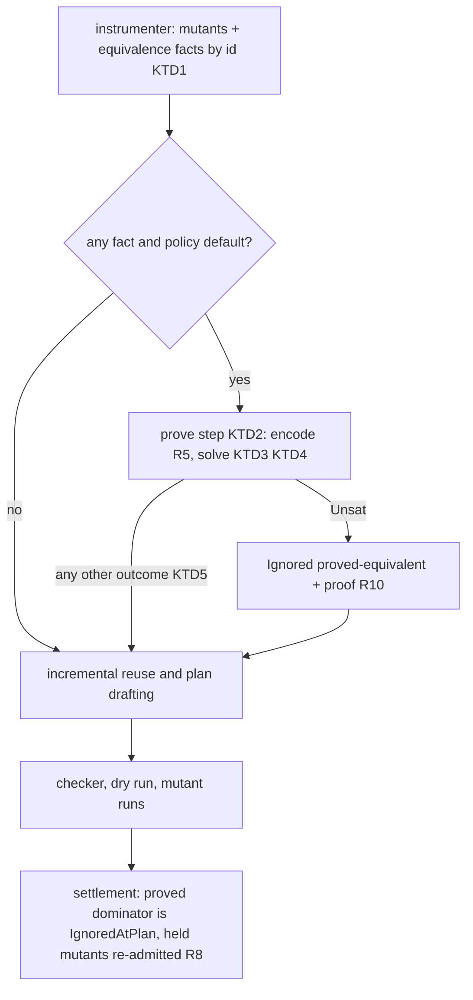
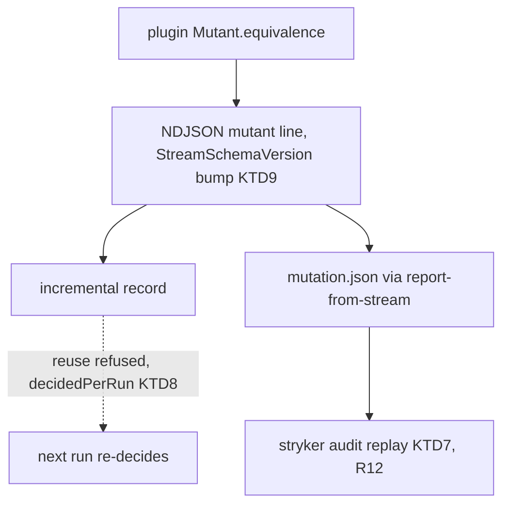
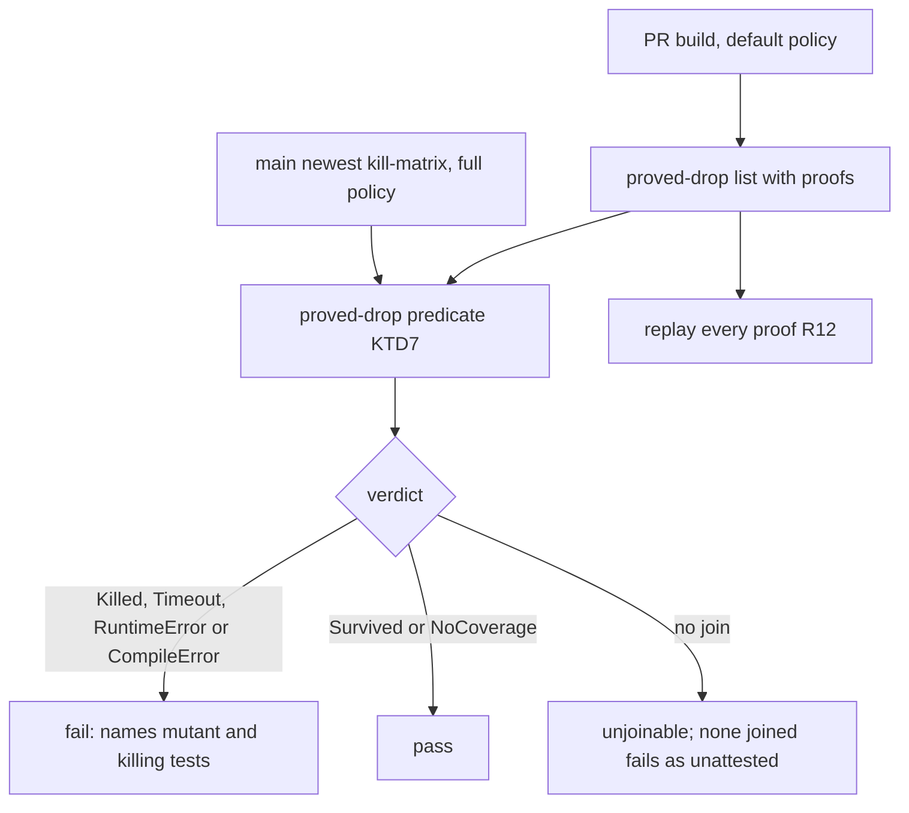

# SMT-Proved Equivalent Mutants - Plan

## Goal Capsule

- **Objective:** a default stryker-js-effect run never runs or scores a mutant that it can prove equivalent to the original program. Each such mutant is reported as Ignored with a proof that anyone can replay from the report alone, and no kill signal is lost.
- **Means:** small pure functions over `number` and `boolean` are encoded into the SMT-LIB FloatingPoint and Bool theories and decided by `z3-solver` (KTD1, KTD3).
- **Product authority:** the root's T12 intent of 2026-10-13, which pre-approves `z3-solver` and supersedes the root's 2026-10-09 rejection of SMT (recorded in `docs/plans/2026-10-09-2024-feat-mutant-subsumption-plan.md`, Key Decisions), then `CONSTITUTION.md`. Stream C owns `constant-collection-size` (#304). Stream H owns the checker's type queries (#328). Stream K and the root own `.github/workflows/`. Stream F owns native mutant generation later.
- **Execution profile:** three stacked PRs on `main` (Sequencing). Local verification is the touched package's typecheck, tests and API report, one build at a time. No mutation run, no e2e and no microVM run locally.
- **Stop conditions:**
  - The root's answer to Q1 comes first: this plan stops at its plan gate.
  - U4 does not start until `async-mutex` is approved (Q2). If it is refused, U1-U3 still ship inert, and the run stops before U4.
  - U6's CI job waits for the root's placement of `drop-audit` (Q5). U6's code ships without it.
- **Who finishes:** `ce-work` builds U1-U7. The root decides Q1 and Q5, the supervisor decides Q2, and the supervisor merges each layer.
- **Open blockers:** Q1 (root), Q2 (supervisor). The root's scorecard and SOTA-bar documents (`~/.kiro/crew/workspace/plans/2026-10-13-0000-stryker-sota-*.md`) are not readable from this workspace, so this plan works from the gap the root quoted: "no z3/SMT solver; static subsumption already exists".
- **Applicable packs** (`.compound-engineering/config.yaml`): `cell-architecture`, `boundary-testing`, `schema-laws`. The rules that shaped decisions are cited where they apply.

---

## Product Contract

### Summary

Each mutant inside a small pure numeric or boolean function gets a fact: the original function and the mutated function as one serializable term pair. The engine encodes the pair as an SMT-LIB query asserting that the two functions return different values for some input. When `z3-solver` answers `unsat`, the mutant is Ignored as `proved-equivalent` and its record carries the query and the solver identity, so the proof can be replayed. Every other answer keeps the mutant.

### Problem Frame

`main` already removes three kinds of equivalent or redundant mutant, and none of them proves semantic equivalence:

| Mechanism on `main`                | Where                                                                                                          | What it catches                                      |
| ---------------------------------- | -------------------------------------------------------------------------------------------------------------- | ---------------------------------------------------- |
| Printed-code equivalence           | `packages/stryker-js-instrumenter/src/mutant-set-policy.workflow.ts:110-124` (`equivalent-to-original`)        | a replacement that prints as the original            |
| Trivial compiler equivalence (TCE) | `packages/stryker-js-typescript-checker/src/classify-tce.workflow.ts:69-76`, `check-mutants.workflow.ts:41-44` | a mutant whose emitted JS equals the original's      |
| S1 relational subsumption          | `subsume-mutants.workflow.ts`, `readmit-subsumed.workflow.ts` (PR-A, #273)                                     | a mutant dominated by a kept mutant; not equivalence |

A mutant whose JS differs but whose behaviour does not is never removed. It is reported Survived and lowers the score until someone writes a `// Stryker disable` comment. No shipped mutation tool proves such mutants equivalent with a solver by default. Stryker's own documentation says "there is no definitive way for Stryker to find and ignore them" (https://stryker-mutator.io/docs/mutation-testing-elements/equivalent-mutants/), and PIT, cargo-mutants, mutmut and Dextool have no solver step either. The research line is Offutt and Pan's constraint-based detection (STVR 7(3), 1997), Nequivack's KLEE equivalence check (ICSTW 2016), and Alive2's bounded SMT translation validation (PLDI 2021).

**Measured on the corpus.** All counts below come from main Mutation run 38363576433 (`mutation-report-463`, `381b3f5b1`): 12,239 mutants, 1,307 Survived and 497 NoCoverage. A parse-only classification of each mutant's enclosing function found:

- 43 mutants in 12 functions inside the 2026-10-09 fragment, of which 14 Survived, 22 Killed and 7 Ignored. R1's sort discipline can only shrink that set. Only a Survived or NoCoverage mutant can be equivalent.
- A scratch `z3-solver` 5.2.0 run under Node 24.21.0 proves exactly one of the 14 equivalent: `87ac4fce39ccfec2` (`flooredTimeoutOf`, `timeout < MUTANT_TIMEOUT_FLOOR_MS` → `<=`, `packages/stryker-js/src/plan-mutant-tests.workflow.ts:155-159`) is `unsat` in 65 ms.
  - `maxOf`/`minOf` `<` → `<=` (`e65ee3e59dbf8148`, `4868200158d404eb`) are `sat` at `left = +0, right = -0`.
  - The other eleven differ on ordinary inputs and are test gaps.
- Admitting any parameter type, with reads of property chains rooted at a parameter, raises the fragment to 171 mutants and 53 candidates. None of the 39 new candidates is equivalent within its function.
  - One (`bed85e7411fe8802`, `index >= 0` → `> 0` under `Option.getOrElse(Option.filter(…), () => 0)`) is equivalent only in its calling context, through Effect's `Option` combinators.
- `87ac4fce39ccfec2` is also the S1 dominator of `00d226d153f913c3` (`<` → `>=`). In kill matrix `kill-matrix-463` the dominator is Survived after 17 tests and the subsumed mutant is Killed by 1 of 17. Proving the dominator equivalent re-admits the subsumed mutant (R8). So on the corpus the change removes one equivalent survivor from the score and leaves the executed-mutant count unchanged.

The corpus is Effect-style decision code with few numeric helpers. Projects with more arithmetic would see more proofs, but no number for them can be measured without a mutation run on an outside corpus.

### Key Decisions

- **The fragment narrows requirement R21 of the 2026-10-09 SMT layer, retired with R19-R30 in `docs/plans/2026-10-09-2024-feat-mutant-subsumption-plan.md`.** R1-R3 below state it in full; the narrowing is that every operator applies only to the sorts its encoding takes. JS coerces mixed sorts (`true + 1` is 2, `1 == true` is true), and a sort-checked fragment needs no coercion table. Widening to property reads measured 0 additional proofs on the corpus. Governs R1, R2, R3, R5.
- **Equivalence is claimed for calls that respect the declared parameter types.** TypeScript types do not hold at runtime, so a caller using `as any` is outside the claim, and the proof states its domain. This is the same standard TCE uses: equivalence under the compiler's semantics. Governs R2, R10.
- **Output equality is `SameValue`.** Tests compare with `Object.is` (`toBe`), which separates `+0` from `-0`, so `===` equality would drop mutants that a test can kill (`maxOf`). Governs R6.
- **Only `unsat` drops a mutant.** Governs R7, R21.
- **The proof is a typed record, not reason text.** The reason string stays human-readable. Replay reads the record. Governs R10, R11, R12.
- **On by default, solver loaded lazily.** A run with no eligible mutant never loads the 35.8 MB WASM. Governs R14, R20.
- **A proved-equivalent dominator counts as not run.** The existing re-admission rule then decides its subsumed mutants (unit I's R5). Governs R8.
- **Verdicts are decided on every run, not remembered.** A query costs milliseconds, and a remembered proof could outlive the source it proved. Governs R9.

### Requirements

**Eligibility**

- R1. A mutant gets an equivalence fact only when its innermost enclosing function is an arrow function or function declaration whose body is an expression or a single `return` of one. Every operator in the body applies only to the operand sorts listed with it:
  - parameters; `number` and `boolean` literals; module-level `const` bindings whose initializer is such a literal, resolved by lexical binding so that a parameter shadows a module `const`;
  - on `number`: unary `-` and `+`; binary `+`, `-`, `*`, `/`; `<`, `<=`, `>`, `>=`;
  - on two operands of the same sort: `===`, `!==`, `==`, `!=`;
  - on `boolean`: `!`, `&&`, `||`;
  - `c ? a : b` and `Boolean.match(c, { onTrue: () => a, onFalse: () => b })` with `c` a `boolean` and `a`, `b` of one sort;
  - calls with at least one `number` argument to `Math.abs`, `Math.min`, `Math.max`, `Math.floor`, `Math.ceil`, `Math.trunc`, `Math.sign`, or to a module `const` bound to one of them.

  The function has no loops, no recursion, no generics, no captured `let` or `var`, and at most 64 nodes counting the body's expression tree and the replacement's. `flooredTimeoutOf`, the largest corpus function with a proof, is well under it.
- R2. Every parameter is declared with the `number` or `boolean` keyword, and `Boolean` is the namespace import of `effect/Boolean`. Any other parameter type, alias or import means no fact. A `number` parameter ranges over every double, NaN, ±0 and ±∞ included.
- R3. The mutant's replacement is itself drawn from the R1 fragment. `%`, `**`, bitwise operators, `Math.round`, strings, bigint and objects anywhere in the function or the replacement mean no fact.
- R4. The fact is a serializable term pair with parameter sorts, independent of parser nodes, emitted where the AST is held. A native generator can emit the same fact. Scoping a run (`--mutate` ranges, diff plans) changes which mutants exist, never a mutant's fact.

**Encoding and decision**

- R5. Encoding is a pure, total function from a fact to SMT-LIB2 text.
  - `number` becomes `(_ FloatingPoint 11 53)` and `boolean` becomes `Bool`. A literal is written as the exact IEEE-754 bits of its JS value, so `0xff`, `1_000` and integers above 2^53 encode as V8 reads them.
  - Arithmetic maps to `fp.add`, `fp.sub`, `fp.mul` and `fp.div` under `RNE`. Unary `-` maps to `fp.neg`, and unary `+` on a number is the identity.
  - Comparisons map to `fp.lt`, `fp.leq`, `fp.gt`, `fp.geq`, and number equality to `fp.eq`. These are false whenever NaN is involved, and `fp.eq` treats `+0` and `-0` as equal. Boolean equality is `=`, and `!`, `&&`, `||` are `not`, `and`, `or`.
  - `?:` and `Boolean.match` become `ite`.
  - `Math.floor`, `ceil` and `trunc` map to `fp.roundToIntegral` with `RTN`, `RTP` and `RTZ`, and `Math.abs` to `fp.abs`. `Math.min`, `max` and `sign` get explicit encodings of the ECMA-262 NaN and ±0 rules (`Math.sign` returns ±0 unchanged), because the FP theory defers `fp.min`/`fp.max` to IEEE-754, where ±0 is unspecified.
- R6. The query declares one unconstrained constant per parameter and asserts that the two function bodies are not equal under SMT `=`, which on FloatingPoint terms is `SameValue`: the theory has exactly one NaN, and `+zero` and `-zero` are distinct values.
- R7. Only `unsat` drops the mutant. `sat`, `unknown`, a resource-limit or wall-clock stop and a solver error keep it, and a solver failure never fails the run.
- R8. A mutant dropped as proved equivalent never counts as a running dominator. A mutant it subsumes is re-admitted when none of that mutant's dominators runs.
- R9. Every query runs under one fixed solver resource limit, with a wall-clock ceiling as backstop. Queries stopped by the wall clock are counted in R15. Incremental reuse never serves a proved-equivalent record; the proof is decided again on every run.

**Proof and reporting**

- R10. A proved mutant is Ignored with the new rule id `proved-equivalent` and the reason `proved-equivalent: z3-solver <version> unsat`. Its record carries a typed proof:
  - the solver name and exact version, and the encoder version, a constant owned by the encoding workflow and bumped whenever R5's mapping changes;
  - R4's fact;
  - the resource limit;
  - the full query text and the verdict `unsat`;
  - the parameter domain.
- R11. The typed proof travels unchanged on the plugin `Mutant`, the NDJSON run-event line, the incremental record and `mutation.json`. Each surface's schema decodes it, a proof is present exactly when the reason is `proved-equivalent`, and a record with a malformed proof fails decoding.
- R12. A replay path reads a report and, for every proof, re-encodes the recorded fact with its own encoder, checks that the encoder version and the query text match the record, and solves the re-encoded text under R9's fixed limit with the pinned solver. It fails unless each one answers `unsat`. It needs no source checkout and no state beyond the report, and never executes query text it did not generate. A proof recorded by a different solver or encoder version is reported as a mismatch, never replayed silently.

**No signal loss**

- R13. On every PR from this unit on, CI computes the proved-drop list from the PR's build under the default policy and joins it to main's newest full kill matrix, which runs every mutant against every covering test:
  - Killed, Timeout, RuntimeError or CompileError fails, because an equivalent mutant can do none of these; the failure names the mutant id and every test that killed it, so the reader can tell an encoding defect from a test that calls the function outside the proof's parameter domain;
  - Survived or NoCoverage passes, as evidence consistent with the proof, not as proof;
  - a drop with no matrix entry is listed as unjoinable, and a run with drops but no joined drop fails as unattested.

  The same job replays every proof on the list (R12). Soundness rests on R5's construct-by-construct mapping onto the cited theory, on R17, and on this check.

**Footprint and policy**

- R14. `z3-solver` is pinned to one exact version and is a dependency of `@systemfsoftware/stryker-js` only. Exactly one production module imports it; U4's differential spec imports it directly, as a dependency pin must. The solver loads only when at least one fact exists, runs only on Node, and its worker threads are terminated on every exit path of the run, interruption included. A release that does not finish (`killThreads` rejects after 5 s) is counted and never changes the run's verdict.
- R20. Under `mutator.mutantSetPolicy: 'full'` no query runs and no mutant is dropped, so the kill matrix keeps every proved mutant.
- R21. A solver that cannot load or initialise keeps every mutant, and the run reports it as unavailable with its cause.

**Measurement**

- R15. Before and after counts come only from CI, cited by run id:
  - planned mutants; Ignored per rule id; re-admitted mutants;
  - executed mutants (Killed + Survived + Timeout + RuntimeError); Σ `testsCompleted`;
  - solver queries per outcome (one count per KTD5 variant, so resource-limit stops, wall-clock stops and unavailability (R21) each have their own), and total solver time.

  The baseline is run 38363576433. The after figure is the first main Mutation run after the release that carries this unit; on the corpus it is expected to show one more Ignored `proved-equivalent`, one more re-admitted mutant, and an unchanged executed count.

**Tests**

- R16. The eligibility, encoding and verdict decisions get colocated property tests. A construct outside R1-R3 yields no fact, including mixed-sort operands and a zero-argument `Math.min`. A parameter that shadows a module `const` is read as the parameter. Every verdict except `unsat` keeps the mutant.
- R17. A differential spec checks the encoding against the JS engine with the real solver. It runs over generated fragment terms and doubles that include NaN, ±0, ±∞, subnormals and boundary values, and compares by `SameValue`. It samples; R13 is the corpus check.
- R18. Integration tests exercise the engine's public run surface with no process spawn. They cover R10's record, R8's re-admission, R12's refusal of a tampered proof, R14's laziness, and R20.
- R19. The typed proof's schema gets codec laws, and a refusal law beside them rejects a proof whose verdict is not `unsat`.

### Acceptance Examples

- AE1. **Covers R6, R7, R10.** In a fixture holding a `flooredTimeoutOf`-shaped function (`timeout < 100 ? 100 : timeout` through `Boolean.match`), the `<=` mutant is Ignored `proved-equivalent: z3-solver 5.2.0 unsat`, its proof replays as `unsat`, and it never reaches the checker or a runner.
- AE2. **Covers R6, R7.** In a `maxOf`-shaped fixture, the `<=` mutant gets `sat` with the model `left = +0, right = -0` and runs.
- AE3. **Covers R8.** In AE1's fixture, the S1-subsumed `>=` mutant names the proved `<=` mutant as its dominator, is re-admitted, and runs.
- AE4. **Covers R12.** A report whose proof query has been edited so that it is satisfiable fails replay and names the mutant id.
- AE5. **Covers R1, R3.** A function using `%`, or `flag + 1` with `flag: boolean`, yields no fact, and its mutants run.
- AE6. **Covers R7, R9.** A query stopped by the resource limit keeps its mutant, and R15 counts it.
- AE7. **Covers R13, R15.** On the corpus, the first main Mutation run after release shows `87ac4fce39ccfec2` Ignored `proved-equivalent` and `00d226d153f913c3` re-admitted, and the R13 check reports `87ac4fce39ccfec2` Survived in the kill matrix.
- AE8. **Covers R14, R20.** A run over files with no eligible function never imports `z3-solver`, and the same AE1 fixture under `mutantSetPolicy: 'full'` runs the `<=` mutant.

### Scope Boundaries

- Out: equivalence in calling context, such as `bed85e7411fe8802` through Effect's `Option` combinators. That needs a model of library semantics.
- Out: property reads, strings, bigint, `%`, `**`, bitwise operators and `Math.round`, each for a reason measured or cited above.
- Out: the shapes Stream C's `constant-collection-size` claims (#304), and type-invalid mutants (unit I, PR-C).
- Out: learned or LLM-based equivalence detection.
- Out: editing `.github/workflows/`, `PROJECTS` or `mutate` globs. R13's job rides on whatever placement the root rules for `drop-audit` (#288).
- Considered and not built: caching verdicts across runs. A query costs about 65 ms and reuse would need the encoding version in the engine digest; evidence of solver time dominating a run would change this.
- Considered and not built: a separate plugin package for the solver. Stream A owns package splits; Q3 records the trade-off.

<!-- ce-section: work-relationships -->

### How This Work Fits Together

This plan covers proved equivalence only. The rest is the current understanding, not a committed roadmap.

- Unit I Layer 1 (S1 subsumption, merged in #273): R8 extends its re-admission rule.
- `stryker audit` (merged in #276) and its CI job `drop-audit` (#288, open): R13 adds a second predicate to the audit, and its job depends on where the root places `drop-audit`.
- Stream H's type queries (#328, open): not needed. R2 reads declared keyword types, not inferred ones.
- Stream F native generation: can emit R4's fact later.

### Outstanding Questions

- Q1. **Build at this yield?** On the corpus the unit disposes one equivalent survivor and saves no executed mutant (Problem Frame). The 2026-10-09 rejection rested on the same count; T12's intent orders the outcome anyway. For the root at the plan gate.
- Q2. **Approve `async-mutex`.** `z3-solver` 5.2.0 depends on `async-mutex ^0.3.2` (MIT, single maintainer `dirtyhairy`; 0.3.2 is what the range resolves to under the pin). It blocks U4 (supervisor).
- Q3. **Package boundary.** `z3-solver` puts 35.8 MB into every install of `@systemfsoftware/stryker-js`. A separate plugin package would keep it optional, but Stream A is splitting packages. The plan keeps it in the engine with a lazy load (KTD3); the root may redirect.
- Q5. **CI home for R13.** No workflow runs `stryker audit` on `main`; #288 adds the job, and the root is ruling on its placement (pull request, postsubmit on the matrix lane, or Stream K's lane). U6 extends the audit command; the job wiring follows the ruling. The drop list comes from the PR's own engine, so a PR that changes the encoder supplies the drops its gate judges; the kill matrix, from main's full-policy run, is the independent side. Until the job is placed, PR-2's default drops have R7, R17 and replay behind them but no corpus check.
- Q6. **Proof field shape against `schema-laws`.** U1 adds an optional `equivalence` field to `Mutant` whose presence follows the reason code. That is the trigger of (pack: schema-laws, tagged-unions-over-state-by-presence.md), which (pack: schema-laws, cross-field-invariants-as-struct-checks.md) rule 2 hands such fields to. `main` already models `statusReason` and `subsumption` this way with struct checks (`Mutant.schema.ts:137-148`), and a status-tagged `Mutant` is a cross-package wire change beyond T12. KTD11 follows the precedent and records the violation. The root may order the union instead, which moves U1 and U5 onto a reshaped `Mutant`.

### Product Contract preservation

Changed: R4, R7, R9, R10, R11, R12, R13, R14, R15, AE8 (added), R20 and R21 (added). These close contradictions that flow analysis and document review found:

- R9 against R11: reuse now refuses proof-carrying records.
- R12 replayed record-supplied text at a record-supplied limit; it now re-encodes the recorded fact and uses the fixed limit.
- R14 was silent on interruption, runtime, release failure and the differential spec's import.
- The `'full'` behaviour and solver-unavailable handling had no requirement.

R13 keeps its original failing set (Killed, Timeout, RuntimeError, CompileError) and now also names the killing tests, lists unjoinable drops and fails an unattested run; a draft of this plan relaxed the failing set and review reverted that. Q4 (whether replay is its own command or part of `stryker audit`) is resolved by KTD7. Scope is unchanged.

---

## Planning Contract

### Key Technical Decisions

- KTD1. **The fact is computed in the instrumenter and travels on `InstrumentResult`, keyed by mutant id, not on the plugin `Mutant`.** `Transformer.service.ts` `mutablesFor` (`:1007-1040`) is the only site holding both the AST node and its replacement. The plugin `Mutant` crosses into checker and runner workers, which must not receive facts. The eligibility decision is a pure workflow over a serializable function summary, so a native generator can reuse it (R4) (pack: cell-architecture, pure-decision-workflows.md).
- KTD2. **The proof step runs in the engine immediately after instrumentation, before incremental reuse and plan drafting.** A proved mutant becomes an early Ignored result, and settlement already records every early result as the dominator outcome `IgnoredAtPlan` (`run/mutant-settlement.ts:185`), which re-admits its subsumed mutants (`readmit-subsumed.workflow.ts:34`), so R8 needs no new rule logic. A dominator settled in another shard is `Unsettled` and also re-admits. It runs in both `run` and `plan` paths through one step shared after `run/instrument.cell.ts` and `run/plan-instrument.cell.ts`.
- KTD3. **The solver is one Effect service in `packages/stryker-js`, acquired with `Effect.acquireRelease`, loaded with `Effect.cached(Effect.promise(() => import('z3-solver')))`, and released with `killThreads(api.em)`, whose rejection is absorbed and counted (R14).** It mirrors the oxc load in `packages/stryker-js-instrumenter/src/Parser.service.ts:37` and the scoped pool in `packages/stryker-js-vitest-runner/src/StandbyThreadsPool.handle.ts:108`. The service is acquired only when a fact exists (R14). `z3-solver` stays external to the `stryker` bin bundle: `packages/stryker-js/tsdown.config.ts:66` bundles every dependency into `dist/main.mjs`, and the solver's glue loads `z3-built.wasm` from its own `__dirname` (`build/z3-built.js:167`), so a bundled copy would never find it and every run would report the solver unavailable.
- KTD4. **Queries are submitted as SMT-LIB2 text through the low-level `Z3.eval_smtlib2_string(ctx, text)`** (`z3-solver` 5.2.0, `build/low-level/wrapper.__GENERATED__.d.ts:454`). The same text is what the proof stores, so replay (R12) runs exactly what decided the drop. A fresh context per query keeps verdicts independent of order.
- KTD5. **The solver's outcome is a closed tagged union: `Unsat`, `Sat`, `Unknown`, `LimitReached`, `TimedOut`, `SolverFailed`, `Unavailable`.** "No proof" is a variant, not an absent field (pack: schema-laws, tagged-unions-over-state-by-presence.md). The verdict-to-outcome decision is a pure workflow.
- KTD6. **The proof record is a fixed-field tagged struct with no open keys, and its schema is exported from the plugin interface so the generated laws cover it.** Open-keyed records re-open the Node 24 `JSON.parse` key corruption (`docs/solutions/test-failures/v8-json-parse-key-corruption-schema-laws.md`, `docs/solutions/test-failures/stream-schema-must-not-carry-json-rest-records.md`). The refusal law lives in the schema file's in-source block (pack: schema-laws, refusals-beside-generated-laws.md).
- KTD7. **Replay and the R13 predicate are both part of `stryker audit`.** One command surface keeps one CI job. The proved-drop predicate is a second pure workflow beside `audit-drops.workflow.ts` with its own closed reason vocabulary, because the dominator predicate's verdicts (`audit-drops.workflow.ts:82-116`) mean the opposite for a self-drop. Replay is a mode that takes a report path.
- KTD8. **Reuse refusal extends the existing `decidedPerRun` reason** (`incremental-diff.workflow.ts:315-319`) to records carrying a proof, rather than adding the encoding version to the engine digest. The proof is re-decided each run (R9), so no digest has to track the encoding.
- KTD9. **The NDJSON line gains a nullable `equivalence` field and `StreamSchemaVersion` takes the next major in U5, the unit that first writes a proof**, as #273 bumped the stream in the commit that first wrote `subsumption` (`add6faa73`). Stream C's #304 takes `8.0` to `9.0`; whichever lands second bumps again. `stryker merge` already refuses mixed majors (`report-from-stream.workflow.ts`, `StreamVersionMismatch`).
- KTD10. **The resource limit is one literal set from the corpus.** U4 measures the `rlimit count` Z3 reports for every corpus query and sets the limit with a safety margin, recorded in the plan's Verification Contract as evidence. The wall-clock ceiling is a backstop only (pack: boundary-testing, pin-dependency-semantics.md).
- KTD11. **The proof rides an optional `Mutant` field with a struct check, following `subsumption`.** This violates (pack: schema-laws, tagged-unions-over-state-by-presence.md) the same way `main`'s `statusReason` and `subsumption` do (`Mutant.schema.ts:137-148`); Q6 puts the trade to the root.

### High-Level Technical Design

The engine path, from instrumentation to settlement:

The proof's lifecycle across surfaces:

The CI handshake for R13:

### Assumptions

- The root's T12 intent stands after Q1 is shown to it. If the root cancels T12, nothing in U1-U7 starts.
- `z3-solver` 5.2.0 stays the pinned version; an upgrade re-runs R17 and replays every recorded proof (pack: boundary-testing, pin-dependency-semantics.md).
- Bun 1.4.3 answered `unsat` for the AE1 query in a scratch probe, but the engine declares Node only (`packages/stryker-js/package.json` `engines`), so nothing depends on Bun.

### Sequencing

Three layers, each green and releasable on its own; new code lands inert until a higher layer wires it in.

| Layer                       | Units      | Ships                                                                                                                                  | Gate                       |
| --------------------------- | ---------- | -------------------------------------------------------------------------------------------------------------------------------------- | -------------------------- |
| PR-1 Contracts and facts    | U1, U2, U3 | the proof schema and rule id on the plugin `Mutant`, instrumenter facts, the encoding workflow; nothing drops, the stream is unchanged | Q1                         |
| PR-2 Solver and engine step | U4, U5     | the pinned solver, the stream field and its major bump, and the prove step, on by default                                              | Q2                         |
| PR-3 Audit and replay       | U6, U7     | the proved-drop predicate, replay, docs                                                                                                | Q5 for the job wiring only |

### Risks & Dependencies

| Risk                                                                                                                                            | Mitigation                                                                                                                                                     |
| ----------------------------------------------------------------------------------------------------------------------------------------------- | -------------------------------------------------------------------------------------------------------------------------------------------------------------- |
| An encoding defect drops a killable mutant.                                                                                                     | Only `unsat` drops (R7); R17 samples the encoding against V8; R13 fails a proved drop the matrix kills, times out or fails to compile; R12 lets anyone replay. |
| Solver threads keep the process alive or leak on interruption.                                                                                  | KTD3 releases with `killThreads` on every exit; R18 checks a clean exit. The scratch probe exited in 0.40 s after `killThreads`.                               |
| Stream C's #304 also edits `RULE_IDS` and `StreamSchemaVersion`.                                                                                | KTD9; whichever lands second merges main and bumps again.                                                                                                      |
| The yield stays at one drop.                                                                                                                    | Q1 puts it to the root before any code lands.                                                                                                                  |
| `rlimit` meaning changes across Z3 versions.                                                                                                    | The proof records the solver version (R10), replay refuses a mismatch (R12), and KTD10 recalibrates on upgrade.                                                |
| R13 cannot join a drop in code the PR adds, because mutant ids are content-derived.                                                             | Such drops are listed as unjoinable; R17 and review stand behind them until main's next kill matrix includes the code.                                         |
| PR-2 enables drops before Q5 places R13's job.                                                                                                  | Q5 states the window; the root can hold PR-2's merge until the job exists.                                                                                     |
| A codebase with many small numeric helpers pays solver time on every default run, and `'full'` (R20) also turns off the other mutant-set rules. | R15 counts total solver time per run; per-query cost is bounded by R9. A separate opt-out is not built without that count showing a need.                      |

### System-Wide Impact

- Every consumer of `IgnoreRuleId`, the NDJSON stream and the incremental record sees a new member or field. U1 and U5 ship the API reports and `major` changesets for each published package they break (`AGENTS.md` BREAK-1).
- Default runs on numeric code report fewer Survived mutants. The README and the agent skill document the new rule id and the `'full'` opt-out.
- Install size grows by 35.8 MB for `@systemfsoftware/stryker-js` (Q3).

---

## Implementation Units

### U1. Proof contract and rule id

- **Goal:** the proof record and the `proved-equivalent` rule id exist on the plugin `Mutant` and decode with laws; nothing produces them and the stream is unchanged.
- **Requirements:** R10, R11, R19; KTD6, KTD11.
- **Dependencies:** none.
- **Files:**
  - `packages/stryker-js-plugin-interface/src/ignore-rule.schema.ts` (`RULE_IDS`, `RULE_DOCUMENTATION`)
  - new `packages/stryker-js-plugin-interface/src/equivalence-proof.schema.ts`
  - `packages/stryker-js-plugin-interface/src/Mutant.schema.ts`, `Mutant/mod.ts`
  - `packages/stryker-js-plugin-interface/etc/*.api.md`
  - changeset for `@systemfsoftware/stryker-js-plugin-interface` (`major`: `IgnoreRuleId` gains a member)
- **Approach:**
  1. Add the rule id and its documentation sentence.
  2. Add the proof struct (KTD6), carrying R10's fields including R4's fact, and an optional `equivalence` field on `Mutant`, with a struct check that it is present exactly when the reason code is `proved-equivalent`, beside `subsumptionMatchesStatus` (`Mutant.schema.ts:111-118`) (KTD11).
- **Patterns to follow:** `Mutant.Subsumption`; the in-source laws at `Mutant.schema.ts:355-395`.
- **Test scenarios:**
  - Covers R19. The proof schema's generated laws hold, and a refusal law rejects a proof whose verdict is not `unsat`.
  - A `Mutant` with reason `proved-equivalent` and no proof fails decoding; one with a proof and another reason fails decoding.
- **Verification:** the plugin interface's typecheck, tests and `api:check` pass. No run produces a proof yet.

### U2. Instrumenter equivalence facts

- **Goal:** for each eligible mutant, the instrumenter emits a serializable fact on `InstrumentResult`, keyed by mutant id.
- **Requirements:** R1, R2, R3, R4, R16; KTD1.
- **Dependencies:** none.
- **Files:**
  - new `packages/stryker-js-instrumenter/src/equivalence-fact.workflow.ts` and `src/__tests__/equivalence-fact.workflow.property.test.ts`
  - `packages/stryker-js-instrumenter/src/Transformer.service.ts`, `Instrument.schema.ts`, `instrument-files.cell.ts`
  - `packages/stryker-js-instrumenter/tests/instrumenter.integration.test.ts`
  - `etc/stryker-js-instrumenter.api.md`, changeset
- **Approach:**
  1. In `mutablesFor`, build a serializable summary of the enclosing function: parameters with their declared keyword types, the body as a term tree, module literal and `Math` alias bindings, and the replacement term.
  2. The pure workflow decides a fact or a named no-fact reason from that summary, applying R1-R3 with sort checking.
  3. `InstrumentResult` gains the facts by mutant id; nothing reads them yet.
- **Patterns to follow:** `subsume-mutants.workflow.ts` and its property test; `relationalSiteFacts` (`Mutator.service.ts:925-931`) for a site fact riding a command.
- **Test scenarios:**
  - Covers AE5. A function using `%` and a function with `flag + 1` (`flag: boolean`) yield no fact, each with its reason.
  - A zero-argument `Math.min` call yields no fact.
  - A parameter named like a module `const` resolves to the parameter in the fact.
  - A generated summary inside R1-R3 always yields a fact whose sorts match its declarations.
  - Integration: instrumenting a `flooredTimeoutOf`-shaped file yields facts for its `<=`, `true` and `false` mutants and none for a mutant in a neighbouring function with an object parameter.
- **Verification:** the instrumenter's typecheck, tests and `api:check` pass.

### U3. Encoding workflow

- **Goal:** a pure workflow turns a fact into SMT-LIB2 query text.
- **Requirements:** R5, R6, R16.
- **Dependencies:** U2 (fact schema).
- **Files:** new `packages/stryker-js/src/encode-equivalence.workflow.ts` and `src/__tests__/encode-equivalence.workflow.property.test.ts`.
- **Approach:** one total mapping per construct (R5); one declared constant per parameter and a top-level `(assert (not (= original mutant)))` (R6). Literals are written as exact IEEE bit patterns. The text is deterministic for a given fact. The workflow exports the encoder version constant R10 records, bumped with any change to the mapping.
- **Patterns to follow:** cyclomatic-complexity-1 `Match` dispatch in existing workflows (pack: cell-architecture, pure-decision-workflows.md).
- **Test scenarios:**
  - Every generated fact encodes, and encoding the same fact twice gives identical text.
  - The query declares exactly one constant per parameter, with the parameter's sort.
  - `Math.sign`, `Math.min` and `Math.max` encodings carry the ±0 and NaN branches; a literal `0xff` and `9007199254740993` encode to the bits V8 produces.
- **Verification:** the engine package's typecheck and tests pass.

### U4. Pinned solver service and verdict decision

- **Goal:** the engine can ask `z3-solver` for a verdict under a fixed limit and turn it into an outcome.
- **Requirements:** R7, R9, R14, R17, R21; KTD3, KTD4, KTD5, KTD10.
- **Dependencies:** U3; Q2 approval.
- **Files:**
  - `pnpm-workspace.yaml` (catalog pin), `packages/stryker-js/package.json`
  - `packages/stryker-js/tsdown.config.ts` (`z3-solver` external to the `main` bin entry, KTD3)
  - new `packages/stryker-js/src/equivalence-solver.service.ts`
  - new `packages/stryker-js/src/decide-equivalence.workflow.ts` and `src/__tests__/decide-equivalence.workflow.property.test.ts`
  - new `packages/stryker-js/tests/equivalence-encoding.differential.test.ts`
  - changeset
- **Approach:**
  1. Pin `z3-solver` exactly through the catalog, and keep it out of the bin bundle.
  2. The service is the only production importer: it loads lazily, acquires the API and releases with `killThreads` on every exit, absorbing and counting a rejected release, and maps each answer into KTD5's union. It applies the resource limit and a wall-clock backstop. A load or init failure maps to `Unavailable`.
  3. The decision workflow maps `Unsat` to a proof and every other variant to keep.
  4. Measure `rlimit count` over the corpus's fact set and set the limit (KTD10).
- **Execution note:** write the differential spec first. It pins what the solver must agree with before the engine trusts it.
- **Patterns to follow:** `packages/stryker-js-instrumenter/src/Parser.service.ts:37` lazy load; `packages/stryker-js-vitest-runner/src/StandbyThreadsPool.handle.ts:108` scoped release; `docs/solutions/` learnings on pinned dependency semantics (pack: boundary-testing, pin-dependency-semantics.md; pack: boundary-testing, real-system-oracles.md).
- **Test scenarios:**
  - Differential (R17): generated fragment terms over doubles including NaN, ±0, ±∞, subnormals and boundaries; V8's value and the solver's model value agree by `SameValue`.
  - Differential: the AE1 query is `unsat` and the AE2 query is `sat` with `left = +0, right = -0`.
  - Every variant except `Unsat` maps to keep; `Unsat` maps to a proof carrying the query, limit, version and domain.
  - A query that exceeds the limit yields `LimitReached`.
  - The service, released after one query, leaves no live worker thread.
  - A release whose `killThreads` rejects is counted and leaves the run's verdict unchanged.
- **Verification:** the engine package's typecheck, tests and `api:check` pass, and the limit literal and the measured counts are recorded.

### U5. Prove step in the engine run

- **Goal:** default runs drop proved mutants before reuse and planning, re-admit their subsumed mutants, and count every outcome.
- **Requirements:** R7, R8, R9, R14, R15, R18, R20, R21; KTD2, KTD8.
- **Dependencies:** U1, U2, U4.
- **Files:**
  - new `packages/stryker-js/src/run/prove-equivalence.cell.ts`
  - `packages/stryker-js/src/run/run-stages.cell.ts`, `run/plan-instrument.cell.ts`, `plan-request.cell.ts`
  - `packages/stryker-js/src/incremental-diff.workflow.ts` (`decidedPerRun`), `run/mutation-test-plan.cell.ts`
  - `packages/stryker-js-cli-contract/src/run-event.schema.ts`, `stream-version.schema.ts`, `run-event-wire.schema.ts`
  - `packages/stryker-js/src/IncrementalReport.schema.ts`, `IncrementalDiff.schema.ts`, `report-from-stream.workflow.ts`, `mutation-reporting.service.ts`, `run/incremental-reuse.cell.ts`, `run/mutant-run.ts`
  - the run-event counts that carry `ignoredByRule` and the new solver counts
  - `packages/stryker-js/tests/proved-equivalence.integration.test.ts`, fixtures under `packages/stryker-js/tests/__fixtures__/`
  - `etc/*.api.md` for each package touched
  - changesets (`major` for `@systemfsoftware/stryker-js-cli-contract`: stream major; `major` for `@systemfsoftware/stryker-js`: default runs drop mutants they used to score)
- **Approach:**
  1. Add the nullable field to `mutantTestedFields` and `mutantWireFields` and bump the stream major (KTD9), following how #273 added `subsumption`; carry it through the incremental record, the report rebuild and the reporting service the same way.
  2. After instrumentation, when the policy is `default` and any fact exists, acquire the solver, encode and solve each fact, and mark `Unsat` mutants Ignored with the proof (R10).
  3. Extend `decidedPerRun` to proof-carrying records (KTD8).
  4. Proved mutants enter planning as early results, so settlement treats a proved dominator as `IgnoredAtPlan` (KTD2).
  5. Emit counts for each outcome, solver time and unavailability.
- **Patterns to follow:** how `subsumption` is held and settled in `run/mutation-test-plan.cell.ts:213-285` and `mutant-settlement.ts:143-211`.
- **Test scenarios:**
  - Covers AE1. The `<=` mutant is Ignored with a proof and reaches neither the checker nor a runner.
  - Covers AE2. The `maxOf` `<=` mutant runs.
  - Covers AE3. The S1-subsumed `>=` mutant is re-admitted and runs.
  - Covers AE6. A limit-stopped query keeps its mutant and is counted.
  - Covers AE8. A run with no eligible function never loads the solver; the AE1 fixture under `'full'` runs the `<=` mutant.
  - A second run over the same incremental report decides the proof again and reports `decidedPerRun` for it.
  - A solver that fails to initialise keeps every mutant, reports unavailability, and the run's verdict is unchanged.
  - An interrupted run releases the solver.
  - The NDJSON line codec round-trips a line carrying a proof, and a reader at the previous major refuses the stream.
  - `report-from-stream` rebuilds a `mutation.json` mutant that carries the proof unchanged.
- **Verification:** the engine package's typecheck, tests and `api:check` pass.

### U6. Proved-drop audit predicate and proof replay

- **Goal:** `stryker audit` judges proved drops against the kill matrix and replays every proof.
- **Requirements:** R12, R13; KTD7.
- **Dependencies:** U1, U4, U5.
- **Files:**
  - new `packages/stryker-js/src/audit-proofs.workflow.ts` and `src/__tests__/audit-proofs.workflow.property.test.ts`
  - `packages/stryker-js/src/audit-request.cell.ts`, `audit.schema.ts`, `Cli.schema.ts`, `bin/cli-command.ts`
  - `packages/stryker-js/tests/audit.integration.test.ts`
  - changeset
- **Approach:**
  1. Beside `dropOf` (`audit-request.cell.ts:154-158`), collect proved drops with their proofs from the default-policy build.
  2. The new workflow joins them to the matrix and assigns R13's verdicts with its own reason vocabulary and next actions, naming the killing tests on a failure.
  3. Replay mode reads a report, checks solver and encoder versions, re-encodes each recorded fact, compares it with the recorded text, and solves under the fixed limit (R12).
  4. Add both to the audit report's union; the job wiring waits for Q5.
- **Patterns to follow:** `audit-drops.workflow.ts` (`NEXT_ACTION` exhaustive record, closed reason literals) and `audit.schema.ts`'s `DropAuditPassed`/`DropAuditFailed`.
- **Test scenarios:**
  - A proved drop Killed, timed out, RuntimeError or CompileError in the matrix fails with its id and the tests that killed it.
  - Survived and NoCoverage pass; an unjoined drop is listed, and drops with none joined fail as unattested.
  - Covers AE4. Replay of a report whose proof query was edited to be satisfiable fails and names the mutant.
  - Replay of a proof recorded by another solver version reports the mismatch.
  - Replay of a proof whose stored query text is not what the recorded fact encodes to reports a mismatch and solves nothing.
  - Replay of a proof recording a limit above the fixed literal solves under the fixed literal.
  - Integration, in-process through the CLI route cell: an audit over a fixture matrix where the proved mutant is Survived exits 0.
- **Verification:** the engine package's typecheck, tests and `api:check` pass.

### U7. Documentation and release notes

- **Goal:** users can find the new rule id, its opt-out, and how to replay a proof.
- **Requirements:** R10, R12, R20.
- **Dependencies:** U5, U6.
- **Files:** `packages/stryker-js/README.md`, `skills/stryker-mutation-testing/SKILL.md`, changesets.
- **Approach:** document `proved-equivalent` beside the other rule ids, the `'full'` opt-out, the install size, and `stryker audit` replay.
- **Test expectation:** none, documentation only.
- **Verification:** `./bin/dprint check` passes; changesets pass the changeset gate.

---

## Verification Contract

| Gate                         | Command or source                                                                                                      | Applies to                   |
| ---------------------------- | ---------------------------------------------------------------------------------------------------------------------- | ---------------------------- |
| Format                       | `./bin/dprint check`                                                                                                   | every PR                     |
| Typecheck, tests, API report | `pnpm --filter <package> typecheck`, `pnpm --filter <package> test`, `pnpm --filter <package> api:check`               | each package a unit touches  |
| Single plan                  | `pnpm gate:repo`                                                                                                       | every PR                     |
| CI                           | `check`, every `e2e (…)` leg, `Changeset Check`, watched with `xd://github run_watch`                                  | every PR head                |
| Solver limit evidence        | U4's measured `rlimit count` over the corpus facts and the chosen literal                                              | PR-2                         |
| No signal loss               | `stryker audit` proved-drop predicate and replay against main's newest `kill-matrix-<n>`, cited by run id              | PR-3, once Q5 places the job |
| Corpus counts                | the R15 counts from the first main Mutation run after release, against run 38363576433                                 | after PR-2's release         |
| Packed binary loads solver   | the first main Mutation run after PR-2 merges, which runs the built CLI: R15 reports zero unavailability and AE7 holds | after PR-2's merge           |

Nothing runs mutation locally. Tests count as passing only when the parent session ran them.

---

## Definition of Done

- Every unit's verification holds and every R-ID is covered by a unit, an AE or the Verification Contract.
- AE7 holds on main, cited by run id, or its gap is reported to the root with the run that shows it.
- Each PR's body carries its full-path code review receipt, the pack rulings, and the models that served each lens.
- The diff holds no scratch scripts, no abandoned attempts and no unused exports (DEL1).
