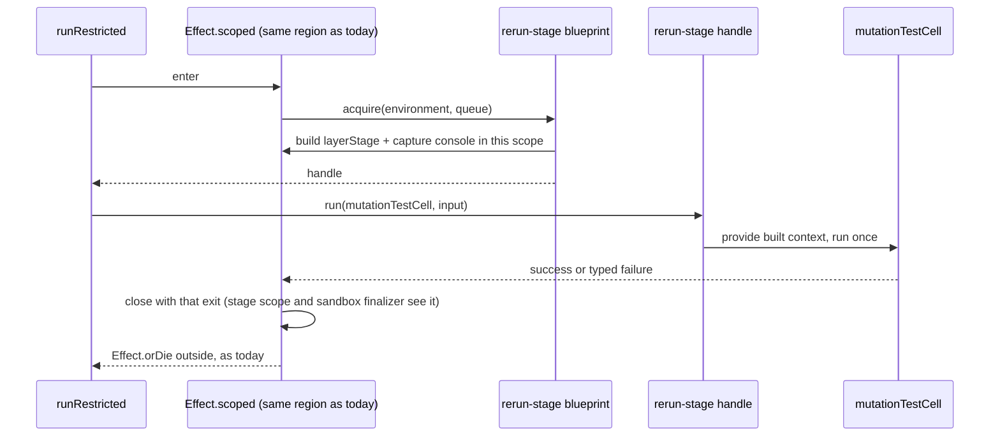

# Boundary Escalations - Plan

## Goal Capsule

- **Objective:** a reviewer grading this repository against the enrolled `cell-architecture` pack finds no violation at the four boundary escalations root named: #322's F8 and F10, and #321's two escalation rows (`Mcp/mcp-server.cell.ts:146` and `plan-request.cell.ts:259-260`). `stryker mcp`, `stryker plan`, `Engine.planRequest` and the e2e lane behave exactly as before.
- **Means:** one pull request on a new stack off `main` (KTD1). The MCP rerun acquires its stage through a blueprint and handle at the scope position it uses today (KTD2, KTD3). `stryker plan` runs its two stage cells as one composed cell (KTD4). The e2e `GuestJobs` contract gets harness-owned types (KTD5), and the Service-less telemetry module loses its `.service` suffix (KTD6).
- **Product authority:** root's 2026-10-13 next-unit intent, as narrowed by the sub-conductor ruling of the same day: exactly these four escalations, no fix to the other Service-less `*.service.ts` files and no new F14-F16 fixes; no new in-process CLI entry; real public-surface integration tests where behaviour is involved; no new code in `test/e2e-core`; no conflict with Stream D. Rule text: the packs `.compound-engineering/config.yaml` pins at systemfsoftware `a578c704` (#336). `cell-architecture`, `schema-laws`, `boundary-testing` and `package-topology` are byte-identical there to `763fd66`, the revision #321 and #322 were graded against (`diff -rq` of both clones).
- **Authority order:** `CONSTITUTION.md` > `AGENTS.md` > `packages/AGENTS.md` > ADR-0003 > this plan.
- **Stop conditions:** stop and report if any of these happen:
  - an existing public-surface test changes verdict;
  - `api:check` reports a changed signature for any `Engine` or `Mcp` export;
  - the MCP stage cannot be built in the same scope region that closes with the rerun's exit (KTD3);
  - Stream D opens a PR that moves or deletes a file this plan edits;
  - a step would edit `release.jsonc`, `turbo.json`, `gritlint.json`, `flake.*`, `.compound-engineering/config.yaml`, `.github/` or anything under `test/e2e-core`.
- **Execution profile:** `ce-work` only after root's go on this plan. No local mutation run, no local e2e (OP27), no Stream K e2e rerun. Reviews are report-only. Push once per review round.
- **Who finishes:** Stream A opens the PR and carries it to green with a full-path receipt. Root merges.

---

## Product Contract

### Summary

Four boundary findings were escalated, not fixed, in #321 and #322. Each is still on `main` at `3797debd`:

- The MCP `rerun_mutant` path provides the run-stage layer inside its own body (`Mcp/mcp-server.cell.ts:146`).
- `stryker plan` runs two stage cells one after another by hand (`plan-request.cell.ts:259-260`).
- The e2e harness's `GuestJobs` contract names the microsandbox driver's types (`test/e2e/src/Harness/guest-job.service.ts:1,12-16`).
- A harness module named `*.service.ts` holds no Service (`test/e2e/src/Harness/harness-telemetry.service.ts`).

This work fixes those four and changes no observable behaviour and no public signature.

### Problem Frame

The escalations come from two receipts:

- #321's rule ledger (merged as `117bff02`) marks `cell-architecture/pipeline-composition` violated at `plan-request.cell.ts:259,260` and `cell-architecture/service-and-layer-boundaries` violated at `Mcp/mcp-server.cell.ts:146` ("the mid-pipeline binding is plan F13"). Both are "pre-existing, escalated".
- #322's "Escalations" section (merged as `e3101563`) records F8 and F10.

The rules:

- No `Effect.provide`, `Cell.provideContext` or layer rebuild in the body of a domain cell, workflow or route handler (pack: cell-architecture, service-and-layer-boundaries.md, section 4.3 and gate item 4).
- Cells compose through combinators, never through sequential `cell.run` calls (pack: cell-architecture, pipeline-composition.md).
- A `*.service.ts` contract imports no driver. A driver-backed implementation lives in a flat sibling module that only roots and tests import (ADR-0003, "Decision Outcome"; pack: cell-architecture, service-and-layer-boundaries.md, section 1).

State on `main` differs from the ruling's evidence lines, which describe the files before #322. `guest-job.service.ts:1` is now `import type { MicroVM }`, and the Shape still names `MicroVM.Mount` and `MicroVM.JobBlueprint` (`:12-16`). The layer that calls `MicroVM.job` already moved to `microsandbox-guest-job.ts` in #322. `harness-telemetry.service.ts` now imports only `effect` (`:1`); `TestTelemetry` and the harness layer moved to the composition root `harness-layers.ts:6,13` in #322. What remains is a driver type in the contract (F8) and a `.service` suffix on a module with no Service (F10).

What makes the MCP fix more than a move: the stage layer provides its own `Scope`, and that scope closes with the exit of whatever scope the layer is built in (`run/RunEnvironment.service.ts:116-122`). The sandbox finalizer lives in that stage scope and reads its exit to keep or remove `.stryker-tmp/sandbox-*` (`Sandbox.service.ts:74-81`; `docs/solutions/runtime-errors/stage-scope-closed-with-exit-void-hides-run-outcome.md`, Mechanism 2). Today `Effect.provide` builds the stage in its own scope, which closes with the rerun's exit (effect `internal/layer.ts:15-21`).

### Requirements

**Engine (#321's two rows)**

- R1. `runRestricted` (`Mcp/mcp-server.cell.ts:126-147`) calls no `Layer.build`, `Cell.provideContext` or `Effect.provide`. The MCP rerun stage is acquired and bound by one module pair beside the MCP server. (pack: cell-architecture, service-and-layer-boundaries.md, section 4.3)
- R2. `planProject` runs `prepareStageCell` and `planInstrumentCell` as one composed cell, run once per project. (pack: cell-architecture, pipeline-composition.md)

**E2e harness (#322's F8, F10)**

- R3. `guest-job.service.ts` imports nothing from `@systemfsoftware/effect-microsandbox` or `microsandbox`, and no `GuestJobsShape` parameter or return type is a driver type. The failure union still includes `GuestJobFailure`, whose `cause` is a union of `MicroVM` error classes declared in `harness-failure.schema.ts:1,9-16`. That is F7, out of scope and recorded as a follow-up. (ADR-0003; pack: cell-architecture, service-and-layer-boundaries.md, section 1)
- R4. `harness-telemetry.service.ts` no longer exists under that name; its constants and span helpers live in a module without the `.service` suffix.

**Behaviour and surface preserved**

- R5. Every user-facing outcome on the changed paths is unchanged:
  - `stryker mcp`: each tool response, and stdout carrying only JSON-RPC lines;
  - the MCP rerun's sandbox kept or removed, per `cleanTempDir` and run outcome;
  - `stryker plan` and `Engine.planRequest`: byte-identical plan output, the `PlanKnown` event, and the exit code;
  - the e2e lane's bake and warm-boot paths.
- R6. `packages/stryker-js/etc/stryker-js.api.md` does not change. Changeset bumps come from the Turbo `typecheck` gate's moved set (KTD8).

**Boundaries with other work**

- R7. No file under `test/e2e-core` is created or edited. No file Stream D's plan moves or deletes is moved or deleted here (KTD9).
- R8. The PR carries:
  - the pinned `cell-architecture` gate run from outside the repository on the PR head and on `main`;
  - a full-path `ce-code-review` receipt whose lenses and cross-model peer were served by named non-Claude models, read from their transcripts;
  - a fixing commit for every confirmed violation or accepted finding on code this PR changes. A confirmed finding on an out-of-scope site (Scope Boundaries) is recorded as an escalation, not fixed (ruling).

### Acceptance Examples

- AE1. **Covers R1.** On the PR head, `runRestricted` contains no `Layer.build(`, `Cell.provideContext(`, `Effect.provide(` or `Layer.merge(`.
- AE2. **Covers R2.** On the PR head, `planProject` calls `.run(` on a stage cell exactly once. That cell is built with `Cell` combinators at module level and stays module-private, and both `prepared.loadedPlugins` (passed to `programDigestAtPlanTime`) and the instrument outcome come from that one run's output.
- AE3. **Covers R3.** `git grep -n microsandbox -- test/e2e/src/Harness/guest-job.service.ts` exits 1.
- AE4. **Covers R4.** `git ls-files test/e2e/src/Harness/harness-telemetry.service.ts` prints nothing, and `git grep -n "harness-telemetry.service" -- ':!docs/plans'` exits 1.
- AE5. **Covers R5.** `mcp-server.integration.test.ts` drives the built `stryker mcp` binary through list, show, `rerun_mutant` and feedback with its current verdict. `plan.integration.test.ts` keeps plan bytes identical across invocations.

### Key Decisions

- **One PR, four escalations.** Root's intent names one PR; the ruling fixes its scope. Governs R8.
- **No new CLI entry, no new spawned test of a changed CLI path** (ruling Q1). The MCP path is proven by its existing built-binary suite. Its exit-sensitive sandbox cleanup and its stdout purity are not pinned by any test, and the PR records both gaps (KTD7).
- **The generic per-run-stage design stays out** (ruling Q2). Only the MCP site gets a stage handle. The value-handle rule it relies on is recorded once, as an assumption.

### Scope Boundaries

- Not here, per the ruling: the 16 other Service-less `*.service.ts` files on `main` (Appendix B), and the three binding sites research found that no receipt escalated (`run/prepare.cell.ts:62`, `Serve/Serve.cell.ts:569`, `Reporter/reporter.service.ts:44,67`). They are observed, not fixed, and the PR body lists them as follow-ups.
- Not here: the other stage bindings plan 0326 grouped under F13 (`Serve/Serve.cell.ts:166`, `run-request.cell.ts:159`, `audit-request.cell.ts:200`, `plan-request.cell.ts:257`) and `programDigestAtPlanTime`'s `Effect.provide(context)` (`plan-request.cell.ts:219`). #321's ledger does not escalate them, so they stay as plan 0326 gap F13, recorded as follow-ups.
- Not here: F7 (`harness-failure.schema.ts` importing microsandbox error classes), F6 and F9.
- Not here: `run/run-stages.ts:45-48` (`Engine.strykerCell`), the programmatic composition root.
- Considered, not built:
  - A new MCP scenario pinning exit-sensitive cleanup (`cleanTempDir: true` with a passing and a failing rerun). The stage keeps closing with the rerun's exit (KTD3), and each row costs real mutation runs in a spawned-server suite. What would change the call: a review finding that the MCP stage's building scope closes with anything but the rerun's exit.
  - Moving `runRestricted`'s binding to the tool registration in `handlers` (edge wrapping). It widens the stage scope to the whole tool call, so a `MutantUnusable` after a successful run would close the stage with a failure and keep a sandbox that `cleanTempDir: true` removes today.

### Deferred to Follow-Up Work

- The F13 bindings, the observed sites above, and F7 (the driver error classes in `GuestJobFailure`), as a separate unit if root schedules one.
- A `docs/solutions/` entry on building a per-call stage in the scope that closes with the call's exit, captured with `ce-compound` after merge.

### Sources

- Escalation rows: #321 rule ledger, rows `cell-architecture/pipeline-composition` and `cell-architecture/service-and-layer-boundaries`; #322 receipt "Escalations" section.
- Sub-conductor ruling, 2026-10-13 (scope, Q1, Q2, review receipt).
- ADR-0003 (`docs/adr/0003-driver-implementations-sit-beside-their-service.md`), "Decision Outcome" and "Confirmation".
- Stream D: #337 merged as `3797debd`; plan `docs/plans/2026-10-13-0900-refactor-dissolve-e2e-core-plan.md` on `main` (KTD9).
- Pack rules (pinned at systemfsoftware `a578c704`): pack: cell-architecture, service-and-layer-boundaries.md; pack: cell-architecture, pipeline-composition.md; pack: cell-architecture, resource-vs-handle-duality.md; pack: cell-architecture, scoped-lifecycle-boundaries.md; pack: cell-architecture, handle-state-privacy.md; pack: schema-laws, tests-own-no-schemas.md. The other enrolled packs (`package-topology`, `boundary-testing`, `mutation-discipline`, `ci-wall-clock`, `turbo-task-graph`) are graded in the PR's ledger; none drives a design choice here.
- Learning: `docs/solutions/runtime-errors/stage-scope-closed-with-exit-void-hides-run-outcome.md` (Mechanism, Prevention).
- Cell API: `@systemfsoftware/effect-cell-types` 12.0.0, `dist/index.d.ts`: `Cell.andThen` has a function form `(response) => Cell`; `Cell.provideContext` takes a built `Context`.

---

## Planning Contract

### Key Technical Decisions

- KTD1. **One stack, one layer, cut from `main` at `3797debd`.** Branch `stream-a/boundary-escalations`. Open PRs from other streams that touch the changed files:
  - `plan-request.cell.ts` `planProject` (`:245-335`): #271, #287, #289, #296 and #313 each edit it.
  - `Mcp/mcp-server.cell.ts`: #298 edits `:154-198`, outside `runRestricted` (`:126-147`).
  - Harness files: #271 and #289 edit `fixture-cache.service.ts` `14-15, 68, 104-113, 272-319, 589-641` and `warm-sandbox.handle.ts` `170-288`; this plan edits `51-54, 701-706` and `1-11, 60, 70-74`. No overlap.
  - Whichever lands second merges `main`. If one of the `planProject` PRs lands first, the merge re-reads `:259-260` before composing. This PR does not stack on them (OP13b's overlap rule is scoped to one author's stack).
- KTD2. **The MCP rerun stage is a blueprint-acquired value handle.** New `Mcp/rerun-stage.blueprint.ts` and `Mcp/rerun-stage.handle.ts`, beside the MCP server.
  - The blueprint takes the run environment and the event queue. Its scoped acquisition builds today's exact layer, `RunEnvironment.layerStage(environment, queue)` merged with `MachineConsole.layerCapture.pipe(Layer.provide(MachineConsole.layer))` (`mcp-server.cell.ts:140-143`), into the caller's current scope, and mints a handle.
  - The handle keeps the built context in a private slot and exposes one dual operation that runs a stage cell with an input (pack: cell-architecture, handle-state-privacy.md; pack: cell-architecture, resource-vs-handle-duality.md, section 2).
  - `runRestricted` acquires the handle and runs `mutationTestCell` through it. Neither module is re-exported from `Mcp/mod.ts`, so the API report does not change (R6).
  - Rejected: binding at `mcpServerLayer`. One stage per server would hold every rerun's sandbox until the server exits.
  - Rejected: a `Context.Service` for the stage bound at the root. A per-call runtime instance is a handle, not an ambient tag (pack: cell-architecture, resource-vs-handle-duality.md, section 2), and no test needs to substitute it.
  - Rejected: edge wrapping in `handlers` (Scope Boundaries).
- KTD3. **The stage keeps closing with the rerun's exit.** Today `Effect.provide` builds the stage in its own scope, closed with `mutationTestCell`'s exit (effect `internal/layer.ts:15-21`), and `Effect.orDie` sits outside `Effect.scoped` (`mcp-server.cell.ts:146`). After: `Effect.scoped` wraps exactly the acquisition and the run, and `Effect.orDie` stays outside it. The building scope closes with the run's exit, so the stage's own `Scope` (`RunEnvironment.service.ts:116-122`) and the sandbox finalizer in it see the same exit as today. The blueprint opens no scope of its own (pack: cell-architecture, scoped-lifecycle-boundaries.md, section 2).
  - This is an inference from reading the code, not a run. The repo's own learning records that a code reading of exactly this kind of claim was wrong once, and says to settle it with a run (`docs/solutions/runtime-errors/stage-scope-closed-with-exit-void-hides-run-outcome.md`, Prevention). No run in this PR can observe it (KTD7), so the PR body records it as an unverified gap, not as a preserved outcome.
- KTD4. **`stryker plan` composes its stage cells.** A module-private, module-level cell joins `prepareStageCell` to `planInstrumentCell` through `Cell.andThen`'s function form. `Cell.andThen` returns only the second cell's output, and `PlanInstrumentDone` has no `loadedPlugins`, so the function maps the second cell's output to a pair: `(prepared) => Cell.map(planInstrumentCell, (done) => ({ prepared, done }))`. `planProject` provides the stage context to that one cell, runs it once, and reads `prepared.loadedPlugins` (`plan-request.cell.ts:270`) and `done` from the pair.
  - The `Layer.build` at `:257` and the `Cell.provideContext` on the composed cell stay. They are F13 bindings outside this scope (Scope Boundaries), and the pipeline-composition rule judges the sequential runs, not the binding.
  - Patterns: `Serve/Serve.cell.ts` `discoverStageCell` (an `andThen` chain run once); `audit-request.cell.ts:73` and `run/run-stages.cell.ts:18` (the same `prepareStageCell` chain built from `Cell.andThen`).
  - The trace keeps its shape. Spans come from each named cell's own run (`effect-cell-types` 12.0.0 `dist/index.mjs:381,435`), and `Cell.andThen` adds none, so the composed run emits the same cell spans under `planProject` as the two runs did. A failure in the prepare stage still stops before plan-instrument runs.
- KTD5. **`GuestJobs` owns its types; driver construction stays in driver modules.**
  - `GuestJobsShape` keeps one operation, which runs a command with harness-owned mounts (`{ host, guest }`) to a clean exit. It returns the same three typed failures. Its constants stay on the class.
  - `warm-sandbox.handle.ts` needs a live VM, not a job result, and is already driver code (`:2` imports `MicroVM`). It builds its idle VM blueprint itself instead of through `jobs.job` (`:72`).
  - The blueprint construction both driver modules share (`microsandbox-guest-job.ts:10-14`) moves to a plain driver helper beside them. It exports no `make` or `layer`, so it is not an adapter (ADR-0003).
  - Rejected: a harness Schema for mounts. Nothing decodes them, and harness schemas stay in the file that uses them (pack: schema-laws, tests-own-no-schemas.md).
- KTD6. **F10 is a rename to `harness-telemetry.ts`.** The module holds constants and span helpers, no state and no Service. Its importers update their specifiers: `fixture-cache.service.ts:54`, `harness-layers.ts:9`, `microsandbox-guest-job.ts:6`, `microsandbox-stryker-cli-runner.ts:3` (grep on `e3101563`; `3797debd` changes none of them). Rejected: wrapping it in a `Context.Service` to fit the suffix.
- KTD7. **Tests: the existing public-surface suites; no new test, no new entry point.**
  - MCP: `mcp-server.integration.test.ts` spawns the built `stryker mcp` and drives list, show, `rerun_mutant` and feedback over JSON-RPC, asserting the tool outcomes (`:261`, `:294-352`). It does not pin two properties on this path. First, it runs with `cleanTempDir: 'always'` (`:44`), so exit-sensitive cleanup is unobserved. Second, its reader skips every stdout line that does not decode as a JSON-RPC response (`:215-220`), so a console leak would pass. Both gaps are recorded in the PR body (ruling Q1). KTD3 rests on reading the code (see KTD3).
  - Plan: `plan.integration.test.ts` (byte-identical plan bytes, dedupe by path and symlink), `compile-error-reuse.integration.test.ts` (`Engine.planRequest` in-process), `plan-costs`, `plan-recorded-costs`, `plan-shard-reuse`, `plan-stream-location` and `plan-without-sandbox`.
  - Harness: the e2e lane runs only on `main` pushes; every journey bakes fixtures and boots warm sandboxes, so the first `main` e2e run after merge exercises F8 and F10. Locally, `@systemfsoftware/stryker-e2e` typecheck and lint resolve every changed type and specifier.
  - Mutation on `main` selects `src/**/*.workflow.ts` and `src/**/*.schema.ts` (`packages/stryker-js/stryker.config.ts:15-17`). No touched file is either kind, so no surviving-mutant ids apply.
- KTD8. **Changeset intents come from the Turbo gate's moved set** (`release.jsonc:14`, since #335), computed with `turbo run typecheck --dry=json` on base and head. Expected: `@systemfsoftware/stryker-js` with bump `none`; `test/e2e` is private. Any other named package gets its honest bump.
- KTD9. **Stream D does not relocate any file this plan edits.** D's PR A (#337) merged as `3797debd` and touched none of them. D's plan (0900) moves only `test/e2e-core` files; its later PR D rewrites the `e2e-core` import block of `fixture-cache.service.ts` (`:24-47`) and `harness-failure.schema.ts`. This plan edits `fixture-cache.service.ts` at `:51-54` and `:701-706` only. D's branches `grab-bags`, `compound-import-closure` and `u6-mutation-verdict` touch no target file. If D opens a PR that moves a target file, stop.

### High-Level Technical Design

The MCP rerun, before and after. Only the module that owns the stage binds it, and the scope that closes with the rerun's exit still owns the stage.

### Assumptions

- The four escalations are the whole scope (ruling).
- The MCP row closes only if a grader accepts the value-handle reading: a per-call runtime resource is a blueprint-acquired handle, and binding inside the handle's own operation is not a handler-body binding (pack: cell-architecture, resource-vs-handle-duality.md, section 2). This departs from section 4.3's carve-out, which reads: "edge middleware provides them once per request, before the handler body runs" (pack: cell-architecture, service-and-layer-boundaries.md, section 4.3). The departure is argued, not quoted from the pack. Edge placement in `handlers` would widen the stage scope to the whole tool call, so a `MutantUnusable` after a successful run would close the stage with a failure and keep a sandbox that `cleanTempDir: true` removes today. Per ruling Q2, this is recorded and does not block the PR. If a grader rejects the reading, the MCP row stays open and is reported, not widened here.
- The memo map Effect forks for `Layer.build` resolves `MachineConsole.layer` the same way `Effect.provide` does today, because both build the same layer value from the same fiber context (effect `Layer.ts:582-586`, `:804`). [unverified by a run; no test pins MCP stdout purity (KTD7).]

### Corrections carried from plan 0326

- KTD6 of `docs/plans/2026-10-13-0326-refactor-cell-layer-placement-plan.md` listed `@systemfsoftware/stryker-js-vitest-runner` as `none`. #322 shipped it as `patch` (`.changeset/large-hoops-sip.md`) and `stryker-js` and `stryker-js-html-reporter` as `none` (`.changeset/smooth-lions-invent.md`), from the Turbo gate's moved set. That bump table is superseded by what merged.

---

## Implementation Units

Units U3, U4 and U6 of the earlier revision of this plan were withdrawn by the ruling's scope; their IDs are not reused.

### U1. Harness telemetry module rename

- **Goal:** `harness-telemetry.service.ts` becomes `harness-telemetry.ts`.
- **Requirements:** R4, R7.
- **Dependencies:** none.
- **Files:** `test/e2e/src/Harness/harness-telemetry.service.ts` (renamed), `test/e2e/src/Harness/fixture-cache.service.ts`, `test/e2e/src/Harness/harness-layers.ts`, `test/e2e/src/Harness/microsandbox-guest-job.ts`, `test/e2e/src/Harness/microsandbox-stryker-cli-runner.ts`.
- **Approach:** `git mv`, then update the four import specifiers (KTD6). No content change.
- **Test expectation:** none: a pure rename, which `test/e2e` typecheck and lint resolve.
- **Verification:** AE4.

### U2. GuestJobs contract owns its types

- **Goal:** no `GuestJobs` operation signature names a driver type; the bake and warm-boot paths behave as today.
- **Requirements:** R3, R5, R7.
- **Dependencies:** U1, which owns the `microsandbox-guest-job.ts` import line it renames.
- **Files:** `test/e2e/src/Harness/guest-job.service.ts`, `test/e2e/src/Harness/microsandbox-guest-job.ts`, `test/e2e/src/Harness/warm-sandbox.handle.ts`, `test/e2e/src/Harness/fixture-cache.service.ts`, and a new driver helper module beside them (name chosen in `ce-work`).
- **Approach:**
  1. `GuestJobsShape` keeps one operation over harness-owned mounts (KTD5); its error union and requirements channel are unchanged.
  2. `microsandbox-guest-job.ts` builds the driver job from those mounts through the helper and runs it to a clean exit as today.
  3. `warm-sandbox.handle.ts:70-74` builds its idle VM blueprint through the helper. The `GuestJobFailure` mapping and step text stay the same.
  4. `fixture-cache.service.ts:701-706` calls the single operation with the same step and mounts.
- **Patterns to follow:** `stryker-cli-runner.service.ts` with `microsandbox-stryker-cli-runner.ts` (contract-only service, driver adapter beside it, from #322).
- **Test expectation:** none in this PR; the e2e lane on `main` exercises both paths (KTD7).
- **Verification:** AE3; `@systemfsoftware/stryker-e2e` typecheck and lint pass; `harness-layers.ts` composes `guestJobsLayer` unchanged.

### U5. MCP rerun acquires its stage through a handle

- **Goal:** `runRestricted` binds nothing itself and keeps its exit and ordering.
- **Requirements:** R1, R5, R6.
- **Dependencies:** none.
- **Files:** new `packages/stryker-js/src/Mcp/rerun-stage.blueprint.ts`, new `packages/stryker-js/src/Mcp/rerun-stage.handle.ts`, `packages/stryker-js/src/Mcp/mcp-server.cell.ts` (`runRestricted`).
- **Approach:**
  1. Add the blueprint and handle (KTD2), following `Checker/checker-pool.blueprint.ts` with `checker-pool.handle.ts` (a blueprint minting a handle with a private slot).
  2. In `runRestricted`, create the queue as today, then `Effect.scoped` around acquiring the handle and running `mutationTestCell` through it, with `Effect.orDie` outside (KTD3). The queue stays undrained and unended, as today.
- **Test scenarios:**
  - Covers AE5. `mcp-server.integration.test.ts`: initialize, list survivors, show, `rerun_mutant` and `report_usefulness` keep their verdict.
- **Verification:** AE1; `api:check` passes with `etc/stryker-js.api.md` unchanged; the correctness lens reads KTD3 on the head, and the PR body carries KTD3 and KTD7's two gaps.

### U7. `stryker plan` runs one composed stage cell

- **Goal:** `planProject` runs prepare and plan-instrument as one composed cell.
- **Requirements:** R2, R5.
- **Dependencies:** none.
- **Files:** `packages/stryker-js/src/plan-request.cell.ts`.
- **Approach:** add the module-level composed cell (KTD4) and replace `:259-260` with one run of it. Later uses of `prepared.loadedPlugins` and `done` read from its output.
- **Test scenarios:**
  - Covers AE5. `plan.integration.test.ts`: plan bytes stay identical across invocations; dedupe by path and symlink holds.
  - `compile-error-reuse.integration.test.ts` (`Engine.planRequest`, exported signature unchanged), `plan-costs`, `plan-recorded-costs`, `plan-shard-reuse`, `plan-stream-location` and `plan-without-sandbox` keep their verdicts.
- **Verification:** AE2.

---

## Verification Contract

| Check             | Command or source                                                                                                                                                                                                                                                                                                               | Proves                                        |
| ----------------- | ------------------------------------------------------------------------------------------------------------------------------------------------------------------------------------------------------------------------------------------------------------------------------------------------------------------------------- | --------------------------------------------- |
| Types, API, lint  | `pnpm exec turbo run typecheck api:check lint lint:tsgo --filter=@systemfsoftware/stryker-js --filter=@systemfsoftware/stryker-e2e`                                                                                                                                                                                             | R6; every unit compiles and lints             |
| Engine suites     | `pnpm exec turbo run test --filter=@systemfsoftware/stryker-js` (the full suite; U5 and U7 name the scenarios that reach changed code)                                                                                                                                                                                          | R5, AE5                                       |
| Format            | `./bin/dprint check`                                                                                                                                                                                                                                                                                                            | all                                           |
| AE greps          | AE1 and AE2 read on `runRestricted` and `planProject`; `git grep -n microsandbox -- test/e2e/src/Harness/guest-job.service.ts` exits 1; AE4's two commands                                                                                                                                                                      | AE1-AE4                                       |
| API report        | `git diff --quiet origin/main -- packages/stryker-js/etc`                                                                                                                                                                                                                                                                       | R6                                            |
| Change intents    | `turbo run typecheck --dry=json` on base and head; publishable packages whose hash moved, compared with the PR's `.changeset/*`                                                                                                                                                                                                 | R6, KTD8                                      |
| Pinned gate       | gritlint built from `0e2e07b3f810929bf7f3db54c6302cf17097f02f` with a scratch config adding `"cell-architecture": {}`, run on `main` and the PR head outside the repository (plan 0326 KTD8). Its one rule selects only `*.service.ts` files, so it sees F8 and F10 but not the MCP and plan rows; review verdicts decide those | R8; no new `service-exports-no-layer` finding |
| Judgment surfaces | `git diff --quiet origin/main -- release.jsonc turbo.json gritlint.json flake.lock flake.nix .compound-engineering .github test/e2e-core`                                                                                                                                                                                       | R7                                            |
| Review            | full-path `ce-code-review` against `main`, report-only, lenses and a separate omp-routed cross-model peer (MiniMax M3.1 or DeepSeek V4.1, never Grok), each served model read from its transcript                                                                                                                               | R8                                            |
| e2e               | first `main` push after merge (postsubmit; no local VM, OP27)                                                                                                                                                                                                                                                                   | R5 for U1, U2                                 |

---

## Definition of Done

- AE1-AE5 hold on the PR head, and every check in the Verification Contract passes, except e2e, which is postsubmit.
- The PR body carries:
  - the unmodified pinned-gate output for `main` and the head;
  - the pack rule ledger for every enrolled pack;
  - each lens's and the peer's served model, findings and dispositions;
  - fixing commit SHAs for confirmed findings;
  - the MCP gaps: exit-sensitive cleanup, stdout purity and the read-only basis of KTD3 (KTD3, KTD7), plus the observed, unfixed follow-ups (Scope Boundaries);
  - the open-PR overlap list (KTD1) and the Stream D check (KTD9).
- Changesets match the Turbo gate's moved set exactly (KTD8).
- No dead or experimental code from abandoned approaches remains in the diff.

---

## Appendix

### A. How the MCP stage closes today and after (`3797debd`)

|                           | Today                                                                                                  | After                                                                       |
| ------------------------- | ------------------------------------------------------------------------------------------------------ | --------------------------------------------------------------------------- |
| Who builds the stage      | `Effect.provide(runLayer)` in `runRestricted` (`mcp-server.cell.ts:146`)                               | the rerun-stage blueprint's acquisition                                     |
| Scope it is built in      | `Effect.provide`'s own scope, closed with `mutationTestCell`'s exit (effect `internal/layer.ts:15-21`) | `runRestricted`'s `Effect.scoped`, which wraps only acquisition and the run |
| Exit the stage scope sees | the run's success or typed failure                                                                     | the same                                                                    |
| `Effect.orDie`            | outside `Effect.scoped`                                                                                | outside `Effect.scoped`                                                     |
| Queue                     | created per call, never ended                                                                          | unchanged                                                                   |
| Console                   | capture layer built per call over `MachineConsole.layer`                                               | the same layer, built by the blueprint                                      |

### B. Service-less `*.service.ts` files on `3797debd` (observed; only the last is in scope)

`packages/stryker-js-instrumenter/src/{Instrument,Mutator,Transformer}.service.ts`, `packages/stryker-js-plugin-interface/src/{PluginRpcs,TraceContext}.service.ts` (`TraceContext` declares only a `Context.Reference`), `packages/stryker-js/src/{framework-claimant,plugin-load-report,plugin-loader,reporter-stream,reporter-wiring}.service.ts`, `packages/stryker-js/src/run/{StageServices,host}.service.ts`, `test/bench/src/{prepare-side,pristine-tree,run-bench,workload-digest}.service.ts`, `test/e2e/src/Harness/harness-telemetry.service.ts` (U1).
