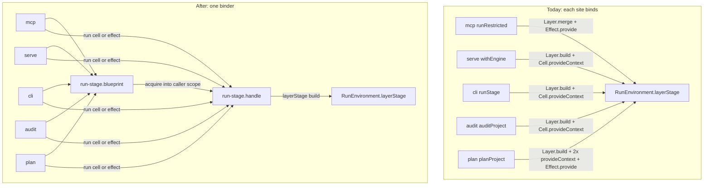
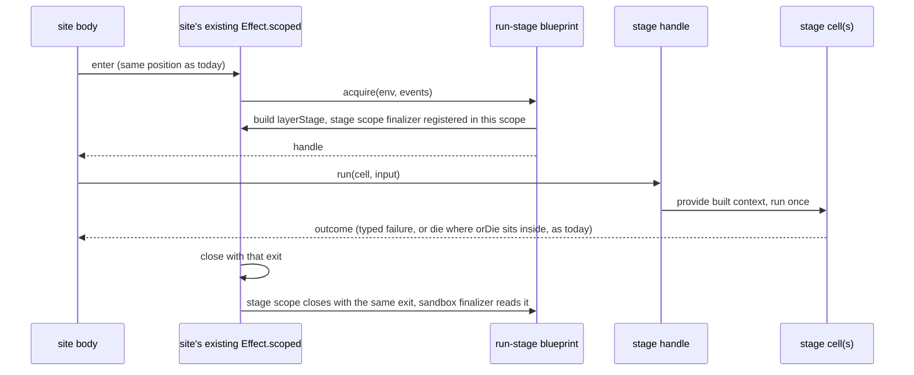

# Boundary Escalations - Plan

## Goal Capsule

- **Objective:** a reviewer grading this repository against the enrolled `cell-architecture` pack finds no violation at the four boundary escalations already on `main`: F8, F10, and #321's two F13 rows. Every user-facing surface (`stryker run`, `plan`, `audit`, `mcp`, `serve`, `Engine.*`, and the e2e lane) behaves exactly as before.
- **Means:** one pull request on a new stack off `main` (KTD1). The engine's per-run stage is acquired through a run-stage blueprint and handle, at the exact scope position each site uses today (KTD2, KTD3). The e2e harness contract gets harness-owned types (KTD5), and the Service-less harness module loses its `.service` suffix (KTD6).
- **Product authority:** root's 2026-10-13 next-unit intent (fix the four escalations; real public-surface integration tests where behaviour is involved; no new code in `test/e2e-core`; do not duplicate or conflict with Stream D's moves). Rule text: the packs `.compound-engineering/config.yaml` pins at systemfsoftware `a578c704` (#336). The four packs this plan cites are byte-identical there to `763fd66`, the revision #321 and #322 were graded against.
- **Authority order:** `CONSTITUTION.md` > `AGENTS.md` > `packages/AGENTS.md` > this plan.
- **Stop conditions:** stop and report if any of these happen:
  - an existing public-surface test changes verdict;
  - `api:check` reports a changed signature for any `Engine`, `Mcp` or `Serve` export;
  - a site cannot keep its current `Effect.scoped`/`Effect.orDie`/`Effect.ensuring` nesting (KTD3);
  - Stream D opens a PR that moves or deletes a file this plan edits;
  - a step would edit `release.jsonc`, `turbo.json`, `gritlint.json`, `flake.*`, `.compound-engineering/config.yaml`, `.github/` or anything under `test/e2e-core`.
- **Execution profile:** `ce-work` after root reviews this plan. No local mutation run, no local e2e (OP27), no Stream K e2e rerun. Reviews are report-only. Push once per review round.
- **Who finishes:** Stream A opens the PR and carries it to green with a full-path receipt. Root merges.

---

## Product Contract

### Summary

Four boundary findings were escalated, not fixed, in #321 and #322. Each is still on `main` at `3797debd`:

- Five engine sites build and bind the per-run stage inside their own body.
- `stryker plan` runs two stage cells one after another by hand.
- The e2e harness's `GuestJobs` contract names the microsandbox driver's types.
- A harness module named `*.service.ts` holds no Service.

This work fixes all four and changes no observable behaviour and no public signature.

### Problem Frame

The cell-architecture pack says capability services bind once, at the composition root, and that no `Effect.provide`, `Cell.provideContext` or layer rebuild appears in the body of a domain cell, workflow or route handler (pack: cell-architecture, service-and-layer-boundaries.md, section 4 and gate item 4). It also says cells compose through combinators, never through sequential `cell.run` calls (pack: cell-architecture, pipeline-composition.md).

#321's review recorded two pre-existing violations as plan gap F13, in its receipt's escalation rows:

- F13a: `Mcp/mcp-server.cell.ts:146`, `Serve/Serve.cell.ts:166`, `run-request.cell.ts:159`, `audit-request.cell.ts:200` and `plan-request.cell.ts:257` (all under `packages/stryker-js/src/`) build or provide the run stage in their own body.
- F13b: `plan-request.cell.ts:259-260` runs `prepareStageCell` then `planInstrumentCell` in sequence.

#322's review recorded two more in its "Escalations" section:

- F8: `test/e2e/src/Harness/guest-job.service.ts:1` imports `type { MicroVM }` and types `GuestJobsShape` with `MicroVM.Mount` and `MicroVM.JobBlueprint`.
- F10: `test/e2e/src/Harness/harness-telemetry.service.ts` has no `Context.Service`.

What makes F13 more than a move: where the stage is built decides which scope owns it. The stage scope then closes with that parent's exit, and the sandbox finalizer reads that exit to keep or remove `.stryker-tmp/sandbox-*` (`docs/solutions/runtime-errors/stage-scope-closed-with-exit-void-hides-run-outcome.md`, Mechanism 2; `packages/stryker-js/src/Sandbox.service.ts:74-81`). The five sites close their stage four different ways, and that is observable behaviour (Appendix A).

### Requirements

**Engine binding (F13)**

- R1. No body of the five F13a sites calls `Layer.build`, `Cell.provideContext` or `Effect.provide` with the run stage. Per-run stage acquisition and binding have one owner module pair. (pack: cell-architecture, service-and-layer-boundaries.md)
- R2. `stryker plan` runs a project's prepare and plan-instrument stages as one composed cell. `programDigestAtPlanTime` (`plan-request.cell.ts:203-222`) stops providing the stage context itself. (pack: cell-architecture, pipeline-composition.md)

**E2e harness (F8, F10)**

- R3. `GuestJobsShape` and `guest-job.service.ts` name no type from `@systemfsoftware/effect-microsandbox` or `microsandbox`. (pack: cell-architecture, service-and-layer-boundaries.md, section 1 `*.service.ts` invariant)
- R4. `test/e2e/src/Harness/` holds no `*.service.ts` file without a `Context.Service`.

**Behaviour and surface preserved**

- R5. Every user-facing outcome is unchanged on every surface that reaches a changed site:
  - stdout stream lines and their order;
  - the verdict and the exit code, including 130 on interruption;
  - the sandbox kept or removed for each `cleanTempDir` and run outcome;
  - report and plan files, byte-identical plan output;
  - MCP tool responses and MSP JSON-RPC frames, with stdout carrying nothing else.
- R6. `packages/stryker-js/etc/stryker-js.api.md` does not change. Each changeset bump comes from the Turbo `typecheck` gate's moved set, with the honest bump per package (KTD8).

**Boundaries with other work**

- R7. No file under `test/e2e-core` is created or edited. No file that Stream D's plan moves or deletes is moved or deleted here (KTD9).
- R8. The PR carries the evidence root requires:
  - the pinned `cell-architecture` gate run from outside the repository on the PR head and on `main`;
  - a full-path `ce-code-review` receipt, naming the actual non-Claude model that served every lens;
  - a fixing commit for every confirmed violation or accepted finding.

### Acceptance Examples

- AE1. **Covers R1.** On the PR head, the five site functions (`runRestricted`, `withEngine`, `runStage`, `auditProject`, `planProject`) contain no `Layer.build(`, `Cell.provideContext(` or `Effect.provide(` call. `programDigestAtPlanTime` contains none either.
- AE2. **Covers R5.** Given a project whose tests fail and `cleanTempDir: true`, when `stryker run` runs, then the run exits non-zero and `.stryker-tmp` still holds its sandbox. Given passing tests, the sandbox is removed. `clean-temp-dir.integration.test.ts` pins these cells for `Engine.strykerCell` only. For the CLI route this plan rewires, AE2 is proven by KTD3's per-site nesting check (KTD7), not by a new test.
- AE3. **Covers R3.** `guest-job.service.ts` has no import from `@systemfsoftware/effect-microsandbox`. The only `MicroVM` references under `test/e2e/src/Harness/` are in `microsandbox-guest-job.ts`, `warm-sandbox.handle.ts`, a new driver helper (KTD5), and `harness-failure.schema.ts` (F7, not in scope).
- AE4. **Covers R4.** `git ls-files 'test/e2e/src/Harness/*.service.ts'` lists only files containing `Context.Service`.

### Key Decisions

- **One PR, four escalations.** Root's intent names one PR. A split would put the low-overlap harness change ahead of the engine change, but root ruled out that cost trade. Governs R8.
- **F10 covers the one file root named.** `main` holds 17 Service-less `*.service.ts` files (Appendix B). Root's intent names `harness-telemetry.service.ts`, so the other 16 stay as F10 debt (Open Question Q1). Governs R4.

### Scope Boundaries

- Not here: the 16 other Service-less `*.service.ts` files (Q1).
- Not here: three binding sites research found that #321 did not escalate (Q2):
  - `run/prepare.cell.ts:62` builds `TemporaryDirectory.layer` inside `prepareCell`;
  - `Serve/Serve.cell.ts:569` builds the socket server layer in `bindListener`;
  - `Reporter/reporter.service.ts:44,67` calls `Cell.provideContext` on reporter cells.
- Not here: `run/run-stages.ts:45-48` (`Engine.strykerCell`). It is the programmatic composition root, where building and binding the stage is the rule's sanctioned site (pack: cell-architecture, service-and-layer-boundaries.md, section 4.1).
- Not here: F7 (`harness-failure.schema.ts` importing microsandbox error classes), F6 and F9.
- Not here: `stryker plan` holding every project's stage until the whole plan ends (`plan-request.cell.ts:464`). It is current behaviour, and R5 keeps it.
- Considered, not built:
  - An interruption test (exit 130) through the built binary. No flow has one today. This work keeps every site's scope nesting (KTD3), so the interrupt path is untouched. A failure in it would surface as an existing verdict change in `incremental-report-roundtrip`, whose interruption test runs `Engine.mutationTestCell`, the cell every F13a stage provides. What would change the call: a KTD3 exception at any site.
  - New exit-sensitive cleanup scenarios for the MCP and Serve routes. Their stage owner stays at the same combinator position (KTD3), and each new row costs two real mutation runs. What would change the call: a review finding that MCP or Serve acquisition moved.
  - A spawned `stryker run` scenario pair pinning AE2 on the CLI route. The test-layer admission gate refuses it ("Spawning a process in an integration test is an automatic fail", `skill://test-layer-selection`, section 2). No published in-process surface reaches site C: `runRequestCell` is not exported (`packages/stryker-js/etc/stryker-js.api.md:19`). A local `stryker run` smoke is a local mutation run, which this stream's contract forbids. What would change the call: root admitting a spawned test, or exporting an in-process CLI entry.

### Deferred to Follow-Up Work

- A `docs/solutions/` entry on acquiring per-run stages where the owning scope sits. It is captured with `ce-compound` after merge, so it records what merged rather than what was planned.

### Sources

- Escalation rows: #321 receipt (merged as `117bff02`; `docs/plans/2026-10-13-0326-refactor-cell-layer-placement-plan.md` gaps F8, F10, F13), #322 receipt "Escalations" section (merged as `e3101563`).
- Stream D: #337 (`stream-d/dissolve-e2e-core`, merged as `3797debd`), plan `docs/plans/2026-10-13-0900-refactor-dissolve-e2e-core-plan.md` on `main` (KTD9).
- Pack rules (pinned at systemfsoftware `a578c704`, identical to `763fd66` for the four cited packs; the other three enrolled packs, `mutation-discipline`, `ci-wall-clock` and `turbo-task-graph`, govern survivors, CI lanes and the task graph, none of which this plan changes): pack: cell-architecture, service-and-layer-boundaries.md; pack: cell-architecture, pipeline-composition.md; pack: cell-architecture, resource-vs-handle-duality.md; pack: cell-architecture, scoped-lifecycle-boundaries.md; pack: cell-architecture, handle-state-privacy.md; pack: schema-laws, tests-own-no-schemas.md; pack: boundary-testing, no-mocks-on-internal-glue.md.
- Learnings: `docs/solutions/runtime-errors/stage-scope-closed-with-exit-void-hides-run-outcome.md` (Mechanism, Prevention); `docs/solutions/best-practices/e2e-lane-owns-its-traces-through-traceparent.md` (harness layers and `globalSetup`).
- Cell API: `@systemfsoftware/effect-cell-types` 12.0.0, `dist/index.d.ts`. `Cell.provideContext` takes a built `Context` only. `Cell.andThen` has a function form `(response) => Cell`. No combinator provides a Layer per input.

---

## Planning Contract

### Key Technical Decisions

- KTD1. **One stack, one layer, cut from `main` at `3797debd`.** Branch `stream-a/boundary-escalations`. `main` moved from `e3101563` to `3797debd` while this plan was written (#336 pinned the packs, #337 is Stream D's PR A). Neither touches a file this plan edits. The F13 sites are also touched by eight open PRs from other streams (#271, #287, #289, #296, #298, #299, #313, #329), and #271/#289 touch two F8 harness files. Their hunks were compared:
  - Harness files: no overlap (#271/#289 edit `fixture-cache.service.ts` 14-15, 68, 104-113, 272-319, 589-641 and `warm-sandbox.handle.ts` 170-288; this plan edits 51-54, 701-706 and 1-11, 60, 70-74).
  - Site functions: #287 edits `runStage` (`run-request.cell.ts:158`, and an insert after `:163`). #271, #287, #289, #296 and #313 each edit `planProject` (`plan-request.cell.ts:245-335`). #298, #299 and #329 edit the same files outside the site functions. No open PR touches `Serve.cell.ts` or `audit-request.cell.ts`.
  - If any of these merges first, the merge of `main` into this branch re-traces that site's Appendix A row on the merged tree before the nesting check runs. A merged PR that changes a site's nesting is a KTD3 exception, which is a stop condition.
  - They are listed in the PR body, and whichever PR lands second merges `main`. This PR does not stack on them: they belong to other streams and are not this branch's base (OP13b's overlap rule is scoped to one author's stack).
- KTD2. **The per-run stage is a blueprint-acquired value handle, not an ambient service.** A new `packages/stryker-js/src/run/run-stage.blueprint.ts` describes a stage from the run environment and the event queue. Its scoped acquisition builds `RunEnvironment.layerStage` into the caller's current scope and mints a handle.
  - `run/run-stage.handle.ts` keeps the built context in a private slot and exposes two dual operations: run a cell against the stage, and run an effect against the stage.
  - The handle module is the one place that binds the stage (R1). Each site acquires a handle and runs through it.
  - This follows the pack's rule that scoped data boundaries are constructed at the request edge as distinct value handles, and that runtime instances are handles, never `Context.Service` tags (pack: cell-architecture, service-and-layer-boundaries.md, section 4.5; pack: cell-architecture, resource-vs-handle-duality.md, section 2). These surfaces have no middleware layer, so each site function is its route's request edge. Section 4.3's carve-out names edge middleware that runs before the handler body. This design does not claim that carve-out. A grader who reads 4.3 as forbidding any acquisition in a handler body would still see F13 open (Assumptions).
  - Rejected: binding the stage at each composition root. The CLI root would build one stage per process, and Serve and MCP per server. That moves each stage's parent scope, which changes the exit the sandbox finalizer sees at sites A and C (Appendix A). It also adds the stage to the `R` of `Engine.planRequest`, `Mcp.mcpServerLayer` and `Serve.serveMutationServer`, all public in `etc/stryker-js.api.md:19,39,54`, which is a `major` for stryker-js.
  - Rejected: a `RunStages` capability service bound at each composition root, whose operation acquires a stage handle at the site. This one keeps scopes, because acquisition still happens at the site, and it makes stages substitutable in tests. Its cost is a choice between the same `major`, or providing its layer inside three exported functions. No test needs the substitution today, and the repo already acquires per-run resources by importing their blueprint directly at the site (`plan-request.cell.ts:214`, `checkerPoolsScoped`). What would change the call: a test that must substitute the stage.
  - Rejected: per-route middleware. Effect's own request-scoped pattern is router middleware that provides services before the handler runs ([HttpRouter](https://www.effect.website/docs/v4/api/effect/unstable/http/HttpRouter)). Effect CLI's `Command.runWith` (`bin/main.ts:246`) offers no per-route hook here, and the stdio MSP and MCP servers have no router, so each surface would need its own. It also moves scopes.
  - Not a bake-off: the facts that decide between these (public signatures, scope parents, repo precedent) are already established, so further development would not change the choice.
- KTD3. **Each site keeps its scope nesting exactly.** The handle is acquired where `Layer.build` runs today, inside the same `Effect.scoped`, with `Effect.orDie` and `Effect.ensuring` in the same relative order. This preserves the exit each stage closes with (Appendix A):
  - Site C (CLI run) keeps `orDie` inside `scoped`, so a typed failure reaches its stage as a die.
  - Sites A (MCP) and D (audit) keep `orDie` outside `scoped`, so their stage closes with the typed failure.
  - Site B (Serve) keeps `Queue.end` and the consumer join in `Effect.ensuring`, outside the stage scope.
  - Site D (audit) keeps one scope per project.
  - Site E (plan) keeps one outer scope for all projects.
  - The blueprint performs no `Effect.scoped` of its own (pack: cell-architecture, scoped-lifecycle-boundaries.md, section 2). A handle operation never opens or closes a scope.
- KTD4. **MCP's console capture is part of that site's stage acquisition, once per tool call.** `MachineConsole.layerCapture` resets the MCP server's shared `MachineConsole` buffer on every acquisition (`reporting/machine-console.service.ts:205-210`). Nothing in the MCP path reads the buffer, so resetting per call is what bounds its growth across a long session. The blueprint's acquisition owns the capture: the run-stage spec carries a console mode as data, and acquisition in capture mode builds `MachineConsole.layerCapture` with the stage. `runRestricted` passes only the environment, the queue and that mode. A site-side composition is rejected because it would put a layer build or provide back in the site body, which AE1 forbids. The capture branch's `MachineConsole` requirement must reach only the MCP call; no other site's `R` changes (R6). It is built once per `rerun_mutant` call, and stdout stays protocol-only.
- KTD5. **`GuestJobs` owns its types; driver construction stays in driver modules.**
  - `GuestJobsShape` keeps one operation, which runs a command with harness-owned mounts (`{ host, guest }`) to a clean exit. It returns the same three typed failures as today. Its constants (`BASE_IMAGE`, `GUEST_MEMORY_MIB`, the guest roots, `STDERR_TAIL_CHARS`) stay on the class.
  - The warm boot needs a live VM, not a job result. `warm-sandbox.handle.ts` is already driver code (`:2-7` import `MicroVM`, `Sandbox`, `Snapshot`), so it builds its VM blueprint itself.
  - The three-line blueprint construction the two driver modules share moves to a plain driver helper module beside them. That module exports no `make` or `layer`, so it is not an adapter, and the adapter-only-imported-by-roots rule does not apply to it (pack: cell-architecture, service-and-layer-boundaries.md, section 1).
  - Rejected: a harness Schema for mounts. `tests-own-no-schemas` puts harness schemas in the harness file that uses them, never in a `*.schema.ts` (pack: schema-laws, tests-own-no-schemas.md). A plain interface in `guest-job.service.ts` is enough because nothing decodes it.
- KTD6. **F10 is a rename to `harness-telemetry.ts`.** The module holds constants and span helpers, with no state and no Service (pack: cell-architecture, handle-state-privacy.md). Rejected: wrapping it in a `Context.Service` to fit the suffix.
  - Its four importers update their specifiers: `fixture-cache.service.ts:54`, `harness-layers.ts:9`, `microsandbox-guest-job.ts:6`, `microsandbox-stryker-cli-runner.ts:3`.
  - The importer list comes from a grep on `e3101563`; `3797debd` changes none of these files. One research pass listed two other files and was wrong.
- KTD7. **Tests: the existing public-surface suites; no new test.**
  - The F13 change is behaviour-preserving by construction (KTD3). Its proof is the existing suites that drive each changed site through a public surface (Verification Contract).
  - One gap stays: exit-sensitive sandbox cleanup is pinned only for `Engine.strykerCell` (`packages/stryker-js/tests/clean-temp-dir.integration.test.ts:82-95`), which this plan does not touch. The CLI route (site C) closes its stage with a die (Appendix A), and no admitted test reaches it (Scope Boundaries, considered and not built).
  - So AE2's proof for the CLI route is a named per-site check: the review's correctness lens compares each site's `Effect.scoped`/`Effect.orDie`/`Effect.ensuring` nesting on the head with Appendix A's table. Any difference is a finding that blocks the PR.
  - That check reads code; it does not run it. The repo's own learning says a scoped-finalizer claim is settled with a run, because the scope a layer attaches to comes from the provided context, not the nearest `Effect.scoped` (`docs/solutions/runtime-errors/stage-scope-closed-with-exit-void-hides-run-outcome.md`, Prevention). So R5's sandbox and interruption rows for the CLI route are unchanged by construction and not verified by any run. The PR body records this as a known gap, not as a preserved outcome.
  - F8 and F10 are harness-internal. Their public surface is the e2e lane, which runs only on `main` pushes (P13 of plan 0900). The first `main` e2e run after merge is that proof.
  - Mutation on `main` selects `src/**/*.workflow.ts` and `src/**/*.schema.ts` (`packages/stryker-js/stryker.config.ts:15-17`). No touched file is either kind, so no surviving-mutant ids apply.
- KTD8. **Changeset intents come from the Turbo gate's moved set.** Since #335 the Changeset Check names every publishable package whose `typecheck` hash moved (`release.jsonc:14`). The intent set comes from `turbo run typecheck --dry=json` on base and head, as on #322.
  - Expected: `@systemfsoftware/stryker-js` with bump `none`, because nothing observable or public changes (R5, R6). `test/e2e` is private.
  - If the dry run names another package, it gets its honest bump.
- KTD9. **Stream D does not relocate any file this plan edits.**
  - D's PR A (#337) merged as `3797debd`. It changed `mutation.yml`, `kill-matrix.yml`, `lockfile-closure-digest.integration.test.ts`, a changeset and its plan, now on `main`.
  - D's plan (0900, inventory and "Files outside the package that name it") moves only `test/e2e-core` files into `test/e2e/src/Harness/` and `test/bench/src/`. Its PR D rewrites the `e2e-core` import block of `fixture-cache.service.ts` (`:24-47`) and `harness-failure.schema.ts`.
  - This plan edits `fixture-cache.service.ts` at `:51-54` and `:701-706`, outside that block. It does not touch `harness-failure.schema.ts`.
  - D's other branches (`grab-bags`, `compound-import-closure`, `u6-mutation-verdict`) touch none of the target files.
  - If D opens a PR that moves a target file before this lands, stop (Goal Capsule).

### High-Level Technical Design

Who binds the stage, before and after. The handle module is the only binder. Sites acquire and run through it, and the programmatic root keeps its own build (Scope Boundaries).

Stage lifecycle at a site. The scope that owns the stage is unchanged, so the exit the sandbox finalizer reads is unchanged.

### Assumptions

- The four escalations are the whole scope. Research found three more binding sites; they are escalated, not fixed (Q2).
- No new test is admitted (KTD7). AE2 on the CLI route rests on the per-site nesting check.
- `Engine.strykerCell` stays the programmatic composition root and is not migrated.
- Root accepts KTD2's handle design over its two root-bound alternatives, and accepts that each site function is its route's request edge (KTD2, section 4.5 rather than 4.3's middleware carve-out). If root prefers a root-bound alternative, KTD2, KTD3 and KTD8 change, and stryker-js may take a `major`.

### Corrections carried from plan 0326

- KTD6 of `docs/plans/2026-10-13-0326-refactor-cell-layer-placement-plan.md` listed `@systemfsoftware/stryker-js-vitest-runner` as `none` and named no intent for `stryker-js` or `stryker-js-html-reporter`. #322 shipped vitest-runner as `patch` (`.changeset/large-hoops-sip.md`), and `stryker-js` and `stryker-js-html-reporter` as `none` (`.changeset/smooth-lions-invent.md`), from the Turbo gate's moved set. That plan's bump table is superseded by what merged. No file of that plan is edited.

---

## Implementation Units

U3 (a spawned `stryker run` test) was removed in review; its ID is not reused (Scope Boundaries, considered and not built).

### U1. Harness telemetry module rename

- **Goal:** `harness-telemetry.service.ts` becomes `harness-telemetry.ts`, so no Service-less `*.service.ts` remains in the harness.
- **Requirements:** R4, R7.
- **Dependencies:** none.
- **Files:** `test/e2e/src/Harness/harness-telemetry.service.ts` (renamed to `harness-telemetry.ts`), `test/e2e/src/Harness/fixture-cache.service.ts`, `test/e2e/src/Harness/harness-layers.ts`, `test/e2e/src/Harness/microsandbox-guest-job.ts`, `test/e2e/src/Harness/microsandbox-stryker-cli-runner.ts`.
- **Approach:** `git mv`, then update the four import specifiers (KTD6). No content change.
- **Patterns to follow:** `test/e2e/tests/__fixtures__/trace-observation.fixture.ts`, which keeps shared settings in a plain module (learning: `e2e-lane-owns-its-traces-through-traceparent.md`).
- **Test expectation:** none. This is a pure rename; `test/e2e` typecheck and lint resolve every specifier.
- **Verification:** AE4 holds. Nothing in the repository names `harness-telemetry.service`, except history under `docs/plans/`.

### U2. GuestJobs contract owns its types

- **Goal:** the `GuestJobs` contract names no driver type, and both driver modules keep their behaviour.
- **Requirements:** R3, R5, R7.
- **Dependencies:** U1, which owns the `microsandbox-guest-job.ts` import line it renames.
- **Files:** `test/e2e/src/Harness/guest-job.service.ts`, `test/e2e/src/Harness/microsandbox-guest-job.ts`, `test/e2e/src/Harness/warm-sandbox.handle.ts`, `test/e2e/src/Harness/fixture-cache.service.ts`, a new driver helper module beside them in `test/e2e/src/Harness/` (name chosen in `ce-work`).
- **Approach:**
  1. `GuestJobsShape` keeps one operation over harness-owned mounts (KTD5). Its error union and requirements channel are unchanged.
  2. `microsandbox-guest-job.ts` builds the driver job from those mounts through the helper, then runs it to a clean exit as today.
  3. `warm-sandbox.handle.ts:70-74` builds its idle VM blueprint through the same helper instead of through `GuestJobs`. The `GuestJobFailure` mapping and step text stay the same.
  4. `fixture-cache.service.ts:701-706` calls the single operation with the same step and mounts.
- **Patterns to follow:** `microsandbox-stryker-cli-runner.ts` and `stryker-cli-runner.service.ts` (a contract-only service with a driver adapter beside it, from #322).
- **Test expectation:** none in this PR. The behaviour lives behind the e2e lane, which runs on `main` pushes (KTD7). Every journey bakes fixtures (the bake path) and boots warm sandboxes (the boot path), so the first `main` e2e run after merge exercises both.
- **Verification:** AE3 holds. `@systemfsoftware/stryker-e2e` typecheck and lint pass. `harness-layers.ts` still composes `guestJobsLayer` unchanged.

### U4. Run-stage blueprint and handle

- **Goal:** one module pair acquires the per-run stage and binds it.
- **Requirements:** R1, R6.
- **Dependencies:** none.
- **Files:** new `packages/stryker-js/src/run/run-stage.blueprint.ts`, new `packages/stryker-js/src/run/run-stage.handle.ts`.
- **Approach:**
  1. The blueprint takes a `RunEnvironmentShape` and the event queue. Its scoped acquisition builds `RunEnvironment.layerStage` in the caller's scope and mints the handle (KTD2). It never calls `Effect.scoped` (KTD3).
  2. The handle slot holds the built context privately (pack: cell-architecture, handle-state-privacy.md). Two dual operations run a cell against it and run an effect against it.
  3. Neither module is exported from `Engine`, so the API report is unchanged (R6).
- **Patterns to follow:** `Checker/checker-pool.blueprint.ts` with `checker-pool.handle.ts` (blueprint `scoped` minting a handle with a private slot); `Sandbox.blueprint.ts`.
- **Test expectation:** none on its own. A test of the two modules alone would test wiring and forwarding. The behaviour is proven where it is used (U5, U6).
- **Verification:** typecheck and lint pass. Nothing imports the modules yet except U5 and U6.

### U5. CLI, Serve and MCP sites run through the stage handle

- **Goal:** sites C, B and A acquire the stage through U4 and keep their exits and ordering.
- **Requirements:** R1, R5, R6.
- **Dependencies:** U4.
- **Files:** `packages/stryker-js/src/run-request.cell.ts` (`runStage`), `packages/stryker-js/src/Serve/Serve.cell.ts` (`withEngine`, `runDiscover`, `runMutationTest`), `packages/stryker-js/src/Mcp/mcp-server.cell.ts` (`runRestricted`).
- **Approach:**
  1. In `runStage`, acquire the handle where `Layer.build` runs today and run `mutationTestCell` through it. Keep `Effect.orDie` then `Effect.scoped`.
  2. In `withEngine`, acquire inside the same inner `Effect.scoped` and hand callers the handle instead of a context. `Queue.end` and the consumer join stay in `Effect.ensuring` outside it.
  3. In `runRestricted`, acquire the stage with the capturing console (KTD4). Keep `Effect.scoped` then `Effect.orDie` in today's order. The queue stays undrained and unended, as today.
- **Execution note:** run the MCP and Serve suites after each site, not only at the end.
- **Test scenarios:**
  - Covers AE2. `clean-temp-dir.integration.test.ts` keeps its six verdicts (the programmatic route, unchanged here). For `runStage`, the nesting check in KTD7 holds against Appendix A.
  - `mutation-server.integration.test.ts`: configure, discover, mutationTest, progress, busy and unknown-method keep their verdicts, and the stdout-purity assertion (`stdoutLeftoverBytes: 0`) still holds.
  - `mcp-server.integration.test.ts`: the list, show, `rerun_mutant` and feedback scenario keeps its verdict, and stdout carries only protocol lines.
  - `rerun-by-id`, `break-threshold-exit`, `shard-run-verdict`, `shard-merge`, `run-event-stream`, `gate` and `refuse-local-mutation` keep their verdicts.
- **Verification:** AE1 holds for these three sites. `api:check` passes with `etc/stryker-js.api.md` unchanged.

### U6. Audit and plan sites; plan's stage cells compose

- **Goal:** sites D and E acquire through U4, and `stryker plan` runs one composed stage cell per project.
- **Requirements:** R1, R2, R5.
- **Dependencies:** U4.
- **Files:** `packages/stryker-js/src/audit-request.cell.ts` (`auditProject`), `packages/stryker-js/src/plan-request.cell.ts` (`planProject`, `programDigestAtPlanTime`).
- **Approach:**
  1. In `auditProject`, acquire inside the existing per-project `Effect.scoped` and run `prepareStageCell` through the handle. `Effect.orDie` stays outside the scope.
  2. In `planProject`, acquire in the same outer plan scope as today. Compose `prepareStageCell` with `planInstrumentCell` through `Cell.andThen`'s function form, so the composed result carries `prepared.loadedPlugins` along with the instrument outcome. Run it once through the handle.
  3. `programDigestAtPlanTime` takes the handle and runs its checker-pool effect through the handle's effect operation. Its own `Effect.scoped` for the pool stays where it is.
- **Patterns to follow:** `Serve/Serve.cell.ts` `discoverStageCell` (an `andThen` chain run once); `Checker/Checker.cell.ts` (`Cell.flatMap`, `Cell.mapInput`).
- **Test scenarios:**
  - `plan.integration.test.ts`: plan bytes stay byte-identical across invocations, and dedupe by path and symlink still holds.
  - `plan-costs`, `plan-recorded-costs`, `plan-shard-reuse`, `plan-stream-location`, `plan-without-sandbox` and `shard-run-verdict` keep their verdicts.
  - `compile-error-reuse.integration.test.ts` (`Engine.planRequest` in-process, with its exported signature unchanged) keeps its verdict.
  - `audit.integration.test.ts`: all nine scenarios, including `--counts-only` and multiple projects, keep their verdicts.
- **Verification:** AE1 holds for sites D and E. The F13b sequential-run shape is gone from `plan-request.cell.ts`.

---

## Verification Contract

| Check             | Command or source                                                                                                                                                                                                                                                            | Proves                                        |
| ----------------- | ---------------------------------------------------------------------------------------------------------------------------------------------------------------------------------------------------------------------------------------------------------------------------- | --------------------------------------------- |
| Types, API, lint  | `pnpm exec turbo run typecheck api:check lint lint:tsgo --filter=@systemfsoftware/stryker-js --filter=@systemfsoftware/stryker-e2e`                                                                                                                                          | R6; U1, U2 and U4-U6 compile and lint         |
| Engine suites     | `pnpm exec turbo run test --filter=@systemfsoftware/stryker-js` (the full suite; U5 and U6 name the scenarios that reach changed sites)                                                                                                                                      | R5                                            |
| Nesting check     | the correctness lens compares each site's `Effect.scoped`/`Effect.orDie`/`Effect.ensuring` order on the head with Appendix A                                                                                                                                                 | AE2, KTD3                                     |
| Format            | `./bin/dprint check`                                                                                                                                                                                                                                                         | all                                           |
| AE greps          | `git grep -nE 'Layer\.build\(\|Cell\.provideContext\(\|Effect\.provide\('` over the six functions; `git grep -n effect-microsandbox -- test/e2e/src/Harness/guest-job.service.ts` exits 1; `git ls-files 'test/e2e/src/Harness/*.service.ts'` with a `Context.Service` check | AE1, AE3, AE4                                 |
| API report        | `git diff --quiet origin/main -- packages/stryker-js/etc`                                                                                                                                                                                                                    | R6                                            |
| Change intents    | `turbo run typecheck --dry=json` on base and head, publishable packages whose hash moved, compared with the PR's `.changeset/*`                                                                                                                                              | R6, KTD8                                      |
| Pinned gate       | gritlint built from `0e2e07b3f810929bf7f3db54c6302cf17097f02f` with a scratch config adding `"cell-architecture": {}`, run on `main` and the PR head outside the repository (plan 0326 KTD8)                                                                                 | R8; no new `service-exports-no-layer` finding |
| Judgment surfaces | `git diff --quiet origin/main -- release.jsonc turbo.json gritlint.json flake.lock flake.nix .compound-engineering .github test/e2e-core`                                                                                                                                    | R7                                            |
| Review            | full-path `ce-code-review` against `main`, report-only, with every lens's served model read from its transcript                                                                                                                                                              | R8                                            |
| e2e               | first `main` push after merge (postsubmit; no local VM, OP27)                                                                                                                                                                                                                | R5 for U1, U2                                 |

---

## Definition of Done

- AE1-AE4 hold on the PR head, and every check in the Verification Contract passes, except e2e, which is postsubmit.
- The PR body carries the following:
  - the unmodified pinned-gate output for `main` and the head;
  - the pack rule ledger for every enrolled pack;
  - each lens's served model and its findings with dispositions;
  - fixing commit SHAs for confirmed findings;
  - the open-PR overlap list (KTD1);
  - the Stream D check (KTD9).
- Changesets match the Turbo gate's moved set exactly (KTD8).
- No dead or experimental code from abandoned approaches remains in the diff.
- No new escalation is fixed silently. Q1 and Q2 items stay escalated unless root rules otherwise.
- Per unit: U1 AE4; U2 AE3 and e2e typecheck; U4 typecheck; U5 and U6 AE1, the KTD7 nesting check and their named suites green.

---

## Open Questions

- Q1. F10 covers one file here. `main` has 16 more Service-less `*.service.ts` files (Appendix B), 4 of them in `test/bench`. Fix them in this PR, or leave them as F10 debt? Default: F10 debt, because root named one file.
- Q2. Research found three binding sites #321 did not escalate (Scope Boundaries). Should they be recorded as new escalations F14-F16 in this PR's body and left unfixed, or added to this unit? Default: recorded and escalated, not fixed.

---

## Appendix

### A. How each stage closes today (single-pass trace on `e3101563`, unchanged on `3797debd`)

| Site | Function                                              | Scope that owns the stage                       | Exit the stage sees                              | Ordering preserved by KTD3                                                                 |
| ---- | ----------------------------------------------------- | ----------------------------------------------- | ------------------------------------------------ | ------------------------------------------------------------------------------------------ |
| A    | `Mcp/mcp-server.cell.ts` `runRestricted` (`:126-147`) | its own `Effect.scoped` (`:146`)                | typed failure (`orDie` outside `scoped`)         | queue never ended; console capture reset per call                                          |
| B    | `Serve/Serve.cell.ts` `withEngine` (`:151-173`)       | inner `Effect.scoped` (`:164`)                  | typed failure as `ServeError`                    | stage closes before `Queue.end` and the consumer join in `Effect.ensuring`                 |
| C    | `run-request.cell.ts` `runStage` (`:158-168`)         | its own `Effect.scoped` (`:167`)                | die on a typed failure (`orDie` inside `scoped`) | stage closes before `closeAndDrain`, the verdict and the exit code (`bin/main.ts:269-280`) |
| D    | `audit-request.cell.ts` `auditProject` (`:174-213`)   | per-project `Effect.scoped` (`:197`)            | typed failure (`orDie` outside)                  | one stage per project, closed before the next                                              |
| E    | `plan-request.cell.ts` `planProject` (`:245-335`)     | `planRequest`'s single `Effect.scoped` (`:464`) | die on failure (`orDie` on the project body)     | all project stages close together after `PlanKnown` and `writePlan`                        |

Finalizers that read the stage's exit: the `TemporaryDirectory` finalizer (`Sandbox.service.ts:74-81`, registered from `run/prepare.cell.ts:62`), and the checker and runner pool releases. No member of `stageLayerOf` (`run/RunEnvironment.service.ts:98-130`) emits anything on close.

### B. Service-less `*.service.ts` files on `3797debd`

`packages/stryker-js-instrumenter/src/{Instrument,Mutator,Transformer}.service.ts`, `packages/stryker-js-plugin-interface/src/{PluginRpcs,TraceContext}.service.ts` (`TraceContext` declares only a `Context.Reference`), `packages/stryker-js/src/{framework-claimant,plugin-load-report,plugin-loader,reporter-stream,reporter-wiring}.service.ts`, `packages/stryker-js/src/run/{StageServices,host}.service.ts`, `test/bench/src/{prepare-side,pristine-tree,run-bench,workload-digest}.service.ts`, `test/e2e/src/Harness/harness-telemetry.service.ts` (U1).
