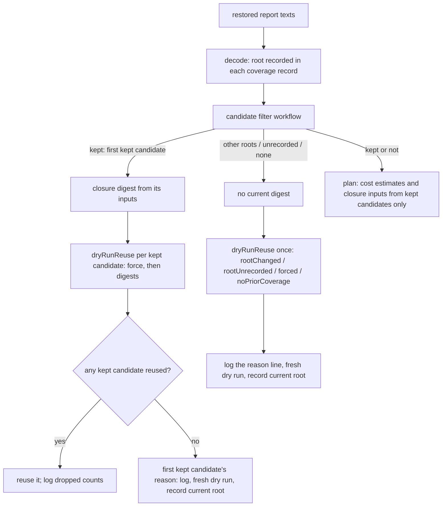

# Dry-run coverage reuse across workspace roots - Plan

## Goal Capsule

- **Objective:** A mutation run never scores mutants NoCoverage because it reused dry-run coverage recorded under another workspace root. When persisted coverage cannot be trusted under the current root, the run does its own dry run and its log says why.
- **Means:** record the project root inside every persisted coverage record and reuse coverage only from candidates recorded under the current root, in both the run and `plan` (Key Decisions 1, 2, 4-6; KTD2, KTD3).
- **Authority:** the root's rulings of 2026-10-11 on this brainstorm outrank the plan. R-IDs win on behaviour, KTDs on mechanism.
- **Stop conditions:** stop and report if R7 or R13 is not red on unchanged main code, if the two R13 plans differ after the fix (Key Decision 7), or if U5 grows beyond swapping the planner's coverage read for the shared candidate filter.
- **Execution profile:** one worktree on `fix/dry-run-coverage-root`. The red scenarios land first (U1). Verification is typecheck plus the targeted tests in the Verification Contract, one build at a time. No local mutation, no hand-applied mutants, no new kill caps or timeouts.
- **Ships:** `ce-work` commits and pushes the branch. The PR opens only when the root says so.

## Product Contract

### Summary

Dry-run coverage is reused only when the root recorded inside the coverage matches the current project root. Coverage that records no root is refused with `rootUnrecorded`, whatever its report header says, and coverage recorded under another root is refused with `rootChanged`; either refusal logs why, runs its own dry run, and records the current root. With several saved reports, only those recorded under the current root are considered. Shard planning reads coverage through the same filter.

### Problem Frame

A run that moved shards from hosted runners to a self-hosted fleet logged "Reusing the persisted dry-run coverage; skipping the initial test run", then warned that test files under the hosted root were "not found in input files", and the shard scored 0: 94 NoCoverage, 123 Ignored, nothing killed or survived.

Two facts the reuse decision cannot see make persisted coverage root-dependent: its paths are absolute (P1), and its per-test map is keyed by mutant ids that hash the absolute file name (P5). The decision compares digests only (P2). With no `testFiles` configured, the closure digest contains no path at all, so byte-identical content under a new root matches and the coverage is reused (P4). Planning then looks up the new root's mutant ids in a map keyed by the old root's ids, finds nothing, and plans every mutant NoCoverage (P6).

### Load-bearing premises

Each premise was checked on `origin/main` 84052beb4, except P7 and P14, which are unverified (see their Status column). U1 settles P7: R13 must be red on main. "Probe" means a throwaway integration test (since deleted) that drove `Engine.mutationTestCell` with the `vm` runner over three real temp roots with byte-identical files: root A ran first, then A's `reports/main.json` was copied into B (A still present) and into C (A deleted).

| ID  | Premise                                                                                                                                                                                                                                                                                                                                                | Evidence                                                                                                                                                                                                                                                                                                                                                                                                                                                                                                            | Status                                          |
| --- | ------------------------------------------------------------------------------------------------------------------------------------------------------------------------------------------------------------------------------------------------------------------------------------------------------------------------------------------------------ | ------------------------------------------------------------------------------------------------------------------------------------------------------------------------------------------------------------------------------------------------------------------------------------------------------------------------------------------------------------------------------------------------------------------------------------------------------------------------------------------------------------------- | ----------------------------------------------- |
| P1  | Persisted coverage carries absolute paths under the root that wrote it; test ids and report file keys are relative.                                                                                                                                                                                                                                    | main's Mutation artifact `mutation-report-443` (run 38130563737), `packages/stryker-js/stryker-incremental.json`: 1306/1306 `tests[].fileName`, 1/1 `globalTestInputs`, 201/201 `testFileModules` keys and all 10502 values are absolute under `/home/runner/work/stryker-js-effect/stryker-js-effect/` (3705 values under `node_modules/.pnpm`, 0 outside the workspace); test ids, `files` keys and `testFiles` keys are relative; top-level `projectRoot` is absolute.                                           | verified (artifact downloaded 2026-10-11)       |
| P2  | Reuse decides on `testClosureDigest`, `runInputsDigest` and `force` only; the coverage schema records no root.                                                                                                                                                                                                                                         | `packages/stryker-js/src/dry-run-reuse.workflow.ts:45-74`; `packages/stryker-js/src/dry-run-coverage.schema.ts:4-14`                                                                                                                                                                                                                                                                                                                                                                                                | verified                                        |
| P3  | The current closure digest is computed from the prior coverage's `globalTestInputs` and `testFileModules`.                                                                                                                                                                                                                                             | `packages/stryker-js/src/run/dry-run-choice.ts:65-81`, `:154-159`                                                                                                                                                                                                                                                                                                                                                                                                                                                   | verified                                        |
| P4  | The digest matched across roots because the project declares no test files, not because unresolvable evidence was dropped. `testFiles` defaults to `[]`; the dogfood config sets none; with no test files `analyzeImportClosure` builds no closures, and the digest reduces to the project digest over root-relative keys.                             | `packages/stryker-js-plugin-interface/src/stryker-options.schema.ts:287`; `packages/stryker-js/stryker.config.ts:4-24`; `packages/toolchain/stryker-config/lib/base.js:14-28`; `packages/stryker-js/src/import-closure.cell.ts:739`, `:749-756`, `:772`; `packages/stryker-js/src/run/dry-run-choice.ts:54-60`. Probe with `testFiles` unset: digest `f52a3ea7…` identical under A, B and C, coverage reused under B and C. Probe with `testFiles: ['test/**/*.mjs']`: the same move refused with `closureChanged`. | verified (code + probe)                         |
| P5  | Mutant ids depend on the absolute root. The id hashes the tuple's `fileName`, which is the instrumented file's name; the instrumenter gets no base path, and project file names are absolute crawl paths.                                                                                                                                              | `packages/stryker-js-instrumenter/src/MutantIdentity.ts:20-31`; `packages/stryker-js-instrumenter/src/Transformer.service.ts:954`, `:1392`, `:356-357`; `packages/stryker-js/src/run/instrument.ts:88-99`; `packages/stryker-js/src/read-project.cell.ts:150`, `:167`, `:191`. Probe: the same 7 mutants got 7 different ids under B and again under C.                                                                                                                                                             | verified (code + probe)                         |
| P6  | The NoCoverage comes from planning, not from the reporter. Per-test coverage is keyed by root-A mutant ids; planning looks up root-B ids, misses, and plans NoCoverage. The "not found in input files" line is only a reporter warning.                                                                                                                | `packages/stryker-js/src/plan-mutant-tests.workflow.ts:330-348`, `:359-360`; `packages/stryker-js/src/mutation-reporting.service.ts:617-618`. Probe: A scored 3 Killed, 4 NoCoverage; B and C scored 7/7 NoCoverage.                                                                                                                                                                                                                                                                                                | verified (code + probe)                         |
| P7  | Shard planning reads the same coverage. It builds per-mutant cost estimates from it (keyed by mutant id), passes its absolute inputs into the verdict-reuse closure digests, and takes the dry-run cost from the same reuse decision. Under another root the cost estimates fall back to defaults and the dry-run cost reads as 0; no verdict changes. | `packages/stryker-js/src/plan-request.cell.ts:260-262`, `:135-147`, `:279-282`, `:297-305`                                                                                                                                                                                                                                                                                                                                                                                                                          | effect is [INFERENCE] from reading; not run     |
| P8  | Verdict reuse across roots is already zero, because verdicts are keyed by mutant id (P5).                                                                                                                                                                                                                                                              | Probe: `reused 0, ran 7` under B and C, with both `testFiles` settings. The refusal reason per mutant was not captured.                                                                                                                                                                                                                                                                                                                                                                                             | verified outcome; mechanism [INFERENCE]         |
| P9  | An existing scenario pins the defect: it expects reuse across roots and never checks mutant statuses. It was added to keep turbo task logs out of the digests, not to promise cross-root reuse.                                                                                                                                                        | `packages/stryker-js/tests/dry-run-coverage-across-roots.integration.test.ts:238-286`; commit 19043fdb3                                                                                                                                                                                                                                                                                                                                                                                                             | verified                                        |
| P10 | Only the end-of-run report records its root. The checkpoint writer and the dry-run coverage writer emit a slim report with no `projectRoot`, though both carry `dryRunCoverage`.                                                                                                                                                                       | `packages/stryker-js/src/mutation-reporting.service.ts:730` (end-of-run report writes `projectRoot: input.basePath`); `:976-1005` (`slimIncrementalReport`: no `projectRoot`, spreads `dryRunCoverage` at `:1004`), used by the checkpoint writer at `:1053` and the dry-run coverage writer at `:1079`                                                                                                                                                                                                             | verified (code)                                 |
| P11 | `DryRunRunReason` is internal: it is in neither the CLI contract nor the API report.                                                                                                                                                                                                                                                                   | no match for `DryRunRunReason` or `noPriorCoverage` under `packages/stryker-js/etc` or `packages/stryker-js-cli-contract`                                                                                                                                                                                                                                                                                                                                                                                           | verified                                        |
| P12 | A merged shard report takes its header (including `projectRoot`) from the first shard but its `dryRunCoverage` from the first shard that has one, so the two can come from different shards.                                                                                                                                                           | `packages/stryker-js/src/shard/incremental-union.ts:94-112`                                                                                                                                                                                                                                                                                                                                                                                                                                                         | verified                                        |
| P13 | With several prior candidates, the current closure digest is computed from the first candidate's inputs only, then every candidate is judged against that one digest.                                                                                                                                                                                  | `packages/stryker-js/src/run/dry-run-choice.ts:152-160`, `:119-140`                                                                                                                                                                                                                                                                                                                                                                                                                                                 | verified                                        |
| P14 | Upstream StrykerJS matches incremental results by diffing relative-path report content, so its cache is portable across checkouts.                                                                                                                                                                                                                     | https://stryker-mutator.io/docs/stryker-js/incremental/                                                                                                                                                                                                                                                                                                                                                                                                                                                             | external doc, not checked against upstream code |

### Key Decisions

- **1. Refuse coverage from another root; do not store coverage root-relative.** Relative paths alone leave the per-test map keyed by root-dependent mutant ids (P5), so a run under B would still plan NoCoverage (P6). Root-relative coverage only works once mutant identity is root-independent, and that change re-keys every mutant id: the verdict cache, survivor baselines (`packages/stryker-js/src/Baseline.schema.ts:8`), and rerun ids. Refusing gives up no reuse that works today, because cross-root verdict reuse is already zero (P8). (session-settled: user-approved — chosen over root-relative coverage storage: relative paths leave per-test coverage keyed by root-dependent mutant ids.) Governs R1-R4.
- **2. The root travels with the coverage record, and only the record counts.** The dry run records its project root, spelled as the run's crawl spells it, inside the coverage it persists. Because the root lives in the record, every writer that persists coverage carries it: the end-of-run report, the checkpoint, and the dry-run-only report. The slim writer gets no `projectRoot` of its own. Coverage written before this change records no root and is `rootUnrecorded` whatever its report header says, so every legacy report (end-of-run, checkpoint or dry-run-only) pays one full dry run, once, after which its coverage records the root. The header `projectRoot` is never consulted: a shard merge pairs one shard's header with another shard's coverage (P12), so a header fallback would admit coverage recorded under another root. (session-settled: user-directed — chosen over a header-root fallback for legacy end-of-run reports: the fallback reproduces the bug for merged shard reports.) Governs R1, R2, R4, R10, R14, R15.
- **3. Patch changeset.** The new reason literals are internal (P11), so no contract version moves. (session-settled: user-approved — chosen over a minor bump: no contract or API surface changes.) Governs R9.
- **4. The root check outranks force.** A prior recorded under another root is refused with `rootChanged`, and a prior with no root anywhere with `rootUnrecorded`, even on a forced run, so the log always says when coverage came from elsewhere or from an older version. (session-settled: user-directed — chosen over forced-first precedence: the root ruled that the root check outranks force, closure and inputs.) Governs R3.
- **5. Unrecorded is its own reason.** Legacy coverage with no root anywhere refuses with `rootUnrecorded`, not `rootChanged` with an "unrecorded" placeholder. (session-settled: user-directed — chosen over `rootChanged` with a placeholder root: the cause is an older version, not a moved root.) Governs R2, R5.
- **6. Several saved reports keep only the current root's.** The candidate filter drops every candidate not recorded under the current root. Reuse is judged only on what remains, and the log counts what was dropped. When nothing remains, the refusal names the current root and every distinct recorded root. (session-settled: user-directed — chosen over judging every candidate and reporting the first one's reason: a foreign candidate's reason misleads when a same-root one exists.) Governs R10, R12.
- **7. The R13 plans must match whole.** A mismatch stops the work for a report; it is never met by a weaker comparison. (session-settled: user-directed — chosen over comparing shard count, mutants per shard and predicted seconds: a weaker check could pass while the planner still reads foreign coverage.) Governs R13.

### Requirements

**Reuse decision**

- R1. Dry-run coverage is reused only when it was recorded under the current project root. A prior recorded under another root refuses with `rootChanged`.
- R2. Coverage with no recorded root refuses with `rootUnrecorded`, whatever its report header records.
- R3. Precedence: `rootChanged` and `rootUnrecorded` outrank `forced`, and `forced` outranks `noPriorCoverage`. With a prior under the current root, the digest reasons keep their order: `closureUnavailable`, `closureChanged`, `runInputsChanged`.
- R4. A legacy report of any kind (no root in its coverage) is refused once with `rootUnrecorded` (R15), even under the same root and even when its header records `projectRoot`.
- R10. With several prior candidates, the candidate filter keeps only those whose coverage records the current root. If any remain, reuse is judged on them alone, the first remaining candidate feeds the current closure digest (P13), the prior is the first kept candidate that reuses, the planner prices from that same prior, and the log counts the dropped candidates, split into other-root and unrecorded. Flaky mutant ids come from kept candidates only. If none remain and at least one candidate records a root, the run refuses with `rootChanged`. If none remain and no candidate records a root, it refuses with `rootUnrecorded`.
- R14. Coverage persisted by any writer after this change records its root: a checkpoint report and a `--dryRunOnly` report written after the change are reused by the next run under the same root.
- R15. Legacy coverage with no root anywhere costs exactly one dry run: the run that refuses it with `rootUnrecorded` records the current root, and the next run under the same root reuses it.

**Operator output**

- R5. Log lines:
  - `rootChanged` names the current root and every distinct recorded root of the dropped candidates, as each run spelled it, sorted. It states the next action: this run performs its own dry run and records coverage under the current root; coverage is shared across machines only when they run from the same absolute workspace path.
  - `rootUnrecorded` says the coverage came from an older version that recorded no root, and that this full dry run records it.
  - When candidates were dropped and one remains, a line counts the dropped other-root and unrecorded candidates.

**Shard planning**

- R6. `plan` reads coverage through the same candidate filter as the run (one shared decision, not a copy), so coverage recorded under another root counts as absent for cost estimates, the dry-run cost, and the verdict-reuse closure inputs.

**Tests and release**

- R7. A failing integration scenario lands first and is shown red on unchanged main code, with the failure quoted. Two real temp roots hold byte-identical files with per-test coverage and no `testFiles` option: root A runs, its report is copied into root B, A is deleted, and B runs. On main, B reuses the coverage and every mutant comes out NoCoverage. After the fix, B refuses with `rootChanged`, runs its own dry run, and its mutants show A's Killed/NoCoverage split. It replaces the cross-root scenario in P9.
- R8. The `dryRunReuse` property law covers the root dimension: a prior under the current root keeps every existing outcome, a prior under other roots refuses with `rootChanged`, an unrecorded prior refuses with `rootUnrecorded`, no prior leaves the outcome unchanged, and the R3 precedence holds.
- R9. A patch changeset for `@systemfsoftware/stryker-js` states the behaviour change and the two new reasons.
- R11. A rebuild that only rewrites a build log naming the project root keeps reusing coverage and verdicts (the guarantee from commit 19043fdb3). The scenario 'A rebuild that only rewrites a build log naming the project root re-executes nothing' in `packages/stryker-js/tests/relocated-project.integration.test.ts` proves it.
- R12. The candidate filter has its own property law over the roots recorded in the coverage records. The R10 outcomes hold: kept candidates are exactly those whose recorded root is the current root, in input order; the dropped counts add up; when none remain, the named roots are the distinct recorded roots, sorted, with no duplicates; and the choice between `rootChanged` and `rootUnrecorded` follows R10, including a list that mixes other-root and unrecorded candidates, which refuses with `rootChanged`.
- R13. One integration scenario shows that `plan` under root B with A's copied report produces the same whole shard plan as `plan` under B once the report is removed (Key Decision 7). It is red on main, where the copied report prices B's dry run at 0 (P7).

**Test admission** (test-layer-selection gate, default refuse): R7, R11, R13 and R14 are scenarios in `packages/stryker-js/tests/relocated-project.integration.test.ts` and `packages/stryker-js/tests/incremental-runs.integration.test.ts`, which run the built `stryker` binary over real temp projects. (session-settled: user-directed — the root ruled to preserve the built-CLI rewrite of these suites over the earlier in-process engine scenarios.) KTD4's spelling comparison is proven in-process through `Engine.mutationTestCell` in `packages/stryker-js/tests/base-path-spelling.integration.test.ts`, because only the API takes a base path the CLI would have realpathed. R8 and R12 are colocated property laws, the only test kind a workflow admits. R2, R4 and R15 are law-only: a released report carries an older `incrementalVersion`, which the version gate discards before the root check, so only a hand-edited current-version report reaches `rootUnrecorded`.

### Acceptance Examples

- AE1. **Covers R1, R4.** **Given** a report written under root A, **when** a run with unchanged content starts under A, **then** the coverage is reused, as on main.
- AE2. **Covers R1, R5, R8.** **Given** A's report copied into root B with A still present, **when** a run starts under B, **then** it refuses with `rootChanged` and the log line names A, B and the next action.
- AE3. **Covers R1, R7.** **Given** A's report copied into B and A deleted, **when** a run starts under B, **then** it refuses with `rootChanged`, runs its own dry run, and B's mutants score as A's did (3 Killed and 4 NoCoverage in the probe fixture), not 7/7 NoCoverage.
- AE4. **Covers R3.** **Given** a prior recorded under another root, **when** the run is forced, **then** the reason is `rootChanged`.
- AE5. **Covers R2, R5.** **Given** a prior report with no `projectRoot` and coverage with no recorded root, **when** a run starts, **then** it refuses with `rootUnrecorded` and logs that the coverage came from an older version that recorded no root.
- AE6. **Covers R6, R13.** **Given** A's report under B, **when** `plan` runs under B, **then** its shard plan equals the plan B gets with no report.
- AE7. **Covers R10, R12.** **Given** two restored candidates, the first recorded under another root and the second under the current root with matching digests, **when** a run starts, **then** it reuses the second candidate and logs one dropped other-root candidate.
- AE8. **Covers R4, R12.** **Given** a legacy end-of-run report whose header `projectRoot` is the current root but whose coverage records no root, **then** the run refuses with `rootUnrecorded`, runs its dry run, and the next run reuses.
- AE9. **Covers R11.** **Given** one root whose turbo task log is rewritten between two runs, **then** the second run reuses the coverage and spawns no runner.
- AE10. **Covers R10, R12.** **Given** candidates recorded under roots C, A and C, none of them current, **then** the run refuses with `rootChanged` naming the current root and A, C, sorted and once each.
- AE11. **Covers R14.** **Given** a run under A interrupted once its first checkpoint lands, **when** the next run starts under A, **then** it reuses the checkpoint's coverage.
- AE12. **Covers R14.** **Given** a `--dryRunOnly` run under A, **when** the next run starts under A, **then** it reuses that coverage.
- AE13. **Covers R4, R15, AE8.** **Given** A's own end-of-run report with the root removed from its coverage only, so the header still records A, **when** two runs start under A, **then** the first refuses with `rootUnrecorded` and runs its dry run, and the second reuses.

### Legacy and edge behaviour

| Case                                                                                        | Outcome                                                                                                                                                                                                                |
| ------------------------------------------------------------------------------------------- | ---------------------------------------------------------------------------------------------------------------------------------------------------------------------------------------------------------------------- |
| Legacy end-of-run report, any root                                                          | Refused once with `rootUnrecorded` (R4, R15): its coverage records no root, and the header `projectRoot` is not consulted. The dry run records the root, so the next run reuses.                                       |
| Legacy checkpoint or dry-run-only report (no root in the coverage or the header)            | Refused once with `rootUnrecorded`, under any root (R2, R15). Interrupted runs and `--dryRunOnly` runs on the old version leave these (P10). The dry run records the root, so the next run reuses.                     |
| Paths outside the project (`node_modules/.pnpm` above the project root, global test inputs) | Unchanged. They are compared only when the roots match, and never re-resolved under another root.                                                                                                                      |
| Restored shard reports (`incrementalSources`) and merged reports                            | Each candidate is judged only on the root inside its coverage (R1, R10). A legacy merged report records no root in its coverage and is refused once with `rootUnrecorded`, whichever shard its header came from (P12). |

### Scope Boundaries

- **Deferred: root-independent mutant identity.** This is what real cross-root verdict and coverage reuse needs (P5, P8), and it is how upstream's cache stays portable (P14). `docs/solutions/tooling-decisions/verdict-cache-content-keyed-reuse.md:38` derives identity from the repo-relative file, and `:7` states that the key names nothing that varies between paths and machines. Today's root-dependent ids (P5) violate that doctrine; making them root-independent re-keys every mutant id, so it is routed to the root as its own unit and stays out of this PR.
- **Deferred: root-relative coverage storage.** Useful only after mutant identity is root-independent (Key Decision 1).
- **Not here:** verdict reuse across roots (already zero, P8), edits to `docs/solutions/tooling-decisions/verdict-cache-content-keyed-reuse.md`, new kill caps or timeouts, CI workflow changes.

### Sources

- `docs/solutions/tooling-decisions/verdict-cache-content-keyed-reuse.md` is the content-keyed reuse doctrine.
- Dry-run reuse log site: `packages/stryker-js/src/run/dry-run.cell.ts:586-612`.
- Candidate decode and choice: `packages/stryker-js/src/run/dry-run-choice.ts:29-36`, `:113-162`. The planner's duplicate decode: `packages/stryker-js/src/plan-request.cell.ts:96-104`, used at `:261`.
- Coverage writer: `packages/stryker-js/src/run/dry-run.cell.ts:224-245` (reused), `:394-409` (fresh), persisted by `packages/stryker-js/src/mutation-reporting.service.ts:1004`, and by the slim writer for checkpoints (`:1053`) and dry-run-only runs (`:1079`).
- Checkpoint interruption pattern: `interruptAtFirstCheckpoint` in `packages/stryker-js/tests/incremental-report-roundtrip.integration.test.ts:187`. Dry-run-only reuse pattern: `packages/stryker-js/tests/incremental-reuse.integration.test.ts:826-828`.

---

## Planning Contract

### Key Technical Decisions

- KTD1. Roots decode into a tagged union, recorded (with its path) or unrecorded. The wire keeps `projectRoot` as an optional key on the coverage record so legacy reports decode; the report header's `projectRoot` is not part of the coverage decode. The decode boundary maps absence to unrecorded, and nothing downstream checks for presence (pack: schema-laws, tagged-unions-over-state-by-presence.md; pack: cell-architecture, decode-never-cast.md). Governs R2, R12.
- KTD2. One pure workflow, the candidate filter, owns root resolution across candidates. Per candidate it takes the root recorded in the coverage record, and nothing else. Its decision is a tagged union: candidates kept (their indices in order, plus dropped other-root and unrecorded counts), other roots only (the distinct recorded roots, sorted), unrecorded only, or no candidates. The run's choice (`packages/stryker-js/src/run/dry-run-choice.ts`) and the planner (`packages/stryker-js/src/plan-request.cell.ts`) both use it, and the planner prices from the run's chosen prior (pack: cell-architecture, pure-decision-workflows.md). Implements Key Decision 6. Governs R6, R10, R12.
- KTD3. `DryRunReuseCommand`'s optional prior becomes a tagged union: no prior, under the current root (with its digests), other roots, or unrecorded. The shell maps each filter outcome one to one onto it. `dryRunReuse` decides in R3's order with exhaustive dispatch, then keeps its existing digest logic (pack: cell-architecture, pure-decision-workflows.md; pack: schema-laws, tagged-unions-over-state-by-presence.md). Implements Key Decisions 4 and 5. Governs R1-R3, R8.
- KTD4. The shell compares roots as the crawl spells them: the current root is `path.join(basePath, '.')`, the prefix of every file name `mutantIdOf` hashes (the crawl joins each entry onto the base path), and the writer records the same string. A directory reached through a symlink and through its real path is two roots, because it yields two sets of mutant ids; comparing real paths would reuse coverage that matches no current mutant and score every mutant NoCoverage. A relative base path keeps its relative root, so it and its absolute spelling are two roots for the same reason; `path.resolve` would merge them, and that pair would then be refused only by the run-inputs digest, which differs between spellings by accident. The CLI, `plan`, `audit` and MCP entry points already pass a realpathed base path, so their roots are unchanged. (session-settled: user-directed — chosen over real-path comparison: the root ruled that reuse must compare the spelling mutant identity uses, and a mismatch must refuse and run a fresh dry run.) Governs R5.
- KTD5. The root is a field of the coverage record, so the end-of-run, checkpoint and dry-run-only writers all persist it with no change to `slimIncrementalReport`. Fresh and reused coverage both record the current root, so legacy coverage reused under the same root carries its own root after its next write. Governs R1, R4, R14, R15.
- KTD6. The cross-root and resumed-run scenarios live in the built-CLI suites: R7, R13 and the own-plus-restored scenario in `packages/stryker-js/tests/relocated-project.integration.test.ts`, R14 in `packages/stryker-js/tests/incremental-runs.integration.test.ts`, both over the per-test-coverage project of `packages/stryker-js/tests/__fixtures__/cli-project.fixture.ts`, which produces Killed and NoCoverage mutants. The old `dry-run-coverage-across-roots` file is deleted, because its command-runner fixture ran with `coverageAnalysis: 'off'` and could not produce NoCoverage. Scenarios observe through `RunEvent` schemas, the JSON report and logs, and declare no domain schema of their own (pack: boundary-testing, real-system-oracles.md; pack: schema-laws, tests-own-no-schemas.md).
- KTD7. `INCREMENTAL_CACHE_VERSION` stays at main's value (`'6'`, set by #303, `packages/stryker-js/src/verdict-semantics.ts`); this change does not bump it. The new root key is optional and additive, so current-version reports without it still decode and are refused once with `rootUnrecorded`. A bump would make `admitReuseSource` discard every prior report, verdicts included, and void R11 and AE1. (session-settled: user-directed — chosen over a cache-layout bump: legacy reports must stay readable.)

### High-Level Technical Design

### Sequencing

U1 lands first and is shown red. U2 lands before U3, which uses U2's root union. U4 wires both into the run and turns R7, R14 and R15 green. U5 swaps the planner's read and turns R13 green.

### Risks

- A fleet whose machines run from different workspace paths never reuses dry-run coverage: each shard pays one full dry run. Accepted by Key Decision 1; R5's log line names the cause.
- After upgrade, each workspace whose saved report is a legacy checkpoint or dry-run-only report pays one full dry run. Accepted by Key Decision 2.
- Hosted CI runners share one workspace path, so main's CI keeps its coverage reuse after the one `rootUnrecorded` dry run that the first post-upgrade run pays per restored report.

### Deferred to Implementation

- Exact names of the candidate filter workflow, its command and decision, and the root unions.

---

## Implementation Units

### U1. Red scenarios on main

**Goal:** land the R7 and R13 scenarios, failing on unchanged main code.

**Requirements:** R7, R11, R13; AE3, AE6, AE9; KTD6.

**Dependencies:** none.

**Files:** `packages/stryker-js/tests/relocated-project.integration.test.ts`, `packages/stryker-js/tests/incremental-runs.integration.test.ts`, `packages/stryker-js/tests/__fixtures__/cli-project.fixture.ts`, `packages/stryker-js/tests/base-path-spelling.integration.test.ts`; delete `packages/stryker-js/tests/dry-run-coverage-across-roots.integration.test.ts`

**Approach:**

1. Add the per-test fixture (two sources, a passing test, a slow killing test, no `testFiles` option) beside the existing command-runner fixture.
2. Rewrite scenario 2 into R7: run A, copy A's `reports/main.json` into B, delete A, run B.
3. Add R13: plan root B holding A's copied report, remove `reports/`, plan B again, and compare the two `PlanKnown` shard plans.
4. Run the file on main and quote each failure in the PR body.

**Execution note:** test-first. Each new scenario must fail on main for the stated reason (B 7/7 NoCoverage; B's dry run priced at 0) before any production change. R13 red on main settles P7; if R13 passes on main, stop and report (Goal Capsule).

**Patterns to follow:** `runOnce` in the same file; `executePlan` in `packages/stryker-js/tests/compile-error-reuse.integration.test.ts:332-378` (in-process `Engine.planRequest` under the workspace directory).

**Test scenarios:**

- R7: A's statuses are some Killed and some NoCoverage, with at least one Killed. B's status counts equal A's.
- R7: B's logs contain a `rootChanged` refusal naming B's root and A's recorded root as each run spelled it and the next action, and no "Reusing the persisted dry-run coverage" line.
- R13: the whole shard plan of B with A's report equals the whole shard plan of B with no report (Key Decision 7).
- R11: the build-log scenario in `packages/stryker-js/tests/relocated-project.integration.test.ts` re-executes nothing.
- KTD4 (`packages/stryker-js/tests/base-path-spelling.integration.test.ts`, in-process through `Engine.mutationTestCell`, a regression test for a known bug): a project run with its base path spelled through a symlink, then through its real path, scores every mutant as a fresh run of a copy does, with the same number of test executions. Red before KTD4's spelling comparison: the second run executes no test and scores every mutant NoCoverage.
- KTD4, same file: a project run from a path relative to the working directory, then from its absolute path, scores every mutant as a fresh run of a copy does, with the same number of test executions. The run-inputs digest also differs between those spellings (the options fingerprint and the manifest and lockfile search depend on them), so this scenario stays green even if the root merged the two spellings; the root check that refuses the pair is shown by the recorded coverage root, which keeps the relative spelling.

**Verification:** on main, R7 fails with every B mutant NoCoverage and R13 fails because the two plans differ (B's dry run priced at 0), while the R11 scenario passes.

### U2. Root on the coverage record and in dryRunReuse

**Goal:** coverage records its root, and the reuse decision refuses another root with `rootChanged` and no root with `rootUnrecorded`, ahead of force.

**Requirements:** R1-R3, R8; AE4, AE5; KTD1, KTD3, KTD7.

**Dependencies:** none.

**Files:** `packages/stryker-js/src/dry-run-coverage.schema.ts`, `packages/stryker-js/src/dry-run-reuse.workflow.ts`, `packages/stryker-js/src/__tests__/dry-run-reuse.workflow.property.test.ts`

**Approach:**

1. Add `rootChanged` and `rootUnrecorded` to `DryRunRunReasonSchema`, the root union, and the optional wire key on `DryRunCoverageSchema` and `ReportedDryRunCoverageSchema` (KTD1). `INCREMENTAL_CACHE_VERSION` keeps main's value (KTD7).
2. Replace `DryRunReuseCommand`'s optional prior with the prior union (KTD3).
3. Rebuild the law file's builders and arbitraries over the prior union; existing laws run with a prior under the current root.

**Test scenarios:**

- A prior under the current root keeps every existing law's outcome (reuse exactly when unforced and digests match; `closureChanged`; `runInputsChanged`; `forced`; `closureUnavailable`).
- A prior under other roots, with any force and digests, gives `rootChanged`.
- An unrecorded prior, with any force, gives `rootUnrecorded`.
- No prior gives `forced` when forced and `noPriorCoverage` otherwise.

**Verification:** the law file passes and the package typechecks.

### U3. Candidate filter workflow

**Goal:** one pure decision keeps only the candidates recorded under the current root and names what it dropped, shared by run and plan.

**Requirements:** R6, R10, R12; AE7, AE8, AE10; KTD1, KTD2.

**Dependencies:** U2 (the root union).

**Files:** `packages/stryker-js/src/dry-run-candidates.workflow.ts` (new), `packages/stryker-js/src/__tests__/dry-run-candidates.workflow.property.test.ts` (new)

**Approach:** a `Workflow.make` decision with `S.Never` error and the KTD2 outcome union.

**Patterns to follow:** `packages/stryker-js/src/dry-run-reuse.workflow.ts` and its law file.

**Test scenarios:**

- Kept candidates' recorded root is the current root; unrecorded candidates are never kept.
- A list mixing other-root and unrecorded candidates with none kept refuses with other roots, naming only the recorded roots.
- Kept candidates are exactly the indices whose recorded root is the current root, in input order, and kept plus dropped counts equal the candidate count.
- When none are kept and some candidate records a root, the outcome is other roots, listing the distinct recorded roots sorted and once each.
- When none are kept and no candidate records a root, the outcome is unrecorded.
- An empty candidate list gives no candidates.
- AE8: an unrecorded candidate is never kept, whatever its report header records (law-only, see Test admission).
- AE7: candidates `[other, current]` keep index 1 with one dropped other-root candidate.
- AE10: roots `[C, A, C]` under current root B give other roots `[A, C]`.

**Verification:** the law file passes and the package typechecks.

### U4. Run shell: record, choose, log

**Goal:** the mutation run records its root as the crawl spells it, decides through U3 and U2, and logs the R5 lines, turning R7, R14 and R15 green.

**Requirements:** R1, R2, R4, R5, R9, R10, R14, R15; AE1-AE3, AE11-AE13; KTD4, KTD5, KTD7; Key Decision 3.

**Dependencies:** U1, U2, U3.

**Files:** `packages/stryker-js/src/run/dry-run-choice.ts`, `packages/stryker-js/src/run/dry-run.cell.ts`, `packages/stryker-js/tests/relocated-project.integration.test.ts`, `.changeset/<stem>.md` (new)

**Approach:**

1. `priorCoveragesOf` decodes each report's coverage record and its recorded root; the report header root is not read.
2. `testClosureDigestOf` takes its inputs from the first kept candidate, not the first candidate (R10).
3. `priorChoiceOf` judges only kept candidates; any other filter outcome maps to one `dryRunReuse` call with the matching prior variant (KTD3).
4. Fresh and reused coverage both record the current root (KTD4, KTD5).
5. The log site prints the R5 lines.
6. Add the R14 and R15 scenarios.
7. Add the patch changeset with `pnpm change`.

**Patterns to follow:** `interruptAtFirstCheckpoint` (`packages/stryker-js/tests/incremental-report-roundtrip.integration.test.ts:187`) for AE11; the dry-run-only sequence in `packages/stryker-js/tests/incremental-reuse.integration.test.ts:826-828` for AE12.

**Test scenarios:**

- AE11: a run under A interrupted at its first checkpoint, then a full run under A, logs "Reusing the persisted dry-run coverage" and spawns no initial test run.
- AE12: a `--dryRunOnly` run under A, then a full run under A, reuses the coverage.
- AE13 is law-only (see Test admission): a released report carries an older `incrementalVersion`, which the version gate discards before the root check.
- U1's built-CLI scenarios cover the rest; the shell gets no test of its own (pack: boundary-testing, no-mocks-on-internal-glue.md).

**Verification:** R7, R14 and the R11 scenario pass, the law files still pass, and the changeset validates.

### U5. Planner reads coverage through the candidate filter

**Goal:** `plan` prices shards only from coverage recorded under its own root, turning R13 green.

**Requirements:** R6, R13; AE6.

**Dependencies:** U3, U4.

**Files:** `packages/stryker-js/src/plan-request.cell.ts`

**Approach:**

1. Replace `firstCoverageOf` and its local decode with U4's decode and U3's digest source.
2. Leave the rest of `planProject` alone: `dryRunChoiceOf` already carries U4's change, so the dry-run cost follows.

**Execution note:** this is a one-read swap. If it needs more, stop and report (Goal Capsule).

**Test scenarios:** U1's R13 scenario covers this unit.

**Verification:** R13 passes and the package typechecks.

---

## Verification Contract

- `pnpm --filter @systemfsoftware/stryker-js typecheck`
- Build the package once when the integration file resolves built output: `pnpm exec turbo run build --filter=@systemfsoftware/stryker-js`.
- `pnpm --filter @systemfsoftware/stryker-js exec vitest run src/__tests__/dry-run-reuse.workflow.property.test.ts src/__tests__/dry-run-candidates.workflow.property.test.ts tests/relocated-project.integration.test.ts tests/incremental-runs.integration.test.ts tests/base-path-spelling.integration.test.ts`
- `./bin/dprint check` on touched files.
- CI runs the full suite, `Changeset Check`, and the mutation run on main. No local mutation and no local e2e.

---

## Definition of Done

- R1-R15 hold, and every AE has a passing test or law behind it.
- R7 and R13 were shown red on unchanged main code, and the failures are quoted in the PR body.
- No test anywhere expects coverage reuse across roots.
- The package typechecks, the targeted tests pass, and touched files are formatted.
- A patch changeset for `@systemfsoftware/stryker-js` is present.
- `INCREMENTAL_CACHE_VERSION` keeps main's value.
- `docs/solutions/tooling-decisions/verdict-cache-content-keyed-reuse.md` records that saved coverage is bound to the root that recorded it, compared as the crawl spells it.
- No probe files, throwaway scripts, or abandoned-attempt code remain in the diff.
