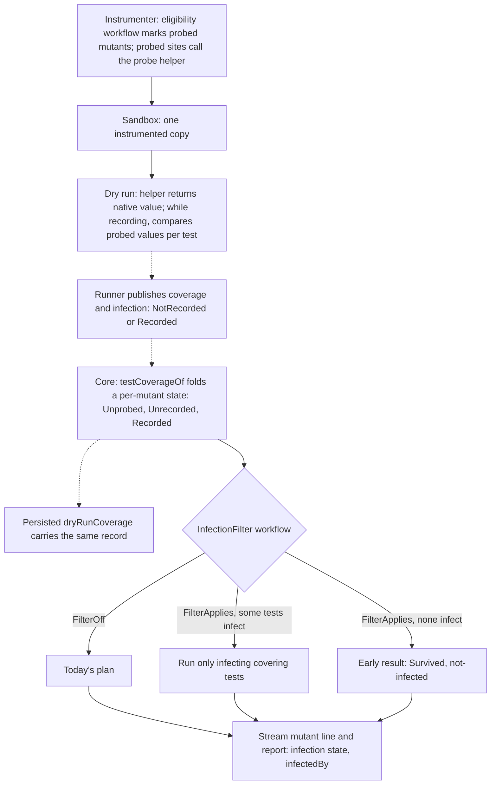
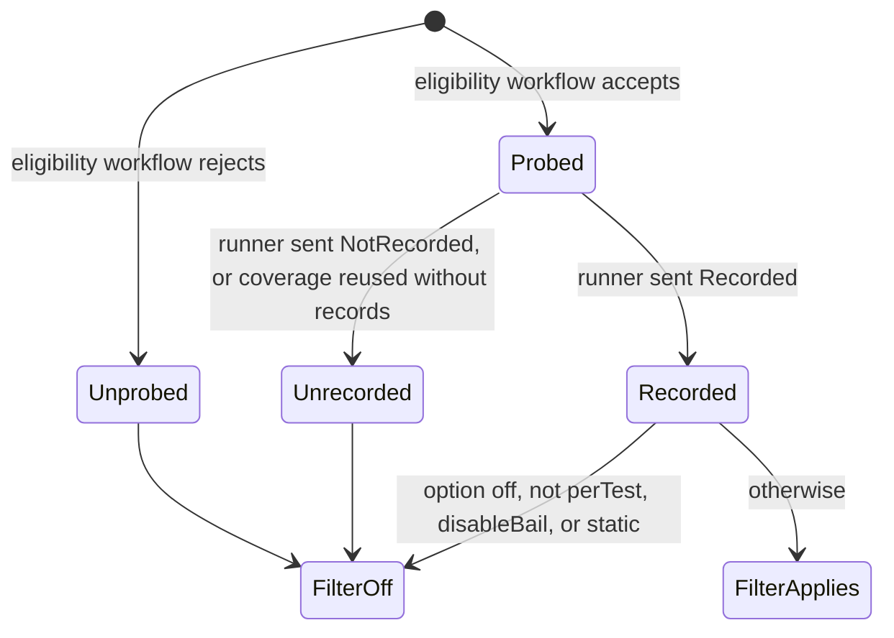
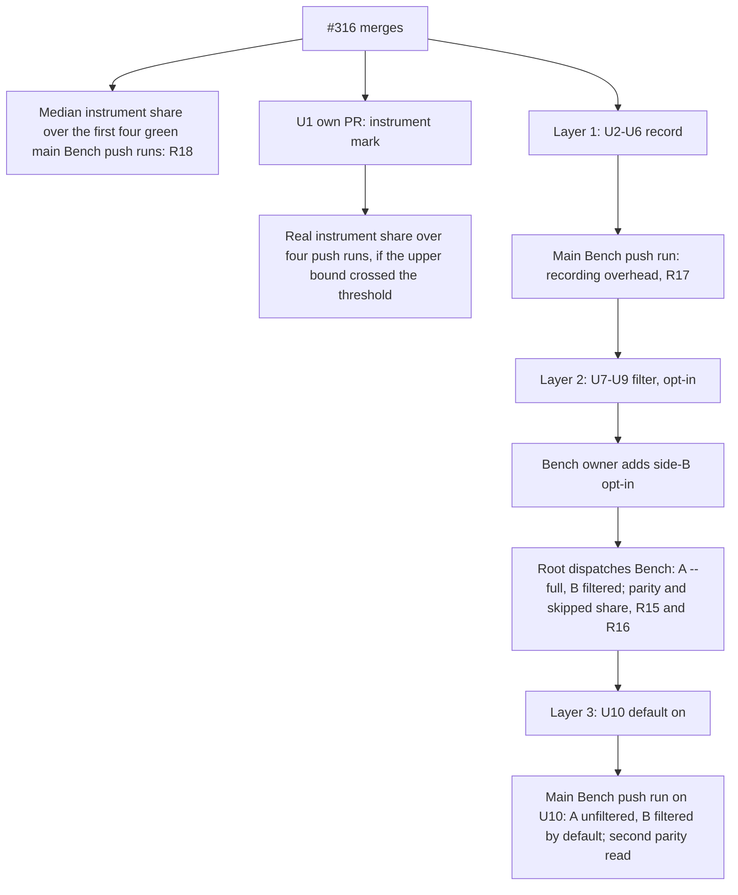

# Infection-Filtered Execution - Plan

## Goal Capsule

- **Objective:** A mutation run spends no test execution on a (mutant, test) pair whose test cannot observe the mutant. Every mutant keeps the status a `--full` run gives it today. An agent reading the run can tell a survivor no test ever infected from one whose infection no assertion caught.
- **Acceptance:** on one frozen bench corpus, side A is the existing `--full` run and side B is the same corpus with infection-filtered execution on. Every mutant verdict side B emits is compared, mutant by mutant, against side A's `--full` verdict, and every status must match on every leg (R15). The run reports the skipped share of covered (mutant, test) pairs and the count of never-infected mutants, which side B emits as `Survived` with reason `not-infected` (R7, R16). The final T10 acceptance also requires filtering on by default (U10).
- **Does not count:** a local mutation run, a hand-applied mutant or a planted bug; a speed or overhead claim without a CI Bench run id against main; the A/A dispatch preview standing in for the main push runs R18 names; parity read from anything but the frozen bench corpus; a Turbo cache hit read as engine speed; a unit test standing in for real CLI or integration evidence. The goal brief's verbatim DOES NOT COUNT list is [unverified] in this plan (source needed: root's T10 goal brief text); any item it adds binds over this paraphrase.
- **Means:** the dry run records, per test, which probed pure-expression mutants would change their expression's value (KTD1-KTD4), and the mutant planner drops the pairs that never infect (KTD5).
- **Authority, highest first:** `CONSTITUTION.md`, `AGENTS.md`, root's T10 intent and restart ruling of 2026-10-13, this plan's Product Contract, then its Planning Contract. The losslessness argument and probe rules in `docs/plans/2026-10-10-1719-perf-execution-engine-bench-lane-plan.md` (Stream Decisions Carried Forward) are bound as the draft this plan narrows (KTD1).
- **Execution profile:** U1 is its own PR off `main`. U2-U10 form one `gh stack` with three layers: record (U2-U6), filter, opt-in (U7-U9), and default on (U10). Each layer leaves `main` releasable and passes the gate on its own. Layer 2 merges with the option off. Its side-B parity evidence is a prerequisite of U10, not of layer 2's merge. #316 merged as `77fbae31950985ba7ef073f75fd43cccc1061803`, so U1 and layer 1 may open once root approves this plan.
- **Stop conditions:**
  - Any local mutation run, hand-applied mutant or planted bug.
  - Any edit to `.github/workflows/`, `test/bench/**`, `test/bench/corpus.json`, `test/e2e/testResources/**`, `turbo.json`, `release.jsonc` or `pnpm-workspace.yaml`.
  - A side-B Bench run with a status mismatch (R15) stops U10.
  - A recording-layer Bench run with a `total` regression (R17) stops U7.
- **Who finishes:** `ce-work` builds one layer at a time after root approves this plan. `ce-code-review` reviews each layer. Root dispatches the Bench runs, and the operator merges bottom-up.
- **Open blockers:**
  - Side B of the R15 measurement needs a Bench harness change only the Bench owner may make (CONST-E9; see Risks & Dependencies). U10 waits for it.

---

## Product Contract

### Summary

Infection filtering ships in stacked layers. The first layer records infection during every per-test dry run and publishes it on every mutant, with no change to any verdict or test selection. The second adds an opt-in option that skips non-infecting pairs and reports never-infected survivors with their own reason code. The third makes filtering the default, after Bench shows status parity with `--full` on the frozen corpus.

### Problem Frame

With `coverageAnalysis: perTest`, a covered mutant runs each covering test until one fails. Coverage only says a test reached the mutant's site. It does not say the test produced a different value there. A mutant whose covering tests never change its expression's value runs every covering test and survives. The stream then reports it with the same `Survived` status, and no reason code, as a mutant whose changed value no assertion caught. The engine emits no reason for any `Survived` mutant today, although the schema defines `covered-not-killed` (`packages/stryker-js-plugin-interface/src/ignore-rule.schema.ts:63`).

Main's A/A Bench run [38375500452](https://github.com/systemfsoftware/stryker-js-effect/actions/runs/38375500452) sizes the gain on the bench corpus. Per mutant, fixed overhead dominates: on the enterprise leg, killed mutants cost 14,223 ms of overhead against 1,364 ms of test bodies. So the gain comes mainly from survivors that would execute nothing, not from shorter test lists. The corpus has few such candidates:

| Leg                | Survivors                                                               | Of those, probed under KTD1  |
| ------------------ | ----------------------------------------------------------------------- | ---------------------------- |
| enterprise         | 6 (2 ConditionalExpression, 3 EqualityOperator swaps, 1 BlockStatement) | the 3 EqualityOperator swaps |
| e2e-core           | 4 (2 template StringLiteral, 2 BlockStatement)                          | none                         |
| typescript-checker | 1 (ArrowFunction)                                                       | none                         |
| vitest-runner      | 0                                                                       | none                         |

The gain on this corpus is likely smaller than Bench's signal floor: non-overlapping samples and |Δ median| ≥ max(3% of A, 10 ms) on `total`.

### Key Decisions

- **Record first, filter second, in separate layers.** Bench then measures the recording overhead and the filtering gain as separate deltas. Governs R1-R6, R17. (session-settled: user-directed — chosen over one layer that records and filters together, which mixes overhead and gain in one delta, and over filtering with no published diagnostics, which gives agents nothing.)
- **Opt-in while measured, on by default for acceptance.** The filtering layer ships off by default. A third layer turns it on after the parity evidence of R15 holds. Governs R12. (session-settled: user-directed — chosen over turning it on in the filtering layer itself: the measurement design must not flip the product default, and T10's acceptance requires filtering on by default.)
- **Side A is the existing `--full` run, and side B is the same frozen corpus with filtering on.** Verdicts are compared mutant by mutant. Governs R15, R16. (session-settled: user-directed — root's restart ruling of 2026-10-13.)
- **The instrument-phase mark is fixed in its own PR, and prepare plus instrument is read as an upper bound until then.** Governs R18. (session-settled: user-directed — chosen over reading only the upper bound with the mark left wrong, and over fixing it inside T10, which would mix the boundary fix into T10's own delta.)
- **A never-infected mutant keeps status `Survived` and gets a new reason code.** Status parity with `--full` is the acceptance bar. A new status would break it by construction and would change every consumer of the status set. Governs R7, R13.
- **Unproven means infected.** A pair is skipped only when the run proves its test never infects. Every unknown counts as infected. Governs R2, R3, R10, R19, R20, R22.
- **`disableBail` turns filtering off.** `disableBail` already means "run every test". The kill-matrix lane sets it, so that lane stays a complete matrix and an independent check on the records. Governs R9.
- **Infection filtering is not verdict reuse.** It decides from this run's own dry run and stores no verdict. `--full` keeps its meaning (no incremental cache, no persisted dry run), and Turbo task caching is untouched. Governs R10, R11, R21.
- **Recording runs in every per-test dry run.** Agents get the diagnostic whether or not filtering is on, and Bench prices the overhead before any filtering ships. Governs R1, R17.

### Requirements

**Recording**

- R1. During every dry run under `coverageAnalysis: perTest`, the run records for each probed mutant the tests in which at least one evaluation of its expression would have yielded a different value or state than the original. An evaluation outside any test counts as infecting every covering test.
- R2. A mutant is probed only when its mutation provably runs no user code and leaves program state identical to the original's whenever their values are equal. Every other mutant is unprobed and runs exactly as today.
- R3. A probe that throws, fails its runtime guard, or meets an operand outside its proof records the pair as infected.
- R4. Recording changes no dry-run test result, test set, coverage or hit count, and a mutant run that executes a pair gives that pair the same outcome as a run without the feature.
- R5. Every mutant carries an explicit infection state: unprobed, probed but unrecorded in this run, or probed with its infecting tests. A missing record never stands for "never infected".
- R20. A test whose execution overlapped another test's in the same worker counts as infecting every probed mutant it covers.
- R22. A test whose infection record differs between the dry run's two passes counts as infecting every probed mutant it covers.

**Filtering**

- R6. With filtering on, a covered non-static mutant runs only those of its covering tests that infect it, in today's order.
- R7. With filtering on, a probed, covered, non-static mutant that none of its covering tests infects is reported `Survived` with reason code `not-infected` and executes no test.
- R8. A mutant infected outside any test keeps today's static-mutant behavior.
- R9. With `disableBail` set, filtering is off and every covering test runs.
- R10. Infection records are used only together with the coverage of the dry run that recorded them. Coverage reused or deferred without its records never causes a skip.
- R11. `--full` keeps its current meaning, and with filtering on a `--full` run still filters.
- R19. Filtering applies only under `coverageAnalysis: perTest`. Under any other mode every mutant runs as today.
- R21. A verdict recorded with filtering on is never reused by a run with filtering off, and the reverse.

**Option and default**

- R12. One boolean option controls filtering. The filtering layer ships with the option off by default. The default-on layer turns it on, and that layer is T10's acceptance.

**Agent surface**

- R13. Each stream `mutant` line states the mutant's infection state and, when recorded, how many of its covering tests infected it. A `not-infected` survivor is distinguishable on the line alone.
- R14. The mutation report lists a probed mutant's infecting tests beside its covering tests, so the skipped share of every run can be computed from that run's own report.

**Measurement and evidence**

- R15. Filtering counts as lossless on the bench corpus only when one Bench run meets both conditions. First, on every leg, with side A the `--full` run without filtering and side B the same corpus with filtering on, every mutant's status in every side-B run equals its status in every side-A run. Second, the enterprise leg's side B skips a share of covered pairs above zero, so parity is not reached by filtering nothing.
- R16. Each such run reports, per leg, the skipped share of covered (mutant, test) pairs and the number of mutants decided `not-infected`, computed from the runs' own reports and streams. Efficacy floor (the goal's): any skipped share above zero satisfies parity's non-vacuity condition (R15), while a share under 5% counts as presence, not effective filtering. Every report of the share states which side of 5% it lands on.
- R17. Every speed or overhead claim cites a CI Bench comparison against main. The recording layer must not produce a `total` regression on any leg.
- R18. The instrument phase's share of wall clock is read from the first four green main Bench push runs after #316's merge commit `77fbae31950985ba7ef073f75fd43cccc1061803`, as the median of the four runs' shares, by the procedure in the Verification Contract, and that reading decides whether the T9 native-core track restarts.

### Acceptance Examples

- AE1. **Covers R1, R6, R7.** Given `if (a > b)` with the EqualityOperator mutant `a >= b`, covered by tests T1 and T2, where `a` never equals `b` in either test, when filtering is on, the mutant is `Survived` with reason `not-infected` and runs no test. A `--full` run without filtering runs T1 and T2 and also reports `Survived`.
- AE2. **Covers R3, R6.** Given `a + b` with the mutant `a - b`, where T1 passes an object for `a`, the probe meets the object operand and records T1 as infecting, so the mutant runs T1.
- AE3. **Covers R1, R8.** Given a probed mutant evaluated at module load, before any test starts, the mutant counts as infected by every test and runs as a static mutant does today.
- AE4. **Covers R10.** Given coverage reused from a persisted dry run that recorded no infection, when filtering is on, every covered mutant runs all its covering tests.
- AE5. **Covers R9.** Given `disableBail: true` and filtering on, every covering test runs, and the report still lists the infecting tests.
- AE6. **Covers R15.** Given one side-B run on one leg in which one mutant is `Survived` while side A has it `Killed`, filtering is not lossless and the default-on layer does not ship.
- AE7. **Covers R20.** Given two tests whose executions overlap in one worker, both cover a probed mutant, and only one of them changes its value, both count as infecting, and the mutant runs both. Under the runner's own `maxConcurrency: 1`, `describe.concurrent` tests run one at a time, so their records stay per test.
- AE9. **Covers R22.** Given a test that infects a probed mutant in the first dry-run pass but not in the second, the test counts as infecting, and the mutant runs it.
- AE8. **Covers R19.** Given `coverageAnalysis: all` and filtering on, every mutant runs the whole suite as today, and no mutant is `not-infected`.

### Success Criteria

- On every leg of the side-A `--full` / side-B filtered Bench run, zero status mismatches (R15). The A/A run 38375500452 recorded zero status differences across all 8 runs on all 4 legs, so a single mismatch is evidence of a loss, not of noise. `killedBy` varies between runs even in A/A (7, 7 and 11 differing killed mutants on three legs), so it is reported but not compared.
- A Bench `total` that is `improved` on at least one leg is the only evidence that may be called a speedup. `no-signal` is reported as `no-signal`.
- An agent can list every `not-infected` survivor from the NDJSON stream alone.

### Scope Boundaries

- Not T9: no native instrumenter, no restart of the native-core track.
- No kill-likelihood ordering and no exact test selection. The runner's name filter over-selects tests as it does today.
- No probing of the Effect mutators, statement mutators, or mutators that call user code (KTD1 lists the probed set).
- T10's maker does not edit the Bench harness, the corpus, the fixtures, the workflows, `turbo.json`, release configuration or the mutation lanes. A needed measurement change goes to the Bench owner as a proposal.
- No new CI gate. The parity comparison is evidence read from Bench artifacts, and any automated check of it needs approval under GATE1.
- No hand-written task cache and no affected classifier.

#### Considered and not built

- A separate instrumented sandbox for the dry run. It would keep mutant runs byte-identical to today, but the dry run would then execute a different program from the one the mutants run in, and instrumentation would run twice. KTD2's helper keeps one sandbox. Evidence that would change this: the KTD2 differential spec finding a helper result that differs from the native operator.
- Regenerating the 8 checked-in instrumented fixtures under `packages/stryker-js-vitest-runner/testResources/`. They carry an old copy of the header, and their generator `tasks/instrument-test-resources.js` no longer exists. Without the probe helper they record nothing, and core reads that as unrecorded (R5), so they stay valid. New runner tests instrument their source through the instrumenter instead (U4).
- Per-mutant shard repricing. `stryker plan` already prices from the previous report's `cost`, and U9 records a zero-test cost for a `not-infected` survivor, so the next plan prices it correctly.
- Probing the 2 enterprise ConditionalExpression survivors. Their conditions read properties (`stats.count`, `input.quantity`), and a property read can run a getter, which R2 forbids the mutant to skip. Evidence that would change this: an argument that those reads cannot run user code.

### Dependencies / Assumptions

- #316 merged as `77fbae31950985ba7ef073f75fd43cccc1061803`. It moved Bench to pushes on `main` and to dispatches. Report schema `2.0`, the per-leg `bench-report-<slug>` and `bench-runs-<slug>` artifacts, and the per-run incremental reports inside `bench-runs-<slug>` were read on #316's branch head and A/A run 38375500452, not yet on `77fbae31` [unverified] (source needed: `.github/workflows/bench.yml` and the bench report schema at `77fbae31`).
- The determinism premise is the one perTest coverage already relies on: a test's behavior does not depend on tests the filter does not run, and a test computes the same values at a site in the dry run and in a mutant run. R22 catches a test whose values change between the dry run's two passes. A test that is nondeterministic in a way both passes miss can be filtered wrongly, exactly as coverage can already drop a test that covers a site only sometimes.
- Mutation evidence on the new code comes only from main's nightly mutation and kill-matrix reports after a release puts it in the dogfood tarballs.

### Outstanding Questions

#### Resolve Before Planning

- None.

#### Deferred to Implementation

- The exact header helper name and argument layout (KTD2).
- Whether the instrumenter's scope analysis can prove an identifier local, which decides whether constant replacements join the probed set in U2 or stay unprobed (KTD1).
- The CLI spelling for turning filtering off once it defaults on (U10).

### Sources / Research

- `docs/plans/2026-10-10-1719-perf-execution-engine-bench-lane-plan.md`: losslessness argument, probe rules, switch-point contract, draft mutator table.
- `docs/plans/2026-10-09-2024-feat-mutant-subsumption-plan.md`: infection containment is not kill containment, and masking across repeated evaluations.
- Just, Ernst and Fraser, "Efficient Mutation Analysis by Propagating and Partitioning Infected Execution States", ISSTA 2014 ([pdf](https://homes.cs.washington.edu/~rjust/publ/state_infection_issta_2014.pdf)): Major checks state-infection conditions in one run of the unmutated program and skips (mutant, test) pairs that cannot infect, with a 40% mean reduction in analysis time on Java. Prior art for R1 and R6.
- Bench A/A run 38375500452 (`bench-report-*` and `bench-runs-*` artifacts): phase shares, per-status mutant cost, status and `killedBy` noise.

---

## Planning Contract

**Product Contract preservation:** changed: R1 ("with recording on" resolved to every per-test dry run, matching the new Key Decision; an evaluation outside any test infects every covering test), R3 (drops "hits a bound": no probe in KTD1's set can recurse or run long), R5 (adds the "unrecorded" state that R10 needs, and names it the infection state), R15 (adds the non-zero skipped share on the enterprise leg, so parity cannot pass vacuously); added R19-R22 and AE7-AE9, applying "unproven means infected" to cases the brainstorm did not list; AE1 now uses an operator swap, because the original ConditionalExpression example is unprobed under KTD1. These changes follow from the brainstorm's Key Decisions and change no scope.

### Key Technical Decisions

- KTD1. **The first probed set is the mutants whose value comes from operands both programs evaluate.** Probed:
  - ArithmeticOperator `-`, `*`, `/`, `%` (the mutator already skips string `+`), guarded on both operands being numbers or both bigints.
  - EqualityOperator mutants whose original operator is relational (`<`, `<=`, `>`, `>=`), whatever the replacement operator (including the sufficiency additions `==` and `!=`), guarded on both operands being primitives other than symbols.
  - UnaryOperator `+x`↔`-x`, guarded on a number operand.
  - ConditionalExpression and EqualityOperator constant replacements (`true`/`false`), only when the replaced expression is a comparison over literals and identifiers the instrumenter proves local to the file, with the same primitive guard.

  Unprobed: `==`↔`!=` and `===`↔`!==` originals (every reach infects), LogicalOperator, AssignmentOperator, OptionalChaining, StringLiteral, MethodExpression, every other mutator, and the Effect mutators. Operator swaps evaluate the same operand expressions in both programs, so only the operator differs, and a primitive operator runs no user code. A constant replacement skips evaluating the comparison, so R2 holds only when that evaluation cannot run user code. The eligibility decision is a pure workflow in the instrumenter (pack: cell-architecture, pure-decision-workflows.md). Governs R2, R3.
- KTD2. **A probed site's original branch calls one new header helper with the evaluated operands.** The emitted original value becomes a helper call that receives the operator, the left and right operand values, and the probed mutants at the site with their replacement operators or literals. The helper always returns the native operator's result on those operands. Only while the namespace's recording flag is set does it also compute each probed mutant's value under its guard and record differences. Mutant branches (`stryMutAct_9fa48(id) ? replacement : …`) are unchanged. Operands are still evaluated once, left to right. ToPrimitive runs inside the helper in the operator's own order, and a throw from the original operator propagates unchanged. All probed mutants at one site read the same operand values. A KTD-level differential spec pins helper-versus-native results (U3). Rejected: a second sandbox (Scope Boundaries) and hoisted temporaries, which break in arrow expression bodies and generators. Governs R2-R4.
- KTD3. **Records travel beside coverage, under the same bucket rule, as a tagged value.** The namespace keeps an infection map shaped like `mutantCoverage` (per test id, plus a static bucket for evaluations outside any test). The vitest sandbox publishes it with coverage in `afterAll` (`packages/stryker-js-vitest-runner/sandbox/stryker-setup.ts:64-70`). It must use the host namespace object itself, never a copy (`docs/solutions/runtime-errors/host-instrumenter-namespace-identity.md`). `DryRunResult`'s `complete` variant carries `infection` as `NotRecorded | Recorded { perTest, static, overlappedTestIds }`, decoding to `NotRecorded` when the key is absent, so the command runner and older runners mean "unrecorded" (pack: schema-laws, tagged-unions-over-state-by-presence.md). Overlap is measured, not read from a `concurrent` flag: a test's `beforeEach` that finds `currentTestId` already set marks both tests overlapped (R20). The runner forces `maxConcurrency: 1` (`packages/stryker-js-vitest-runner/src/VitestRuntime.blueprint.ts:291`), so the enterprise fixture's `describe.concurrent` suites run one test at a time and keep per-test records. The vm runner is an alias of the vitest runner (`packages/stryker-js/package.json:50`), so it needs no separate work. Governs R1, R5, R8, R20.
- KTD4. **Core folds records into a per-mutant infection state, and persists them inside `dryRunCoverage`.** `testCoverageOf` (`packages/stryker-js/src/run/dry-run-coverage.ts`) derives `Unprobed | Unrecorded | Recorded { infectingTestIds }` per mutant. `infectingTestIds` is the covering tests that infected the mutant in either dry-run pass. A static-bucket infection, an overlapped covering test, or a covering test in `flakyTestIds` adds that test. `detect-dry-run-flakes.workflow.ts` gains one condition: a test whose infection record differs between the two passes joins `flakyTestIds` (R22). The dry run already runs a second pass whenever the first completes (`packages/stryker-js/src/run/dry-run.cell.ts:519-523`). `DryRunCoverageSchema` gains the same tagged record, so reused coverage carries its own records. Coverage written before T10 decodes as `NotRecorded` (R10). The incremental report file is already in `strykerOutputFilesOf`, so no new sidecar is added (`docs/solutions/tooling-decisions/verdict-cache-content-keyed-reuse.md`). A deferred dry run has no coverage and therefore no records. Governs R5, R10, R22.
- KTD5. **The planner decides an `InfectionFilter` per mutant, by id, and never emits an empty test filter.** A `Workflow.make` decides `FilterOff { reason } | FilterApplies { infectingTestIds }`. `FilterOff` covers: the option off, `coverageAnalysis` not `perTest`, `disableBail`, static, unprobed, and unrecorded. `plan-mutant-tests.workflow.ts` feeds `runWithCoveredTests` the covering tests that are also in `infectingTestIds`, selected by test id, in today's order (`docs/solutions/runtime-errors/directive-ignored-mutants-shift-placed-replacements.md`). When none remain, it emits a `PlannedEarlyResultMutant` with status `Survived` and reason `not-infected`, because `nonEmptyTestFilterOf` (`:75-76`) turns an empty filter into "run the whole suite". Timeout and net time follow the tests that run, as they already do for any covering-test filter. The hit limit stays on the dry-run hit count. A prior killer outside the filtered list is dropped by the existing `priorKillerOf`. Governs R6-R9, R19 (pack: cell-architecture, pure-decision-workflows.md).
- KTD6. **The option stays in the run-inputs fingerprint.** `optionsFingerprintOf` (`packages/stryker-js/src/verdict-semantics.ts:127-138`) strips only scope, presentation and storage keys. Leaving the new key unstripped makes `runInputsDigest` differ between filtered and unfiltered runs, so incremental reuse refuses across them with `runInputsChanged`. The engine digest changes with every release that ships T10. No `INCREMENTAL_CACHE_VERSION` bump is needed, because every new report field decodes to a default when absent. Governs R21.
- KTD7. **Each wire surface carries the state as a fixed-field tagged value.**
  - The stream `mutant` line (`packages/stryker-js-cli-contract/src/run-event.schema.ts`) gains `infection`: `unprobed`, `unrecorded`, or `recorded { infectingTests, coveringTests }`, with a struct check that `infectingTests <= coveringTests` (pack: schema-laws, cross-field-invariants-as-struct-checks.md; `docs/solutions/test-failures/stream-schema-must-not-carry-json-rest-records.md`).
  - The report gains `infectedBy` per recorded mutant beside `coveredBy`, remapped through the same `testIdRemap`. The upstream `MutantResult` record is open, so the generated report schema carries it unchanged.
  - `not-infected` joins `SETTLED_CODES_BY_STATUS.Survived` and its documentation table (`packages/stryker-js-plugin-interface/src/ignore-rule.schema.ts:61-78`).

  Each change ships with a changeset classified by what it adds or narrows (pack: package-topology, surface-changes-are-versioned.md). Under BREAK-1, a widened closed union is major for `@systemfsoftware/stryker-js-plugin-interface` (16.x) and minor for `@systemfsoftware/stryker-js-cli-contract` (0.x). Governs R7, R13, R14.
- KTD8. **The option is `infectionFilter`, a defaulted boolean beside `disableBail`.** It follows the `disableBail` path: schema (`packages/stryker-js-plugin-interface/src/stryker-options.schema.ts:248`, `:284`), CLI flag (`packages/stryker-js/src/bin/cli-command.ts:225`) and config passthrough (`:532`), and `MutantTestPlanCommand.options` (`packages/stryker-js/src/MutantTestPlanCommand.schema.ts:18` already carries `disableBail`). `ignoreStatic` (`cli-command.ts:66-70`, passthrough `:509`) is the same shape. Governs R12.
- KTD9. **The instrument mark moves into the read phase of both instrument cells.** `phaseEntered('instrument')` runs today in the cells' write phase (`packages/stryker-js/src/run/instrument.ts:144-158`), after `instrumentFiles` and `makeSandbox` have run in `readInstrument` (`packages/stryker-js/src/run/instrument.cell.ts:72-108`). So instrumentation and sandbox copying land in `prepare`, and every A/A sample reads `instrument` as 0-1 ms. U1 emits the mark before `instrumentFiles` in `instrument.cell.ts` and `plan-instrument.cell.ts`, and keeps the `instrument` phase span around the same work. Governs R18.
- KTD10. **Parity and skipped share are read from Bench's own artifacts with existing tools.** For each leg, `stryker compare --baseline <A run report> --fresh <B run report>` runs over all 16 (A, B) pairs of the per-run incremental reports in `bench-runs-<slug>`. It compares status only, and a mutant present on one side but absent on the other counts as a mismatch. The skipped share is the sum of `|coveredBy| - |infectedBy|` over recorded mutants, divided by the sum of `|coveredBy|` over all covered mutants, taken from each B run's report. The `not-infected` count comes from B's stream lines. This is evidence in the PR body, not a gate (GATE1). Governs R15, R16.

### High-Level Technical Design

Data flow from instrumentation to verdict. Recording (U2-U6) adds the dashed path. Filtering (U7-U9) adds the planner gate.

The per-mutant infection state and the filter decision:

Stack and measurement sequence:

### Sequencing

U1 is independent of the stack and lands first, so the T9 reading after it has a correct boundary. Within the stack: U2 before U3 (eligibility before emission), U3 before U4 (helper before runner publication), U4 before U5, and U5 before U6. Layer 2 (U7, U8, U9) stacks on layer 1, and U10 stacks on layer 2. Layer 1's recording is inert for verdicts, so it can merge as soon as its Bench push run shows no `total` regression.

### Assumptions

- The setup file's `beforeEach` and `afterEach` hooks run around every test, including tests in `describe.concurrent` suites, so measured overlap (KTD3) sees every test.
- `stryker compare` reads the per-run incremental report shape that `bench-runs-<slug>` holds (`{ files: { mutants: [{ id, status }] } }`, `packages/stryker-js/src/compare-verdicts.workflow.ts:20-24`).

---

## Implementation Units

### U1. Instrument phase mark covers the instrumenter's work

- **Goal:** `phaseDurations.instrument` measures instrumentation and the sandbox copy, so Bench can read the instrument share.
- **Requirements:** R18; KTD9.
- **Dependencies:** none. It is its own PR, opened after #316 merges.
- **Files:** `packages/stryker-js/src/run/instrument.cell.ts`, `packages/stryker-js/src/run/plan-instrument.cell.ts`, `packages/stryker-js/src/run/instrument.ts`, `packages/stryker-js/tests/instrument-phase-span.integration.test.ts` (new), `.changeset/*.md`.
- **Approach:**
  1. Emit the `instrument` phase mark at the start of `readInstrument` in both cells, before `instrumentFiles`.
  2. Open the `instrument` phase span around the same work, and leave the write phase only offering skips.
  3. Changeset: a patch for `@systemfsoftware/stryker-js`, stating that `instrument` now includes instrumentation and the sandbox copy, and that `prepare` shrinks by the same amount.
- **Patterns to follow:** `packages/stryker-js/tests/sandbox-acquisition-telemetry.integration.test.ts` (Engine run with `InMemorySpanExporter`).
- **Test scenarios:**
  - On a fixture with one mutated file, the `stryker.instrument.gather` span starts no earlier than the `instrument` phase span and ends no later than it.
  - On the same run, the `instrument` `phase` event's `elapsedMs` is no later than the start of the `stryker.instrument.gather` span, measured from run start.
- **Verification:** the new integration test passes in CI. On the PR's first main Bench push run, `instrument` reads above 1 ms on every leg and `prepare` shrinks by a matching amount.

### U2. Probe eligibility in the instrumenter

- **Goal:** each instrumented mutant carries an explicit probed or unprobed marker, decided by a pure workflow.
- **Requirements:** R2, R5; KTD1.
- **Dependencies:** none (layer 1, bottom).
- **Files:** `packages/stryker-js-instrumenter/src/probe-eligibility.workflow.ts` (new), `packages/stryker-js-instrumenter/src/__tests__/probe-eligibility.workflow.property.test.ts` (new), `packages/stryker-js-instrumenter/src/Mutator.service.ts`, `packages/stryker-js-plugin-interface/src/Mutant.schema.ts`, `.changeset/*.md`.
- **Approach:**
  1. The workflow decides `Probed { kind } | Unprobed { reason }` from mutator name, node kind, operator, and the operand facts KTD1 names, with `Match.exhaustive` over closed facts.
  2. The plugin-interface `Mutant` gains the probe marker as a tagged field, never an optional boolean.
  3. If the instrumenter cannot prove an identifier local, constant replacements stay `Unprobed` (Deferred to Implementation).
- **Patterns to follow:** `packages/stryker-js-instrumenter/src/place-mutants.workflow.ts` and its property test.
- **Test scenarios:**
  - Each probed operator pair in KTD1 decides `Probed` with its kind.
  - `==`↔`!=` and `===`↔`!==` originals, LogicalOperator, AssignmentOperator, OptionalChaining, StringLiteral, MethodExpression, BlockStatement and the three Effect mutators decide `Unprobed` with a reason.
  - A relational original with a sufficiency replacement (`<` to `!=`) decides `Probed`.
  - A constant replacement over a member expression decides `Unprobed`.
  - A string `+` never reaches the workflow, because the mutator emits no mutant for it.
- **Verification:** the property test passes, and `pnpm typecheck` passes with the new `Mutant` field.

### U3. Probe helper and emission

- **Goal:** a probed site's original branch computes its value through the header helper, which records infection only while recording.
- **Requirements:** R1-R4; KTD2.
- **Dependencies:** U2.
- **Files:** `packages/stryker-js-instrumenter/src/InstrumentHeader.ts`, `packages/stryker-js-instrumenter/src/InstrumentContext.schema.ts`, `packages/stryker-js-instrumenter/src/Transformer.service.ts`, `packages/stryker-js-instrumenter/tests/probe-helper.differential.test.ts` (new), `packages/stryker-js-instrumenter/tests/probe-recording.integration.test.ts` (new), `.changeset/*.md`.
- **Approach:**
  1. The header gains the helper and the namespace keys for the recording flag and the infection map, beside `stryCov_9fa48`.
  2. `expressionMutantPlacer` replaces the innermost original expression with the helper call only when the site holds at least one probed mutant, and keeps the coverage call.
  3. The helper short-circuits to the native operator when not recording.
- **Execution note:** write the differential spec before changing the placer. It is the evidence for R4's second half.
- **Patterns to follow:** `packages/stryker-js-instrumenter/tests/conditional-test-placement.integration.test.ts`, `docs/solutions/runtime-errors/mutant-switch-in-a-conditional-test-needs-parens.md`.
- **Test scenarios:**
  - Differential: for generated operand pairs (numbers, bigints, strings, booleans, `null`, `undefined`, `NaN`, `-0`, objects with counting `valueOf` and `toString`) and each probed operator, the helper's result, its thrown error class and the side-effect count equal the native operator's. This holds with recording on and with it off.
  - Integration through `instrument()`: evaluating the instrumented output in-process with recording on and `currentTestId = T1`, and `a > b` evaluated with `a = 2, b = 2`, records T1 for the `>=` mutant. With `a = 3, b = 2`, it records nothing.
  - An evaluation with `currentTestId` unset records the static bucket.
  - An object operand records the pair infected (Covers AE2).
  - Two probed mutants at one site read one operand evaluation: a counting getter on the operand fires once per evaluation.
  - With recording off, the infection map stays empty and the expression's value is unchanged.
- **Verification:** both new tests pass, and `packages/stryker-js-instrumenter/tests/instrumenter.integration.test.ts` passes unchanged.

### U4. Runner publishes infection records

- **Goal:** the vitest dry run returns `Recorded` infection beside coverage, with concurrent tests marked.
- **Requirements:** R1, R5, R20; KTD3.
- **Dependencies:** U3.
- **Files:** `packages/stryker-js-vitest-runner/sandbox/stryker-setup.ts`, `packages/stryker-js-vitest-runner/src/vitest-test-runner.ts`, `packages/stryker-js-plugin-interface/src/TestRunner.schema.ts`, `packages/stryker-js-vitest-runner/tests/dry-run-infection.integration.test.ts` (new), `.changeset/*.md`.
- **Approach:**
  1. In dry-run mode the setup file sets the recording flag on the host namespace before tests load, records overlapped test ids when a `beforeEach` finds another test still current, and publishes the infection map in `afterAll` beside `mutantCoverage`.
  2. `readMutantCoverage`'s sibling reader decodes and merges per-file maps the same way.
  3. `DryRunResultSchema.complete` gains `infection` with the `NotRecorded` decoding default.
- **Patterns to follow:** `packages/stryker-js-vitest-runner/tests/dry-run-module-evidence.integration.test.ts`. The fixture source is instrumented in-test through the instrumenter, not taken from the checked-in fixtures.
- **Test scenarios:**
  - A two-test project in which only T2 drives a probed comparison to its boundary returns `Recorded` with T2 against that mutant, and T1 absent.
  - A mutant evaluated at module load appears in the static bucket.
  - Two tests in a `describe.concurrent` suite under the runner's `maxConcurrency: 1` produce separate per-test records, and neither is marked overlapped (Covers AE7).
  - A dry run whose test configuration forces two tests to overlap marks both overlapped.
  - Mutant mode sets no recording flag, so the infection map stays empty.
  - A dry-run result without the key decodes to `NotRecorded`.
- **Verification:** the new integration test passes in CI's `check` job.

### U5. Core infection state and persistence

- **Goal:** core derives each mutant's infection state and persists records inside `dryRunCoverage`.
- **Requirements:** R5, R8, R10, R20, R22; KTD4.
- **Dependencies:** U4.
- **Files:** `packages/stryker-js/src/run/dry-run-coverage.ts`, `packages/stryker-js/src/test-coverage.schema.ts`, `packages/stryker-js/src/dry-run-coverage.schema.ts`, `packages/stryker-js/src/detect-dry-run-flakes.workflow.ts`, `packages/stryker-js/src/__tests__/detect-dry-run-flakes.workflow.property.test.ts`, `packages/stryker-js/src/infection-state.workflow.ts` (new), `packages/stryker-js/src/__tests__/infection-state.workflow.property.test.ts` (new).
- **Approach:**
  1. A workflow folds probe marker, coverage and record into `Unprobed | Unrecorded | Recorded { infectingTestIds }`.
  2. Static-bucket infection, overlapped test ids and `flakyTestIds` add to `infectingTestIds`, which never leaves the covering set.
  3. `detect-dry-run-flakes.workflow.ts` adds a changed infection record as a flake condition.
  4. `DryRunCoverageSchema` carries the tagged record, and `reusedTestCoverage` reads it back.
- **Patterns to follow:** `packages/stryker-js/src/__tests__/dry-run-reuse.workflow.property.test.ts`; in-source refusal laws in `packages/stryker-js-plugin-interface/src/ignore-rule.schema.ts:232-390`.
- **Test scenarios:**
  - For generated coverage and records, `infectingTestIds` is a subset of the covering tests.
  - A static-bucket entry for a mutant makes every covering test infecting (Covers AE3).
  - An overlapped covering test is infecting.
  - A test whose record differs between the two passes is in `flakyTestIds` and is infecting (Covers AE9).
  - Identical records in both passes add no flaky test.
  - An unprobed mutant is `Unprobed` whatever the record says.
  - A probed mutant under `NotRecorded` is `Unrecorded`.
  - A persisted `dryRunCoverage` without the field decodes to `NotRecorded` (Covers AE4).
  - The schema refuses `Recorded` with an infecting id outside the covering set.
- **Verification:** the property test passes, and `packages/stryker-js/tests/dry-run-coverage-across-roots.integration.test.ts` passes unchanged.

### U6. Publish infection state on the stream and in the report

- **Goal:** agents read infection state and infecting tests per mutant, with verdicts unchanged.
- **Requirements:** R13, R14, R17; KTD7.
- **Dependencies:** U5.
- **Files:** `packages/stryker-js-cli-contract/src/run-event.schema.ts`, `packages/stryker-js-cli-contract/contract/stream.schema.json` (regenerated), `packages/stryker-js/src/mutation-reporting.service.ts`, `packages/stryker-js/src/IncrementalReport.schema.ts`, `packages/stryker-js/tests/run-event-stream.integration.test.ts`, `packages/stryker-js/README.md`, `.changeset/*.md`.
- **Approach:**
  1. The `mutant` line gains the `infection` struct (KTD7).
  2. `reportMutantOf` adds `infectedBy` through `testIdRemap`, and the incremental report's mutant record (`IncrementalReport.schema.ts`) gains `infectedBy` beside `coveredBy`, because Bench archives the incremental report, not the mutation report (KTD10).
  3. Regenerate the contract document with `packages/stryker-js-cli-contract/scripts/contract-documents.ts`, and document the field and its meaning in the README.
- **Patterns to follow:** `packages/stryker-js-cli-contract/tests/run-event-wire-line.integration.test.ts`; `docs/solutions/test-failures/stream-schema-must-not-carry-json-rest-records.md`.
- **Test scenarios:**
  - A line with `recorded` and `infectingTests > coveringTests` is refused.
  - Each variant round-trips byte-stable through `RunEventWireLine`.
  - In an engine run on a fixture with one probed and one unprobed covered mutant, the stream carries `recorded` and `unprobed` for them, and the report's `infectedBy` names exactly the boundary-driving test for the probed one.
  - Every mutant's status in that run equals the status written by hand beside the fixture, so recording changes no verdict.
- **Verification:** `contract-documents.integration.test.ts`, `contract-version-law.integration.test.ts` and the engine integration test pass in CI. The layer's main Bench push run shows no `total` regression on any leg (R17), and its instrument and dry-run deltas are reported.

### U7. Option and reason code

- **Goal:** `infectionFilter` exists, off by default, and `not-infected` is a settled Survived code.
- **Requirements:** R7, R12, R21; KTD6, KTD8, KTD7.
- **Dependencies:** U6, plus U6's Bench push run showing no regression.
- **Files:** `packages/stryker-js-plugin-interface/src/stryker-options.schema.ts`, `packages/stryker-js-plugin-interface/src/ignore-rule.schema.ts`, `packages/stryker-js/src/bin/cli-command.ts`, `packages/stryker-js/src/MutantTestPlanCommand.schema.ts`, `.changeset/*.md`.
- **Approach:**
  1. Add the defaulted boolean and the CLI flag on the `disableBail` path, and leave it unstripped in `optionsFingerprintOf`.
  2. Add `not-infected` with its documentation entry ("Survived: no covering test changed the mutant's value; strengthen a test to reach the case where it differs").
- **Test scenarios:**
  - In-source law: `Survived` accepts `not-infected: 3 covering tests, none infected`.
  - `Killed` and `Ignored` refuse it.
  - Two option sets that differ only in `infectionFilter` give different `runInputsDigest` values.
- **Verification:** the in-source laws pass, and `api:check` passes with the changeset classification.

### U8. Planner filters non-infecting pairs

- **Goal:** with the option on, the planner runs only infecting covering tests and decides never-infected survivors early.
- **Requirements:** R6-R9, R19; KTD5.
- **Dependencies:** U7.
- **Files:** `packages/stryker-js/src/infection-filter.workflow.ts` (new), `packages/stryker-js/src/plan-mutant-tests.workflow.ts`, `packages/stryker-js/src/__tests__/infection-filter.workflow.property.test.ts` (new), `packages/stryker-js/src/__tests__/plan-mutant-tests.workflow.property.test.ts`.
- **Approach:**
  1. The `InfectionFilter` workflow decides from the option, coverage mode, `disableBail`, static-ness and the infection state (KTD5).
  2. `decidePlanForMutant` consults it before `runWithCoveredTests`, and emits the early `Survived`/`not-infected` result when the filtered list is empty.
- **Patterns to follow:** `plan-mutant-tests.workflow.ts`'s existing `toEarlyResultPlan`, and its property test's generators.
- **Test scenarios:**
  - For generated commands, a `FilterApplies` plan's test filter equals the covering tests in today's order with non-infecting ids removed.
  - A `FilterApplies` mutant with no infecting covering test gets an early result: `Survived`, reason `not-infected`, no test filter (Covers AE1).
  - Metamorphic law: with any `FilterOff` reason, the plan equals the plan computed with the infection state erased.
  - `disableBail` gives `FilterOff` (Covers AE5).
  - `coverageAnalysis: all` gives `FilterOff` (Covers AE8).
  - A static mutant gives `FilterOff`.
  - A filtered plan's timeout equals the timeout today's rule gives for that filtered list.
  - A prior killer outside the filtered list is not in `priorKillerTestIds`.
- **Verification:** both property tests pass.

### U9. Settle and report never-infected survivors

- **Goal:** an early `not-infected` result reaches the stream, the report and the shard planner like any settled mutant.
- **Requirements:** R7, R13, R16; KTD5, KTD7.
- **Dependencies:** U8.
- **Files:** `packages/stryker-js/src/run/mutation-test-plan.cell.ts`, `packages/stryker-js/src/run/mutant-settlement.ts`, `packages/stryker-js/src/mutant-cost.ts`, `packages/stryker-js/tests/infection-filter.integration.test.ts` (new), `packages/stryker-js/README.md`, `.changeset/*.md`.
- **Approach:**
  1. Route the early result through the existing early-result path. It keeps a running status, so held subsumed mutants stay subsumed (`packages/stryker-js/src/readmit-subsumed.workflow.ts:98-110`).
  2. Record a finite zero-test `cost` (`docs/solutions/performance-issues/shard-plan-priced-untested-verdicts-at-a-whole-suite-prediction.md`).
  3. Document the option and the reason in the README.
- **Test scenarios:**
  - Engine run, option on, on a fixture whose only covering test never reaches the boundary of a `>` swap: the mutant line is `Survived`, `not-infected`, with `testsExecuted: 0`. The same fixture with the option off runs the test, and the mutant is `Survived` (Covers AE1).
  - On a fixture where the dominator of a held subsumed mutant is `not-infected`, the subsumed mutant stays `Ignored` with `redundant-relational`.
  - The run's `plannedTotal` and `verdict.counts` equal those of the option-off run.
- **Verification:** the integration test passes in CI. The Bench owner's side-B run then meets R15 with zero mismatches and reports R16's figures.

### U10. Filtering on by default

- **Goal:** `infectionFilter` defaults to on, which is T10's acceptance.
- **Requirements:** R12, R15; Key Decision "Opt-in while measured".
- **Dependencies:** U9, plus a side-B Bench run on the layer-2 head meeting R15.
- **Files:** `packages/stryker-js-plugin-interface/src/stryker-options.schema.ts`, `packages/stryker-js/src/bin/cli-command.ts`, `packages/stryker-js/README.md`, `.changeset/*.md`.
- **Approach:**
  1. Flip the default.
  2. Give the CLI a way to turn filtering off (Deferred to Implementation).
  3. Changeset: a behavior change consumers observe (status reasons and executed-test counts).
- **Test scenarios:**
  - With no option set, a run decides `FilterApplies` for a recorded covered mutant.
  - The off spelling decides `FilterOff`.
- **Verification:** U10's main Bench push run gives a second parity read: side A is the parent without filtering, side B is U10 with filtering by default. KTD10 reads it, and it must show zero mismatches.

---

## Verification Contract

| Gate                     | Command or source                                                                                                                                                                                                                                                    | Applies to                                  |
| ------------------------ | -------------------------------------------------------------------------------------------------------------------------------------------------------------------------------------------------------------------------------------------------------------------- | ------------------------------------------- |
| Format                   | `pnpm format:check`                                                                                                                                                                                                                                                  | every unit                                  |
| Typecheck                | `pnpm typecheck`                                                                                                                                                                                                                                                     | every unit                                  |
| Tests                    | `pnpm test` locally for property and in-source laws; engine-run integration tests in CI's `check` job                                                                                                                                                                | every unit                                  |
| Build and checks         | `pnpm check:ci`                                                                                                                                                                                                                                                      | every unit                                  |
| API report               | `api:check` (in `check:ci`)                                                                                                                                                                                                                                          | U2, U4, U6, U7                              |
| Contract documents       | `packages/stryker-js-cli-contract/tests/contract-documents.integration.test.ts`, `contract-version-law.integration.test.ts`                                                                                                                                          | U6                                          |
| Changeset                | CI `Changeset Check`                                                                                                                                                                                                                                                 | every unit that changes a published package |
| Recording overhead       | Main Bench push run on layer 1's merge commit: no `PhaseRegressed` on `total` for any leg; report instrument and dry-run deltas                                                                                                                                      | U6 (R17)                                    |
| Parity and skipped share | Root-dispatched Bench run on the layer-2 head with side B opted in, read per KTD10: zero status mismatches across all 16 pairs on every leg, and a skipped share above zero on the enterprise leg; skipped share and `not-infected` count per leg                    | U9, U10 (R15, R16)                          |
| Second parity read       | Main Bench push run on U10's merge commit, read per KTD10                                                                                                                                                                                                            | U10                                         |
| Mutation                 | Main's nightly `mutation-report-<run_number>` and `kill-matrix-<run_number>` after a release ships the code. Read the new workflows' mutant ids, and kill survivors with contract properties (pack: mutation-discipline, kill-survivors-with-contract-properties.md) | U5, U8                                      |
| Kill-matrix cross-check  | In the first kill-matrix report after U6 ships, every `killedBy` test of a recorded mutant is in its `infectedBy` (disableBail keeps every killer, R9)                                                                                                               | U6                                          |

No sabotage checks: root forbids hand-applied mutants and planted bugs, so test strength is read from main's nightly mutation report instead. Engine-run integration tests run only in CI, because the CLI refuses a mutation run outside GitHub Actions.

### Reading the instrument share for T9 (R18)

1. `M` is #316's merge commit, `77fbae31950985ba7ef073f75fd43cccc1061803`.
2. List the first four successful `bench.yml` runs on `main` with event `push` whose head is `M` or a descendant, oldest first: `gh run list --workflow bench.yml --branch main --event push --status success --json databaseId,headSha,createdAt`. Record their run ids and head SHAs. A push run benches only the legs Turbo marks affected, so a leg absent from one of those runs takes its four samples from the earliest later successful push runs in which it ran, and the plan records which run ids fed which leg. The four run ids are [unverified] until those runs exist (source: the `gh run list` above). Green main samples known so far: 38429923569 and 38430066932; they count toward the four only if they are the earliest green push runs at or after `M`.
3. Download each run's `bench-report-<slug>` artifacts with `gh run download <run id> -p 'bench-report-*'` and read each leg's `phase` rows (`prepare`, `instrument`, `total`) for side B, the pushed commit. Each side's samples carry `ms` and `shareOfTotal` per interleaved run.
4. Per run and leg, the run's share is the median of its side-B samples. Before U1 lands, that share is the upper bound `U` = `(prepare.ms + instrument.ms) / total.ms`, because the engine counts instrumentation under `prepare` until then (KTD9). After U1 lands, it is `S` = `instrument.ms / total.ms`, read from the first four green main push runs on or after U1's merge commit by the same steps.
5. The baseline per leg is the median of the four run shares, which for four values is the mean of the middle two (the same rule as Bench's `medianOfSorted`).
6. Decide with the proposed threshold of 4.5%: T9's target cuts instrument time to a third, which saves two thirds of `S`. That saving is a Bench signal only when it reaches 3% of `total`, so `S` must be at least 4.5%. If `U` is below 4.5% on every leg, T9 stays parked. If any leg's `U` reaches 4.5%, the decision waits for `S` after U1.
7. Re-read `S` the same way after layer 1 merges, because KTD2's helper adds instrument work.
8. Record the run ids, per-leg four shares, the median-of-four, and the T9 decision in U1's PR body and in this plan's T9 section.

A preview from A/A dispatch 38375500452, not a main push and so not the deciding run: `U` is 1.6% (typescript-checker), 2.7% (vitest-runner), 4.1% (e2e-core) and 4.6% (enterprise). Enterprise sits just over the proposed threshold, so the decision will probably need U1.

---

## Definition of Done

- Every unit's tests and verification pass on its layer's exact head, and CI is green on that head.
- Layer 1: its main Bench push run shows no `total` regression on any leg (R17).
- Before U10: one side-B Bench run on the layer-2 head meets R15 (zero status mismatches on every leg, and a skipped share above zero on the enterprise leg), with skipped share and `not-infected` counts reported per leg (R16).
- Layer 3 (T10's acceptance): `infectionFilter` defaults to on, and U10's main Bench push run also shows zero mismatches.
- U10's Done reports the measured skipped share per leg from those real Bench runs (run ids cited) and states whether it is at or above 5% (effective) or under 5% (presence only). Under 5%, the Done names the next widening layer: a new unit after U10 that adds probed mutator kinds under the same R2 proof and "unproven means infected" rule. That widening is never folded into an existing unit. U1's Done has no filter to measure, so it reports the R18 instrument share instead and says skipped share is not applicable to U1.
- R18's reading is recorded with the four run ids, per-leg run shares and median-of-four `U` (and `S` once U1 lands), and the T9 decision stated.
- Every speed claim in a PR body cites a Bench run id and verdict. `no-signal` is written as `no-signal`.
- Every confirmed review finding has a fixing commit on the reported head.
- No abandoned-attempt code, scratch scripts or throwaway evidence left in the diff.

---

## Risks & Dependencies

| Risk or dependency                                                                                                                                                                                                                                                                                    | Mitigation                                                                                                                                                                                                      |
| ----------------------------------------------------------------------------------------------------------------------------------------------------------------------------------------------------------------------------------------------------------------------------------------------------- | --------------------------------------------------------------------------------------------------------------------------------------------------------------------------------------------------------------- |
| Side B needs the Bench harness to pass the opt-in to side B only. The harness gives both sides the same CLI arguments and generated config (`test/bench/src/run-bench.service.ts:76-99`, `test/bench/src/prepare-side.service.ts:144-169` on #316's branch), and the maker may not edit it (CONST-E9) | Proposal to the Bench owner: a dispatch-only input that appends CLI arguments to side B, so push runs stay commit-versus-parent. U10 waits for it                                                               |
| The frozen corpus offers at most 3 probed survivors, all on one leg, so `total` may read `no-signal`                                                                                                                                                                                                  | Acceptance rests on parity (R15) and default-on (R12). A speedup is claimed only on `improved`. Root decides whether the Bench owner should widen the corpus (Open Questions)                                   |
| KTD2's helper changes the code every mutant run executes at probed sites                                                                                                                                                                                                                              | Differential spec (U3) and side-B parity (R15). The helper short-circuits when not recording                                                                                                                    |
| Cross-stream dependency: `packages/stryker-js-instrumenter` and `packages/stryker-js-plugin-interface` are absent from the mutation lane's `PROJECTS` (`.github/workflows/mutation.yml:36`), so U2 and U3 get no nightly mutation evidence                                                            | Stream K owns `mutation.yml` (root ruling, CONST-E7; also CONST-E9). T10 never edits that file or enrolls packages; the gap is handed to K, and U2/U3 PR bodies state that their mutation evidence is pending K |
| A future runner configuration lets tests overlap in one worker, so one `currentTestId` would serve two tests                                                                                                                                                                                          | R20: measured overlap counts both tests as infecting. Under today's `maxConcurrency: 1` no test overlaps, and perTest coverage attribution is correct                                                           |
| A test computes different values in a mutant run than in the dry run                                                                                                                                                                                                                                  | R22 catches value changes between the two dry-run passes. The residual matches coverage's existing determinism premise (Dependencies / Assumptions)                                                             |
| Timeout follows the tests that run, so a slow mutant could flip between `Timeout` and another status                                                                                                                                                                                                  | R15 catches it on the corpus. The A/A run had one `Timeout` mutant (typescript-checker) and no status noise                                                                                                     |
| The corpus probes only EqualityOperator swaps (the enterprise leg's 3 survivors and its covered kills), so R15 never exercises ArithmeticOperator, UnaryOperator or constant-replacement probes end to end                                                                                            | U3's differential spec pins every probed operator against native results. Widening the corpus is the Bench owner's call (Open Questions)                                                                        |
| Helper cost scales with a project's probed-site density and evaluation count, which the corpus does not reach, so R17 can pass while a dense project pays more                                                                                                                                        | Accepted: R17 permits only Bench evidence for speed claims. The helper adds one call per evaluation and computes mutant values only while recording. The corpus-widening question also covers this              |

---

## Open Questions

- The T9 threshold: is a 4.5% instrument share (two thirds of it must clear Bench's 3% floor) the restart rule? Owner: root.
- Does root want the Bench owner to widen the corpus so the gain can register and so R15 and R17 see arithmetic, unary and denser probed sites, or is parity plus `no-signal` acceptable for T10? Owner: root.
- Which mechanism should the Bench owner use for side B, a dispatch input or something else? Owner: Bench owner.

### Unverified anchors

- The first four green main Bench push run ids after `77fbae31` (R18). Source: `gh run list --workflow bench.yml --branch main --event push --status success`.
- Bench artifact names, report schema `2.0` and the phase-row shape on `main` at `77fbae31` (read only on #316's branch and A/A run 38375500452). Source: `.github/workflows/bench.yml` and the bench report schema file at `77fbae31`.
- The harness anchors `test/bench/src/run-bench.service.ts:76-99` and `test/bench/src/prepare-side.service.ts:144-169` (read on #316's branch). Source: the same files at `77fbae31`.
- The goal brief's verbatim DOES NOT COUNT list. Source: root's T10 goal brief.
- That Vitest runs the setup file's `beforeEach`/`afterEach` around tests in `describe.concurrent` suites (Assumptions, KTD3). Source: U4's integration test, or Vitest's hook documentation.
