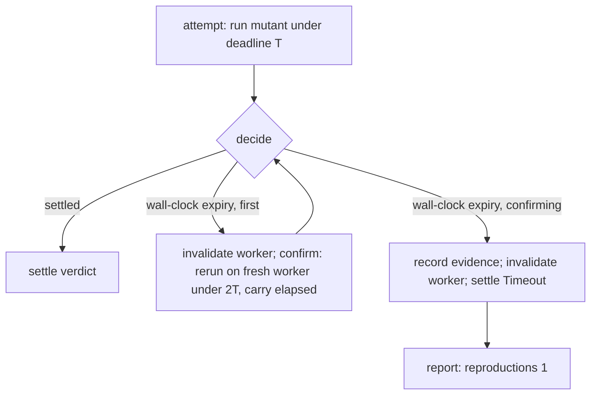

# Timeout Needs Nontermination Evidence - Plan

## Goal Capsule

- **Objective:** a stryker-js-effect report scores a mutant as a detected Timeout only when the run holds evidence that the mutant does not terminate, so a slow survivor is reported as a survivor.
- **Means:** an unconfirmed wall-clock expiry is re-run once, in the same run, on a fresh worker, under twice its deadline, before it is scored. A hit-limit breach needs no confirmation.
- **Product authority:** the root's 2026-10-13 intent ("runaway-mutant safety"), narrowed by the measurement in the Problem Frame and accepted by the root's review against `origin/main` `efd199625`, then `CONSTITUTION.md`.
- **Execution profile:** one PR stacked on `main`. Local verification is the engine package's typecheck, unit and property tests and API report, one build at a time. No mutation run, no hand-applied mutant and no e2e run locally; integration tests that drive a fixture run in CI.
- **Open blockers:** none. The root resolved the reframe and the confirmation mode on 2026-10-13.
- **Applicable packs** (`.compound-engineering/config.yaml`, pin `a578c704a`): `cell-architecture`, `boundary-testing`, `schema-laws`, `package-topology`, `mutation-discipline`, `ci-wall-clock`, `turbo-task-graph`. Rules that shaped a decision are cited where they apply.

## Product Contract

### Summary

A mutant whose run expires the wall-clock deadline gets one confirmation run in the same mutation run, on a fresh worker, under twice the deadline. It is reported Timeout only if the confirmation expires too; otherwise the confirmation's verdict is reported. Termination, the hit limit and worker replacement stay as they are.

### Problem Frame

**How `main` ends a runaway mutant, by class.** On `main` (`efd199625`):

| Runaway class                                                                           | What ends it on `main`                                                                                                                                                                                                               | Evidence                                                                                                                                                                                                                                                    |
| --------------------------------------------------------------------------------------- | ------------------------------------------------------------------------------------------------------------------------------------------------------------------------------------------------------------------------------------ | ----------------------------------------------------------------------------------------------------------------------------------------------------------------------------------------------------------------------------------------------------------- |
| A loop that re-enters the mutant's own activation helper                                | The hit limit: the helper throws once `++hitCount > hitLimit`, with the limit at the dry-run hit count x 100; the runner reports Timeout `Hit limit reached (n/limit)`                                                               | `packages/stryker-js-instrumenter/src/InstrumentHeader.ts:65-78`, `packages/stryker-js/src/plan-mutant-tests.workflow.ts:94-101`, `packages/stryker-js-vitest-runner/src/interpret-vitest-mutant-run.workflow.ts:10-11`                                     |
| A tight synchronous loop that never touches the helper, or a promise that never settles | Not the hit limit. The orchestrator's wall-clock deadline (`timeoutFactor x net + timeoutMS + overhead`, armed when the worker reports `MutantRunStarted`) expires, the worker process is killed and replaced, and the run continues | `plan-mutant-tests.workflow.ts:140-162`; `packages/stryker-js/src/pooled-test-runner.handle.ts:69-112` (`deadlineArmedMutantRun`), `:156-163` (`invalidatesRunnerPool`); workers are separate OS processes (`packages/stryker-js/src/node-platform.ts:118`) |

Parity with StrykerJS 10.0.0 holds for the classes this corpus exercises, and only those: StrykerJS uses the same helper-level hit limit (`packages/instrumenter/src/util/syntax-helpers.ts:59-70`) and the same deadline formula with runner restart. mutmut 3.8.0 has no loop detection; it forks per mutant under CPU and wall limits. The corpus shows no runaway of either class: the hit limit fired 0 times in `mutation-report-465`, `-468`, `-469` and `kill-matrix-468`, and no main run failed to end. Absence on the corpus is not a bound; two classes stay unexamined (How This Work Fits Together).

**What fails is the verdict.** A wall-clock expiry is scored as a detected Timeout (`packages/stryker-js/src/Reporter/render-progress-report.workflow.ts:96`) with no evidence that the mutant would not finish. Main's own Mutation runs at one commit show it:

- Push run [38378246563](https://github.com/systemfsoftware/stryker-js-effect/actions/runs/38378246563) (#468, `3797debd6`, `mutation-report-468`) reports 24 Timeouts, all `wall-clock-timeout`, all in `packages/stryker-js-typescript-checker`.
- The scheduled run [38384850859](https://github.com/systemfsoftware/stryker-js-effect/actions/runs/38384850859) (#469) at the same commit, over the same 10,277 mutants, reports 20 of those 24 as Survived, 3 Killed and 1 Timeout. Both runs executed every mutant: no verdict in either report is `remembered`, and the schedule passes `--full` (`.github/workflows/mutation.yml:85`).
- So #468 credits 20 survivors as detected: 1,362 detected against #469's 1,342, score 51.85% against 51.08%.
- The 24 are slow, not runaway. In #468's checker record, completed survivors ran at up to 1.53x their predicted cost (p90 1.42x); the 24 Timeouts sit at a median of 1.56x and a maximum of 1.73x, the tail of the same distribution cut by the deadline. They took 871 s of the project's 2,365 s of mutant time.

The incremental record already distrusts these verdicts: an unreproduced wall-clock Timeout is refused reuse and re-run next time (`packages/stryker-js/src/incremental-diff.workflow.ts:86-101`, refusal `timeoutUnreproduced`). The report of the run that produced it still scores it.

### Key Decisions

- **The unit fixes the Timeout verdict, not termination.** The measured defect is 20 survivors scored as detected at one commit. Governs R2, R3. (session-settled: user-approved — chosen over adding loop detection: the corpus shows no runaway `main` fails to end.)
- **Confirm in the same run, on a fresh worker, under at least twice the deadline.** Re-running under the same deadline does not separate slow from runaway: in #469, `f3fd369e0d507988` expired again at 1.53x its predicted cost and `85e7dc436a591f9f` finished at 1.44x, while #468's survivors reach 1.53x. Governs R3. (session-settled: user-directed — chosen over cross-run confirmation: a status that depends on cache history is not lossless against `--full`, and a first run would confirm nothing.)
- **A hit-limit breach is evidence on its own.** It is a deterministic count over the mutant's own activations. Governs R4.
- **No new wire field, and `statusReason` keeps its meaning.** For Killed and RuntimeError, `statusReason` is the failure or error message (`packages/stryker-js/src/mutation-reporting.service.ts:1070-1081`), so it cannot carry a note. The record's existing `reproductions` carries the confirmation. Governs R5, R6. Respects the root's ruling against presence-by-reason fields (pack: schema-laws, tagged-unions-over-state-by-presence.md).

### Requirements

**Termination (kept as is)**

- R1. Every mutant run ends by its tests, by the hit limit, or by the wall-clock deadline that kills and replaces the worker process, and the run continues. The unit must not weaken this.

**Timeout verdict**

- R2. A report scores a mutant as Timeout only with nontermination evidence: a hit-limit breach (R4) or a confirmed wall-clock expiry (R3).
- R3. A wall-clock expiry gets exactly one confirmation run of that mutant in the same mutation run, on a fresh worker, under a deadline twice the first one.
- R4. A hit-limit breach is reported Timeout with its `Hit limit reached (n/limit)` reason and no confirmation run.
- R5. A confirmation that expires again yields Timeout with reason `wall-clock-timeout`, and the run itself records it as reproduced (`reproductions` 1), so the next run reuses it. Today only a previous run's record supplies that evidence (`incremental-diff.workflow.ts:275-289`, `packages/stryker-js/src/run/incremental-reuse.cell.ts:425-429`).
- R6. A confirmation that finishes yields its verdict exactly as an ordinary run would (Killed, Survived, RuntimeError, with the usual `statusReason`), and the score counts it accordingly.
- R7. The kill-matrix lane (`STRYKER_KILL_MATRIX=1`, every killer kept) runs confirmations too, so a confirmed kill records its killers. `stryker audit` keys its predicates on `status` and `killedBy` only (`packages/stryker-js/src/audit-drops.workflow.ts`), so no audit change follows.
- R8. The recorded cost of a confirmed mutant (`costs[id].actualMs` in the incremental record) is the sum of both attempts, so shard planning sees what the mutant really took.

**Evidence**

- R9. Tests: the decision (when to confirm, the confirmation deadline, how the second outcome maps to a verdict) is a pure workflow with property tests. One engine integration test drives the published engine run (`Engine.mutationTestCell`) with a fixture whose mutant expires on its first attempt and finishes on its confirmation (R6), and the existing never-settling fixture asserts a confirmed Timeout with `reproductions` 1 in the record (R5).
- R10. Merge acceptance is checkable from named runs. The PR body names the before runs, push run 38378246563 (#468) and scheduled run 38384850859 (#469) at `3797debd6`, with this plan's counts. After merge, the after runs are the first push Mutation run on `main` that runs the released engine and the scheduled `--full` run at the same commit; their reading (R11, Success Criteria) is independent-auditor evidence for the root, not this stream's own proof.
- R11. The after reading reports, from those two runs' artifacts: the reported Timeouts and their reasons, how many of them the scheduled run reports Survived (baseline 20), and the measured wall-clock delta of the Mutation lane against #468.

### Acceptance Examples

- AE1. **Covers R3, R6.** In #468, mutant `141d93c9edf79341` (`CheckerCommands.schema.ts:20`, ObjectLiteral) expires and is reported Timeout; #469 runs it at 0.87x its predicted cost and reports it Survived. Under this contract its confirmation finishes inside the doubled deadline and the report shows Survived.
- AE2. **Covers R3, R5.** `f3fd369e0d507988` (`override-tsconfig-options.workflow.ts:35`, ObjectLiteral) expires in #468 and again in #469 at 1.53x. Under this contract its confirmation runs with twice the deadline: if it finishes, the report shows its test verdict; if it expires again, it is a confirmed Timeout with `reproductions` 1.
- AE3. **Covers R5.** The never-settling promise mutant of `packages/stryker-js/tests/wall-clock-timeout.integration.test.ts` expires, its confirmation expires, and it is reported Timeout `wall-clock-timeout` with `reproductions: 1` in the record.
- AE4. **Covers R4.** A `while` mutant in `packages/stryker-js-vitest-runner/testResources/infinite-loop` breaches its hit limit and is reported Timeout `Hit limit reached (n/limit)` after one run.
- AE5. **Covers R7.** In a kill-matrix run, a mutant whose first run expires and whose confirmation is killed by two tests records both killers.

### Success Criteria

- No report on `main` scores a wall-clock Timeout whose record lacks `reproductions` 1 (mechanical, from the report and the record of the after push run).
- The count of after-run Timeouts that the same-commit scheduled run reports Survived is published next to the baseline of 20 (R11).
- The Mutation lane's wall-clock delta is measured, not estimated: the after push run's Mutation wall time (run start to the `Mutation report` job's end) and the checker project's `budget.actualSeconds`, against #468's 61 min 3 s (09:42:33 to 10:43:36) and 250.1 s. The bound it is judged against is the worst case in KTD2: 1,742 s of runner time on the checker project.

### Scope Boundaries

- Out: marking a confirmation's verdict as "expired once" in the report. There is no channel for it without a new field (Key Decisions).
- Out: loop or recursion back-edge counters beyond the hit limit, and per-test progress events on the runner stream (`MutantRunEventSchema` carries only `MutantRunStarted` and `MutantRunSettled`, `packages/stryker-js-plugin-interface/src/TestRunner.schema.ts:57-81`). Neither fixes the verdict.
- Out: changing the `timeoutFactor` or `timeoutMS` defaults, or raising any timeout as a workaround. A larger factor moves the cut-off for every mutant and still scores unconfirmed expiries.
- Out: diagnosing why checker tests run slower under mutation than in the dry run. That is a cost question for its own unit.
- Out: hot reload. It changes how fast an environment resets, not whether a runaway ends or how it is scored.
- Out: editing `.github/workflows/mutation.yml` or `kill-matrix.yml`. Stream K owns them; the after reading uses their existing artifacts.

<!-- ce-section: work-relationships -->

### How This Work Fits Together

This plan covers the Timeout verdict. The breakdown below is the current understanding, not a committed roadmap.

- Follow-up unit (a), children orphaned after worker replacement. Still to decide. When the deadline kills a worker, a child process a test spawned may outlive it and hold ports, files or CPU into later mutants. Can proceed independently of this plan. Evidence plan: a fixture whose test spawns a long-lived child, run in CI through the engine, asserting no descendant of a replaced worker survives the run; plus a process count around worker replacement on one main Mutation run, cited by run id.
- Follow-up unit (b), a mutant or test that hangs or poisons the dry run. Still to decide. The dry run is bounded only by `withDryRunTimeout` (`pooled-test-runner.handle.ts:118-131`); a hang or a slow outlier there corrupts the hit counts and `netTime` that every mutant's hit limit and deadline in the file derive from (`plan-mutant-tests.workflow.ts:94-101`, `:140-162`). Shares the deadline formula with this plan. Evidence plan: per-file dry-run hit-count and time distributions from main's incremental records across consecutive runs, flagging files whose dry-run cost moves without a source change, then a fixture that stalls one dry-run test, run in CI.

### Dependencies / Assumptions

- The vitest runner is the only test-runner plugin (`packages/stryker-js-vitest-runner`); every runner reaches the engine through the pooled runner, so R3's fresh worker is the existing pool replacement.
- Mutant ids are content-addressed, so #468 and #469 compare the same mutants (both list 10,277).

### Outstanding Questions

**Deferred to Planning** (all resolved in the Planning Contract)

- Q3. Changeset classification: resolved by KTD5.
- Q4. When confirmations run and how their cost is attributed: resolved by KTD2 and KTD4.

### Sources

- Rerun-once before scoring is the remedy reported for the same false-detection elsewhere: Stryker users seeing slow suites scored as Timeout ([Chris-Wolfgang/DbContextBuilder#544](https://github.com/Chris-Wolfgang/DbContextBuilder/issues/544)), cargo-mutants under load ([AndySakov/omnimarket#145](https://github.com/AndySakov/omnimarket/issues/145)), nextest termination ([zbynekdrlik/iemmixer#23](https://github.com/zbynekdrlik/iemmixer/issues/23)).
- StrykerJS 10.0.0 hit limit and timeout: `stryker-mutator/stryker-js` `packages/core/src/mutants/mutant-test-planner.ts:36`, `:193-199`; mutmut 3.8.0: `boxed/mutmut` `src/mutmut/workers/isolation.py:840-867`.

---

## Planning Contract

### Key Technical Decisions

- KTD1. **The confirmation is a new outcome of the existing mutant-run decision, `interpret-mutant-run.workflow.ts`.** The observation gains `confirming` and the run's `timeoutMs`; the decision gains `MutantRunConfirm { timeoutMs }`, and the existing pool-invalidated outcome becomes `MutantRunTimeoutConfirmed`, reached only when the confirmation expired. The deadline factor of 2 is a named constant in the workflow, so the doubling is decided purely and pinned by property tests (pack: cell-architecture, pure-decision-workflows.md).
- KTD2. **Confirm inline, at the expiry, not after the shard (Q4).** On expiry `main` already invalidates the worker (`run/mutant-run.ts:278-281`); the confirmation runs on the replacement the pool creates, so it costs no extra worker boot, and it overlaps other slots' work at the run's concurrency. Confirming after the shard would hold expired mutants in a queue, boot again and serialize the confirmations at the end, adding their whole sum to the shard's wall time. The doubled deadline already clears the contention tail measured at concurrency: #468's survivors reach 1.53x and its expiries were cut at 1.56x-1.73x, the first deadline plus the kill. Worst case on #468's checker project: each of the 24 expiries runs its full doubled deadline again, 2 x 871 s = 1,742 s of runner time, spread across the slots that held them.
- KTD3. **The confirmation's evidence travels in a run-scoped set on `RunContext`, merged into the reporting input's `timeoutEvidenceByMutantId`.** The `MutantRunTimeoutConfirmed` writer adds the mutant with `{ timeoutKind: 'wallClock', reproductions: 0 }`, the first attempt's expiry, which `reproducedCountOf` (`mutation-reporting.service.ts:453-461`) already turns into `reproductions` 1. Checkpoints carry the same set, so a resumed run keeps it. No reporting rule changes.
- KTD4. **The recorded cost sums both attempts (R8).** The confirmation attempt carries the expired attempt's elapsed time and adds it to its own, so `costs[id].actualMs` and the shard planner see both.
- KTD5. **One changeset, `major` for `@systemfsoftware/stryker-js` (Q3).** Reported statuses change for mutants that used to be scored on a single expiry; `AGENTS.md` BREAK-1 sends a behavior break to `major` (pack: package-topology, surface-changes-are-versioned.md). No wire shape changes, so no other package bumps.
- KTD6. **The confirmation re-enters the attempt cell, as `MutantRunRetry` does today.** `mutant-run.cell.ts` already re-runs the attempt from its writer after invalidating the worker; the confirmation follows that precedent rather than adding a second run path. This is the same shape (pack: cell-architecture, pipeline-composition.md) rules on, already present on `main`.

### High-Level Technical Design

### Assumptions

The stage gate (destructive review) broke three assumptions of the first draft; the plan now holds these instead:

- The slowdown behind an expiry is mostly contention at concurrency, not intrinsic cost. If a mutant's cost is intrinsic, its confirmation can expire again under 2T; AE2 states that outcome and the after reading counts it.
- The pool supplies a fresh worker within its boot timeout, as it does for every expiry on `main` today.
- Inline confirmations keep each shard inside the 60-minute stuck-job backstop (pack: ci-wall-clock, one-stuck-job-backstop.md): #468's slowest shard took 832 s, and KTD2's worst case adds at most 1,742 s spread across slots.

### Test Layer Admission

`skill://test-layer-selection` admits two layers and refuses the rest. The decision is a `workflow` cell, so it gets colocated property tests only (U1). Worker kill and replacement are a live multi-process seam, so the confirmation's end-to-end behavior is one more scenario in the existing live engine journey, `packages/stryker-js/tests/wall-clock-timeout.integration.test.ts`, not a new file (U3). Unit tests or mocks of the writers are refused (pack: boundary-testing, no-mocks-on-internal-glue.md).

### Sequencing

One PR on `main`: U1, then U2 and U3 in the same change, U4 last.

### Risks & Dependencies

| Risk                                                                  | Mitigation                                                                                                                                       |
| --------------------------------------------------------------------- | ------------------------------------------------------------------------------------------------------------------------------------------------ |
| A real runaway now costs three deadlines (T, then 2T) instead of one. | Bounded by KTD2's worst case; measured on the after run (Success Criteria). The corpus has one confirmed-class expiry per run on average (#469). |
| Concurrent confirmations still contend with other slots.              | The doubled deadline clears the measured tail; the after run's Survived-among-Timeouts count shows whether it held.                              |
| Two property tests on `main` pin the old outcome name.                | They change with the workflow in U1.                                                                                                             |

### System-Wide Impact

The report, the NDJSON line and the incremental record keep their shapes; only which status a slow mutant receives changes, and a confirmed Timeout's `reproductions` becomes 1. `stryker audit` reads status and killers only. The kill-matrix lane takes the same path.

## Implementation Units

### U1. Confirmation decision

- **Goal:** the mutant-run decision confirms a first wall-clock expiry under twice the deadline and settles a second one as Timeout.
- **Requirements:** R2, R3, R4; KTD1.
- **Files:** `packages/stryker-js/src/interpret-mutant-run.workflow.ts`, `packages/stryker-js/src/__tests__/interpret-mutant-run.workflow.property.test.ts`.
- **Approach:** add `confirming` and `timeoutMs` to `MutantRunObservation`; add `MutantRunConfirm { timeoutMs }`; rename `MutantRunPoolInvalidated` to `MutantRunTimeoutConfirmed`; decide with exhaustive `Boolean.match`.
- **Test scenarios:**
  - A first wall-clock expiry confirms, with a deadline equal to twice the observation's `timeoutMs`.
  - A wall-clock expiry while confirming settles as a confirmed Timeout.
  - Without a wall-clock expiry the decision ignores `confirming` and keeps the covering-test retry rule.
- **Verification:** `pnpm --filter @systemfsoftware/stryker-js typecheck` and the property tests pass.

### U2. Confirmation run and evidence

- **Goal:** the attempt cell runs the confirmation on a fresh worker, records confirmed evidence, and sums the cost.
- **Requirements:** R3, R5, R6, R7, R8; KTD2, KTD3, KTD4, KTD6.
- **Files:** `packages/stryker-js/src/run/mutant-run.cell.ts`, `packages/stryker-js/src/run/mutant-run.ts`, `packages/stryker-js/src/run/mutant-settlement.ts`.
- **Approach:**
  1. The attempt input carries `confirming` and the expired attempt's elapsed time; the observation reports the plan's `timeout`.
  2. `MutantRunConfirm` invalidates the worker and re-enters the attempt with the plan's `runOptions.timeout` set to the decided deadline.
  3. `MutantRunTimeoutConfirmed` adds the mutant to `RunContext`'s confirmed set, then recycles and settles as today.
  4. `reportAll` and checkpoints merge the confirmed set into `timeoutEvidenceByMutantId`.
- **Patterns to follow:** the `MutantRunRetry` writer in `run/mutant-run.cell.ts`.
- **Test scenarios:** covered by U3's integration scenarios; the writers are I/O glue (pack: boundary-testing, no-mocks-on-internal-glue.md).
- **Verification:** typecheck passes.

### U3. Integration evidence through the engine run

- **Goal:** the published engine run shows both confirmation outcomes.
- **Requirements:** R5, R6, R9; AE3.
- **Files:** `packages/stryker-js/tests/wall-clock-timeout.integration.test.ts`.
- **Approach:** keep the never-settling scenario and assert `reproductions` 1 on its Timeout in the incremental record; add a scenario whose mutant reaches a helper outside the mutate glob that hangs only on the first call in the run (a marker file in the workspace), so the first attempt expires and the confirmation finishes.
- **Test scenarios:**
  - Covers AE3. The never-settling mutant is a Timeout `wall-clock-timeout` with `reproductions` 1, and the run completes.
  - Covers R6. The first-call-hang fixture reports no Timeout, its marker shows the hang happened, and the run completes.
- **Verification:** CI's `check` job runs the integration test; nothing runs it locally (Execution profile).

### U4. Release note

- **Goal:** consumers learn that a single wall-clock expiry no longer scores a mutant.
- **Requirements:** KTD5.
- **Files:** one `.changeset/*.md`, `major` for `@systemfsoftware/stryker-js`.
- **Verification:** `Changeset Check` passes on the PR head.

## Verification Contract

| Gate                         | Command or source                                                                                                                        | Applies to                         |
| ---------------------------- | ---------------------------------------------------------------------------------------------------------------------------------------- | ---------------------------------- |
| Format                       | `./bin/dprint check`                                                                                                                     | the PR                             |
| Typecheck, tests, API report | `pnpm --filter @systemfsoftware/stryker-js typecheck`, the touched property tests, `pnpm --filter @systemfsoftware/stryker-js api:check` | the PR                             |
| Single plan                  | `pnpm gate:repo`                                                                                                                         | the PR                             |
| CI                           | `check`, every `e2e (…)` leg, `Changeset Check`, watched with `xd://github run_watch`                                                    | the PR head                        |
| Before evidence              | runs 38378246563 and 38384850859, named in the PR body (R10)                                                                             | the PR                             |
| After evidence               | the first push Mutation run after release and the same-commit scheduled `--full` run: R11's counts and the measured wall-clock delta     | after release, independent auditor |

Nothing runs mutation locally. Tests count as passing only when the parent session ran them or CI reports them on the PR head.

## Definition of Done

- Every unit's verification holds and every R-ID is covered by a unit, an AE or the Verification Contract.
- The PR body names the before runs, the after runs to read, the full-path code review receipt with pack rulings and the models that served each lens.
- The diff holds no scratch scripts, no abandoned attempts and no unused exports (DEL1).
