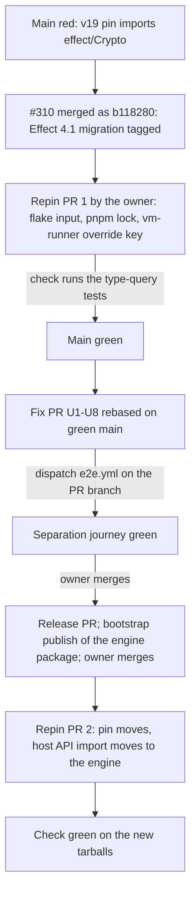

# stryker-js runs on its own effect - Plan

## Goal Capsule

- **Objective:** A project pinned to any `effect` version runs `stryker` and completes a mutation run. No package on the run path has any `effect` relationship with that project.
- **Means:** The run path bundles its own `effect` and declares it nowhere. The Effect-native library surface ships as separate packages that declare `effect` as a required peer. One e2e journey proves the separation on the packed tarballs (KTD1, KTD2, KTD5).
- **Authority:** SYS-1276 "Done when" and its "Dependency model, settled" section (2026-11-10), which replaces the "direct exact dependency" bullets; `AGENTS.md` (BREAK-1, START-6, PLUG-1); `packages/AGENTS.md`; `repos/constitution/CONSTITUTION.md` (CONST-B1, CONST-B2). Where they conflict, the constitution governs.
- **Stop conditions:** U1-U8 are one pull request. It is published when the local Verification Contract rows pass, with the off-host rows named as pending. It merges only after the dispatched separation journey is green and main is green (U9a). U9 is human-gated (release, bootstrap publish, pin) and is never executed by an agent. No agent approves or merges.
- **Execution profile:** Inline editing in one worktree. The separation journey runs off-host only: it needs KVM and the collector (`test/e2e/README.md`, OP28).

## Product Contract

### Summary

`@systemfsoftware/stryker-js`, the vitest runner and the TypeScript checker are the run path. Each bundles the `effect` copy it runs on and declares `effect` in no dependency field, so no package manager can bind it to the consumer's copy. The Effect-native host API at `.` of `@systemfsoftware/stryker-js` moves to a new package, `@systemfsoftware/stryker-js-engine`. That package, plugin-interface, plugin-runtime and the other Effect-typed library packages declare `effect` as a required peer, so library users share one instance. A packed-tarball journey in the e2e lane installs the run-path tarballs into a consumer on `effect@4.0.0`, runs a real mutation run, and fails when any run-path package declares `effect`. Main returns to green through the release that already merged (#310) and a repin; the separation ships in the following release.

### Problem Frame

`@systemfsoftware/stryker-js` and `@systemfsoftware/stryker-js-html-reporter` declare `effect` as a peer, and several packages depend on `@effect/*` packages that peer on `effect`. A consumer on another `effect` version therefore changes what stryker-js loads. The visible failure: main moved to effect 4.1.0, which removed `effect/Crypto`; the pinned release `@systemfsoftware/stryker-js@v19.0.0` (flake input `stryker-published`, release commit `9e81669b`) imports it from `dist/run-stages-YROKrRt1.mjs`, so `type-query-worker.integration.test.ts` and `type-query-unenforced-context.integration.test.ts` fail on main and on #366.

The defect is narrower than the peer declaration suggests. The shipped CLI (`dist/main.mjs`, 4.4 MB) already has no external `effect` import. The coupling lives in the library entries (`.`, `./config`, `./promises`, `./events`), which import `effect` as an external, and in the dependencies that peer on it.

### Requirements

**Run path**

- R1. `@systemfsoftware/stryker-js`, `@systemfsoftware/stryker-js-vitest-runner` and `@systemfsoftware/stryker-js-typescript-checker` declare `effect` in no field a package manager installs from: not `dependencies`, `peerDependencies`, `peerDependenciesMeta` or `optionalDependencies`. They declare no package that peers on `effect` either (`@effect/*`, `@systemfsoftware/effect-cell-types`, the Effect-typed workspace libraries).
- R2. Their shipped JavaScript imports no `effect` specifier, and their emitted declarations import none: every `effect` module they need is inlined.
- R3. A run-path package lists in `dependencies` only what its shipped JavaScript or declarations import as an external.

**Library surface**

- R4. `@systemfsoftware/stryker-js-engine` (new), `-plugin-interface`, `-plugin-runtime`, `-cli-contract`, `-instrumenter` and `-html-reporter` declare `effect` as a required peer, at the catalog range, and nowhere else. No optional peer is used.
- R5. `@systemfsoftware/stryker-js` no longer exports the Effect-native host API at `.` (`Engine`, `Worker`, `Plugin`, `Configuration`, `Checker`, `RunEvent`, `Serve`, `Mcp`, `SourceParser`, `GitDiff`, `ImportClosure`); the engine package exports it.

**Proof**

- R6. A check installs the packed run-path tarballs into a consumer pinned to `effect@4.0.0` under npm, runs a real mutation run, and passes only when the run ends with a verdict.
- R7. The check fails when any run-path package declares `effect` in a field of R1, including a peer whose range admits the consumer's version.
- R8. No test is added besides that check (SYS-1276 rules).

**Release**

- R9. Main's `check` passes with the type-query tests unchanged after the repin to the release already merged (#310, `b118280`), and after the repin to the release that carries R1-R5. The second repin moves the import specifier of the host API; Open Questions records the choice.
- R10. Every change that narrows a declared surface ships a changeset at `major` (`minor` while a package is `0.x`) (BREAK-1; pack: package-topology, surface-changes-are-versioned.md).

### Scope Boundaries

- Not in scope: retargeting the dogfood pin to `workspace:^` or a registry version (`AGENTS.md`, Dogfood row); editing `.github/workflows/`; adding a gate (GATE1); adding a shell script; deleting or skipping a type-query test; touching the type-query test files.
- Not in scope: a physical move of the engine source out of `packages/stryker-js` (KTD3 records why), and a Promise facade for the host API.
- Deferred: the engine package's coverage in the nightly mutation lane (needs a `mutation.yml` edit, which is read-only here).

## Planning Contract

### Key Technical Decisions

- KTD1. **Run path has no `effect` relationship; the library surface requires one shared peer.** (session-settled: user-directed — the owner's settled section of SYS-1276, chosen over a direct exact dependency, which this plan's first draft built, and over an optional peer, tested on npm 11 where it still fails the install when the consumer's `effect` is outside the range; this replaces the first draft's KTD1 and KTD3.) The classification rule is the package's public surface: a package a consumer runs bundles; a package that exposes an Effect-typed API to authors peers. The owner named the engine package, plugin-interface and plugin-runtime. The same rule puts cli-contract, instrumenter and html-reporter on the peer side: each exports Effect schemas, services or layers, and each already declares `effect` as a dependency or peer. A package that is both is classified by what the owner named: the TypeScript checker's plugin declaration is run path, and its `./runtime` and `./type-query` subpaths ship on the checker's bundled copy (KTD2).
- KTD2. **Run-path bundling through the existing PLUG-1 mechanism.** Each run-path package inlines `effect`, `@effect/*`, `@systemfsoftware/effect-cell-types` and the workspace libraries it uses, and gates its externals with `deps.onlyImport` so tsdown fails the build on any specifier outside the list. `effect` and the other bundled inputs move to `devDependencies`: the repository's Turborepo boundary rule requires an imported package to be declared, and a dependency's `devDependencies` are never installed. Declarations inline the same inputs (tsdown inlines devDependency types, `docs/solutions/build-errors/tsdown-inlines-devdep-types-into-dts-single-copy-rule.md`), so R2 holds for types. Fallback, per entry and only if the emitted-declaration check in the Verification Contract fails: keep a types-only `effect` import out of that entry by not publishing it; recorded in the solution doc.
- KTD3. **One source tree, two artifacts.** The engine's source and its roughly 100 integration tests stay in `packages/stryker-js`. `packages/stryker-js-engine` is a new published package whose build compiles the engine's `src/mod.ts` with `effect` external; `@systemfsoftware/stryker-js` keeps building the run-path bundle from the same sources. Rejected: a physical move of the sources into the engine package. The read-only `mutation.yml` and `kill-matrix.yml` mutate and build `packages/stryker-js`, `node packages/stryker-js/dist/main.mjs audit` runs in `mutation.yml`, and the e2e fault-seeding script and the bench read `packages/stryker-js/src`; a move would drop the engine from the nightly mutation lane until the owner edits a workflow, and it would turn about 100 test files into renames this pull request cannot prove. The repository already builds two artifacts from this directory (library chunks and the CLI bundle); this adds a third, published under its own name. The cost is a package whose build reaches into a sibling's source; the owner may overturn this once the workflows can change. In-workspace consumers of `.` (the checker-parity lane, the stryker-js tests) keep resolving it through the `@systemfsoftware/source` condition, which stays in the development manifest and is stripped from the published one.
- KTD4. **The Effect-typed Evaluator contract is removed, with no replacement.** Nothing in the engine calls an evaluator (only the loader and plugin-interface name it). The service tag and `EvaluatorFailed` go; the `Evaluator` plugin-kind literal and descriptor stay as data (CONST-B1).
- KTD5. **The separation proof is one e2e journey, run postsubmit and by dispatch.** It lives in `test/e2e`, which already packs the workspace closure, installs it with `npm ci` in the fixture bake and runs the packed CLI in a microVM. The lane is main-only by rule (pack: ci-wall-clock, heavy-suites-judge-every-main-commit.md) and `.github/workflows/e2e.yml` is read-only; the new file joins the `rest-1` and `rest-2` shards without a workflow edit. The bake installs every packed closure member into every fixture, and the library packages in that closure now peer on `effect ^4.1.0`. The fixture pins `effect@4.0.0` and sets npm `overrides: { effect: "$effect" }`, which resolves those library peers to the consumer's copy. Measured on npm 11.19.0: without the override the install fails with ERESOLVE; with it, it installs `effect@4.0.0` once. The override does not touch the run path, which declares nothing to override.
- KTD6. **Consumer pinned to `effect@4.0.0`.** 4.0.0 ships `dist/Crypto.js`; 4.1.0 does not (both read from the registry tarballs). The fixture's source imports `effect/Crypto`, which resolves only against the consumer's copy, while stryker-js runs on its own 4.1.x. Assertions read installed bytes (`node_modules/.package-lock.json`, installed manifests), never the check's own metadata (CHK1).
- KTD7. **Return main to green first, then ship the separation.** Release PR #310 merged as `b118280` and carries the Effect 4.1 migration. A repin PR (human) moves the flake input, the lock and the vm-runner override key; main goes green on it. The fix pull request rebases onto green main and merges on a green `check`; its release and a second repin follow.
- KTD8. **Versioning.** `major`: stryker-js (the `.` surface leaves, dependencies change), plugin-interface (peer, Evaluator removed), plugin-runtime, instrumenter, html-reporter, typescript-checker. `minor` (0.x): cli-contract. `patch`: vitest-runner (declared-but-unimported dependencies removed). `minor`: stryker-js-engine, a new package that publishes as 0.1.0 after a maintainer bootstrap publish (`.changeset/README.md`).

### Surface Disposition

| Surface                                                                                       | What put `effect` in front of the consumer                                                                                           | After                                                                                              | Disposition                           |
| --------------------------------------------------------------------------------------------- | ------------------------------------------------------------------------------------------------------------------------------------ | -------------------------------------------------------------------------------------------------- | ------------------------------------- |
| CLI: argv, NDJSON `--json` stream, exit codes, report JSON                                    | Nothing; `dist/main.mjs` already had no external `effect` import.                                                                    | Process boundary and bundled copy; contract in `packages/stryker-js-cli-contract/contract/*.json`. | Unchanged.                            |
| `./config`: `defineConfig`, `mergeConfig`, `StrykerConfig`, `ConfigEnv`                       | Plain objects and functions, but the chunk imported 17 `effect/*` specifiers from the peer, and the declarations imported its types. | Plain-data contract on the bundled copy; declarations self-contained.                              | Contract unchanged; resolution fixed. |
| `./promises` `run`, `./events` (`PrepareError`, `StageError`)                                 | `run` returns plain `Promise<MutationTestDone>`; the error classes were Schema classes read through `instanceof` and fields.         | Plain data on the bundled copy.                                                                    | Unchanged; resolution fixed.          |
| `.` Effect-native host API                                                                    | Effects, Layers and Streams on the consumer's `effect`.                                                                              | `@systemfsoftware/stryker-js-engine`, required peer.                                               | Moved out of stryker-js.              |
| Plugin declarations (`strykerPlugins`) and worker protocol                                    | Declaration modules imported nothing; the worker is a spawned process on NDJSON RPC.                                                 | Plain-data declaration, process boundary, bundled worker (PLUG-1).                                 | Unchanged.                            |
| Checker `./runtime`, `./type-query`                                                           | External `effect`, plugin-interface, cli-contract and instrumenter imports.                                                          | Bundled into the checker package; they interoperate with authors by string-keyed services.         | Resolution fixed; private copy.       |
| Ignorers, frameworks, mutator providers                                                       | Plain function contracts.                                                                                                            | Unchanged.                                                                                         | Unchanged.                            |
| In-process Evaluator                                                                          | `Context.Service` returning `Effect`, never called by the engine.                                                                    | None.                                                                                              | Removed (KTD4).                       |
| Library packages: plugin-interface, plugin-runtime, cli-contract, instrumenter, html-reporter | `dependencies` or optional/required peer on `effect`.                                                                                | Required peer `effect`.                                                                            | Declaration fixed (KTD1).             |

### Install Semantics

Verified for the owner's question "what does pnpm install once `effect` is a direct, exact dependency", which the settled model no longer relies on but which fixed the rejection:

- pnpm 11.27.0, source `pnpm/pnpm@8813abc` (`resolve_peers/walker/child_walk.rs`, `peer_provider.rs`) and a recorded install: a package's peer binds to its dependent's own `dependencies` entry before the importing project's. The owner's claim holds for pnpm.
- npm 11.19.0, same fixture: the claim does not hold. A peer-bound package (`effect-cell-types`, peer `effect ^4`) was hoisted to the root and resolved the consumer's `effect@4.1.2`; another was nested only because its range excluded the consumer's version. Equal exact versions did not give one copy.
- Hence the settled model: bundling removes the peer edge itself, so no resolver decision remains.
- Optional peer on npm 11 (owner, SYS-1276): still fails the install outside the range. Required peer on the library side is therefore the honest declaration.
- `overrides: { effect: "$effect" }` (KTD5), measured: library peer `^4.1.0` against a consumer on `4.0.0` fails with ERESOLVE without it and installs with it.

### Separation Check

One journey, `test/e2e/tests/effect-separation.e2e.test.ts`, on the existing `vm-vitest-fixture`. The fixture becomes the consumer that pins `"effect": "4.0.0"` literally and carries the npm override of KTD5; it already uses the built-in `vm` test runner, and the other journey that runs on it (`vm-vitest.e2e.test.ts`) does not read `effect`. A new fixture was tried and dropped: a fixture whose test imports a module of its own needs a published export for the guard on test files, and the existing fixture needs none. The bake installs the packed closure with `npm ci` before any journey. The journey asserts:

- A1. Starting from the three run-path packages (`@systemfsoftware/stryker-js`, `-vitest-runner`, `-typescript-checker`), the journey walks the dependency, optional-dependency and peer-dependency edges recorded in `node_modules/.package-lock.json`. It fails when the walk reaches `effect` or any package that has an `effect` edge. This is R7: a peer whose range admits 4.0.0, such as `^4.0.0`, installs cleanly and fails here.
- A2. The only `effect` version in the installed tree is `4.0.0`: no run-path package nests a second copy.
- A3. `stryker run --json` exits 0 and emits a terminal `verdict` event, using the existing stream-decoding fixtures. 4.0.0 still ships `effect/Crypto` and 4.1.x does not, so a run that completed on stryker-js's own 4.1.x copy beside a consumer on 4.0.0 shows the copies are separate.

`devDependencies` are not read: a dependency's `devDependencies` are never installed, and the packed manifests already carry workspace tooling there. A1 states that reading.

The red proof (CHK1): on a scratch branch that is never merged, restore `"peerDependencies": { "effect": "^4.0.0" }` in `packages/stryker-js/package.json`, regenerate the fixture locks, dispatch `e2e.yml`, and expect the separation journey red at A1 while the other legs stay green.

### High-Level Technical Design

### Assumptions and Constraints

- tsdown inlines declarations of devDependency packages into emitted `.d.mts` (KTD2); the emitted-declaration check verifies it for `effect` itself, whose types are far larger than the cell-types it was observed on.
- `deps.onlyImport` is the PLUG-1 mechanism; extending it to the library entries applies the existing mechanism and counts as a new gate (GATE1) only if the owner reads it so.
- The development manifest keeps `.` of stryker-js under the source condition so in-workspace imports of the host API resolve (KTD3).

## Implementation Units

### U1. Return the catalog `effect` to its range

- **Goal:** Library peers take the catalog range; nothing needs an exact pin.
- **Requirements:** R4.
- **Files:** `pnpm-workspace.yaml` (`effect: ^4.1.0`), `pnpm-lock.yaml`.
- **Approach:** Undo the first draft's exact pin. The bundled copy is the version the lock resolves.
- **Test expectation:** none -- catalog change.
- **Verification:** `pnpm install --frozen-lockfile` after the lock is regenerated.

### U2. Run path: `@systemfsoftware/stryker-js`

- **Goal:** No `effect` relationship; `.` leaves the published surface.
- **Requirements:** R1, R2, R3, R5.
- **Files:** `packages/stryker-js/package.json`, `tsdown.config.ts`, `src/published.ts`, `api-extractor.json`, `tsconfig.api.json`, `README.md`, `etc/stryker-js.api.md`; `turbo.json`.
- **Approach:** Remove `peerDependencies.effect`. `effect` and the peer-bound inputs live in `devDependencies`; the library config (`config`, `promises`, `events`) bundles them with `deps.alwaysBundle` and gates with `deps.onlyImport: [node builtins, '@noble/hashes', '@opentelemetry/api']`. The published build drops the `index` entry; the development manifest keeps `.` on the source condition, through an `injectTypes` hook on `exports.customExports` that adds it only when `isPublish` is false (the repository convention gate requires that hook shape). api-extractor cannot read the declarations, which inline the whole `effect` type surface, so a second declarations-only config builds the same entries with `effect` external (`src/published.ts`, output under `temp/api`, which `turbo.json` lists as a build output) and the API report reads that. Extend `inlinedDependencies`. README: replace the Effect embedding section with `./promises` and the CLI, point library users to the engine package, state that `effect` is not a consumer requirement. `api:update`.
- **Test expectation:** none beyond the journey -- packaging change.
- **Verification:** `pnpm --filter @systemfsoftware/stryker-js build api:check typecheck`; the emitted-declaration check.

### U3. Library peers

- **Goal:** The Effect-typed libraries declare the shared peer.
- **Requirements:** R4.
- **Files:** `package.json` of `-plugin-interface`, `-plugin-runtime`, `-cli-contract`, `-instrumenter`, `-html-reporter`; each `etc/*.api.md` if the report moves.
- **Approach:** `effect` moves from `dependencies` (or stays a peer) to a required `peerDependencies` entry at `catalog:`, and to `devDependencies` for the build. Nothing else in those manifests changes; their other dependencies already match their imports.
- **Test expectation:** none -- manifest change.
- **Verification:** `pnpm --filter <pkg> build api:check typecheck`.

### U4. Run path: vitest runner and TypeScript checker

- **Goal:** The two plugin packages declare no `effect` relationship.
- **Requirements:** R1, R2, R3.
- **Files:** `packages/stryker-js-vitest-runner/package.json`, `packages/stryker-js-typescript-checker/package.json`, `tsdown.config.ts`, `README.md`, `etc/*.api.md`.
- **Approach:** vitest-runner: its tarball imports only `vitest` outside node builtins, so the unimported dependencies leave `dependencies`; the worker bundle keeps `deps.onlyImport: ['vitest']`. Checker: `effect`, the workspace libraries and `@effect/*` move to `devDependencies` and into `alwaysBundle` for the library entries (`index`, `runtime`, `type-query`), gated by `onlyImport` (node builtins, `@noble/hashes`, `typescript`); the worker keeps `onlyImport: ['typescript']`. README states that `./runtime` and `./type-query` ship on the checker's own copy.
- **Test expectation:** none beyond the journey.
- **Verification:** `pnpm --filter @systemfsoftware/stryker-js-vitest-runner --filter @systemfsoftware/stryker-js-typescript-checker build` (PLUG-1); `api:check`; `typecheck`; the emitted-declaration check.

### U5. `@systemfsoftware/stryker-js-engine`

- **Goal:** The Effect-native host API ships as its own package with a required `effect` peer.
- **Requirements:** R4, R5.
- **Files:** `packages/stryker-js-engine/` (`package.json`, `tsdown.config.ts`, `tsconfig.json` plus build and app configs, `api-extractor.json`, `.attw.json`, `oxlint.config.ts`, `README.md`, `LICENSE`, `etc/stryker-js-engine.api.md`), `pnpm-workspace.yaml` (workspace list is a glob; no change expected).
- **Approach:** Entry `src/mod.ts` of `packages/stryker-js`, `effect` and the Effect-typed workspace libraries external, everything else the engine bundles today inlined; `deps.onlyImport` lists exactly the manifest's `dependencies`. `peerDependencies.effect: catalog:`. The README carries the library section moved out of stryker-js and says plainly that the CLI, `./config` and `./promises` do not need it. A changeset (U8) publishes it as `minor`.
- **Test expectation:** none -- the engine's behavior is covered by the existing stryker-js integration tests, which run the same sources.
- **Verification:** `pnpm --filter @systemfsoftware/stryker-js-engine build api:check typecheck`; the emitted-declaration check shows `effect` as the only Effect import.

### U6. Remove the Effect-typed Evaluator contract

- **Goal:** No Effect an author builds can run in the engine through the Evaluator kind (KTD4).
- **Requirements:** R5.
- **Files:** `packages/stryker-js-plugin-interface/src/Evaluator.service.ts`, `src/Evaluator.schema.ts`, `src/Evaluator/mod.ts` (deleted), `src/mod.ts`, README.
- **Approach:** Delete the tag, `EvaluatorFailed` and the namespace export; keep the `Evaluator` plugin-kind literal and descriptor. Already applied in this worktree; `pnpm typecheck` proves no caller remains.
- **Test expectation:** none new.
- **Verification:** `pnpm --filter @systemfsoftware/stryker-js-plugin-interface --filter @systemfsoftware/stryker-js typecheck api:check`.

### U7. The separation journey

- **Goal:** Prove R6 and R7 on the packed tarballs.
- **Requirements:** R6, R7, R8.
- **Dependencies:** U2-U5.
- **Files:** `test/e2e/tests/effect-separation.e2e.test.ts`; `test/e2e/testResources/vm-vitest-fixture/package.json` (pin and override); every `test/e2e/testResources/*/package-lock.json` that `fixtures:lock` regenerates.
- **Approach:** Follow `test/e2e/tests/mutation-run.e2e.test.ts` for the harness (`E2eHarnessLive`, `runStryker`, `decodeStream`, `readReportOf`). Read the installed tree through the run output's `readFile`. After U2-U5 run `pnpm --filter @systemfsoftware/stryker-e2e fixtures:lock` once and commit every rewritten lock: one stale lock fails the shared bake for all five legs. Assertions A1-A3.
- **Execution note:** The journey is off-host. Dispatch `gh workflow run e2e.yml --ref <branch>`; never run it here (OP28).
- **Test scenarios:**
  - Consumer on `effect@4.0.0`, packed closure: the bake succeeds, nothing reachable from the run path touches `effect`, 4.0.0 is the only copy, the run ends with a `verdict` event and exit 0.
  - `peerDependencies.effect ^4.0.0` restored in stryker-js with the locks regenerated: the bake succeeds and A1 fails.
  - A run-path package restored to `dependencies` on `@systemfsoftware/effect-cell-types`: A1 fails.
- **Verification:** the dispatched run is green; the scratch-branch red proof is red at A1.

### U8. Docs, solution record, changesets

- **Goal:** The release carries the correct bumps and the finding is recorded.
- **Requirements:** R10.
- **Files:** `.changeset/own-effect-run-path.md` (new); `packages/stryker-js-plugin-interface/README.md`; `docs/solutions/tooling-decisions/run-path-bundles-effect-library-peers-it.md` (new).
- **Approach:** One changeset lists every package at the bump in KTD8, naming the removed `.` surface, the peer changes and the Evaluator removal. The solution doc records the install findings, the override, the classification rule and the superseded 2026-09-24 decision.
- **Test expectation:** none.
- **Verification:** CI `Changeset Check`; `pnpm format:check`.

### U9a. Repin to the merged release (human-gated)

- **Goal:** Main returns to green (R9, first half).
- **Files:** `flake.lock` and `nix/release-hashes.json` if the pin carries one; `pnpm-lock.yaml`; `pnpm-workspace.yaml` (the `stryker-js-vm-runner@npm:...@^<version>` override key); `.sfs-deps/` is rebuilt, not committed.
- **Approach:** `nix flake update stryker-published`, `nix build .#stryker-published --out-link .sfs-deps`, `pnpm install`, move the override key to the range `pnpm pack` wrote into the new manifest. No type-query file changes. The U1-U8 pull request rebases onto this.
- **Verification:** the START-6 command; `CI / check` green on the repin head with both type-query files.

### U9b. Release the separation and repin (human-gated)

- **Goal:** The pin carries the own-effect release (R9, second half).
- **Dependencies:** U1-U8 merged; U9a done; the engine package bootstrap-published.
- **Approach:** As U9a, plus the host API import: after this release the dogfood tarball of stryker-js has no `.`, so the three type-query/vitest-runner test files and `test/checker-parity` that import `Engine` and `Worker` from the tarball resolve them from the engine's tarball (Open Questions).
- **Verification:** the START-6 command; `CI / check` green.

## Verification Contract

| Row                                       | Command or source                                                                                                                                                                                                     | Where             | Proves                                                        |
| ----------------------------------------- | --------------------------------------------------------------------------------------------------------------------------------------------------------------------------------------------------------------------- | ----------------- | ------------------------------------------------------------- |
| Format                                    | `pnpm format:check`                                                                                                                                                                                                   | local             | START-1                                                       |
| Typecheck, touched packages               | `pnpm --filter <pkg> typecheck`                                                                                                                                                                                       | local             | START-2, U6 leaves no caller                                  |
| Unit and property tests, touched packages | `pnpm --filter <pkg> test` for the manifest-only packages                                                                                                                                                             | local             | no regression in plain-data paths                             |
| Build and API reports                     | `pnpm --filter <pkg> build api:check` for each package in U2-U6                                                                                                                                                       | local             | R3 and the build gate (`deps.onlyImport`) hold                |
| PLUG-1                                    | `pnpm --filter @systemfsoftware/stryker-js-vitest-runner --filter @systemfsoftware/stryker-js-typescript-checker build`                                                                                               | local             | worker bundles import only node builtins and the allowed tool |
| Emitted declarations and chunks           | read the `from` specifiers of `dist/*.mjs` and `dist/*.d.mts` of each run-path package; none names `effect`, `@effect/*` or `@systemfsoftware/effect-cell-types`; the engine names `effect` as its only Effect import | local             | R2                                                            |
| Changeset                                 | CI `Changeset Check`                                                                                                                                                                                                  | CI                | R10                                                           |
| Separation journey                        | `gh workflow run e2e.yml --ref <branch>` (source: `.github/workflows/e2e.yml`)                                                                                                                                        | off-host, pending | R6, R7; the regenerated fixture locks                         |
| Red proof                                 | same dispatch on a scratch branch with the `^4.0.0` peer restored                                                                                                                                                     | off-host, pending | R7                                                            |
| Full gate                                 | `pnpm check:ci`                                                                                                                                                                                                       | CI, pending       | START-4                                                       |
| Pin                                       | START-6 command                                                                                                                                                                                                       | repin PRs         | R9                                                            |

Local runs are limited to the touched packages (OP28). Pending rows are reported with the exact dispatch command and the run URL once they run; unknown status stays pending.

## Definition of Done

- R1-R8 and R10 hold, each by its Verification Contract row; R9 is verified on the two repin PRs and is not an exit condition of the U1-U8 pull request.
- The Surface Disposition table appears in the pull request body.
- No run-path manifest declares `effect` in a field of R1; the library packages of R4 declare it as a required peer.
- The only new test artifacts are the journey and its fixture; the regenerated fixture locks are expected changes; the type-query test files are byte-identical to main.
- No scratch scripts, no local scan files, no unused devDependency entries.

## Risks and Dependencies

- Red-check merge. The repin PR to the merged release is the owner's (U9a); the fix PR merges after it.
- Declaration size. Inlining `effect` types into three run-path declaration sets may produce multi-megabyte `.d.mts` files and slow api-extractor. The build and `api:check` runs measure it; the KTD2 fallback bounds it.
- Nominal types across copies. The checker's `./runtime` and `./type-query` inline their own plugin-interface types; a class with a `unique symbol` brand in the inlined copy is not assignable from the author's copy. The journey does not cover it; the README names the limit.
- Engine package outside the e2e closure. No entry package depends on it, so the journey does not install it; its coverage is the build gates and the shared integration tests.
- A package whose build reads a sibling's source (KTD3). A change to the engine sources now changes two published artifacts; one of them has no tests of its own.
- Harness drift. Each Dependabot `effect` bump opens a window in which the dogfood tarball and the workspace run two `effect` copies, until the next release and repin.
- The vm-runner override key tracks the vitest-runner version in the packed stryker-js manifest, so a vitest-runner release moves it (U9).

## Open Questions

- For U9b: after the host API leaves stryker-js, the files that import `Engine` and `Worker` from the dogfood tarball need the engine's tarball. Either edit those import specifiers in the repin PR (the type-query tests then differ from main by one line each), or alias the dependency name `@systemfsoftware/stryker-js` to the engine's tarball in the importing packages' manifests, which keeps the test files unchanged and reads oddly. The owner decides; this pull request changes none of them.
- Deferred: add `packages/stryker-js-engine` to the `PROJECTS` list in `mutation.yml` and `kill-matrix.yml`, which are read-only here.

## Sources and Research

- SYS-1276, Linear: owner ruling, "Done when", "Dependency model, settled", rules.
- Tarball reading, packed v19 set in `.sfs-deps/`: `stryker-js` `dist/main.mjs` 4,480,007 bytes with no external `effect` import; library chunks `index.mjs` 31, `merge-config-*.mjs` 17, `run-stages-*.mjs` 66 (includes `effect/Crypto`), `promises.mjs` 2, `Run.schema-*.mjs` 2 external `effect` imports. vitest-runner and the checker's plugin declaration import none.
- Source reading, `packages/stryker-js/src`: 288 production files; the `.` closure is 243, the CLI-only closure 36; `config/`, `promises/`, `events/` are 5, 2 and 2 files.
- Harness reading: `test/e2e/src/Harness/fixture-cache.service.ts` (closure from the turbo build graph of the four entry packages; every packed member installed into every fixture) and `test/e2e-core/src/install-closure.workflow.ts`.
- Install experiments (throwaway): `fake-stryker` under npm 11.19.0 and pnpm 11.27.0; `overrides` on a peer edge under npm 11.19.0.
- `pnpm-workspace.yaml` (catalog and overrides), `.changeset/effect-4-1-crypto-migration.md`, PR #310 (merged `b118280`), PR #366, `test/e2e/README.md`, `.github/workflows/e2e.yml`, `mutation.yml`, `kill-matrix.yml`.
- Prior decision superseded: `docs/plans/2026-09-24-1825-feat-effect-rc117-peer-dependencies-rationalization-plan.md`.
- Repo law: `packages/AGENTS.md`, `repos/constitution/CONSTITUTION.md` CONST-B1 and CONST-B2, `docs/solutions/tooling-decisions/plain-entry-contract-without-a-declared-schema.md`, `docs/solutions/build-errors/tsdown-inlines-devdep-types-into-dts-single-copy-rule.md`. `CODING_STANDARDS.md` does not exist in this tree.
- Packs: (pack: package-topology, surface-changes-are-versioned.md), (pack: package-topology, public-signature-types.md), (pack: ci-wall-clock, heavy-suites-judge-every-main-commit.md), (pack: ci-wall-clock, red-main-reverts-its-culprit-same-day.md), (pack: boundary-testing, real-system-oracles.md).
